# Arquitetura de observabilidade

> **Escopo:** **como** a telemetria é coletada, roteada e gravada: as peças, o papel de cada uma, o caminho de cada sinal, o que acontece quando uma peça falha, a segurança, o mapeamento para Kubernetes e como acrescentar uma feature.
>
> **Fora do escopo:** **o que** a telemetria contém (formato e campos dos logs, atributos, semconv, contexto de negócio, spans do gateway). Isso é o contrato e está em [`OBSERVABILITY.md`](OBSERVABILITY.md).
>
> **Decisões:** [`0050`](../.decisions/0050-traces-do-gateway-opentelemetry.md), [`0051`](../.decisions/0051-telemetry-agent-coleta-em-dev.md), [`0053`](../.decisions/0053-telemetria-infra-app-limites-e-rotas-zitadel.md), [`0059`](../.decisions/0059-telemetria-no-piso.md), [`0061`](../.decisions/0061-contexto-de-negocio-nos-logs-dos-apps.md) e [`0062`](../.decisions/0062-coleta-de-telemetria-em-duas-camadas.md) (a que define esta arquitetura). Em conflito, vale `AGENTS.md`.

**Telemetria não é auditoria.** A telemetria pode perder dado (a fila descarta quando cheia, a rotação apaga em cerca de 1 dia, o trace pode ser amostrado) e é **de operador**. A auditoria, que precisa de completude, retenção e acesso por dono, é outro produto, alimentado pelos fatos de negócio duráveis (outbox e NATS), e **não** passa por esta arquitetura.

# 1. Ideia central

Quatro peças, **um verbo cada**. Todas são o OpenTelemetry Collector (distribuição contrib) com configurações diferentes; por isso o nome diz o **papel**, e não o binário.

| Verbo | Peça | Em uma frase |
|---|---|---|
| **Lê** | `telemetry-agent` | Lê os logs e as métricas dos contêineres (Docker) ou dos nós (Kubernetes) e os envia adiante |
| **Roteia** | `telemetry-router` | Manda cada sinal ao telemeter dono e **não grava em nenhum backend** |
| **Grava** | `platform-telemeter` | Processa e grava a **infra** e o app que nenhuma feature reivindica |
| **Grava** | `<módulo>-<tipo>-telemeter` | Processa e grava os sinais de **app** de **uma** feature |

**Por que separar.** Quem lê precisa de privilégio (é a única peça privilegiada), então ela não deve fazer mais nada. Quem roteia precisa conhecer só os atributos dos sinais, e não o negócio. Quem grava é por **dono** (cada feature e a plataforma), para que a feature seja dona da sua observabilidade de app e para limitar o raio de uma falha.

# 2. Visão geral

*Fonte: [`diagrams/observability-architecture.mmd`](diagrams/observability-architecture.mmd).*

## 2.1 As peças

| Peça | Onde está | Entrada | Saída | Privilégio | Quantas |
|---|---|---|---|---|---|
| **`telemetry-agent`** | `infrastructure/dev/telemetry-agent` | arquivos de log dos contêineres (`json-file`) e API do Docker (`docker_stats`) | OTLP gRPC ao roteador, com fila em disco | **root e socket do Docker em dev** (lacuna declarada); sem root nem socket em stg e prd | uma por nó |
| **`telemetry-router`** | `infrastructure/dev/telemetry-router` | OTLP gRPC (`4317`, do agente) e OTLP HTTP (`4318`, do APISIX) | OTLP gRPC a cada telemeter, com fila em disco por destino | nenhum | uma |
| **`platform-telemeter`** | `infrastructure/dev/platform-telemeter` | OTLP gRPC (`4317`, do roteador) | arquivos: `logs/{app,infra}`, `metrics/{app,infra}`, `traces/` | nenhum | uma |
| **`<módulo>-<tipo>-telemeter`** | `features/<módulo>/<tipo>/telemeter` (serviço no `compose.yaml` da feature) | OTLP gRPC (`4317`, do roteador) | arquivos: `telemeter/logs/`, `telemeter/traces/` | nenhum | uma por feature, quando houver necessidade (hoje só `core/account`) |
| `tests/telemetry` | `tests/telemetry` | — | — | — | teste black-box da cadeia inteira (não é serviço) |

Todas expõem `health_check` em `13133` (rede `internal`) e não publicam portas no host. O README de cada peça detalha a função: [`telemetry-router`](../infrastructure/dev/telemetry-router/README.md), [`platform-telemeter`](../infrastructure/dev/platform-telemeter/README.md) e [`core-account-telemeter`](../features/core/account/telemeter/README.md).

## 2.2 O que cada peça não faz

| Peça | Não lê | Não roteia | Não grava em backend | Não conhece o negócio |
|---|---|---|---|---|
| `telemetry-agent` | — | ✔ não roteia | ✔ não grava | ✔ só identifica o sinal |
| `telemetry-router` | ✔ | — | ✔ | ✔ só usa atributos |
| `platform-telemeter` | ✔ | ✔ | — (grava arquivos) | ✔ |
| `…-telemeter` | ✔ | ✔ | — (grava arquivos) | aplica a política da feature |

O `telemeter` **não é um dos seis papéis do loop** (Receiver, Manager, Publisher, Reconciler, Observer e Executor): nenhum componente depende dele.

# 3. Sinais e roteamento

*Fonte: [`diagrams/observability-routing.mmd`](diagrams/observability-routing.mmd).*

| Sinal | Origem | Chave de roteamento | Telemeter da feature | Padrão |
|---|---|---|---|---|
| **Logs de app** | os 18 componentes (stdout, JSON do contrato 0045) | Resource: `smarkee.module` e `smarkee.resource.type` | o da feature (`core-account-telemeter`, `ipm-organization-telemeter` ou `sum-service-telemeter`) | `platform-telemeter` |
| **Logs de infra** | broker, banco, Zitadel, gateway, mail, coletores | não têm `smarkee.module` | — | `platform-telemeter` |
| **Spans** | plugin `opentelemetry` do APISIX | atributo `apisix.service_name` (o ADC define um serviço por feature) | o da feature (`<módulo>-<tipo>-receiver` → `<módulo>-<tipo>-telemeter`) | `platform-telemeter` (identidade e rotas sem feature) |
| **Métricas** | `docker_stats` do agente (`container.*`) | — | — (ainda não há métrica de app) | `platform-telemeter` |

- **O agente não conhece as features.** O roteamento é do roteador, com o conector `routing` do Collector, usando o que os sinais já trazem. O contrato 0045 já exige `smarkee.module`, `smarkee.resource.type` e `smarkee.component.role` no Resource.
- **Por que o roteamento de spans é no roteador.** O endereço do coletor do plugin `opentelemetry` do APISIX é um metadado do plugin, global, e não por rota. Então o APISIX envia tudo ao roteador, e este decide.
- **A normalização dos spans** à semconv (decisão 0050) e a redação do `url.query` acontecem no roteador, **antes** de rotear, para que cada telemeter receba o span conforme.
- **O `platform-telemeter` separa infra de app** (decisão 0053): log de **app** é o que traz `smarkee.component.role`; métrica de **infra** é a de prefixo `container.`, `system.`, `process.` ou `k8s.`; o resto é de app.

# 4. Fluxos

## 4.1 Logs de app de `core/account`

`componente (stdout)` → `telemetry-agent` (lê o arquivo do contêiner, identifica o sinal, descarta healthchecks) → `telemetry-router` (casa `smarkee.module` e `smarkee.resource.type` no Resource, aqui `core` e `account`) → `core-account-telemeter` → `features/core/account/telemeter/logs/`.

## 4.2 Spans de uma requisição a `core/account`

`APISIX` (plugin `opentelemetry`, span de servidor) → `telemetry-router` (normaliza à semconv, casa `apisix.service_name = core-account-receiver`) → `core-account-telemeter` → `telemeter/traces/`. O `trace_id` do span é o mesmo dos logs dos componentes (decisão 0055), o que permite juntar os dois.

## 4.3 Logs e métricas da infra

`contêineres da plataforma` → `telemetry-agent` (só `WARN` ou acima nos logs, sem as linhas de acesso do nginx; redação de e-mail) → `telemetry-router` (default) → `platform-telemeter` → `logs/infra/` e `metrics/infra/`.

## 4.4 Um trace atravessa features

O cadastro de uma conta passa também pelo `sum`. Os logs de cada feature vão ao telemeter dela (ou ao `platform-telemeter`, se a feature ainda não tiver um). A chave para juntá-los é o `trace_id`; a suíte `tests/telemetry` lê as duas fontes.

# 5. Filas, retry e falhas

Cada salto que pode falhar tem `sending_queue` **em disco** (`file_storage`, 1000 lotes, sem bloquear quando cheia) e `retry_on_failure` explícito (de 5 s a 30 s, por até 10 minutos).

| Elo | Fila em disco | Onde |
|---|---|---|
| agente → roteador | sim | volume `telemetry-agent-data` (também guarda a posição de leitura dos logs) |
| roteador → telemeters | sim, uma por destino e por sinal | `infrastructure/dev/telemetry-router/data/` |
| telemeter → arquivo | — (o exporter `file` não tem fila) | `…/logs`, `…/traces` |

| Cenário | Comportamento | Evidência |
|---|---|---|
| Um telemeter cai | o roteador retém na fila e reenvia quando ele volta | 150 de 150 registros, sem duplicatas |
| O roteador reinicia durante a queda de um telemeter | a fila em disco persiste | idem (medido nos dois caminhos de uma vez, com os dois telemeters fora por 60 s) |
| O agente reinicia durante a queda do roteador | a fila em disco persiste (com a fila só em memória, perdiam-se 31 de 150) | decisão 0059 |
| Fila cheia | descarta o dado novo, sem bloquear a leitura | configuração |
| Passou o `max_elapsed_time` (10 min) | o lote é descartado | configuração |
| **Telemeter ausente** (feature não implantada) | o que era dele se perde depois da fila; a plataforma não depende da feature, mas o roteamento aponta para ela | decisão 0062 |
| **Recriar um telemeter** (novo IP) | o roteador pode usar o IP antigo até o cache de DNS expirar; reiniciar o roteador resolve | observado em dev em 2026-10-19 |
| Dois contêineres na mesma pasta `data/` | o arquivo da fila tem trava: o segundo não inicia | observado em dev em 2026-10-19 |

A telemetria **nunca** bloqueia o negócio: os componentes só escrevem em stdout, e o agente lê de forma assíncrona.

# 6. Segurança e privacidade

| Tema | Como está |
|---|---|
| **Privilégio** | só o `telemetry-agent` é privilegiado (root e socket do Docker em dev, **lacuna de dev declarada**, `IMPLEMENTATION-STATUS.md` 7.1). O roteador e os telemeters rodam com `cap_drop: ALL`, `no-new-privileges` e sem socket |
| **Transporte** | OTLP sem TLS nem autenticação na rede `internal` em dev (**lacuna de dev declarada**); em stg e prd, TLS e autenticação |
| **Dados pessoais na infra** | o agente descarta o `WARN` "missing translation" do Zitadel e troca e-mail por `<redacted-email>` (decisão 0059) |
| **Dados nos apps** | só identificador opaco; sem e-mail nem nome (decisão 0061); o schema valida o formato |
| **Isolamento** | o telemeter da feature só recebe a feature; não há leitura de arquivo de outros contêineres. **Por feature não é por cliente**: a separação por dono é o contexto de negócio dos logs |
| **Acesso** | arquivos na máquina do operador, ignorados pelo git; sem exposição a clientes |
| **Retenção** | rotação em 10 MB, 3 arquivos, no máximo 1 dia por arquivo (dev). Em stg e prd, retenção e base legal a definir antes de guardar ator e IP |

# 7. Dev (Docker) e Kubernetes (stg e prd)

| Peça | Dev (Docker Compose) | Kubernetes |
|---|---|---|
| `telemetry-agent` | contêiner; lê `/var/lib/docker/containers` como root, com o socket do Docker | **DaemonSet**; lê `/var/log/pods` (formato CRI) e descobre namespace e pod pela API, **sem root nem socket** |
| `telemetry-router` | contêiner | Deployment (plataforma) |
| `platform-telemeter` | contêiner | Deployment (plataforma) |
| `<feature>-telemeter` | contêiner no `compose.yaml` da feature | **Deployment no namespace da feature**, com NetworkPolicy aceitando só o roteador, cota e RBAC próprios |

A configuração do roteador e dos telemeters é a **mesma** nos dois ambientes (só recebem e exportam OTLP). O que muda entre Docker e Kubernetes fica todo no agente. Um agente por feature não serve em nenhum dos dois: no Docker cada um leria os logs de todos os contêineres, e no Kubernetes o `hostPath` dos logs do nó não se restringe por namespace. O formato CRI do `file_log` em Kubernetes **ainda não foi testado** (`OBSERVABILITY.md`, seção 10).

# 8. Nomes e convenções

- `telemetry-agent` e `telemetry-router`: nomes por função, em `infrastructure/dev`. "Gateway" foi evitado porque neste repositório já designa o APISIX.
- `telemeter` (nome escolhido pelo responsável): quem **processa e grava**, **por dono**. `platform-telemeter` é o da plataforma; `<módulo>-<tipo>-telemeter` é o da feature, como os papéis (pasta `features/<módulo>/<tipo>/telemeter/`, contêiner `<módulo>-<tipo>-telemeter`).
- A saída do telemeter da feature (`telemeter/logs/`, `telemeter/traces/`) só tem sinais de app, então não há subpasta `app`. A do `platform-telemeter` separa `logs/{app,infra}` e `metrics/{app,infra}`.
- Variáveis de limites: `TELEMETRY_ROUTER_CPUS|MEMORY`, `PLATFORM_TELEMETER_CPUS|MEMORY`, `<MÓDULO>_<TIPO>_TELEMETER_CPUS|MEMORY`; endereço do agente ao roteador: `TELEMETRY_ROUTER_ENDPOINT`; do APISIX ao roteador: `APISIX_OTEL_COLLECTOR_ADDRESS`.

# 9. Como acrescentar uma feature com telemeter

1. **Na feature:** a pasta `telemeter/` com o `config.yaml` (receptor OTLP gRPC `4317`, limites, lotes e exportadores de arquivo para logs e spans), as pastas `logs/` e `traces/` com `.gitkeep`, e o serviço `<módulo>-<tipo>-telemeter` no `compose.yaml`, com a rede `internal`, o alias `<módulo>-<tipo>-telemeter.smarkee.internal` e os limites. Modelo: `features/core/account/telemeter`.
2. **No roteador** (`infrastructure/dev/telemetry-router/config.yaml`): uma linha na tabela de `routing/logs` (módulo e tipo) e de `routing/traces` (`apisix.service_name`), uma pipeline por sinal e um exportador `otlp_grpc/<feature>` com fila em disco.
3. **No `.gitignore`:** as regras da saída da feature (`logs/*` e `traces/*`, com `.gitkeep`).
4. **Na suíte `tests/telemetry`:** a pasta nova em `FEATURE_TELEMETRY_DIRS`.
5. **Verificar:** subir o telemeter antes do roteador (ou reiniciar o roteador, por causa do cache de DNS), fazer uma requisição e conferir que os sinais da feature chegaram à pasta dela e que **nenhum** caiu no `platform-telemeter`.

Nada muda nos apps nem no agente.

# 10. Estado atual e limites

- **Implementado e verificado em dev:** o agente, o roteador, o `platform-telemeter` e e os três telemeters de feature (`core-account-telemeter`, `ipm-organization-telemeter` e `sum-service-telemeter`, com `config.yaml` idêntico). O `platform-telemeter` recebe a infra e o app de qualquer feature sem telemeter próprio.
- **Destino ainda é arquivo.** Não há backend; trocar o exportador do telemeter é a mudança necessária.
- **Lacunas de dev declaradas:** OTLP sem TLS nem autenticação; o agente privilegiado; roteador e telemeters únicos (sem alta disponibilidade). Condições de saída em [`IMPLEMENTATION-STATUS.md`](IMPLEMENTATION-STATUS.md) 7.1.
- **Ainda não existe:** métricas de aplicação (`metrics/app` está vazio), spans dos componentes (só o span do gateway), o auditor, o formato CRI testado em Kubernetes.
- **Evolução (decisão 0058: do simples ao avançado, sem descartar):** política própria por feature neste `config.yaml`; métricas de app derivadas dos logs (conector `count`); backend ou fila no lugar do arquivo; os componentes enviarem OTLP direto (SDK), quando o agente de nó fica só com a infra.

# 11. Verificação

Em 2026-10-19, em dev:

- Todas as configurações validadas pelo próprio Collector (`otelcol validate`), com controle negativo.
- **Roteamento nos três sinais:** cada feature teve seus logs e spans no telemeter dela; a infra e as métricas, no `platform-telemeter`; nenhum sinal de app de uma feature caiu no `platform-telemeter` nem no telemeter de outra (suíte `tests/telemetry`, com sonda sintética por feature para os logs).
- **Resiliência nos dois caminhos de uma vez** (app de `core` e infra): 150 de 150 registros, sem duplicatas, com os dois telemeters fora do ar por 60 s e o roteador recriado no meio da queda.
- **Suíte `tests/telemetry`** (9 testes): correlação do `trace_id` entre o gateway e os cinco papéis do loop, `traceparent` forjado ignorado, contexto de negócio, roteamento de logs e de spans, ausência de dado sensível e redação do agente.
