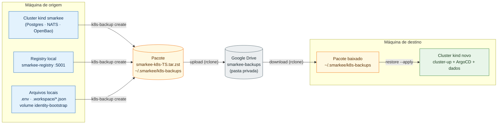
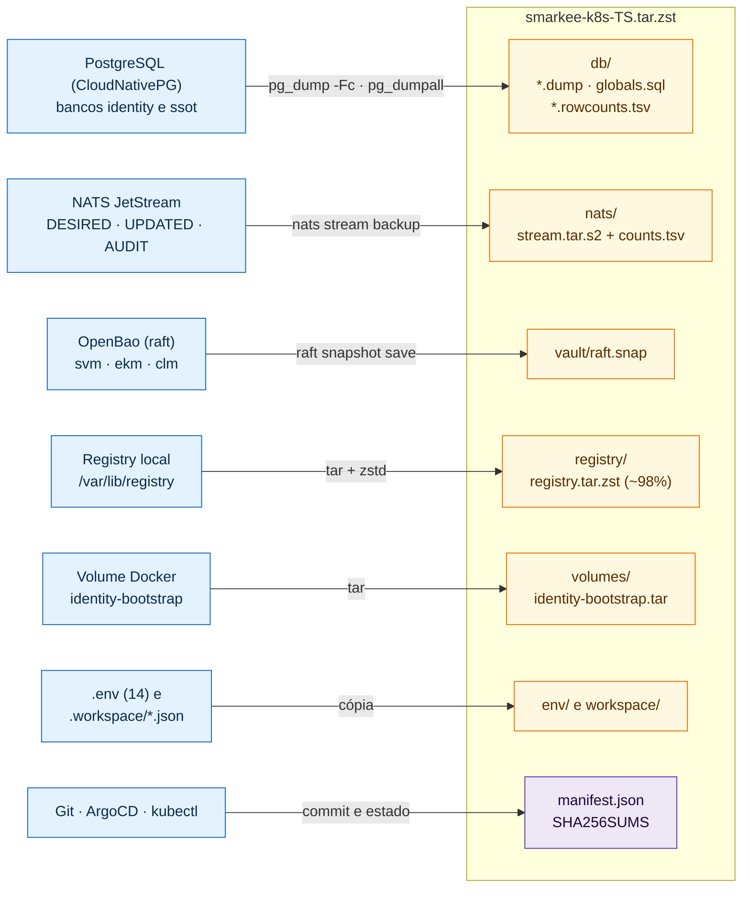
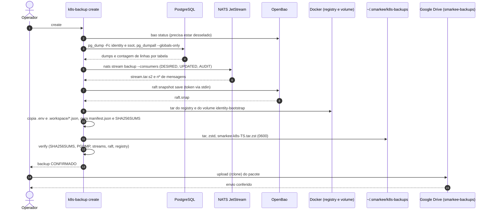
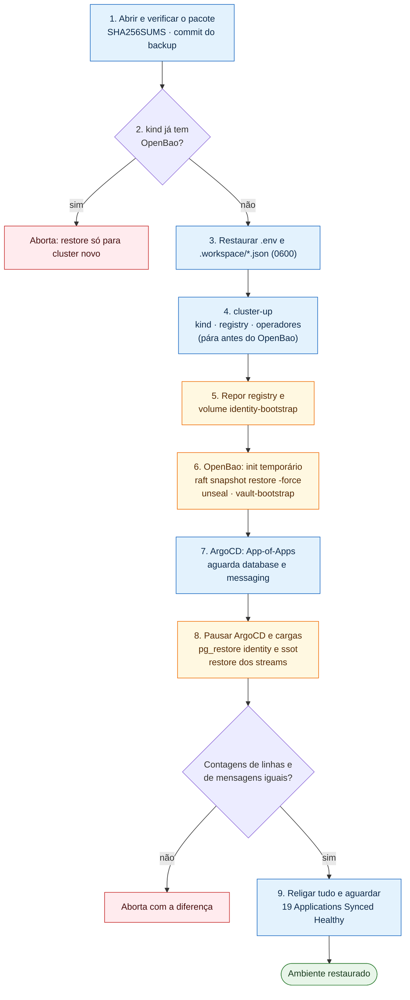

# Backup e Recuperação do Ambiente de Desenvolvimento (dev)

> **Escopo:** backup, transporte e restauração do ambiente Kubernetes de desenvolvimento (`kind` `smarkee` + ArgoCD), inclusive para recriá-lo em **outra máquina**. Ferramenta: [`scripts/dev/k8s-backup`](../../../scripts/dev/k8s-backup).
>
> **Documentos de referência:** [`docs/infrastructure/k8s/INFRASTRUCTURE.md`](../../infrastructure/k8s/INFRASTRUCTURE.md) (arquitetura), [`docs/infrastructure/k8s/OPERATION.md`](../../infrastructure/k8s/OPERATION.md) (operação) e a decisão [`.decisions/0102-kubernetes-kind-argocd-vault-e-operadores.md`](../../../.decisions/0102-kubernetes-kind-argocd-vault-e-operadores.md).

---

## Sumário

1. [Introdução](#1-introdução)
2. [Objetivos](#2-objetivos)
3. [Visão geral](#3-visão-geral)
4. [O que entra e o que não entra](#4-o-que-entra-e-o-que-não-entra)
   - 4.1 [Entra no backup (não se reconstrói só com o Git)](#41-entra-no-backup-não-se-reconstrói-só-com-o-git)
   - 4.2 [Não entra (é reconstruído)](#42-não-entra-é-reconstruído)
   - 4.3 [A CA vem do OpenBao](#43-a-ca-vem-do-openbao)
5. [Conteúdo do pacote](#5-conteúdo-do-pacote)
6. [Segurança (sem cifra, só para dev)](#6-segurança-sem-cifra-só-para-dev)
7. [Pré-requisitos](#7-pré-requisitos)
8. [Fazer o backup](#8-fazer-o-backup)
   - 8.1 [Preparar o estado do cluster](#81-preparar-o-estado-do-cluster)
   - 8.2 [Criar o backup](#82-criar-o-backup)
   - 8.3 [Outros comandos](#83-outros-comandos)
   - 8.4 [O que o `verify` prova (e o que não prova)](#84-o-que-o-verify-prova-e-o-que-não-prova)
9. [Levar para outra máquina](#9-levar-para-outra-máquina)
   - 9.1 [Pelo Google Drive (com `rclone`)](#91-pelo-google-drive-com-rclone)
   - 9.2 [Por outros meios](#92-por-outros-meios)
   - 9.3 [Sem acesso à pasta do pacote](#93-sem-acesso-à-pasta-do-pacote)
   - 9.4 [Pacote grande demais?](#94-pacote-grande-demais)
10. [Restaurar](#10-restaurar)
   - 10.1 [Preparar a máquina de destino](#101-preparar-a-máquina-de-destino)
   - 10.2 [Conferir e simular](#102-conferir-e-simular)
   - 10.3 [Executar](#103-executar)
   - 10.4 [Etapas do `--apply`](#104-etapas-do---apply)
   - 10.5 [Refazer depois de uma falha](#105-refazer-depois-de-uma-falha)
11. [Conferir a restauração](#11-conferir-a-restauração)
12. [Pós-restauração](#12-pós-restauração)
13. [Problemas conhecidos](#13-problemas-conhecidos)
14. [Backup legado (Docker Compose)](#14-backup-legado-docker-compose)
15. [Estado da validação e limitações](#15-estado-da-validação-e-limitações)
   - 15.1 [O que foi e o que não foi verificado](#151-o-que-foi-e-o-que-não-foi-verificado)
   - 15.2 [Limitações e riscos](#152-limitações-e-riscos)

---

## 1. Introdução

O ambiente de desenvolvimento roda num cluster `kind` e é reconstruído pelo GitOps (ArgoCD) a partir do Git. Porém, parte do estado **não está no Git**: os bancos `identity` e `ssot`, os streams do NATS, o cofre OpenBao, as imagens do registry local, o volume `identity-bootstrap` e os arquivos locais de segredos (`.env`, `.workspace/*.json`). Perder a máquina significa perder esse estado.

Este documento descreve como salvar esse estado num único pacote `.tar.zst`, levá-lo para outra máquina (por exemplo, pelo Google Drive) e restaurá-lo por completo, além de dizer com honestidade o que já foi provado e o que não foi (§15).

O utilitário `scripts/dev/backup` (`smarkee-dev-backup`) é do ambiente Docker Compose legado e **não** serve para o cluster (§14).

## 2. Objetivos

1. **Fazer backup** do estado do cluster que não se reconstrói só com o Git, de forma simples (um comando) e sem parar o cluster.
2. **Restaurar por completo em outra máquina**, num cluster `kind` novo, com a mesma identidade, os mesmos segredos, a mesma CA e os mesmos dados.
3. **Verificar** o pacote (integridade) e a restauração (contagens de linhas e de mensagens).
4. **Transportar** o pacote pelo Google Drive com `rclone` (`upload` e `download`).
5. **Declarar** a segurança aceita em dev, o que o backup não cobre e o estado real da validação.

**Fora do escopo:** `stg` e `prd`, recuperação pontual no tempo (PITR) e backup de outros projetos que usam o mesmo Docker.

---

## 3. Visão geral

> Fonte: [`diagrams/01-visao-geral.mmd`](diagrams/01-visao-geral.mmd)




O backup é um **retrato lógico**, tirado com o cluster no ar. A restauração **não** copia discos do cluster antigo: ela cria um cluster novo pelo GitOps (`cluster-up` + ArgoCD) e **repovoa** o que não vem do Git (bancos, streams, OpenBao, segredos locais, imagens).

---

## 4. O que entra e o que não entra

### 4.1 Entra no backup (não se reconstrói só com o Git)

| Estado | Onde vive no cluster | Como é salvo | Arquivo no pacote |
|---|---|---|---|
| Configuração do Zitadel (orgs, projetos, roles, usuários, service accounts, credenciais cifradas) | banco `identity` (CloudNativePG) | `pg_dump -Fc` + contagem de linhas por tabela | `db/identity.dump`, `db/identity.rowcounts.tsv` |
| Recursos e estado de negócio (SSOT, outbox, idempotência) | banco `ssot` | `pg_dump -Fc` + contagem de linhas | `db/ssot.dump`, `db/ssot.rowcounts.tsv` |
| Papéis e logins do PostgreSQL | cluster CloudNativePG | `pg_dumpall --globals-only` | `db/globals.sql` |
| Estado pretendido e histórico (`DESIRED`, `UPDATED`, `AUDIT`) com consumers | JetStream (PVC `data-messaging-0`) | `nats stream backup --consumers` + nº de mensagens | `nats/<STREAM>/`, `nats/counts.tsv` |
| Segredos (`core/svm`), chaves de criptografia (`core/ekm`), CA raiz e intermediária (`core/clm`), políticas, auth OIDC/Kubernetes | OpenBao (raft, PVC `data-vault-0`) | `bao operator raft snapshot save` | `vault/raft.snap` |
| Chave de unseal e root token do OpenBao | `.workspace/vault-init.json` | cópia | `workspace/vault-init.json` |
| Chaves das service accounts dos controllers e `login-client.pat` | volume Docker `identity-bootstrap` | `tar` | `volumes/identity-bootstrap.tar` |
| `SMARKEE_IDENTITY_MASTERKEY`, IDs da instância e demais variáveis locais | `.env` de `clients/cli`, `features/*/*` e `infrastructure/dev/*` (14 arquivos) | cópia, com os mesmos caminhos relativos | `env/…` |
| Estado auxiliar de bootstrap | `.workspace/{vault-oidc-app,service-account-platform-bootstrap,zitadel-state,controllers-keys,seed_ids}.json` | cópia | `workspace/…` |
| Imagens `smarkee-*` já construídas | registry local `smarkee-registry` (`/var/lib/registry`) | `tar` + `zstd` | `registry/registry.tar.zst`, `registry/catalog.json` |
| Commit do repositório, versões e estado das 19 Applications | Git / ArgoCD / kubectl | JSON | `manifest.json` |

### 4.2 Não entra (é reconstruído)

| Item | Por que não entra | Como volta |
|---|---|---|
| Manifestos, operadores, CRDs, Applications | estão no Git | `cluster-up` e ArgoCD |
| Certificados TLS (`database-server-tls`, `messaging-server-tls`, `trust-manager-tls`) | derivados da CA do OpenBao | cert-manager reemite a partir da CA restaurada |
| Gateway (etcd do APISIX) | stateless | job `gateway-sync` aplica `infrastructure/dev/gateway/bootstrap/adc.yaml` |
| Mailpit, telemetria (`.jsonl`) | transitórios | recriados; `scripts/dev/telemetry-reset` zera os sinais |
| Imagens de terceiros (operadores, PostgreSQL, NATS, OpenBao…) | públicas | baixadas na restauração |
| Dados de outros projetos que usam o mesmo Docker (advisor-*, sonarqube, omniroute…) | fora do escopo | não são tocados |

### 4.3 A CA vem do OpenBao

O OpenBao é restaurado **antes** do `vault-bootstrap`. Se ele fosse recriado do zero, a CA raiz seria outra e todos os certificados emitidos passariam a não ser confiáveis. Por isso o `cluster-up` ganhou `SMARKEE_CLUSTER_UP_STOP_BEFORE_VAULT=1`, que o faz parar logo antes do bootstrap do cofre.

---

## 5. Conteúdo do pacote

> Fonte: [`diagrams/02-conteudo-pacote.mmd`](diagrams/02-conteudo-pacote.mmd)



O arquivo gerado é `smarkee-k8s-<AAAAMMDDTHHMMSSZ>.tar.zst` (um `tar` comprimido com `zstd`, sem cifra). Aberto, contém:

```text
db/
  identity.dump  ssot.dump  globals.sql
  identity.rowcounts.tsv  ssot.rowcounts.tsv     # "schema.tabela<TAB>linhas" (144 e 35 tabelas)
nats/
  DESIRED/  UPDATED/  AUDIT/                     # backup.json + stream.tar.s2 de cada stream
  counts.tsv                                     # nº de mensagens por stream, no momento do backup
vault/raft.snap
registry/registry.tar.zst  catalog.json
volumes/identity-bootstrap.tar
env/…                                            # 14 arquivos .env
workspace/                                       # vault-init.json e demais .json de bootstrap
manifest.json                                    # commit, branch, versões do kind/Kubernetes, estado das Applications
SHA256SUMS                                       # checksum de cada arquivo acima
```

Tamanhos medidos num backup real (`20261108T160317Z`, 689 MiB): `registry` 691 MB, `db` 2,4 MB, `vault` 532 KB, `nats` 68 KB, `env` 56 KB, `workspace` 32 KB, `volumes` 20 KB. **As imagens são ~98% do pacote.**

---

## 6. Segurança (sem cifra, só para dev)

Por decisão, o pacote **não é cifrado** e não há frase-senha: a proteção é o controle de acesso de onde ele fica (o disco local e a conta do Google Drive, que exige autenticação). Isso mantém o backup e a restauração simples.

O pacote contém **segredos de dev em claro** (chave de unseal e root token do OpenBao, masterkey do Zitadel, chaves de service accounts, `.env`). Quem tiver acesso ao arquivo controla o ambiente (`AGENTS.md` §4).

- **Aceito em dev**, onde essas mesmas credenciais já ficam em claro em `.workspace/vault-init.json` e nos `.env`. **Não use este fluxo em `stg`/`prd`**: lá o OpenBao não pode ter chave de unseal e root token em arquivo, e o backup precisaria ser cifrado e com chaves em cofre. Essa lacuna é declarada no §15.
- **Local:** `~/.smarkee/k8s-backups/`, fora do repositório e do ciclo de vida do Docker (`docker system prune --volumes` não o atinge). Diretório `0700`, arquivos `0600`. **Nunca versione no Git**: o histórico não esquece e o GitHub rejeita arquivos acima de 100 MB.
- **No Drive:** mantenha a pasta `smarkee-backups` **privada** (sem link compartilhado) e a conta com verificação em duas etapas.
- Credenciais do NATS e o root token do OpenBao são passados por variável de ambiente ou `stdin`, nunca por argumento de processo, e não são impressas.
- Arquivos temporários ficam em `.workspace/` (ignorado pelo Git) e são removidos ao fim.

Variáveis opcionais:

| Variável | Padrão | Uso |
|---|---|---|
| `SMARKEE_BACKUP_DIR` | `~/.smarkee/k8s-backups` | pasta dos pacotes |
| `SMARKEE_BACKUP_REMOTE` | `gdrive-gmail:smarkee-backups` | destino do `upload`/`download` (remoto do `rclone`) |
| `SMARKEE_NATS_URL` | `nats://127.0.0.1:4222` | NATS visto do host |
| `SMARKEE_KIND_CLUSTER_NAME` | `smarkee` | nome do cluster `kind` |
| `SMARKEE_KIND_REGISTRY_NAME` | `smarkee-registry` | nome do contêiner do registry |
| `SMARKEE_KIND_REGISTRY_PORT` | `5001` | porta do registry no host |

---

## 7. Pré-requisitos

**Nas duas máquinas:** `docker`, `kind`, `kubectl`, `jq`, `zstd`, `python3`, `git` e a CLI `nats` (0.4+). Para transportar pelo Google Drive: `rclone`.

**Na máquina de destino, ainda:**
- Repositório clonado, com o código **igual ao do backup** (veja `manifest.json` → `git.commit`). Se os manifestos de `infrastructure/k8s` e `features/*/*/k8s` divergirem do commit do backup, a restauração avisa; o ArgoCD aplicará os do repositório atual.
- Entrada em `/etc/hosts`: `127.0.0.1 ipm-dev.smarkee.com.br api-dev.smarkee.com.br`.
- Portas livres no host: `8080 9180 5432 4222 8222 8025 8200 8443 5001` (o `kind` as publica, conforme `infrastructure/k8s/kind/cluster.yaml`). Outro projeto usando 5432/8080/etc. derruba a restauração.
- **Acesso à internet**, inclusive a `raw.githubusercontent.com`: o `cluster-up` baixa dali os manifestos do CloudNativePG e do ArgoCD, e de `github.com` os CRDs do NACK. Também são baixadas as imagens dos operadores, PostgreSQL, NATS e OpenBao.
- Recursos: ~20 GB de RAM e ~10 CPUs no Docker (o nó usa cerca de 6 GB) e ~10 GB de disco livre para o nó (`/var/lib/containerd` ≈ 7,6 GB) mais o registry.

---

## 8. Fazer o backup

### 8.1 Preparar o estado do cluster

O cluster precisa estar de pé, com o OpenBao **desselado** e as Applications `Healthy`.

```bash
cd smarkee   # raiz do repositório

# 1. Todas as 19 devem estar Synced Healthy
kubectl -n gitops-operator get applications.argoproj.io

# 2. O OpenBao precisa estar desselado ("Sealed false")
kubectl -n vault exec vault-0 -- env BAO_ADDR=http://127.0.0.1:8200 bao status | grep Sealed
```

Se o OpenBao estiver selado (acontece depois de reiniciar o Docker) ou houver `ExternalSecret` em `SecretSyncedError`:

```bash
./scripts/dev/vault-bootstrap            # desela com .workspace/vault-init.json
kubectl annotate externalsecrets -A --all force-sync=$(date +%s) --overwrite
# aguarde ~2 min e confira de novo o passo 1
```

### 8.2 Criar o backup

> Fonte: [`diagrams/03-fluxo-backup.mmd`](diagrams/03-fluxo-backup.mmd)



```bash
./scripts/dev/k8s-backup create
```

O que o comando faz, em ordem:

| # | Etapa | Detalhe |
|---|---|---|
| 1 | Pré-checagens | ferramentas presentes; OpenBao desselado; `vault-init.json` existe |
| 2 | PostgreSQL | `pg_dump -Fc` de `identity` e `ssot` no pod primário; confere o cabeçalho `PGDMP`; grava a contagem de linhas de cada tabela; `pg_dumpall --globals-only` |
| 3 | NATS | `nats stream backup --consumers` de `DESIRED`, `UPDATED` e `AUDIT`; grava o nº de mensagens |
| 4 | OpenBao | `raft snapshot save` com o root token passado por `stdin`; copia o snapshot e apaga o temporário no pod |
| 5 | Registry | `tar` de `/var/lib/registry` comprimido com `zstd` |
| 6 | `identity-bootstrap` | `tar` do volume Docker |
| 7 | Arquivos locais | `.env` (com caminhos relativos) e `.workspace/*.json` de bootstrap |
| 8 | Manifesto e checksums | `manifest.json` e `SHA256SUMS` |
| 9 | Empacota | `tar` → `zstd` → `…tar.zst` (`0600`) |
| 10 | Verifica | roda o `verify` (§8.4) |

Saída esperada: `backup CONFIRMADO: ~/.smarkee/k8s-backups/smarkee-k8s-<TS>.tar.zst (689M)`.

**Consistência:** o backup é feito **sem parar** o cluster. Cada banco é consistente por si (`pg_dump`), cada stream e o OpenBao são consistentes por si (snapshots), mas **os três não são tirados no mesmo instante**. Uma mensagem publicada entre as etapas pode estar num e não em outro; o `scripts/dev/republish` (§12) reconcilia o `desired` a partir do SSOT. Para um retrato mais estável, evite alterar recursos durante o backup.

### 8.3 Outros comandos

```bash
./scripts/dev/k8s-backup list                 # lista os pacotes locais
./scripts/dev/k8s-backup verify [ARQUIVO]     # integridade; sem ARQUIVO usa o mais recente
```

### 8.4 O que o `verify` prova (e o que não prova)

Prova, sem precisar do cluster: o pacote abre (`zstd` e `tar`); o `SHA256SUMS` interno confere em todos os arquivos; os dumps são `PGDMP`; os 3 streams, o `raft.snap`, o `vault-init.json` e o registry (`zstd -t`) estão presentes e íntegros; o `manifest.json` é válido.

**Não prova** que a restauração funciona. Isso só é provado restaurando (§15).

---

## 9. Levar para outra máquina

Leve o pacote `.tar.zst`. Não há frase-senha.

### 9.1 Pelo Google Drive (com `rclone`)

Na origem, depois do `create`:

```bash
rclone listremotes                                   # precisa existir um remoto da conta desejada
./scripts/dev/k8s-backup upload                      # envia o mais recente (ou: upload ARQUIVO)
```

Envia o pacote para `SMARKEE_BACKUP_REMOTE` (padrão `gdrive-gmail:smarkee-backups`) e confere o envio. A pasta é privada; não crie link público.

Para criar o remoto do `rclone` numa conta nova: `rclone config create gdrive-gmail drive scope=drive` e autorize no navegador **com a conta certa**. Cuidado para não imprimir o token na tela (ele dá acesso ao Drive). Para revogar depois: https://myaccount.google.com/permissions.

No destino:

```bash
rclone config                                        # crie o remoto "gdrive-gmail" (mesma conta)
./scripts/dev/k8s-backup download                    # sem argumento lista os pacotes disponíveis
./scripts/dev/k8s-backup download smarkee-k8s-<TS>.tar.zst
```

O `download` grava em `~/.smarkee/k8s-backups/` com `0600` e roda o `verify`.

### 9.2 Por outros meios

Qualquer cópia serve (`scp`, pendrive, AirDrop, bucket privado). Depois, ajuste o dono e as permissões:

```bash
mkdir -p ~/.smarkee/k8s-backups && chmod 700 ~/.smarkee ~/.smarkee/k8s-backups
chmod 600 ~/.smarkee/k8s-backups/*
```

O `restore` aceita o arquivo em **qualquer pasta**; `~/.smarkee` não é obrigatório no destino.

### 9.3 Sem acesso à pasta do pacote

Se o terminal disser que não tem acesso à pasta do pacote: confira o dono (`ls -ld`), corrija com `chown`/`chmod` e, no macOS, conceda ao Terminal "Acesso Total ao Disco" ou mova o arquivo para dentro do seu `$HOME` (Downloads, Desktop e volumes externos são protegidos).

### 9.4 Pacote grande demais?

~98% do tamanho é o registry local, e as imagens `smarkee-*` podem ser reconstruídas com `./scripts/dev/build-push` (§12). Hoje **não existe** opção para deixar o registry de fora: o pacote é sempre completo (~700 MB). Se isso for um problema para o transporte, é uma melhoria a implementar (um `create --no-registry` com o `build-push` como passo da restauração).

---

## 10. Restaurar

A restauração é **só para cluster novo**. Ela recusa se o `kind` de mesmo nome já tiver o OpenBao, para nunca sobrescrever um ambiente em uso. Para refazer um cluster: `kind delete cluster --name smarkee`.

### 10.1 Preparar a máquina de destino

```bash
git clone https://github.com/danielsabatini/smarkee.git && cd smarkee
git checkout <commit do manifest.json>       # o verify imprime o commit; ex.: b16c475b
grep ipm-dev.smarkee.com.br /etc/hosts || echo '127.0.0.1 ipm-dev.smarkee.com.br api-dev.smarkee.com.br' | sudo tee -a /etc/hosts
```

Garanta que as portas do §7 estejam livres e que o Docker esteja com recursos suficientes. Se existirem `.env` ou `.workspace/*.json` locais **diferentes** dos do backup, a restauração para; mova-os antes (ou apague-os se for um clone novo).

### 10.2 Conferir e simular

```bash
./scripts/dev/k8s-backup verify  <ARQUIVO>        # integridade do que foi copiado
./scripts/dev/k8s-backup restore <ARQUIVO>        # PLANO (dry-run): nada é alterado
```

### 10.3 Executar

```bash
./scripts/dev/k8s-backup restore <ARQUIVO> --apply
```

Demora de 10 a 25 minutos (download das imagens e sincronização do ArgoCD). Acompanhe em outro terminal com `kubectl get pods -A`.

### 10.4 Etapas do `--apply`

> Fonte: [`diagrams/04-fluxo-restore.mmd`](diagrams/04-fluxo-restore.mmd)



| # | Etapa | O que acontece | Falha típica |
|---|---|---|---|
| 1 | Abrir e verificar | abre o pacote, confere `SHA256SUMS`, compara o commit do backup com o repositório | arquivo corrompido; commit com manifestos diferentes (apenas aviso) |
| 2 | Cluster novo? | recusa se o `kind` já tem o OpenBao | cluster existente |
| 3 | Arquivos locais | restaura os `.env` e `.workspace/*.json` (`0600`) | já existem e diferem → aborta |
| 4 | `cluster-up` | cria `kind`, registry e instala cert-manager, trust-manager, CloudNativePG, External Secrets, OpenTelemetry, NACK e ArgoCD; **para antes do OpenBao** | sem acesso a `raw.githubusercontent.com`; portas ocupadas |
| 5 | Registry e `identity-bootstrap` | repõe `/var/lib/registry` e recria o volume Docker | — |
| 6 | OpenBao | aplica o StatefulSet, `operator init` temporário, `raft snapshot restore -force`, desela com a chave do backup e roda o `vault-bootstrap` (idempotente) | cofre já inicializado; continua selado |
| 7 | ArgoCD | aplica o App-of-Apps; aguarda o primário do `database` e o `messaging-0` | demora do download de imagens |
| 8 | Dados | **pausa** o controlador do ArgoCD e as cargas (`identity`, `cam`, `bsm`, `sum`, `ipm`); `DROP DATABASE … WITH (FORCE)` + `pg_restore --create` de `identity` e `ssot`; **confere as contagens de linhas** contra o backup; pausa o NACK, remove e restaura `DESIRED`, `UPDATED` e `AUDIT` e **confere o nº de mensagens**; religa tudo | contagens ou mensagens divergentes → aborta com a diferença |
| 9 | Convergência | aguarda as 19 Applications `Synced Healthy` (até 25 min) | tempo esgotado |

Logs de `pg_restore` ficam em `.workspace/k8s-restore-pg-<banco>.log`.

### 10.5 Refazer depois de uma falha

O `cluster-up` e o `vault-bootstrap` são idempotentes, mas o `restore` recusa cluster com OpenBao. Se a falha ocorreu **antes** da etapa 6 (por exemplo, rede na etapa 4), basta repetir o mesmo comando. Se ocorreu a partir da etapa 6, recomece do zero:

```bash
kind delete cluster --name smarkee
docker rm -f smarkee-registry 2>/dev/null
./scripts/dev/k8s-backup restore <ARQUIVO> --apply
```

---

## 11. Conferir a restauração

```bash
# 1. Applications: as 19 em Synced Healthy
kubectl -n gitops-operator get applications.argoproj.io

# 2. Nenhum pod com problema
kubectl get pods -A --no-headers | awk '$4!="Running" && $4!="Completed"'

# 3. OpenBao desselado e segredos presentes
kubectl -n vault exec vault-0 -- env BAO_ADDR=http://127.0.0.1:8200 bao status | grep -E "Sealed|Initialized"

# 4. Streams do NATS (credenciais no Secret messaging-secret, ns messaging)
export NATS_URL=nats://127.0.0.1:4222
export NATS_USER="$(kubectl -n messaging get secret messaging-secret -o jsonpath='{.data.NATS_USER}' | base64 -d)"
export NATS_PASSWORD="$(kubectl -n messaging get secret messaging-secret -o jsonpath='{.data.NATS_PASSWORD}' | base64 -d)"
nats stream ls          # DESIRED / UPDATED / AUDIT com as contagens de counts.tsv
```

Valores de referência do backup `20261108T160317Z`: `DESIRED` 199, `UPDATED` 20, `AUDIT` 40; 144 tabelas em `identity` e 35 em `ssot`.

Verificação funcional: `sk auth login` e `sk cam account list` devem responder com os dados do ambiente de origem (isso exercita o Zitadel restaurado, o OIDC, a cadeia de certificados e o gateway). Para validação mais ampla: `./scripts/dev/check`, `tests/telemetry` e a suíte de conformidade de identidade (`infrastructure/dev/identity/conformance`).

---

## 12. Pós-restauração

- **Recursos sem `desired` publicado:** reenfileire a partir do SSOT: `cd scripts/dev/republish && uv sync && uv run smarkee-dev-republish --apply` (`docs/loop/`, `docs/data/SSOT.md`).
- **Reconstruir uma imagem** em vez de usar a restaurada: `./scripts/dev/build-push <módulo>/<tipo>` (ou sem argumento para todas).
- **Resíduo de testes:** `./scripts/dev/cleanup`; retenção de outbox/idempotência: `./scripts/dev/retention`.
- **Rotacionar os segredos** (root token e chave de unseal do OpenBao, masterkey do Zitadel) se o pacote tiver saído do seu controle.

---

## 13. Problemas conhecidos

| Sintoma | Causa | Solução |
|---|---|---|
| `cluster-up` falha com `socket is not connected` baixando CloudNativePG/ArgoCD | `raw.githubusercontent.com` inacessível na rede | trocar de rede ou usar VPN e repetir (o `cluster-up` é idempotente) |
| `ExternalSecret` em `SecretSyncedError` e Applications `Degraded` | OpenBao selado após reiniciar o Docker | `./scripts/dev/vault-bootstrap` e `force-sync` (§8.1) |
| `restore` aborta com "já existe e difere do backup" | `.env` ou `.workspace/*.json` locais diferentes | mover os locais ou apagar num clone novo |
| `restore` aborta com "OpenBao já inicializado" | cluster não é novo | `kind delete cluster --name smarkee` e repetir |
| `falha ao abrir o backup` | arquivo corrompido ou incompleto | baixar/copiar de novo e rodar o `verify` |
| Erro de porta em uso | outro projeto usa 5432/8080/4222… | liberar as portas do §7 |
| Sem acesso à pasta do pacote (macOS) | dono/permissão ou proteção de privacidade | §9.3 |
| Aviso de manifestos diferentes do commit do backup | repositório em outro commit | `git checkout <commit>` para fidelidade |

---

## 14. Backup legado (Docker Compose)

`scripts/dev/backup` (`smarkee-dev-backup`) opera sobre o ambiente Compose (contêiner `database.smarkee.internal`, volumes `identity-bootstrap` e `bsm-account-state`). Não cobre NATS, OpenBao, registry nem o cluster `kind`, e só vale enquanto o Compose existir. O `README.md` dele descreve o uso. A pasta `~/.smarkee/backups/` é dele; a do cluster é `~/.smarkee/k8s-backups/`.

---

## 15. Estado da validação e limitações

### 15.1 O que foi e o que não foi verificado

- **Verificado:** `create` (inclui o `verify` automático) sobre o cluster real, na versão cifrada; a versão atual (sem cifra) foi obtida por conversão do mesmo pacote e passou no `verify`, e seu `upload` ao Google Drive foi conferido; inspeção do conteúdo e dos tamanhos; o plano (`restore` sem `--apply`). O `create` da versão sem cifra ainda não foi executado contra o cluster.
- **Verificado parcialmente:** a restauração real num cluster `kind` novo (`SMARKEE_KIND_CLUSTER_NAME=smarkee-restore-test SMARKEE_KIND_REGISTRY_NAME=smarkee-registry-test`) executou as etapas 1 a 3 e parte da 4 (`kind`, registry, cert-manager e trust-manager). Parou ao instalar o CloudNativePG porque `raw.githubusercontent.com` estava inacessível.
- **Não verificado:** as etapas 5 a 9 do `--apply` (registry e `identity-bootstrap`, restore raft do OpenBao, `pg_restore`, restore dos streams, `Synced Healthy`) e o `download`. O script cobre essas etapas, mas **ainda não foi provado que a restauração completa funciona**. Repita o procedimento (§10) numa rede que alcance `raw.githubusercontent.com` antes de depender do backup.

### 15.2 Limitações e riscos

- **Retrato lógico, não físico:** sem PITR nem WAL arquivado. O CloudNativePG de dev tem 1 instância e não usa Barman.
- **Pacote sem cifra (lacuna declarada, dev):** os segredos de dev ficam em claro no pacote, protegidos só pelo controle de acesso do disco e do Drive. É aceitável em dev (as mesmas credenciais já estão em claro em `.workspace/` e nos `.env`). **Condição para fechar antes de `stg`:** cifrar o backup com chave em cofre e não manter chave de unseal/root token em arquivo local (pendência já registrada no `MEMORY.md`).
- **Sem verificação de integridade dos operadores baixados:** o `cluster-up` aplica os YAMLs de CloudNativePG e ArgoCD direto da URL oficial, sem hash. O CloudNativePG aponta para o ramo `release-1.30`, que é mutável.
- **Portas fixas:** o teste na mesma máquina exige parar o cluster original (`docker stop smarkee-control-plane smarkee-registry`) ou usar uma configuração de portas alternativa.
- **Repositório no commit do backup:** o git-server do ArgoCD serve o repositório local; se o código divergir, as Applications sincronizam o que está no repositório, e não o que estava no backup.
- **Pacote sempre completo:** o registry é incluído sempre (~98% do tamanho).
