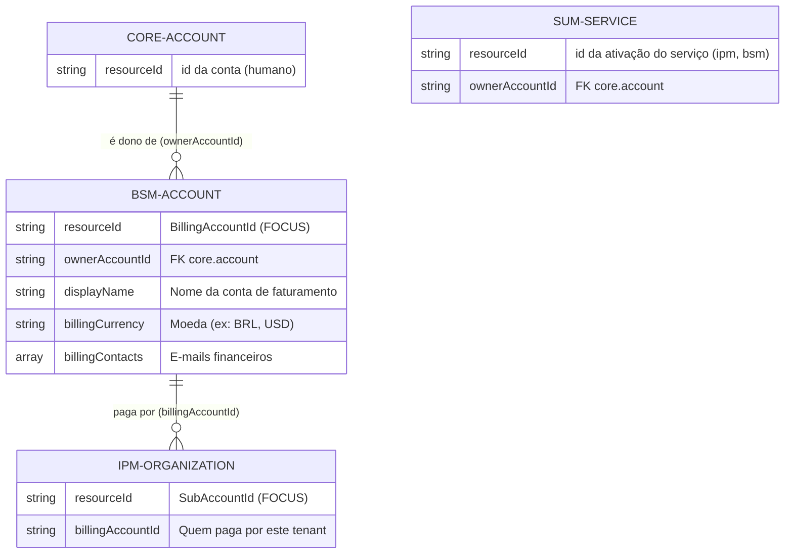

# Especificação de Billing e FinOps

> **Escopo:** modelo de identidade financeira, arquitetura assíncrona, persistência, domínios operacionais, interface de gestão (BSM) e contratos do sistema de faturamento e tarifação da plataforma.
>
> **Papel:** Fonte de Verdade da arquitetura de Billing.
>
> **Responsabilidade:** Definir como o consumo de recursos é catalogado, medido, precificado e faturado, de forma desacoplada do plano de controle, aderente à especificação FOCUS 1.4, com persistência inicial em disco e comunicação 100% assíncrona.

# 1. Princípios Arquiteturais

A arquitetura de Billing difere fundamentalmente da arquitetura de orquestração de recursos, baseando-se nestes pilares:

1. **Separação de Planos (Control Loop vs. Ledger):** Recursos mutáveis (`core.account`, `ipm.organization`) usam o padrão declarativo do Resource Control Loop. Fatos financeiros (`Metering`, `Pricing`, `Invoicing`) são **fatos ocorridos no passado, estritamente imutáveis e *append-only***.
2. **Totalmente Assíncrono e Desacoplado:** Um domínio não faz chamadas síncronas (HTTP/gRPC) para o outro. Toda a comunicação ocorre via eventos publico-inscritos no NATS JetStream.
3. **Persistência Inicial em Disco (Estratégia *Storage-Agnostic*):** Assim como a telemetria inicial, os dados de medição e tarifação nascerão em **arquivos no disco (formato JSONL *append-only*)**, consumidos via NATS. Adoção de banco de dados (Relacional ou OLAP) fica postergada até que o volume exija (AGENTS.md §6).
4. **Idempotência Estrita:** O consumo de eventos garante deduplicação exata baseada em `idempotencyKey` determinística (AGENTS.md §11).
5. **Norma FOCUS 1.4:** A saída analítica e financeira segue rigorosamente os datasets do **FOCUS 1.4** (*FinOps Open Cost & Usage Specification*).

---

# 2. Modelo de Identidade Financeira (Billing Account)

Inspirado no modelo do Google Cloud (GCP), a plataforma separa a *Identidade de Acesso* da *Identidade Pagadora*.

*   **`core.account`**: Identidade do usuário (humano ou máquina) que acessa a plataforma. **Não guarda cartão de crédito nem moeda.**
*   **`bsm.account` (Recurso do Control Loop no módulo BSM)**: Entidade financeira que concentra o perfil de faturamento (`displayName`), moeda preferencial (`billingCurrency`), contatos financeiros (`billingContacts`) e proteção contra exclusão (`deletionProtection`). Pertence a um `ownerAccountId` (`core.account`). Na Fase P0, o Executor materializa o estado em disco local (JSON/JSONL) e o Observer lê desse armazenamento para confirmar a convergência do loop.
*   **`ipm.organization`**: O tenant (espaço de trabalho). Toda Organization aponta para um `billingAccountId` (`bsm.account.resourceId`). Múltiplas Organizations podem ser pagas pela mesma Billing Account.

### Diagrama de Relacionamento (ER)



> **Mapeamento FOCUS 1.4:** 
> *   `bsm.account.resourceId` → **`BillingAccountId`** (Conta que recebe a fatura).
> *   `ipm.organization.resourceId` → **`SubAccountId`** (Tenant que gerou o consumo).

---

# 3. Os Quatro Domínios Assíncronos

Para evitar um monólito de faturamento, a arquitetura é decomposta em quatro domínios especialistas. Cada domínio consome eventos do NATS, processa o dado e grava o resultado localmente, emitindo novos eventos se necessário.

### 3.1. `Cataloging` (Catálogo de Produtos)
*   **Responsabilidade:** Definir o que existe na plataforma (`Service`, `SKU`, `MeterDefinition`).
*   **Comportamento:** Funciona como um registro imutável versionado. Quando um SKU é criado ou atualizado (ex: nova unidade de medida), ele emite um evento `catalog.sku.published`.

### 3.2. `Metering` (Medição de Consumo)
*   **Responsabilidade:** Agregar eventos brutos (`UsageEvent`) em janelas de tempo consolidadas (`UsageRecord`).
*   **Entrada:** Consome eventos de ciclo de vida do NATS (ex: *organization updated* no outbox do loop).
*   **Saída:** Grava `UsageRecord` (sem preço, apenas quantidade e unidade) em disco local (JSONL) e emite `metering.usagerecord.closed`.

### 3.3. `Pricing` (Motor de Tarifação / *Rating*)
*   **Responsabilidade:** Manter versões de preços (`PriceVersion`) e multiplicar consumo por preço.
*   **Comportamento:** Função puramente determinística. 
*   **Entrada:** Consome `metering.usagerecord.closed`. Busca o preço vigente na data do consumo (`chargePeriodStart`).
*   **Saída:** Grava `RatedUsageRecord` (contendo custo e moeda) em disco local e emite `pricing.ratedrecord.created`.

### 3.4. `Invoicing` (Faturamento)
*   **Responsabilidade:** Orquestrar o ciclo financeiro (`BillingPeriod`) e consolidar os itens na Fatura (`Invoice`).
*   **Entrada:** Agrupa os `RatedUsageRecord`s vinculados a uma `BillingAccount` no mês vigente.
*   **Saída:** Fecha a fatura (`invoiceIssueStatus: issued`), emite cobrança para o gateway externo (via Control Loop) e gera os arquivos finais de conciliação (`Invoice Detail`).

---

# 4. Fluxo de Dados e Armazenamento (Estratégia P0)

Para manter a simplicidade arquitetural no início, o **Armazenamento de Metering e Pricing será feito no disco de volume local** do serviço (formato *JSONL append-only*), desacoplando a ingestão do banco de dados definitivo.

### Diagrama de Arquitetura Assíncrona

```mermaid
flowchart TD
    subgraph SSOT [Plano de Controle (SSOT PostgreSQL)]
        B[bsm.account]
        O[ipm.organization]
        S[sum.service]
    end
    
    subgraph NATS [NATS JetStream - Broker de Eventos]
        E1((Eventos de<br/>Ciclo de Vida))
        E2((Eventos de<br/>UsageRecord))
        E3((Eventos de<br/>RatedRecord))
    end
    
    SSOT -- Publisher publica outbox --> E1
    
    subgraph Billing_Pipeline [Pipeline Imutável de Billing]
        MET[Metering Service]
        PRI[Pricing Service]
        INV[Invoicing Service]
        
        D1[/(Disco Local:<br/>UsageRecords.jsonl)/]
        D2[/(Disco Local:<br/>RatedRecords.jsonl)/]
        D3[/(Disco Local:<br/>Invoices.jsonl)/]
    end
    
    E1 -- Consome --> MET
    MET -- 1. Grava no disco --> D1
    MET -- 2. Publica Janela Fechada --> E2
    
    E2 -- Consome --> PRI
    PRI -- 1. Aplica Preço / Grava disco --> D2
    PRI -- 2. Publica Linha Tarifada --> E3
    
    E3 -- Consome --> INV
    INV -- Consolida e Fecha Fatura --> D3
```

**Regras do Fluxo em Disco:**
1.  **Imutabilidade Estrita:** Os arquivos `.jsonl` operam apenas com `append` (escrita no final do arquivo). Nenhuma linha existente pode ser alterada.
2.  **Idempotência e Reprocessamento:** Cada linha JSON gravada contém uma `idempotencyKey` única. Caso o consumidor NATS reinicie, ele relê o stream, verifica se a chave já existe no arquivo (carregando as chaves para a memória ou usando um bloom filter/índice leve) e ignora as duplicadas.
3.  **Rotação de Arquivos:** Os arquivos serão rotacionados diariamente (ex: `usage_records_2026-11-01.jsonl`) para facilitar o arquivamento ou ingestão futura por outras ferramentas (ETL/Data Lakes).

---

# 5. Mapeamento para FOCUS 1.4

A estrutura de dados gravada no disco será formatada 100% nativa aos schemas do FinOps FOCUS 1.4.

### 5.1. Dataset: Cost and Usage (Saída do Pricing)
A saída do `Pricing` mapeia diretamente para o principal dataset do FOCUS:

| Smarkee (RatedRecord no Disco) | FOCUS 1.4 (Cost and Usage) | Descrição |
|---|---|---|
| `billingAccountId` | `BillingAccountId` | Conta financeira responsável (`bsm.account`). |
| `subAccountId` | `SubAccountId` | Organização que consumiu (`ipm.organization`). |
| `resourceId` | `ResourceId` | ID do recurso provisionado. |
| `billingCurrency` | `BillingCurrency` | Moeda da fatura (ex: `BRL`). |
| `chargePeriodStart/End` | `ChargePeriodStart` / `End` | Janela exata do consumo. |
| `chargeClass` | `ChargeClass` | `null` (normal) ou `"Correction"` (ajuste retroativo). |
| `skuId` e `skuPriceId` | `SkuId` e `SkuPriceId` | Identificadores do Catálogo e da Versão de Preço. |
| `consumedQuantity` | `ConsumedQuantity` | Volume de uso (ex: 10.5 horas). |
| `listCost` | `ListCost` | Custo bruto (tabela de preço). |
| `billedCost` | `BilledCost` | Custo final faturado após descontos e impostos. |
| `invoiceIssuerName` | `InvoiceIssuerName` | Entidade emissora (`"Smarkee"`). |

### 5.2. Novos Datasets FOCUS 1.4 (Saída do Invoicing)
O domínio de Invoicing gera dois arquivos em disco que mapeiam para as novas especificações da versão 1.4:
*   **Billing Period:** (`BillingPeriodStart`, `BillingPeriodEnd`, `BillingPeriodStatus`).
*   **Invoice Detail:** (`InvoiceId`, `InvoiceIssueDate`, `InvoiceIssueStatus`, `BilledCost`, `PaymentDueDate`).

---

# 6. Plano de Evolução (P0 a P3)

Seguindo o padrão de entrega aditiva (AGENTS.md §2.2):

### Fase P0: Fundação Financeira (Contas e Consumo)
*   Criação da feature `bsm/account` (`bsm.account`) dentro do Resource Control Loop, como capacidade de nível de conta (`core.account`): as roles `bsm.account.*` são concedidas automaticamente no cadastro e o Manager de `bsm.account` provisiona automaticamente a conta inicial `"Free Tier"` (`BRL`) quando `core.account` converge para `Ready`.
*   Exigência de pelo menos uma `bsm.account` ativa (`Ready`) antes de habilitar serviços no `sum/service` (`409 BillingAccountRequired`), validação de `billingAccountId` ativo em `ipm.organization` (`409 BillingAccountNotReady`) e bloqueio de exclusão de `bsm.account` enquanto houver Organizations vinculadas (`409 ResourcesAttached`).
*   Criação do serviço `Metering` consumindo NATS e gravando `UsageRecords` no disco.

### Fase P1: Tarifação Determinística (Pricing)
*   Criação do serviço `Pricing`.
*   Estruturação estática do `Cataloging` (JSON com SKUs e Prices).
*   `Pricing` consome `UsageRecords`, taxa os valores e grava `RatedRecords` no disco (formato FOCUS 1.4).

### Fase P2: Faturamento e Ciclo (Invoicing)
*   Criação do serviço `Invoicing`.
*   Consolidação mensal dos `RatedRecords` em `Invoices`.
*   Transição do armazenamento local em disco (JSONL) para persistência em banco analítico leve (como DuckDB, se o disco se mostrar insustentável) ou tabelas particionadas no PostgreSQL.

### Fase P3: Cobrança Externa
*   Evolução do Executor/Observer para sincronizar o status da `bsm.account` e da `Invoice` com um Gateway de Pagamentos externo (ex: Stripe, Iugu), atualizando `invoiceIssueStatus` para `paid` de forma assíncrona.

---

# 7. BSM (Billing Service Manager)

Inspirado nas práticas maduras de provedores de nuvem (como *AWS Billing Preferences & Cost Explorer* e *GCP Billing & Cost Management*), o Smarkee expõe suas capacidades financeiras através de um módulo dedicado: o **BSM (Billing Service Manager, módulo `bsm`)**.

O BSM é a interface (APIs e recursos) entre o cliente e o motor interno de Billing. Ele separa a administração comercial da análise de dados em três capacidades principais:

### 7.1. Administração e Identidade Financeira (Recurso `bsm/account`)
O BSM expõe o ciclo de vida da Conta de Faturamento através do Resource Control Loop (`/v1/bsm/accounts`).
*   **Papel:** Centralizar o nome da conta de faturamento, moeda, pontos de contato financeiro e proteção contra exclusão.
*   **Atributos Declarativos (`desired` v1.0):**
    *   `displayName`: Nome de exibição da conta de faturamento (`BillingAccountName` no FOCUS 1.4).
    *   `billingCurrency`: A moeda ISO 4217 na qual a conta será faturada (ex: `BRL`, `USD`).
    *   `billingContacts`: Lista de e-mails para envio de alertas, faturas (Invoices) e recibos.
    *   `deletionProtection`: Proteção contra exclusão acidental (`true` por padrão, decisão `0043`).
*   **Evolução Aditiva (P2/P3):** Inclusão de `legalEntity` (razão social, documento fiscal e endereço) e `purchaseOrderNumber`, além da sincronização pelo Executor/Observer com Gateway de Pagamentos externo.

### 7.2. Análise e Visualização (APIs Síncronas)
Diferente da conta (que é declarativa), a visualização de custos não possui "estado desejado". É uma capacidade síncrona de consulta (*Query*).
*   **Papel:** Alimentar os *dashboards* do Smarkee Console (gráfico de barras, *pie charts* de distribuição de custos).
*   **Como funciona (Fase P0/P1):** O BSM expõe rotas HTTP síncronas (ex: `GET /v1/bsm/accounts/{id}/costs?groupBy=serviceName&start=2026-10-01`). A API lê os arquivos consolidados gerados pelo *Pricing* (ex: `RatedRecords.jsonl` em disco ou, mais adiante, no banco), executa a agregação solicitada em tempo real e devolve o JSON otimizado para o frontend.

### 7.3. Exportação de Dados (Recurso `bsm/export`)
Atendendo à necessidade de equipes maduras de FinOps que precisam realizar ingestão no próprio Data Lake (equivalente ao *AWS CUR* ou *GCP Cloud Billing Export*).
*   **Papel:** Entregar os dados brutos, particionados e formatados no padrão FOCUS 1.4 de forma automatizada.
*   **Atributos Declarativos (`desired`):**
    *   `format`: Formato de saída (ex: `jsonl`, `csv`, `parquet`).
    *   `frequency`: Frequência da entrega (ex: `daily`).
    *   `destination`: Destino da exportação (ex: um webhook, um bucket S3 providenciado pelo cliente).
*   **Comportamento no Loop:** O *Executor* deste recurso configura e orquestra um *worker* interno. Este *worker* rotaciona o arquivo de `RatedRecords` no fim do período configurado e despacha o arquivo diretamente para o `destination` declarado pelo usuário.