# Infraestrutura Kubernetes da Plataforma Smarkee (`kind`, `ArgoCD`, `Kustomize`, `vault` e Operadores)

> **Escopo:** arquitetura completa, topologia de rede e namespaces, portas (internas e expostas no host), interligações entre serviços, matriz de quem acessa cada componente e procedimentos de acesso para **usuários/clientes** e **operadores**.
>
> **Decisão arquitetural de referência:** [`.decisions/0102-kubernetes-kind-argocd-vault-e-operadores.md`](../../../.decisions/0102-kubernetes-kind-argocd-vault-e-operadores.md).
>
> **Documentos correlatos:**
> - Manual operacional do dia a dia e troubleshooting: [`docs/infrastructure/k8s/OPERATION.md`](OPERATION.md)
> - Estado por ambiente e lacunas declaradas: [`docs/platform/IMPLEMENTATION-STATUS.md`](../../platform/IMPLEMENTATION-STATUS.md)
> - Banco de dados e SSOT: [`docs/data/SSOT.md`](../../data/SSOT.md) e [`docs/data/POSTGRESQL.md`](../../data/POSTGRESQL.md)
> - Mensageria NATS JetStream: [`docs/messaging/MESSAGING.md`](../../messaging/MESSAGING.md) e [`docs/messaging/NATS.md`](../../messaging/NATS.md)
> - Telemetria e observabilidade: [`docs/telemetry/OBSERVABILITY.md`](../../telemetry/OBSERVABILITY.md) e [`docs/telemetry/OBSERVABILITY-ARCHITECTURE.md`](../../telemetry/OBSERVABILITY-ARCHITECTURE.md)
> - Loop de controle e segurança: [`docs/loop/RESOURCE-CONTROL-LOOP.md`](../../loop/RESOURCE-CONTROL-LOOP.md) e [`docs/loop/RESOURCE-CONTROL-SECURITY.md`](../../loop/RESOURCE-CONTROL-SECURITY.md)

---

## Sumário

1. [Visão Geral e Princípios Arquiteturais](#1-visão-geral-e-princípios-arquiteturais)
2. [Topologia do Cluster, Rede, DNS e Portas Consolidados](#2-topologia-do-cluster-rede-dns-e-portas-consolidados)
3. [Orquestração GitOps (`argocd` e `git-server`)](#3-orquestração-gitops-argocd-e-git-server)
4. [Operadores de Infraestrutura e Segurança](#4-operadores-de-infraestrutura-e-segurança)
5. [Cofre de Segredos, Criptografia e PKI (`vault`: `/svm`, `/ekm`, `/clm`)](#5-cofre-de-segredos-criptografia-e-pki-vault-svm-ekm-clm)
6. [Banco de Dados Relacional e SSOT (`database`)](#6-banco-de-dados-relacional-e-ssot-database)
7. [Mensageria e Streams (`messaging`)](#7-mensageria-e-streams-messaging)
8. [Servidor de E-mail (`mail`)](#8-servidor-de-e-mail-mail)
9. [Provedor de Identidade (`identity` e `identity-login`)](#9-provedor-de-identidade-identity-e-identity-login)
10. [Gateway de API (`gateway`, `gateway-etcd` e `gateway-sync`)](#10-gateway-de-api-gateway-gateway-etcd-e-gateway-sync)
11. [Observabilidade e Telemetria (`telemetry` e `<feature>-telemeter`)](#11-observabilidade-e-telemetria-telemetry-e-feature-telemeter)
12. [Features de Produto (`core`, `bsm`, `sum`, `ipm`)](#12-features-de-produto-core-bsm-sum-ipm)
13. [Referência Operacional e Catálogo de Utilitários](#13-referência-operacional-e-catálogo-de-utilitários)

---

## 1. Visão Geral e Princípios Arquiteturais

A infraestrutura da Smarkee executa integralmente sobre **Kubernetes** desde o ambiente de desenvolvimento (`dev`), eliminando a divergência entre o ambiente local e os ambientes de homologação (`stg`) e produção (`prd`).

### 1.1 Papel vs. Produto (`AGENTS.md` §15.1)

Os namespaces, serviços Kubernetes (`Service`), variáveis e pacotes recebem o **nome do papel** que desempenham na plataforma, e nunca o nome comercial do produto que os implementa:

| Papel na Plataforma | Namespace | Serviços Kubernetes (`Service`) | Produto Utilizado | Versão |
|---|---|---|---|---|
| **Orquestração GitOps** | `gitops-operator` | `argocd-server`, `git-server` | ArgoCD | `v3.5.6` |
| **Cofre, Criptografia e PKI (`vault`)** | `vault` | `svm`, `ekm`, `clm`, `vault-internal` | OpenBao | `2.7.2` |
| **Banco de Dados Relacional (`database`)** | `database` | `database`, `database-rw`, `database-ro`, `database-r` | PostgreSQL (via CloudNativePG `v1.30.1`) | `18.6` |
| **Mensageria (`messaging`)** | `messaging` | `messaging`, `messaging-headless` | NATS Server + JetStream + NACK (`v0.25.0`) | `2.15.2-alpine` |
| **E-mail (`mail`)** | `mail` | `mail` | Mailpit (em `dev`) | `v1.29.6` |
| **Provedor de Identidade (`identity`)** | `identity` | `identity`, `identity-login` | Zitadel | `v4.20.0` |
| **Gateway de API (`gateway`)** | `gateway` | `gateway`, `gateway-etcd`, `gateway-external` | Apache APISIX + etcd + ADC | `3.19.0` / `3.6.9` / `0.26.1` |
| **Observabilidade (`telemetry`)** | `telemetry` | `telemetry-router`, `telemetry-sink`, `telemetry-agent-*` | OpenTelemetry Collector Contrib (via Operator `v0.162.0`) | `0.164.0` |

### 1.2 Estrutura Declarativa (`Kustomize` + `ArgoCD`)

Todo manifesto Kubernetes segue o padrão `base/` + `overlays/{dev,stg,prd}`:
- **Infraestrutura e Operadores:** `infrastructure/k8s/{kind,operators,platform,argocd}/`
- **Features de Produto:** `features/<módulo>/<tipo>/k8s/{base,overlays/dev}/`
- **Template de Feature (`sync.py`):** `templates/feature/seed/k8s/{base,overlays/dev}/`

```text
infrastructure/k8s/
├── kind/
│   └── cluster.yaml                  # Definição do cluster kind `smarkee` (v1.37.0), extraPortMappings e extraMounts
├── operators/
│   ├── namespaces.yaml               # Os 16 namespaces do cluster com labels de camada
│   ├── argocd/                       # ArgoCD + git-server interno em dev
│   ├── cert-manager/                 # cert-manager v1.21.3
│   ├── trust-manager/                # trust-manager v0.26.0
│   ├── external-secrets/             # External Secrets Operator v2.13.0
│   ├── cnpg/                         # CloudNativePG v1.30.1
│   ├── nack/                         # NATS JetStream Controller (NACK) v0.25.0
│   └── opentelemetry-operator/       # OpenTelemetry Operator v0.162.0
├── platform/
│   ├── vault/{base,overlays/dev}     # OpenBao (mounts /svm, /ekm, /clm), ClusterIssuer, ClusterSecretStore, Bundle
│   ├── database/{base,overlays/dev}  # Cluster CNPG PostgreSQL 18.6, bootstrap SQL de roles/schemas e funções
│   ├── messaging/{base,overlays/dev} # StatefulSet NATS + reloader + exporter e CRDs Stream (DESIRED, UPDATED, AUDIT)
│   ├── mail/{base,overlays/dev}      # StatefulSet Mailpit (SMTP 1025 e HTTP 8025)
│   ├── telemetry/{base,overlays/dev} # CRDs OpenTelemetryCollector: telemetry-agent, telemetry-router, telemetry-sink
│   ├── identity/{base,overlays/dev}  # Deployments identity + identity-login (Zitadel v4)
│   └── gateway/{base,overlays/dev}   # StatefulSet gateway-etcd, Deployment gateway (APISIX) e gateway-sync (ADC)
└── argocd/
    ├── root-application.yaml         # App-of-Apps da plataforma (`smarkee-platform-root`)
    ├── platform/*.yaml               # 7 Applications de plataforma ordenadas por sync-wave
    └── features/
        ├── root-features.yaml        # App-of-Apps das features (`smarkee-features-root`)
        └── feature-*.yaml            # 9 Applications de features (sync-wave "4")
```

---

## 2. Topologia do Cluster, Rede, DNS e Portas Consolidados

### 2.1 Cluster `kind` e Container Registry Local (`dev`)

No ambiente de desenvolvimento, o cluster executa sobre o Docker Desktop por meio de dois contêineres principais na rede Docker `kind`:
1. **`smarkee-control-plane` (`kindest/node:v1.37.0`)**: nó Kubernetes control-plane + worker, executando `containerd` configurado com `config_path = "/etc/containerd/certs.d"` para confiar nativamente no registry local.
2. **`smarkee-registry` (`registry:3.1.2`)**: CNCF Distribution Registry publicado em `127.0.0.1:5001` no host (`localhost:5001`), armazenando as imagens das 9 features (`localhost:5001/smarkee-<módulo>-<tipo>:dev`) e o utilitário de migração (`localhost:5001/smarkee-psql-client:dev`).

### 2.2 Namespaces do Cluster (16 Namespaces)

| Namespace | Camada (`smarkee.io/layer`) | Papel / Módulo | Componentes em Execução |
|---|---|---|---|
| `gitops-operator` | `operator` | GitOps | `argocd-application-controller`, `argocd-server`, `argocd-repo-server`, `argocd-redis`, `argocd-dex-server`, `argocd-applicationset-controller`, `argocd-notifications-controller`, `git-server` |
| `cert-manager-operator` | `operator` | PKI / Certificados | `cert-manager`, `cert-manager-cainjector`, `cert-manager-webhook`, `trust-manager` |
| `external-secrets-operator` | `operator` | Sincronização de Segredos | `external-secrets`, `external-secrets-cert-controller`, `external-secrets-webhook` |
| `database-operator` | `operator` | Operador de Banco de Dados | `cnpg-controller-manager` |
| `messaging-operator` | `operator` | Operador NATS JetStream | `nack-jetstream-controller` |
| `telemetry-operator` | `operator` | Operador de Telemetria | `opentelemetry-operator-controller-manager` |
| `vault` | `infra` | `vault` (`svm`, `ekm`, `clm`) | `vault-0` (OpenBao) |
| `database` | `infra` | `database` | `database-1` (PostgreSQL 18 via CNPG), `database-role-passwords-sync` |
| `messaging` | `infra` | `messaging` | `messaging-0` (`nats` + `reloader` + `exporter`), CRDs `Stream` (`desired`, `updated`, `audit`) |
| `mail` | `infra` | `mail` | `mail-0` (Mailpit) |
| `telemetry` | `infra` | `telemetry` | `telemetry-agent-collector` (DaemonSet), `telemetry-router-collector-0`, `telemetry-sink-collector-0` |
| `identity` | `infra` | `identity` | `identity` (Zitadel API), `identity-login` (Zitadel Login v2 UI) |
| `gateway` | `infra` | `gateway` | `gateway-etcd-0`, `gateway` (APISIX), `gateway-sync` (ADC) |
| `core` | `app` | Módulo `core` | `core-account-{api,publisher,controller,migrate,telemeter-collector-0}` |
| `bsm` | `app` | Módulo `bsm` | `bsm-account-{api,publisher,migrate,telemeter-collector-0}` |
| `sum` | `app` | Módulo `sum` | `sum-service-{api,publisher,controller,migrate,telemeter-collector-0}` |
| `ipm` | `app` | Módulo `ipm` | `ipm-{organization,user,serviceaccount,permission}-{api,publisher,controller,migrate,telemeter-collector-0}` e `ipm-{role,group}-{api,publisher,migrate,telemeter-collector-0}` |

### 2.3 Padrão de DNS Interno e Aliases CoreDNS

Toda comunicação interna entre pods utiliza o **DNS padrão do Kubernetes**:

```text
<service>.<namespace>.svc.cluster.local
```

Além disso, em `dev`, o `ConfigMap` `kube-system/coredns` possui duas regras `rewrite` para que os domínios externos de desenvolvimento resolvam internamente para o `gateway` (necessário para validação OIDC/JWT entre `vault`, `identity` e features):
- `api-dev.smarkee.com.br` → `gateway.gateway.svc.cluster.local`
- `auth-dev.smarkee.com.br` → `gateway.gateway.svc.cluster.local`

### 2.4 Matriz Consolidada de Portas (Host `127.0.0.1` ↔ NodePort ↔ ClusterIP)

No ambiente `dev`, apenas `127.0.0.1` no host macOS recebe o mapeamento de portas do `smarkee-control-plane` (`extraPortMappings` em `infrastructure/k8s/kind/cluster.yaml`):

| Porta no Host (`127.0.0.1`) | `NodePort` (K8s) | Serviço e Namespace | Porta Interna (`ClusterIP`) | Protocolo / Finalidade |
|---|---|---|---|---|
| **`127.0.0.1:8080`** | `30080` | `gateway-external` (`gateway`) | `8000` (`gateway.gateway.svc.cluster.local`) | HTTP — Ponto único de entrada público: APIs (`/v1/*`) com `Host: api-dev.smarkee.com.br` e OIDC/Login com `Host: auth-dev.smarkee.com.br` ou `localhost:8080` |
| **`127.0.0.1:9180`** | `30180` | `gateway-external` (`gateway`) | `9180` (`gateway.gateway.svc.cluster.local`) | HTTP — Admin API do APISIX (restrita ao sincronizador ADC e diagnósticos locais) |
| **`127.0.0.1:5432`** | `30432` | `database-nodeport` (`database`) | `5432` (`database.database.svc.cluster.local`) | TCP (PostgreSQL) — Acesso do host para testes E2E, `scripts/dev/cleanup`, `retention`, `republish` e inspeção SQL |
| **`127.0.0.1:4222`** | `30422` | `messaging-nodeport` (`messaging`) | `4222` (`messaging.messaging.svc.cluster.local`) | TCP (NATS Client) — Acesso do host para testes E2E, `scripts/dev/cleanup` e `republish` |
| **`127.0.0.1:8222`** | `30822` | `messaging-nodeport` (`messaging`) | `8222` (`messaging.messaging.svc.cluster.local`) | HTTP (NATS Monitoring) — Endpoints `/healthz`, `/varz`, `/jsz` |
| **`127.0.0.1:8025`** | `30025` | `mail-nodeport` (`mail`) | `8025` (`mail.mail.svc.cluster.local`) | HTTP — Interface Web e API REST do Mailpit (captura de e-mails de verificação em `dev`) |
| **`127.0.0.1:8200`** | `30200` | `vault-nodeport` (`vault`) | `8200` (`{svm,ekm,clm}.vault.svc.cluster.local`) | HTTP — API e UI do OpenBao (`/v1/core/svm`, `/v1/core/ekm`, `/v1/core/clm`, `/ui/`) |
| **`127.0.0.1:8443`** | `30443` | `argocd-server-nodeport` (`gitops-operator`) | `443` (`argocd-server.gitops-operator.svc.cluster.local`) | HTTPS — Interface Web e API/CLI do ArgoCD |
| **`127.0.0.1:5001`** | *(Docker)* | `smarkee-registry` (contêiner Docker) | `5000` (`smarkee-registry:5000`) | HTTP — Container Registry OCI v2 local |

### 2.5 Diagramas de Topologia e Interligações

#### 2.5.1 Topologia Geral do Cluster


> **Fontes editáveis do diagrama:**
> - Mermaid: [`diagrams/01-cluster-topology.mmd`](diagrams/01-cluster-topology.mmd)
> - Draw.io (arquivo dedicado): [`diagrams/01-cluster-topology.drawio`](diagrams/01-cluster-topology.drawio)
> - Draw.io (álbum multi-página): [`diagrams/infrastructure-k8s.drawio`](diagrams/infrastructure-k8s.drawio) (página `01 - Cluster Topology`)

#### 2.5.2 Mapa de Fluxo e Interligações de Serviços

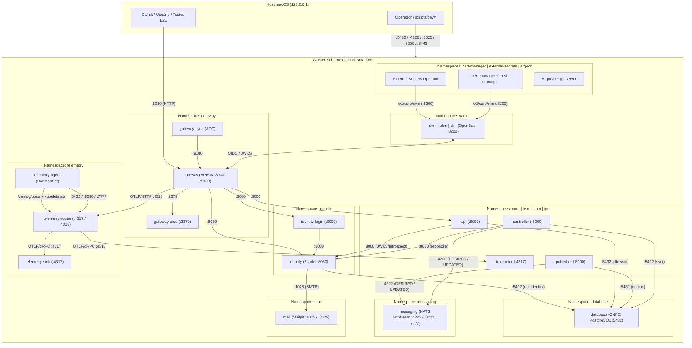

---

## 3. Orquestração GitOps (`gitops-operator` e `git-server`)

### 3.1 Arquitetura
- **Namespace:** `gitops-operator`
- **Manifestos:** `infrastructure/k8s/operators/argocd/` e `infrastructure/k8s/argocd/`
- **Componentes:**
  - `argocd-application-controller`, `argocd-server`, `argocd-repo-server`, `argocd-redis`, `argocd-dex-server`, `argocd-applicationset-controller` e `argocd-notifications-controller`.
  - **`git-server` (somente em `dev`):** `Deployment` (`alpine/git:2.52.0`) que monta `/workspace/smarkee` (repositório do host via `extraMounts` somente leitura), sincroniza continuamente para um repositório bare `/git/smarkee.git` na branch `dev` e o expõe via `git daemon` (`git://git-server.gitops-operator.svc.cluster.local:9418/smarkee.git`). Isso permite que o ArgoCD reconcilie alterações locais nos manifestos Kustomize sem exigir `git push` para um servidor remoto durante o desenvolvimento.
- **Padrão *App of Apps* e Ondas de Sincronização (`sync-wave`):**
  1. `smarkee-platform-root` gerencia as 7 `Application`s de plataforma (`platform-vault` na wave `0`; `platform-database`, `platform-messaging` e `platform-mail` na wave `1`; `platform-telemetry` e `platform-identity` na wave `2`; `platform-gateway` na wave `3`) e a `smarkee-features-root` (wave `4`).
  2. `smarkee-features-root` gerencia as 9 `Application`s de features (`feature-core-account`, `feature-bsm-account`, `feature-sum-service`, `feature-ipm-{organization,user,serviceaccount,permission,role,group}`).
  3. Todas as 18 `Application`s operam com `automated: {prune: true, selfHeal: true}`.


> **Fontes editáveis do diagrama:**
> - Mermaid: [`diagrams/02-gitops-argocd-waves.mmd`](diagrams/02-gitops-argocd-waves.mmd)
> - Draw.io (arquivo dedicado): [`diagrams/02-gitops-argocd-waves.drawio`](diagrams/02-gitops-argocd-waves.drawio)
> - Draw.io (álbum multi-página): [`diagrams/infrastructure-k8s.drawio`](diagrams/infrastructure-k8s.drawio) (página `02 - GitOps ArgoCD Waves`)

#### 3.1.1 Sequência de Reconciliação Declarativa

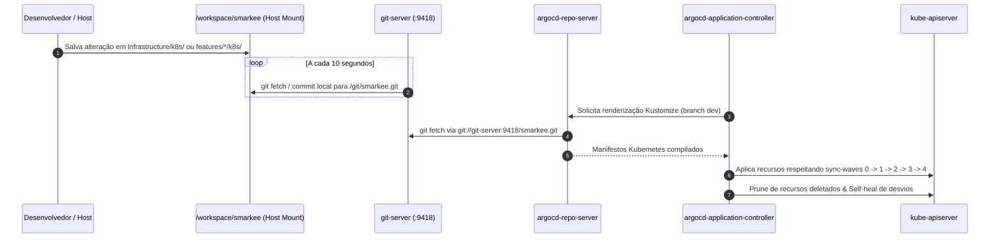

### 3.2 Portas e Endpoints

| Serviço (`Service`) | Tipo | Porta Interna | Porta no Host (`dev`) | Protocolo / Caminho |
|---|---|---|---|---|
| `argocd-server.gitops-operator.svc.cluster.local` | `ClusterIP` | `80`, `443` | — | HTTP / HTTPS (API e UI interna) |
| `argocd-server-nodeport` | `NodePort` | `443` (`30443`) | `127.0.0.1:8443` | HTTPS (UI Web e gRPC/CLI) |
| `git-server.gitops-operator.svc.cluster.local` | `ClusterIP` | `9418` | — | Git Daemon (`git://.../smarkee.git`) |

### 3.3 Interligações
- **Entrada:** recebe conexões HTTPS do operador em `https://127.0.0.1:8443`.
- **Saída:**
  - `argocd-repo-server` lê os manifestos de `git://git-server.gitops-operator.svc.cluster.local:9418/smarkee.git` (em `dev`).
  - `argocd-application-controller` aplica e reconcilia recursos na API do Kubernetes (`kubernetes.default.svc:443`).

### 3.4 Quem Acessa e Como Acessa
- **Usuário Final:** **não acessa.** O ArgoCD é um componente exclusivo de controle de infraestrutura.
- **Operador:**
  - **Via Web UI:** `https://127.0.0.1:8443`
    - Usuário: `admin`
    - Senha inicial (obtida via `kubectl`):
      ```bash
      kubectl -n gitops-operator get secret argocd-initial-admin-secret -o jsonpath='{.data.password}' | base64 -d && echo
      ```
  - **Via `kubectl`:**
    ```bash
    kubectl -n gitops-operator get applications
    ```

---

## 4. Operadores de Infraestrutura e Segurança

O cluster utiliza cinco operadores oficiais para gerenciar o ciclo de vida declarativo de certificados, segredos, banco de dados, mensageria e coletores de telemetria:

| Operador | Namespace | Versão | CRDs Principais no Cluster | Quem interage com ele |
|---|---|---|---|---|
| **`cert-manager`** | `cert-manager-operator` | `v1.21.3` | `ClusterIssuer` (`smarkee-internal-ca`), `Certificate` | Autentica no `vault` (`clm.vault.svc.cluster.local:8200`, mount `/v1/core/clm`) usando sua `ServiceAccount` Kubernetes e emite certificados X.509 como `Secret`s `kubernetes.io/tls`. |
| **`trust-manager`** | `cert-manager-operator` | `v0.26.0` | `Bundle` (`smarkee-internal-ca-bundle`) | Lê o certificado da CA raiz (`vault/smarkee-root-ca`) e distribui automaticamente o `ConfigMap` `smarkee-ca-bundle` (`ca.crt`) em todos os namespaces com label `smarkee.io/layer in (infra, app)`. |
| **`External Secrets Operator` (ESO)** | `external-secrets-operator` | `v2.13.0` | `ClusterSecretStore` (`smarkee-core-svm`), `ExternalSecret` | Autentica no `vault` (`svm.vault.svc.cluster.local:8200`, mount `/v1/core/svm`) via Kubernetes Auth (`role: svm-reader`) e projeta segredos como `Secret`s nativos nos namespaces de plataforma e features. |
| **`CloudNativePG` (CNPG)** | `database-operator` | `v1.30.1` | `Cluster` (`database`) | Provisiona e supervisiona os pods PostgreSQL (`database-1`), Services `database-{rw,ro,r}`, probes, failover e PVC no namespace `database`. |
| **`NACK`** | `messaging-operator` | `v0.25.0` | `Stream` (`desired`, `updated`, `audit`), `Consumer` | Conecta em `nats://messaging.messaging.svc.cluster.local:4222` (conta `$SYS` / `smarkee`) e reconcilia declarativamente os Streams JetStream. |
| **`OpenTelemetry Operator`** | `telemetry-operator` | `v0.162.0` | `OpenTelemetryCollector` (`telemetry-agent`, `telemetry-router`, `telemetry-sink`, `<módulo>-<tipo>-telemeter`) | Reconcilia o DaemonSet do `telemetry-agent` e os StatefulSets + Services do `telemetry-router`, `telemetry-sink` e dos 9 `<módulo>-<tipo>-telemeter`. |

---

## 5. Cofre de Segredos, Criptografia e PKI (`vault`: `/svm`, `/ekm`, `/clm`)

### 5.1 Arquitetura
- **Namespace:** `vault`
- **Produto e Imagem:** OpenBao `openbao/openbao:2.7.2`
- **Manifestos:** `infrastructure/k8s/platform/vault/{base,overlays/dev}/` e bootstrap em `scripts/dev/vault-bootstrap`
- **Topologia (`dev` vs. `prd`):**
  - Em `dev`, um único `StatefulSet` (`vault-0`, armazenamento Raft em PVC `/openbao/data`) hospeda os três motores sob três Kubernetes `Service`s distintos:
    1. **`svm.vault.svc.cluster.local`** → *Secret Vault Manager* (motor `kv-v2` montado em `/svm`)
    2. **`ekm.vault.svc.cluster.local`** → *Encryption Key Manager* (motor `transit` montado em `/ekm`, ex.: chave `bsm-account-credentials`)
    3. **`clm.vault.svc.cluster.local`** → *Certificate Lifecycle Manager* (motor `pki` montado em `/clm`, CA interna `Smarkee Internal Root CA`, role `smarkee-svc` para `*.svc.cluster.local` e `*.smarkee.com.br`)
  - Em `prd`, cada um dos três `Service`s (`svm`, `ekm`, `clm`) aponta para seu próprio cluster OpenBao HA de 3 nós, sem alterar uma única linha de endereço DNS nos consumidores.
- **Namespaces OpenBao espelhados no `identity` (Zitadel):**
  - Todo namespace no OpenBao (`/v1/sys/namespaces/<ns>`) corresponde 1:1 a uma Organization do Zitadel e carrega em `custom_metadata`:
    - `identity_org_id`: ID da organização no Zitadel (`core`, `operator` ou `<organizationId>` do tenant)
    - `identity_org_name`: nome da organização
  - Cada namespace possui seus próprios mounts isolados `/svm`, `/ekm` e `/clm`.


> **Fontes editáveis do diagrama:**
> - Mermaid: [`diagrams/03-vault-security-pki.mmd`](diagrams/03-vault-security-pki.mmd)
> - Draw.io (arquivo dedicado): [`diagrams/03-vault-security-pki.drawio`](diagrams/03-vault-security-pki.drawio)
> - Draw.io (álbum multi-página): [`diagrams/infrastructure-k8s.drawio`](diagrams/infrastructure-k8s.drawio) (página `03 - Vault Security PKI`)

#### 5.1.1 Fluxos de Acesso ao Vault: Projeção de Segredos e Certificados

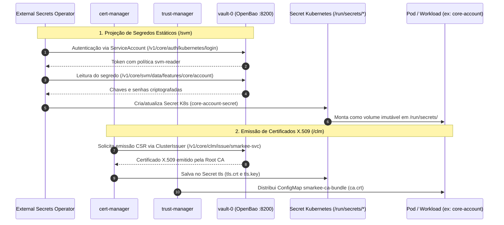

### 5.2 Portas e Endpoints

| Serviço (`Service`) | Tipo | Porta Interna | Porta no Host (`dev`) | Finalidade |
|---|---|---|---|---|
| `svm.vault.svc.cluster.local` | `ClusterIP` | `8200` | — | Endpoint dedicado para leitura/escrita de segredos (`/v1/<ns>/svm/...`) |
| `ekm.vault.svc.cluster.local` | `ClusterIP` | `8200` | — | Endpoint dedicado para criptografia *Transit* (`/v1/<ns>/ekm/...`) |
| `clm.vault.svc.cluster.local` | `ClusterIP` | `8200` | — | Endpoint dedicado para emissão de certificados PKI (`/v1/<ns>/clm/...`) |
| `vault-internal.vault.svc.cluster.local` | `ClusterIP (Headless)` | `8200`, `8201` | — | Descoberta de pares Raft e cluster port |
| `vault-nodeport` | `NodePort` | `8200` (`30200`) | `127.0.0.1:8200` | Acesso HTTP da máquina do operador (`bao` CLI, UI `/ui/`, `vault-bootstrap`) |

### 5.3 Interligações
- **Entrada:**
  - `External Secrets Operator` → `http://svm.vault.svc.cluster.local:8200` (autenticação `auth/kubernetes`, role `svm-reader` no namespace `core`).
  - `cert-manager` → `http://clm.vault.svc.cluster.local:8200` (autenticação `auth/kubernetes`, role `clm-issuer` no namespace `core`).
  - Workloads / Controllers → `http://ekm.vault.svc.cluster.local:8200` (autenticação `auth/kubernetes`, role `ekm-crypto`, ou JWT do Zitadel).
- **Saída:**
  - Conecta a `http://gateway.gateway.svc.cluster.local:8000` (via `auth-dev.smarkee.com.br` resolvido pelo CoreDNS) para validar tokens OIDC/JWT emitidos pelo `identity` (`jwks_url: http://auth-dev.smarkee.com.br:8080/oauth/v2/keys`).

### 5.4 Quem Acessa e Como Acessa
- **Serviços da Plataforma e Features:**
  - Não leem segredos estáticos diretamente da API HTTP no boot; o `External Secrets Operator` materializa os segredos do `/svm` como Kubernetes `Secret`s montados em `/run/secrets/*` nos pods (ou variáveis de ambiente nos serviços legados).
  - Para operações criptográficas (`/ekm`) e PKI (`/clm`), autenticam via `ServiceAccount` Kubernetes (`/v1/core/auth/kubernetes/login`) ou via JWT do Zitadel (`/v1/auth/jwt/login`, role `identity-org-member`, que valida a claim `urn:zitadel:iam:org:id` contra o `identity_org_id` da política templated).
- **Usuário / Operador da Organização (via OIDC / JWT do Zitadel):**
  - Na UI Web (`http://127.0.0.1:8200/ui/`) ou via API REST, pode autenticar com o método `oidc` ou `jwt` usando um token emitido pelo Zitadel (`auth-dev.smarkee.com.br`), recebendo acesso estritamente ao namespace cujo `identity_org_id` coincide com sua organização no Zitadel.
- **Operador de Infraestrutura (`dev`):**
  - Credenciais de inicialização/unseal de `dev` ficam salvas localmente (fora do Git) em `.workspace/vault-init.json` (`root_token` e `unseal_key_b64`).
  - Exemplo de consulta via CLI ou `curl` no host:
    ```bash
    VAULT_TOKEN="$(jq -r .root_token .workspace/vault-init.json)"
    # Listar namespaces OpenBao e metadados identity_org_id
    curl -s -H "X-Vault-Token: ${VAULT_TOKEN}" "http://127.0.0.1:8200/v1/sys/namespaces?list=true" | jq .
    # Ler um segredo no mount /svm do namespace core
    curl -s -H "X-Vault-Token: ${VAULT_TOKEN}" -H "X-Vault-Namespace: core" \
      "http://127.0.0.1:8200/v1/svm/data/platform/messaging" | jq .
    ```

---

## 6. Banco de Dados Relacional e SSOT (`database`)

### 6.1 Arquitetura
- **Namespace:** `database`
- **Produto e Operador:** PostgreSQL `18.6` (`ghcr.io/cloudnative-pg/postgresql:18.6`) gerenciado pelo operador **`CloudNativePG` (`v1.30.1`)** via CRD `Cluster` (`database`).
- **Manifestos:** `infrastructure/k8s/platform/database/{base,overlays/dev}/`
- **Bancos de Dados na Instância:**
  1. **`ssot`** (owner: `ssot_owner`): Fonte Única da Verdade (*Single Source of Truth*, decisão `0087`) contendo os schemas `core`, `bsm`, `sum`, `ipm` e `telemetry`.
  2. **`identity`** (owner: `identity`): banco dedicado ao eventstore e projeções do Zitadel.
- **Segregação de Papéis (Menor Privilégio — `docs/data/POSTGRESQL.md`):**
  - Nenhum componente de runtime conecta como `postgres` ou `ssot_owner`.
  - Cada feature possui:
    - `<módulo>_<tipo>_owner` (`NOLOGIN`, dono das tabelas da feature via `postInitApplicationSQL` e migrações `*-migrate`).
    - `<módulo>_<tipo>_api_login` (herda `<módulo>_<tipo>_api_service`: `SELECT, INSERT, UPDATE` na tabela principal e idempotência, `INSERT` no outbox).
    - `<módulo>_<tipo>_publisher_login` (herda `<módulo>_<tipo>_publisher_service`: `SELECT, UPDATE` no outbox + `pg_try_advisory_lock`).
    - `<módulo>_<tipo>_controller_login` (somente nas features `external-reconciled`: `SELECT, UPDATE, DELETE` na tabela principal e `INSERT` no outbox).
    - `<módulo>_maintenance_login`: `DELETE` exclusivo de linhas expiradas em `<tipo>_outbox` (`published_at IS NOT NULL`) e `<tipo>_idempotency` (`expires_at < now()`).
  - Telemetria possui `telemetry_login` (com `pg_read_all_stats` e `EXECUTE ON FUNCTION telemetry.outbox_stats()`, sem acesso às linhas de negócio).
- **Sincronização de Senhas com o `vault`:**
  - O `ExternalSecret` `database-role-passwords` projeta os segredos de `/svm/data/platform/database` e `/svm/data/features/*` no `Secret` `database-role-passwords`, e o `Job` `database-role-passwords-sync` aplica as senhas nos papéis SQL do PostgreSQL.


> **Fontes editáveis do diagrama:**
> - Mermaid: [`diagrams/04-database-cnpg-roles.mmd`](diagrams/04-database-cnpg-roles.mmd)
> - Draw.io (arquivo dedicado): [`diagrams/04-database-cnpg-roles.drawio`](diagrams/04-database-cnpg-roles.drawio)
> - Draw.io (álbum multi-página): [`diagrams/infrastructure-k8s.drawio`](diagrams/infrastructure-k8s.drawio) (página `04 - Database CNPG & Roles`)

#### 6.1.1 Fluxos Transacionais no Banco `ssot`

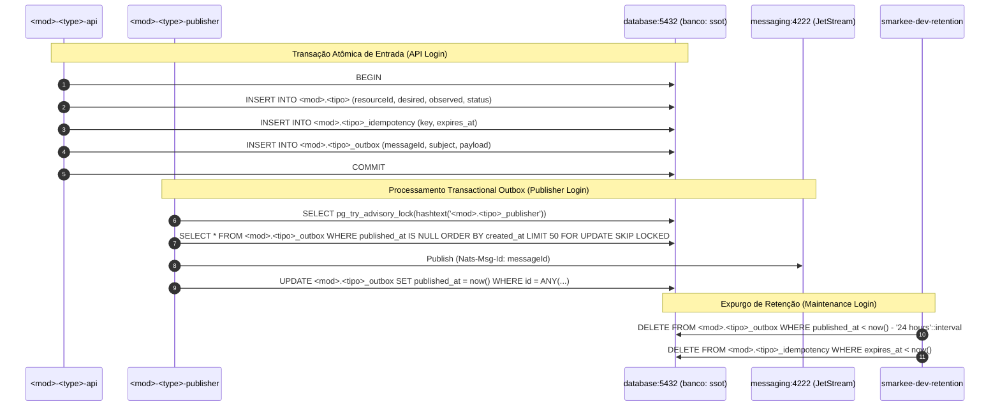

### 6.2 Portas e Endpoints

| Serviço (`Service`) | Tipo | Porta Interna | Porta no Host (`dev`) | Finalidade |
|---|---|---|---|---|
| `database.database.svc.cluster.local` | `ClusterIP` | `5432` | — | Alias canônico da plataforma apontando para a instância primária (`database-1`) |
| `database-rw.database.svc.cluster.local` | `ClusterIP` | `5432` | — | Serviço nativo CNPG de leitura e escrita (primário) |
| `database-ro.database.svc.cluster.local` | `ClusterIP` | `5432` | — | Serviço nativo CNPG somente leitura (réplicas em `stg`/`prd`) |
| `database-r.database.svc.cluster.local` | `ClusterIP` | `5432` | — | Serviço nativo CNPG de leitura (qualquer instância) |
| `database-nodeport` | `NodePort` | `5432` (`30432`) | `127.0.0.1:5432` | Acesso do host em `dev` para suítes de teste e utilitários `scripts/dev/*` |

### 6.3 Interligações
- **Entrada:**
  - `identity` e `identity-init` (`namespace: identity`) → banco `identity` (usuário `identity`).
  - Jobs `<módulo>-<tipo>-migrate` → banco `ssot` (usuário `ssot_owner` na migração de bootstrap).
  - Pods `<módulo>-<tipo>-{api,publisher,controller}` (`namespaces: core, bsm, sum, ipm`) → banco `ssot` (com seus respectivos `*_login`).
  - `telemetry-agent-collector` (`namespace: telemetry`) → banco `ssot` (usuário `telemetry_login`).
- **Saída:** Nenhuma (não inicia conexões externas).

### 6.4 Quem Acessa e Como Acessa
- **Usuário Final:** **não acessa.** Todo acesso de usuário passa pela API HTTP das features via `gateway`.
- **Operador (`dev`):**
  - **Via utilitários de manutenção (menor privilégio):**
    ```bash
    # Expurgo de outbox e idempotência (> 24h) usando *_maintenance_login
    (cd scripts/dev/retention && uv run smarkee-dev-retention --apply)
    # Republicação de recursos do SSOT
    (cd scripts/dev/republish && uv run smarkee-dev-republish)
    ```
  - **Via `psql` a partir do host (`127.0.0.1:5432`) ou via `kubectl exec`:**
    ```bash
    # Usando o superusuário postgres dentro do pod CNPG para diagnóstico administrativo
    kubectl -n database exec -it database-1 -c postgres -- psql -U postgres -d ssot
    ```

---

## 7. Mensageria e Streams (`messaging`)

### 7.1 Arquitetura
- **Namespace:** `messaging`
- **Produto e Operador:** NATS Server `nats:2.15.2-alpine` com JetStream habilitado, acompanhado de dois sidecars no mesmo Pod (`messaging-0`) e gerenciado declarativamente pelo operador **NACK (`v0.25.0`)**:
  1. **`nats` (`nats:2.15.2-alpine`):** servidor NATS + JetStream persistindo em `/data/jetstream` (PVC).
  2. **`reloader` (`natsio/nats-server-config-reloader:0.22.2`):** monitora `/etc/nats-config/nats.conf` e `/etc/nats-secrets/auth.conf` (gerado via `ExternalSecret` a partir do `vault`) e envia sinal de reload sem reiniciar o broker.
  3. **`exporter` (`natsio/prometheus-nats-exporter:0.20.3`):** lê `http://127.0.0.1:8222/{varz,jsz}` e expõe métricas Prometheus na porta `:7777`.
- **Streams JetStream (reconciliados via CRDs `Stream` do NACK — decisão `0101`):**
  - **`DESIRED`**: captura `desired.>` (4 tokens: `desired.<módulo>.<tipo>.<resourceId>`), `retention: limits`, `max_msgs_per_subject: 1`, `storage: file`, `allow_direct: true`.
  - **`UPDATED`**: captura `updated.>` (4 tokens: `updated.<módulo>.<tipo>.<resourceId>`), `retention: limits`, `max_msgs_per_subject: 1`, `storage: file`, `allow_direct: true`.
  - **`AUDIT`**: captura `audit.>` e agrega via `sources: [DESIRED, UPDATED]`, `retention: limits`, `storage: file`, `deny_delete: true`, `deny_purge: true`, `allow_rollup_hdrs: false`.


> **Fontes editáveis do diagrama:**
> - Mermaid: [`diagrams/05-messaging-nats-nack.mmd`](diagrams/05-messaging-nats-nack.mmd)
> - Draw.io (arquivo dedicado): [`diagrams/05-messaging-nats-nack.drawio`](diagrams/05-messaging-nats-nack.drawio)
> - Draw.io (álbum multi-página): [`diagrams/infrastructure-k8s.drawio`](diagrams/infrastructure-k8s.drawio) (página `05 - Messaging NATS & NACK`)

#### 7.1.1 Fluxo de Publicação e Consumo nos Streams NATS

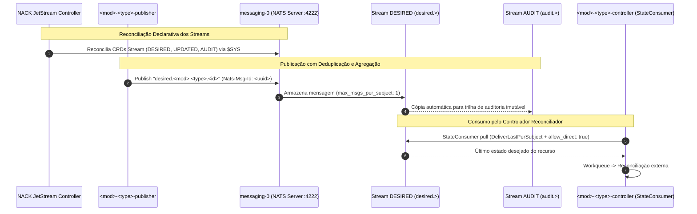

### 7.2 Portas e Endpoints

| Serviço (`Service`) | Tipo | Porta Interna | Porta no Host (`dev`) | Finalidade |
|---|---|---|---|---|
| `messaging.messaging.svc.cluster.local` | `ClusterIP` | `4222`, `8222`, `7777` | — | `4222` (NATS Client), `8222` (HTTP Monitoring), `7777` (Prometheus Exporter) |
| `messaging-headless.messaging.svc.cluster.local` | `ClusterIP (Headless)` | `4222`, `8222` | — | Endereçamento estável do StatefulSet `messaging-0` |
| `messaging-nodeport` | `NodePort` | `4222` (`30422`), `8222` (`30822`) | `127.0.0.1:4222`, `127.0.0.1:8222` | Acesso NATS e monitoramento a partir do host em `dev` |

### 7.3 Interligações
- **Entrada:**
  - `nack-jetstream-controller` (`namespace: nack`) → `:4222` (gerencia os CRDs `Stream`).
  - `<módulo>-<tipo>-publisher` (`namespaces: core, bsm, sum, ipm`) → `:4222` (publica `desired.<mod>.<type>.<id>` e `updated.<mod>.<type>.<id>` com `Nats-Msg-Id` determinístico).
  - `<módulo>-<tipo>-controller` (`namespaces: core, sum, ipm`) → `:4222` (consome `DESIRED` via `StateConsumer` com `DeliverLastPerSubject` e `allow_direct: true`).
  - `telemetry-agent-collector` (`namespace: telemetry`) → `:7777/metrics` (coleta métricas do NATS/JetStream).
- **Saída:** Nenhuma.

### 7.4 Quem Acessa e Como Acessa
- **Usuário Final:** **não acessa.**
- **Serviços (Features e NACK):**
  - Autenticam na porta `4222` com usuário `smarkee` e a senha injetada via `ExternalSecret` (`/run/secrets/messaging_password` nas features).
- **Operador (`dev`):**
  - **Inspeção de Streams via HTTP Monitoring (`127.0.0.1:8222`):**
    ```bash
    curl -s http://127.0.0.1:8222/jsz?streams=true | jq '.account_details[0].stream_detail[] | {name, messages: .state.messages, subjects: .config.subjects}'
    ```
  - **Inspeção dos CRDs `Stream` via `kubectl`:**
    ```bash
    kubectl -n messaging get streams.jetstream.nats.io
    ```
  - **Obtenção da senha de `dev` para suítes de conformidade:**
    ```bash
    kubectl -n messaging get secret messaging-secret -o jsonpath='{.data.NATS_PASSWORD}' | base64 -d && echo
    ```

---

## 8. Servidor de E-mail (`mail`)

### 8.1 Arquitetura
- **Namespace:** `mail`
- **Produto e Imagem:** Mailpit `axllent/mailpit:v1.29.6` (`StatefulSet` `mail-0`).
- **Manifestos:** `infrastructure/k8s/platform/mail/{base,overlays/dev}/`
- **Papel:** Captura todos os e-mails transacionais enviados pelo `identity` (Zitadel) em `dev` (códigos de verificação de conta, convites, redefinição de senha e OTP), sem enviá-los para a internet.

### 8.2 Portas e Endpoints

| Serviço (`Service`) | Tipo | Porta Interna | Porta no Host (`dev`) | Finalidade |
|---|---|---|---|---|
| `mail.mail.svc.cluster.local` | `ClusterIP` | `1025`, `8025` | — | `1025` (SMTP sem TLS interno), `8025` (HTTP UI e API REST `/api/v1/*`) |
| `mail-nodeport` | `NodePort` | `8025` (`30025`) | `127.0.0.1:8025` | Interface Web e API REST do Mailpit para o operador e suítes E2E no host |

### 8.3 Interligações
- **Entrada:**
  - `identity` (`namespace: identity`) → `mail.mail.svc.cluster.local:1025` (envio SMTP de e-mails de ativação e códigos de verificação do Zitadel).
  - Suítes `tests/e2e` e `scripts/dev/cleanup` (no host) → `http://127.0.0.1:8025/api/v1/messages` (leitura de códigos de ativação e limpeza de mensagens de teste).
- **Saída:** Nenhuma.

### 8.4 Quem Acessa e Como Acessa
- **Usuário Final (em `dev`):** consulta seus e-mails simulados (como o código de verificação após `POST /v1/core/accounts`) em `http://127.0.0.1:8025`.
- **Operador (`dev`):**
  - **Web UI:** `http://127.0.0.1:8025`
  - **API REST:** `curl -s http://127.0.0.1:8025/api/v1/messages | jq .`

---

## 9. Provedor de Identidade (`identity` e `identity-login`)

### 9.1 Arquitetura
- **Namespace:** `identity`
- **Produto e Imagem:** Zitadel `ghcr.io/zitadel/zitadel:v4.20.0` e `ghcr.io/zitadel/zitadel-login:v4.20.0`
- **Manifestos:** `infrastructure/k8s/platform/identity/{base,overlays/dev}/`
- **Componentes:**
  1. **`Deployment/identity`**: motor OIDC/OAuth2, gRPC/REST Management, Auth e Admin APIs v1/v2 (`start --from-steps`). Possui o `initContainer` `identity-init` (`init zitadel`) que garante o schema no banco `identity`.
  2. **`Deployment/identity-login`**: interface de autenticação Login v2 (`:3000`), autenticando contra o `identity` com o token da conta de serviço `login-client.pat` montado em `/init-user/login-client.pat`.
- **Estrutura de Identidade da Plataforma:**
  - **Organizações base:**
    - `core` (`395132726044262411`): contas humanas auto-registradas (`core.account`), conta `core-owner` e serviço `gateway-jwt-introspector`.
    - `operator` (`395132729248710667`): contas de serviço dos `controller`s (`core-account-controller`, `sum-service-controller`, `ipm-{organization,user,serviceaccount,permission}-controller`) e `identity-admin`.
    - `<organizationId>`: organizações criadas pelos clientes via `ipm/organization`.
  - **Projetos:** `core` (`394490764261851138`), `bsm` (`396296690602082330`), `sum` (`395263163731279883`) e `ipm` (`395263156584185867`).
  - **Domínios reconhecidos pela instância (`ExternalDomain`):** `localhost`, `auth-dev.smarkee.com.br` e `api-dev.smarkee.com.br` (porta externa `8080`).


> **Fontes editáveis do diagrama:**
> - Mermaid: [`diagrams/06-identity-gateway-auth.mmd`](diagrams/06-identity-gateway-auth.mmd)
> - Draw.io (arquivo dedicado): [`diagrams/06-identity-gateway-auth.drawio`](diagrams/06-identity-gateway-auth.drawio)
> - Draw.io (álbum multi-página): [`diagrams/infrastructure-k8s.drawio`](diagrams/infrastructure-k8s.drawio) (página `06 - Identity & Gateway Auth`)

#### 9.1.1 Fluxos de Autenticação Humana (PKCE) e de Máquina (JWT Profile)

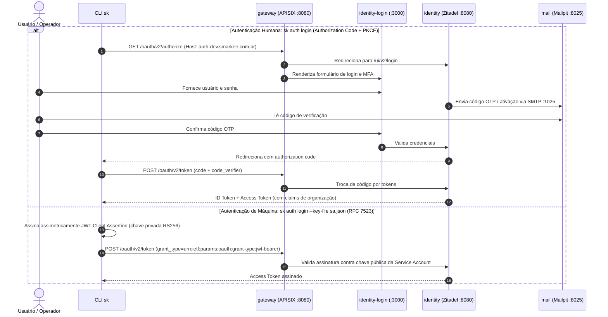

### 9.2 Portas e Endpoints

| Serviço (`Service`) | Tipo | Porta Interna | Porta no Host (`dev`) | Finalidade |
|---|---|---|---|---|
| `identity.identity.svc.cluster.local` | `ClusterIP` | `8080` | *(via `gateway` em `:8080`)* | APIs HTTP/1.1, HTTP/2 (gRPC), OIDC (`/oauth/v2/*`, `/oidc/v1/*`, `/.well-known/*`), Management/Admin APIs e métricas (`/debug/metrics`) |
| `identity-login.identity.svc.cluster.local` | `ClusterIP` | `3000` | *(via `gateway` em `:8080/ui/v2/login/*`)* | Interface gráfica de Login v2 (Next.js) |

*(Nota: o `identity` nunca expõe `NodePort` direto; todo tráfego externo chega exclusivamente através do `gateway` em `127.0.0.1:8080`.)*

### 9.3 Interligações
- **Entrada:**
  - `gateway` (`namespace: gateway`) → `identity.identity.svc.cluster.local:8080` (rotas OIDC, JWKS, introspection e console) e `identity-login.identity.svc.cluster.local:3000` (`/ui/v2/login/*`).
  - `<módulo>-<tipo>-api` (`namespaces: core, bsm, sum, ipm`) → `identity.identity.svc.cluster.local:8080` (busca de chaves públicas `/oauth/v2/keys` e introspecção OAuth2 `/oauth/v2/introspect` com header `Host: localhost:8080`).
  - `<módulo>-<tipo>-controller` (`namespaces: core, sum, ipm`) → `identity.identity.svc.cluster.local:8080` (reconciliação de organizações, usuários, contas de serviço, metadados e autorizações usando JWT Profile RFC 7523).
  - `telemetry-agent-collector` (`namespace: telemetry`) → `identity.identity.svc.cluster.local:8080/debug/metrics`.
- **Saída:**
  - `database.database.svc.cluster.local:5432` (banco `identity`, usuário `identity`).
  - `mail.mail.svc.cluster.local:1025` (envio SMTP de e-mails de verificação e códigos).

### 9.4 Quem Acessa e Como Acessa
- **Usuário Final:**
  - **Via CLI `sk` (fluxo OAuth2 Authorization Code + PKCE):**
    ```bash
    sk auth login
    ```
    Abre o navegador em `http://auth-dev.smarkee.com.br:8080/oauth/v2/authorize...` (ou `http://localhost:8080`), redireciona para `/ui/v2/login` (`identity-login`) e devolve o token OIDC com as claims de organização e permissões.
  - **Via Service Account (fluxo JWT Profile RFC 7523):**
    ```bash
    sk auth login --key-file caminho/para/sa.json
    ```
- **Operador (`dev`):**
  - **Console Administrativo do Zitadel:** `http://auth-dev.smarkee.com.br:8080/ui/console` (ou `http://localhost:8080/ui/console` com `/etc/hosts` apontando `auth-dev.smarkee.com.br` e `api-dev.smarkee.com.br` para `127.0.0.1`).
  - **Chaves das Service Accounts de Bootstrap (em `dev`):** sincronizadas do `vault` (`/v1/core/svm/data/platform/identity-keys`) e disponíveis localmente em `infrastructure/dev/identity/.bootstrap/*.json` para os utilitários `scripts/dev/cleanup` e suítes de conformidade (`infrastructure/dev/identity/conformance`).

---

## 10. Gateway de API (`gateway`, `gateway-etcd` e `gateway-sync`)

### 10.1 Arquitetura
- **Namespace:** `gateway`
- **Produto e Imagens:**
  - **`gateway` (`apache/apisix:3.19.0-debian`):** `Deployment` do Apache APISIX com o plugin customizado `opaque-token-introspect.lua` (converte tokens opacos em JWTs internos assinados via introspecção RFC 7662 no `identity`, mantendo cache curto em memória e bloqueando qualquer `X-Smarkee-Internal-Token` vindo de fora).
  - **`gateway-etcd` (`quay.io/coreos/etcd:v3.6.9`):** `StatefulSet` (`gateway-etcd-0`) armazenando a configuração dinâmica de rotas, upstreams, serviços e plugins do APISIX.
  - **`gateway-sync` (`ghcr.io/api7/adc:0.26.1`):** `Deployment` que reconcilia declarativamente o arquivo `adc.yaml` (gerado a partir de `infrastructure/k8s/platform/gateway/base/adc-configmap.yaml` com as variáveis do `ExternalSecret` `gateway-secret`) contra a Admin API do APISIX (`http://gateway:9180`) a cada 30 segundos.
- **Regras Globais e Segurança na Borda:**
  1. **Sanitização de Tracing (`proxy-rewrite`):** remove headers `traceparent` e `tracestate` enviados pelo cliente externo antes de iniciar um novo trace W3C no plugin `opentelemetry`.
  2. **Introspecção de Token Opaco (`opaque-token-introspect`):** valida tokens opacos das contas de serviço no `identity` (`http://identity.identity.svc.cluster.local:8080/oauth/v2/introspect`).
  3. **Rate Limiting e Limite de Payload (`limit-req`, `limit-count`, `client-control`):** protege rotas anônimas (`POST /v1/core/accounts` limitado a 10 req/min por IP com retorno `429` + `Retry-After`) e rotas autenticadas.
  4. **Segregação por `Host`:**
     - `api-dev.smarkee.com.br`: expõe exclusivamente `/v1/core/*`, `/v1/bsm/*`, `/v1/sum/*` e `/v1/ipm/*`.
     - `auth-dev.smarkee.com.br` (e `localhost` em `dev`): expõe exclusivamente as rotas OIDC/OAuth2 e UI de login do `identity`.

#### 10.1.1 Pipeline de Processamento de Requisição no Gateway

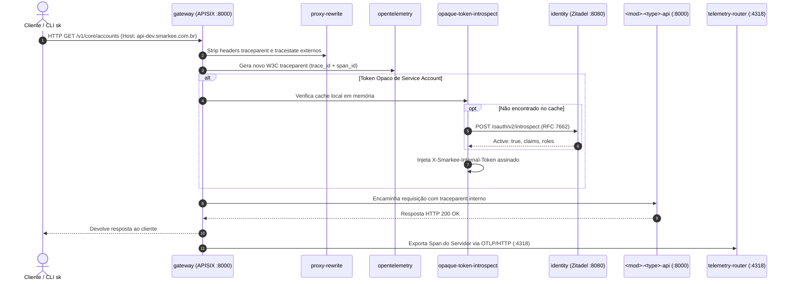

### 10.2 Portas e Endpoints

| Serviço (`Service`) | Tipo | Porta Interna | Porta no Host (`dev`) | Finalidade |
|---|---|---|---|---|
| `gateway.gateway.svc.cluster.local` | `ClusterIP` | `8000`, `8080`, `9180` | — | `8000` e `8080` (HTTP Proxy para tráfego externo e interno), `9180` (Admin API) |
| `gateway-external` | `NodePort` | `8000` (`30080`), `9180` (`30180`) | `127.0.0.1:8080`, `127.0.0.1:9180` | Entrada HTTP única da plataforma (`:8080`) e Admin API local (`:9180`) |
| `gateway-etcd.gateway.svc.cluster.local` | `ClusterIP` | `2379` | — | Armazenamento de configuração do APISIX |

### 10.3 Interligações
- **Entrada:**
  - Clientes externos (CLI `sk`, Console, integrações, testes E2E) → `http://127.0.0.1:8080`.
  - Chamadas internas OIDC (`vault` → `auth-dev.smarkee.com.br:8080`) → `gateway.gateway.svc.cluster.local:8080`.
- **Saída (Upstreams):**
  - `identity.identity.svc.cluster.local:8080` e `identity-login.identity.svc.cluster.local:3000`
  - `core-account-api.core.svc.cluster.local:8000`
  - `bsm-account-api.bsm.svc.cluster.local:8000`
  - `sum-service-api.sum.svc.cluster.local:8000`
  - `ipm-{organization,user,serviceaccount,permission,role,group}-api.ipm.svc.cluster.local:8000`
  - `telemetry-router-collector.telemetry.svc.cluster.local:4318` (exportação OTLP/HTTP de spans de servidor).

### 10.4 Quem Acessa e Como Acessa
- **Usuário Final / Cliente de API:**
  - Acessa todas as APIs de produto em `http://api-dev.smarkee.com.br:8080/v1/<módulo>/<coleção>` (ou `http://127.0.0.1:8080` com header `Host: api-dev.smarkee.com.br`) enviando `Authorization: Bearer <token>`.
  - Acessa os endpoints OIDC em `http://auth-dev.smarkee.com.br:8080`.
- **Operador (`dev`):**
  - **Inspeção de rotas ativas na Admin API (`127.0.0.1:9180`):**
    ```bash
    ADMIN_KEY="$(kubectl -n gateway get secret gateway-secret -o jsonpath='{.data.SMARKEE_GATEWAY_ADMIN_KEY}' | base64 -d)"
    curl -s -H "X-API-KEY: ${ADMIN_KEY}" http://127.0.0.1:9180/apisix/admin/routes | jq '.list[].value | {name, uri, hosts}'
    ```

---

## 11. Observabilidade e Telemetria (`telemetry` e `<feature>-telemeter`)

### 11.1 Arquitetura
- **Namespaces:** `telemetry` (componentes de plataforma) e `core`, `bsm`, `sum`, `ipm` (telemeters de cada feature).
- **Produto e Operador:** `otel/opentelemetry-collector-contrib:0.164.0` gerenciado declarativamente pelo **`OpenTelemetry Operator` (`v0.162.0`)** via CRDs `OpenTelemetryCollector`.
- **Manifestos:** `infrastructure/k8s/platform/telemetry/{base,overlays/dev}/` e `features/<módulo>/<tipo>/k8s/{base,overlays/dev}/telemeter.yaml`.
- **As 4 Peças da Cadeia (1 verbo por peça — decisões `0062` e `0102`):**
  1. **`telemetry-agent` (`mode: daemonset`, namespace `telemetry`):**
     - **Lê** os logs de todos os pods do nó em `/var/log/pods/*/*/*.log` no formato CRI (`containerd`) via `filelog/app` (logs JSON do contrato `0045` nos namespaces `core`, `bsm`, `sum`, `ipm`) e `filelog/infra` (logs `WARN+` dos namespaces `database`, `messaging`, `identity`, `gateway`, `mail`, `telemetry`, `vault`, com redação de e-mail e descarte de healthchecks).
     - **Coleta** métricas de infraestrutura via `kubeletstats` (CPU, memória e rede de nós, pods e contêineres na API do Kubelet `:10250`, sem `docker.sock`), `postgresql` + `sql_query/outbox` (em `database:5432` com `telemetry_login`), e `prometheus/infra` (`identity:8080/debug/metrics` e `messaging:7777/metrics`).
     - Envia tudo por OTLP/gRPC (com `sending_queue` persistente em disco `file_storage`) ao `telemetry-router`.
  2. **`telemetry-router` (`mode: statefulset`, namespace `telemetry`):**
     - **Roteia** cada sinal ao seu dono e **não grava em nenhum backend**.
     - Recebe logs e métricas do `telemetry-agent` em `:4317` (OTLP/gRPC) e spans do `gateway` em `:4318` (OTLP/HTTP).
     - Normaliza os spans do APISIX à semconv HTTP v1.44.0 (`transform/gateway_semconv`, redigindo valores de `url.query` para `REDACTED`).
     - Roteia logs de aplicação (por `smarkee.module` + `smarkee.resource.type`) e spans (por `apisix.service_name`) para o `<módulo>-<tipo>-telemeter` correspondente; roteia toda a telemetria de infraestrutura e spans de plataforma para o **`telemetry-sink`**.
  3. **`telemetry-sink` (`mode: statefulset`, namespace `telemetry`):**
     - **Grava** os sinais da plataforma (`logs/{app,infra}`, `metrics/{app,infra}`, `traces/`) em `/var/lib/smarkee/telemetry/telemetry-sink/`, mapeado via `extraMounts` do `kind` para `infrastructure/dev/telemetry-sink/` no host.
  4. **`<módulo>-<tipo>-telemeter` (`mode: statefulset`, namespaces `core`, `bsm`, `sum`, `ipm`):**
     - **Grava** exclusivamente os logs de aplicação e spans da sua feature em `/var/lib/smarkee/telemetry/features/<módulo>/<tipo>/`, mapeado via `extraMounts` para `features/<módulo>/<tipo>/telemeter/{logs,traces}/` no host.


> **Fontes editáveis do diagrama:**
> - Mermaid: [`diagrams/07-telemetry-pipeline.mmd`](diagrams/07-telemetry-pipeline.mmd)
> - Draw.io (arquivo dedicado): [`diagrams/07-telemetry-pipeline.drawio`](diagrams/07-telemetry-pipeline.drawio)
> - Draw.io (álbum multi-página): [`diagrams/infrastructure-k8s.drawio`](diagrams/infrastructure-k8s.drawio) (página `07 - Telemetry Pipeline`)

#### 11.1.1 Fluxo Detalhado de Roteamento de Sinais

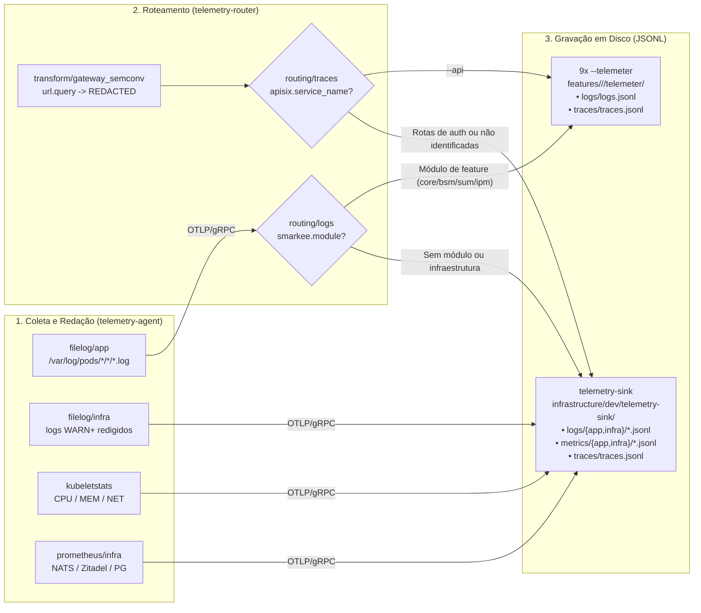

### 11.2 Portas e Endpoints

| Serviço (`Service`) | Namespace | Porta Interna | Protocolo / Finalidade |
|---|---|---|---|
| `telemetry-router-collector.telemetry.svc.cluster.local` (e alias `telemetry-router`) | `telemetry` | `4317`, `4318` | `4317` (OTLP/gRPC do `telemetry-agent`), `4318` (OTLP/HTTP do `gateway`) |
| `telemetry-sink-collector.telemetry.svc.cluster.local` (e alias `telemetry-sink`) | `telemetry` | `4317` | OTLP/gRPC (recebe do `telemetry-router`) |
| `<módulo>-<tipo>-telemeter-collector.<módulo>.svc.cluster.local` (e alias `<módulo>-<tipo>-telemeter`) | `core`, `bsm`, `sum`, `ipm` | `4317` | OTLP/gRPC (recebe do `telemetry-router` os sinais da feature) |
| `*-collector-extension` / `*-collector-monitoring` | `telemetry`, `core`, `bsm`, `sum`, `ipm` | `13133`, `8888` | Healthcheck (`:13133`) e métricas internas do Collector (`:8888`) |

*(Nota: nenhum coletor publica portas no host; os sinais nunca são expostos a clientes externos.)*

### 11.3 Quem Acessa e Como Acessa
- **Usuário Final:** **não acessa.**
- **Operador (`dev`):**
  - **Inspeção dos arquivos OTLP JSONL no host com `jq`:**
    ```bash
    # Spans do gateway roteados para core/account
    jq . features/core/account/telemeter/traces/traces.jsonl
    # Logs de aplicação de core/account
    jq . features/core/account/telemeter/logs/logs.jsonl
    # Logs e métricas de infraestrutura no telemetry-sink
    jq . infrastructure/dev/telemetry-sink/logs/infra/logs.jsonl
    jq . infrastructure/dev/telemetry-sink/metrics/infra/metrics.jsonl
    ```
  - **Limpeza/rotação completa dos sinais de telemetria e cursores `file_storage`:**
    ```bash
    (cd scripts/dev/telemetry-reset && uv run smarkee-dev-telemetry-reset --apply)
    ```

---

## 12. Features de Produto (`core`, `bsm`, `sum`, `ipm`)

### 12.1 Arquitetura e Modelos de Reconciliação
As 9 features da plataforma dividem-se em 4 namespaces de produto (`core`, `bsm`, `sum`, `ipm`) e seguem dois modelos arquiteturais (decisões `0096`, `0098` e `0099`):

| Feature (`<módulo>/<tipo>`) | Namespace | Modelo | Componentes no Cluster (`Deployment` / `Job` / `OpenTelemetryCollector`) | Rota no `gateway` (`api-dev.smarkee.com.br`) |
|---|---|---|---|---|
| **`core/account`** | `core` | `external-reconciled` | `api`, `publisher`, `controller`, `migrate` (Job), `telemeter` | `/v1/core/accounts` |
| **`bsm/account`** | `bsm` | `internal-state` | `api`, `publisher`, `migrate` (Job), `telemeter` | `/v1/bsm/accounts` |
| **`sum/service`** | `sum` | `external-reconciled` | `api`, `publisher`, `controller`, `migrate` (Job), `telemeter` | `/v1/sum/services` |
| **`ipm/organization`** | `ipm` | `external-reconciled` | `api`, `publisher`, `controller`, `migrate` (Job), `telemeter` | `/v1/ipm/organizations` |
| **`ipm/user`** | `ipm` | `external-reconciled` | `api`, `publisher`, `controller`, `migrate` (Job), `telemeter` | `/v1/ipm/users` |
| **`ipm/serviceaccount`** | `ipm` | `external-reconciled` | `api`, `publisher`, `controller`, `migrate` (Job), `telemeter` | `/v1/ipm/service-accounts` |
| **`ipm/permission`** | `ipm` | `external-reconciled` | `api`, `publisher`, `controller`, `migrate` (Job), `telemeter` | `/v1/ipm/permissions` |
| **`ipm/role`** | `ipm` | `internal-state` | `api`, `publisher`, `migrate` (Job), `telemeter` | `/v1/ipm/roles` |
| **`ipm/group`** | `ipm` | `internal-state` | `api`, `publisher`, `migrate` (Job), `telemeter` | `/v1/ipm/groups` |

#### Responsabilidade de cada papel dentro da Feature:
1. **`<módulo>-<tipo>-migrate` (`Job`):** executa as migrações SQL idempotentes (`migrations/*.sql`) no banco `ssot` antes da subida dos componentes.
2. **`<módulo>-<tipo>-api` (`Deployment`, porta `:8000`):** valida autenticação (JWT / introspecção no `identity`) e autorização, aplica as regras de admissão e grava atomicamente na mesma transação PostgreSQL no banco `ssot` a linha principal (`<módulo>.<tipo>`), a chave de idempotência (`<tipo>_idempotency`) e a mensagem na tabela `<tipo>_outbox`.
   - Em recursos **`internal-state`** (`bsm/account`, `ipm/role`, `ipm/group`), a transação da `api` já conclui com `phase = Ready` e enfileira `desired` e `updated` no outbox.
   - Em recursos **`external-reconciled`**, a transação da `api` grava a intenção (`desired`, `phase = Pending`/`Updating`/`Deleting`) e enfileira `desired` no outbox.
3. **`<módulo>-<tipo>-publisher` (`Deployment`, porta `:8000`):** adquire `pg_try_advisory_lock` exclusivo por feature, lê lotes pendentes de `<tipo>_outbox`, publica no NATS JetStream (`desired.<mod>.<type>.<id>` ou `updated.<mod>.<type>.<id>`) com `Nats-Msg-Id` determinístico e marca `published_at`.
4. **`<módulo>-<tipo>-controller` (`Deployment`, porta `:8000`, apenas em `external-reconciled`):** mantém cache em memória alimentado pelo `StateConsumer` do stream `DESIRED` + `Workqueue` com deduplicação e rate limit, observa e executa idempotentemente o efeito externo no `identity` (Zitadel) ou nas APIs internas, grava o `observed` e o `status` (`Ready`/`Failed`) + outbox `updated` na mesma transação no `ssot`.
5. **Segurança dos Pods das Features:** todos os Pods (`api`, `publisher`, `controller`, `migrate`) rodam com `automountServiceAccountToken: false`, configuração imutável montada em `/etc/smarkee/config.toml` (`ConfigMap`) e segredos projetados pelo `External Secrets Operator` em `/run/secrets/` (`ExternalSecret` → `Secret`).


> **Fontes editáveis do diagrama:**
> - Mermaid: [`diagrams/08-features-control-loop.mmd`](diagrams/08-features-control-loop.mmd)
> - Draw.io (arquivo dedicado): [`diagrams/08-features-control-loop.drawio`](diagrams/08-features-control-loop.drawio)
> - Draw.io (álbum multi-página): [`diagrams/infrastructure-k8s.drawio`](diagrams/infrastructure-k8s.drawio) (página `08 - Features Control Loop`)

#### 12.1.1 Sequência Comparativa dos Loops de Controle

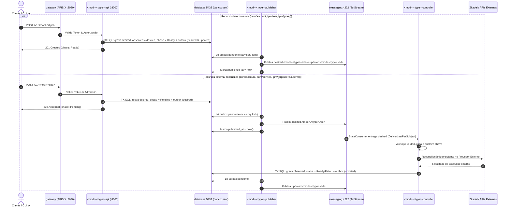

### 12.2 Portas e Endpoints

| Componente | Tipo de Service | Porta Interna | Acesso Externo |
|---|---|---|---|
| `<módulo>-<tipo>-api.<módulo>.svc.cluster.local` | `ClusterIP` | `8000` (HTTP API + `/health/{live,ready}`) | Somente via `gateway` (`127.0.0.1:8080/v1/<módulo>/...`) |
| `<módulo>-<tipo>-publisher` | *(Sem Service exposto)* | `8000` (apenas probes `/health/{live,ready}` para o Kubelet) | Nenhum |
| `<módulo>-<tipo>-controller` | *(Sem Service exposto)* | `8000` (apenas probes `/health/{live,ready}` para o Kubelet) | Nenhum |

### 12.3 Quem Acessa e Como Acessa
- **Usuário Final / Cliente:**
  - **Via CLI `sk`:**
    ```bash
    sk ipm organization list
    sk ipm role list --organization-id <orgId>
    sk bsm account list --organization-id <orgId>
    ```
  - **Via HTTP direto no Gateway (`127.0.0.1:8080`):**
    ```bash
    curl -s http://127.0.0.1:8080/v1/ipm/organizations \
      -H "Host: api-dev.smarkee.com.br" \
      -H "Authorization: Bearer ${TOKEN}" | jq .
    ```
- **Operador (`dev`):**
  - **Verificar status dos Pods e Logs de uma Feature:**
    ```bash
    kubectl -n ipm get pods -l app.kubernetes.io/part-of=ipm-organization
    kubectl -n ipm logs deployment/ipm-organization-controller --tail=50
    ```
  - **Reconstruir imagem, publicar no registry local e reiniciar uma Feature (`k8s-dev`):**
    ```bash
    ./scripts/dev/k8s-dev ipm/organization
    # Ou apenas um papel específico:
    ./scripts/dev/k8s-dev ipm/organization controller
    ```

---

## 13. Referência Operacional e Catálogo de Utilitários

> **Manual Operacional Completo:** os procedimentos detalhados de operação diária, ciclo de vida do cluster, fluxos de desenvolvimento iterativo de código (`k8s-dev`) e manifestos GitOps, acesso a portas/dashboards e guia de resolução de problemas (*troubleshooting*) estão consolidados no **[`docs/infrastructure/k8s/OPERATION.md`](OPERATION.md)**.

### 13.1 Utilitários Oficiais em `scripts/dev/`

A tabela abaixo sumariza as ferramentas de linha de comando disponíveis para orquestrar e operar o cluster Kubernetes de desenvolvimento:

| Utilitário | Invocação | Papel e Responsabilidade |
|---|---|---|
| **`cluster-up`** | `./scripts/dev/cluster-up` | Provisiona de forma idempotente o `smarkee-registry` (`localhost:5001`), o cluster `kind` `smarkee`, os 17 namespaces canônicos, os 7 operadores oficiais (`cert-manager`, `trust-manager`, `cnpg`, `external-secrets`, `opentelemetry-operator`, `nack`, `argocd`), o CoreDNS, o `vault-bootstrap` e as `Application`s raiz no ArgoCD. |
| **`vault-bootstrap`** | `./scripts/dev/vault-bootstrap` | Inicializa e deslacra (*unseal*) o `vault-0` (armazenando as chaves em `.workspace/vault-init.json`), cria os namespaces `core/` e `operator/` com metadados `identity_org_id`, habilita `/svm`, `/ekm` e `/clm`, configura a PKI interna, políticas, Kubernetes Auth, OIDC/JWT Auth com o Zitadel e popula os segredos em `dev`. |
| **`build-push`** | `./scripts/dev/build-push [feature...]` | Constrói as imagens OCI da plataforma e das features, publica no registry local (`localhost:5001`) e sincroniza com o `containerd` do nó `smarkee-control-plane` via `crictl pull`. |
| **`k8s-dev`** | `./scripts/dev/k8s-dev <módulo>/<tipo> [papel]` | Ciclo rápido de desenvolvimento (*fast loop*): executa `build-push` da feature e faz `kubectl rollout restart` + `rollout status` nos Deployments correspondentes no cluster. |
| **`check`** | `./scripts/dev/check` | Executa a suíte de verificação completa nos 15 componentes da plataforma (limites arquiteturais, conformidade de template via `sync.py --check`, linter `ruff`, checagem de tipos `pyright` e testes unitários e de integração). |
| **`cleanup`** | `(cd scripts/dev/cleanup && uv run smarkee-dev-cleanup [--apply] [--orphans])` | Varre e remove resíduos de testes E2E no Zitadel, no banco `ssot`, nos streams do NATS JetStream e no Mailpit (respeitando o loop de controle para recursos em estado `Ready`). |
| **`retention`** | `(cd scripts/dev/retention && uv run smarkee-dev-retention [--apply] [--older-than 24h])` | Aplica a política de retenção no banco `ssot`, expurgando registros antigos entregues em `<tipo>_outbox` e chaves vencidas em `<tipo>_idempotency` via papéis `*_maintenance_login`. |
| **`republish`** | `(cd scripts/dev/republish && uv run smarkee-dev-republish [--apply])` | Reconstrói e republica mensagens `desired` a partir do estado vigente no banco `ssot` após restauração de backup ou recuperação de desastre. |
| **`telemetry-reset`** | `(cd scripts/dev/telemetry-reset && uv run smarkee-dev-telemetry-reset [--apply])` | Pausa temporariamente os coletores no Kubernetes, apaga os arquivos locais `.jsonl` de telemetria e os cursores `file_storage`, e reinicia a cadeia de observabilidade limpa. |

### 13.2 Ciclo GitOps e Sincronização Local

A infraestrutura adota GitOps via ArgoCD consumindo o repositório servido internamente pelo `git-server` no namespace `gitops-operator` (`git://git-server.gitops-operator.svc.cluster.local:9418/smarkee.git`). 

Em desenvolvimento, o `git-server` espelha o bind mount do repositório local a cada 10 segundos na branch `dev`. Para forçar a reconciliação imediata de uma aplicação sem aguardar o polling periódico:

```bash
kubectl -n gitops-operator annotate application <nome-da-application> argocd.argoproj.io/refresh=hard --overwrite
```

Para instruções passo a passo, comandos de diagnóstico e receitas de resolução de problemas, consulte o [**`OPERATION.md`**](OPERATION.md).
