# Resource Control Loop

# 1. Introdução

O **Resource Control Loop** é o padrão arquitetural utilizado pela plataforma para gerenciar recursos de forma declarativa, idempotente e orientada à convergência.

O padrão define como a plataforma:

- recebe uma intenção e a admite de forma síncrona;
- estabelece o estado desejado;
- observa a realidade;
- compara `desired` e `observed`;
- determina uma ação;
- executa a ação;
- observa novamente;
- atualiza o estado consolidado;
- converge continuamente para o estado desejado.

O padrão é independente da tecnologia utilizada para implementar a mensageria, persistência ou integração com sistemas externos.

Na implementação atual, NATS JetStream é utilizado como mecanismo de mensageria e PostgreSQL como SSOT, mas esses componentes são detalhes de implementação. O modelo e as garantias de gravação do SSOT estão em `SSOT.md`, e a implementação em PostgreSQL está em `POSTGRESQL.md`.

O Resource Control Loop é baseado no princípio:

```text
Desired → Observe → Reconcile → Act → Observe → Converge
```

O modelo de referência é o dos controladores do Kubernetes (`AGENTS.md` §2.7): a API admite e persiste a intenção (`spec`, aqui `desired`); um controlador reconcilia a realidade contra ela e registra o resultado (`status`, aqui `observed`, `phase` e `conditions`). As decisões 0096, 0098 e 0101 registram esse modelo; a seção 51.8 declara onde a plataforma diverge dele.

## 1.1 Dois perfis de recurso

Todo tipo de recurso é um dos dois perfis abaixo. Eles diferem apenas em haver ou não um sistema externo a reconciliar (decisões 0096 e 0098):

| Perfil | Quando se aplica | Papéis (processos) | Exemplos |
|---|---|---|---|
| **`external-reconciled`** | O recurso é materializado em um sistema externo (por exemplo, o Zitadel), que precisa ser observado e corrigido | `api` + `publisher` + `controller` | `core/account`, `ipm/organization`, `ipm/user`, `ipm/serviceaccount`, `ipm/permission`, `sum/service` |
| **`internal-state`** | O recurso é só dado do SSOT: nenhum sistema externo o materializa | `api` + `publisher` | `ipm/role`, `ipm/group`, `bsm/account` |

Em `internal-state`, a admissão da API já é o estado final: o recurso nasce `Ready` com `observedGeneration` igual à geração, não há `observed`, nem Controller, nem `updated`. A API publica apenas o `desired`, que é a fonte das projeções dos demais tipos (seção 3.8). Todo o restante deste documento descreve o perfil `external-reconciled`, e as diferenças do `internal-state` são indicadas onde existirem. O guia de criação de uma feature é `docs/platform/FEATURE-BOOTSTRAP.md`.

# 2. Objetivo

Este documento define o padrão arquitetural oficial para componentes que gerenciam recursos da plataforma.

O objetivo é estabelecer uma estrutura consistente para recursos como:

```text
Organization
Agent
Runner
Tool
Identity
Vault
Project
Node
Volume
VM
...
```

O padrão deve permitir que diferentes recursos utilizem a mesma arquitetura conceitual sem que cada domínio crie um modelo próprio de controle.

# 3. Princípios

## 3.1 Declarativo sobre imperativo

O sistema deve representar **o estado que deseja alcançar**, e não uma sequência de comandos necessária para alcançá-lo.

```text
Desired
   │
   ▼
Reconciliation
   │
   ▼
Action
```

O `desired` não diz:

```text
"execute create now"
```

Ele diz:

```text
"este recurso deve existir"
```

O Controller determina como transformar a realidade atual na realidade desejada.

**Nota sobre `operation` no `desired`:** o `desired` é uma mensagem de estado e utiliza sempre a operação `changed` (`MESSAGING.md`). Ele não carrega verbo de ação: a decisão sobre `create`, `update` ou `delete` resulta exclusivamente da comparação entre `desired` e `observed`.

**`desired` só tem intenção** (decisão 0097). Ele não guarda resultado calculado: por exemplo, as permissões efetivas de um usuário (expansão das roles e dos grupos) são calculadas pelo Controller e ficam em `observed`, e não no `desired`. Assim, mudar uma Role não reescreve o `desired` de todos os recursos que a usam, e o `desired` continua sendo o que o cliente pediu.

## 3.2 Desired e Observed são conceitos centrais

O controle é baseado em dois estados:

```text
Desired = o que queremos

Observed = o que existe
```

A decisão é:

```text
Desired
   vs
Observed
   ↓
Reconciliation
```

## 3.3 Decidir, agir e observar são um só ciclo atômico

No Controller, a decisão, a ação e a observação são etapas de um mesmo ciclo de reconciliação de um recurso, e não de processos separados:

```text
Controller (um ciclo, uma transação, a linha do recurso bloqueada)
    1. observa    → lê a realidade (somente leitura)
    2. decide     → decide(desired, observed): função pura
    3. age        → escreve no sistema externo, se a decisão pedir
    4. reobserva  → lê a realidade depois da ação
    5. grava      → fase, conditions, observed e geração confirmada
    6. anuncia    → `updated` no outbox, na mesma transação
```

A decisão (`decide`) é uma função **pura**: recebe `desired` e `observed` e devolve a ação a executar, ou nenhuma. Ela não acessa rede nem banco, e por isso é testada isoladamente. A observação e a ação ficam em adaptadores separados (`drivers/`): a observação nunca escreve no sistema externo, e a escrita acontece só na etapa de ação.

Unificar os papéis num só processo elimina o estado intermediário em trânsito entre eles (mensagens `observed`, `action` e `completed`/`failed` que podiam chegar atrasadas, duplicadas ou fora de ordem) e as corridas que ele causava (decisão 0096). A separação de privilégios é preservada pelo perfil do Controller (seção 31).

## 3.4 A observação não corrige

Observar é ler. A leitura do sistema externo não altera nada nele:

```text
Controller (observa)
   │
   │ read
   ▼
External System
```

A correção pertence à etapa de ação do ciclo (3.3), e só ocorre quando `decide` a pedir.

## 3.5 A API é a autoridade da admissão; o Controller, a do estado reconciliado

O SSOT do recurso tem dois escritores, com campos distintos (`SSOT.md`):

| Quem | Escreve | Quando |
|---|---|---|
| **API** | `desired`, `lifecycle`, `reconciliation`, `desired_generation`, `requested_by`, `correlation_id` e a linha do `desired` no outbox | Na admissão de uma escrita do cliente (seção 8) |
| **Controller** | `observed`, `presence`, `phase`, `conditions`, `observed_generation`, `failure_count`, `reconciliation` (ao suspender) e a linha do `updated` no outbox | A cada ciclo de reconciliação (seção 3.3) |

Responsabilidades da API: persistência da intenção, geração, concorrência otimista, regras de negócio da admissão e publicação (via outbox) do `desired`. A API não executa operações no sistema externo. Responsabilidades do Controller: observar, decidir, agir, reobservar, consolidar `phase` e `conditions`, confirmar `observedGeneration` e anunciar (via outbox) o `updated`.

## 3.6 Comunicação entre componentes

Dentro do loop, os componentes não dependem de chamadas síncronas entre si. A comunicação é pela mensageria e pelo SSOT:

```text
Component
    │
    ▼
 Messaging
    │
    ▼
Component
```

em vez de:

```text
Component A
    │ HTTP
    ▼
Component B
    │ HTTP
    ▼
Component C
```

A única interação síncrona é a do **cliente com a API** (seção 6.1): ela admite e responde na própria requisição. Quando uma API precisa de dados de outro tipo para validar uma escrita (por exemplo, a Organization e o dono de uma Role), ela **não chama a API do outro tipo**: consulta uma projeção local construída a partir do Stream `DESIRED` (seção 3.8; decisão 0100).

## 3.7 Responsabilidade antes de processo

O padrão define **responsabilidades arquiteturais**: API, Publisher e Controller (e, dentro do Controller, o Informer, a Workqueue e o ciclo de reconciliação). A publicação do outbox é do Publisher (seção 6.6).

Na plataforma, cada papel de cada tipo de recurso é um **componente com processo e contêiner próprios**; a feature (módulo × tipo) é um projeto e uma imagem, com um entrypoint por papel (decisões 0015, 0063 e 0096). Os papéis não importam uns aos outros: usam só o `common/` da feature, e se comunicam pela mensageria, pelo SSOT (nos limites de cada papel) e por artefatos neutros de linguagem (*Componentes por papel*, seção 48).

Os critérios que justificam a separação são:

- possuem ciclos de escala diferentes;
- possuem permissões diferentes;
- possuem dependências diferentes;
- precisam de isolamento;
- possuem falhas independentes;
- possuem requisitos operacionais diferentes.

Um componente só é criado quando o seu papel passa a ser necessário (seção 48). A unificação de Observer, Reconciler e Executor no Controller (decisão 0096) é a aplicação desse critério: os três escalavam juntos, falhavam juntos e só se comunicavam por um estado intermediário que gerava corridas.

## 3.8 Estado do Controller

O Controller mantém duas fontes de estado, com finalidades diferentes:

- **O SSOT é a fonte do recurso.** A cada ciclo, o Controller lê a linha do recurso com bloqueio (`FOR UPDATE`) e trabalha sobre o `desired` ali gravado. O `desired` lido do SSOT é o estado vigente; a mensagem do Stream `DESIRED` serve só de gatilho.
- **O Stream `DESIRED` alimenta o Informer e as projeções.** O Informer (`StateConsumer`) consome o `DESIRED` e enfileira o `resourceId` na Workqueue; as projeções locais são visões descartáveis do `DESIRED` de **outros** tipos, usadas para validar e decidir sem chamada HTTP (decisão 0100):

| Projeção | Usada para |
|---|---|
| `OrganizationProjection` | Validar dono e ciclo de vida da Organization |
| `MemberProjection` | Saber a que Organization pertence um usuário ou conta de serviço |
| `RoleUsageProjection` | Impedir a exclusão de uma Role em uso |
| `GroupUsageProjection` | Impedir a exclusão de um Grupo vinculado |
| `DependentsProjection` | Bloquear a exclusão de uma Organization com dependentes ativos e reenfileirá-la quando os dependentes saírem |

Regras:

- as projeções e o cache em memória são **descartáveis**: após restart, cada instância os reconstrói relendo o Stream `DESIRED` (que retém a última mensagem por recurso; `NATS.md`). O consumo é por instância, e não compartilhado, para que todas tenham a projeção completa;
- a API e o Controller só ficam **prontos** (`/health/ready`) depois que as projeções de que dependem foram sincronizadas (`is_synced`), para não decidir com uma visão parcial;
- o Controller não decide com observação `unknown` (seção 10.1) nem com `desired` suspenso (seção 23);
- mais de uma instância pode tomar a mesma decisão. Isso é inofensivo: o ciclo é serializado por recurso pelo bloqueio da linha no SSOT, e a ação é idempotente (seção 14.1).

# 4. Modelo geral

O Resource Control Loop pode ser representado como:

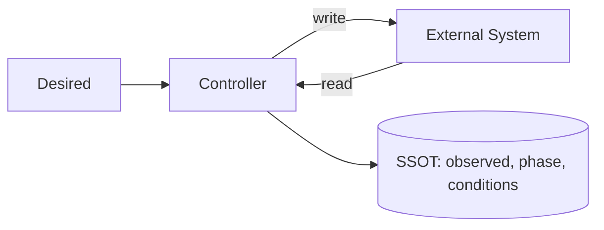

O ponto fundamental é que a decisão sempre usa **dois estados lidos no mesmo ciclo**: o `desired` gravado e o `observed` lido agora do sistema externo. Não existe uma cadeia obrigatória de mensagens entre eles:

```text
             Desired (SSOT)
                │
                ▼
           ┌──────────┐
           │Controller│ ◄── lê a realidade (observed)
           └──────────┘
```

Como a observação é feita **dentro** do ciclo, ela nunca envelhece nem chega fora de ordem em relação à decisão.

# 5. Arquitetura de referência

A plataforma adota dois perfis arquiteturais de controle de recursos:

## 5.1 Perfil external-reconciled (reconciliação com sistema externo)

Utilizado quando o estado do recurso depende de um provedor ou sistema externo (ex.: Zitadel, nuvem, gateway). A API admite o `desired` e o Controller executa o loop de convergência e observação no provedor externo:

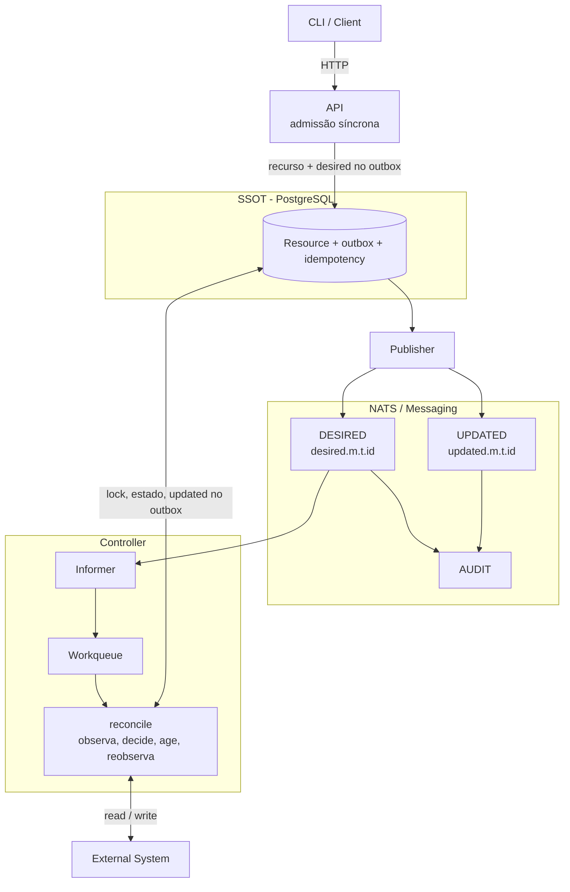

## 5.2 Perfil internal-state (estado interno ao SSOT)

Utilizado quando o SSOT é a autoridade absoluta do recurso (ex.: `ipm/role`, `ipm/group`, `bsm/account`). Não há sistema externo nem Controller: a API valida e grava o recurso no SSOT imediatamente como `Ready` numa única transação atômica, inserindo o evento de mutação no outbox. O Publisher entrega o `desired` ao NATS para consumo por projeções desacopladas de outras features:

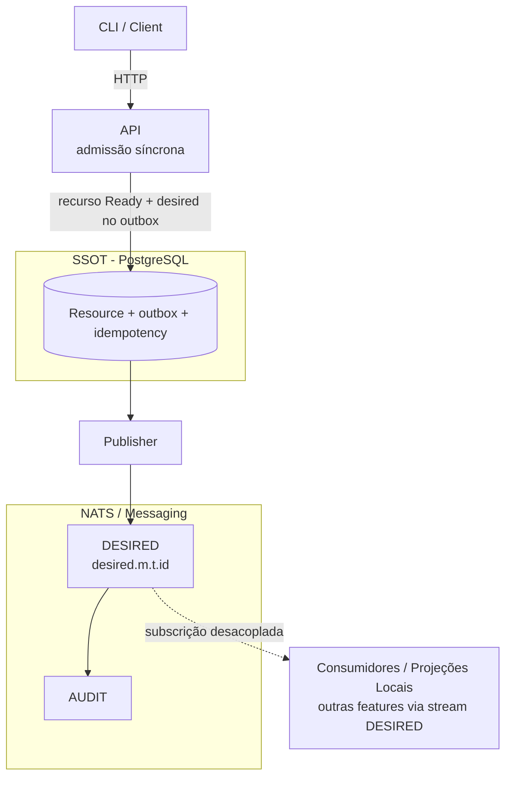

**Nota sobre os diagramas.** Neste documento, "a API publica `desired`" e "o Controller publica `updated`" significam que o **emissor** da mensagem é `api` ou `controller`, respectivamente. Na implementação, cada um grava a mensagem no outbox, na mesma transação do SSOT, e quem a publica no transporte é o Publisher (seção 6.6).

# 6. Componentes

# 6.1 API

A API é a porta de entrada do sistema: o componente que expõe a **API HTTP** do recurso (decisões 0020 e 0098). Ela **admite** as escritas de forma síncrona e atende as leituras.

Responsabilidades:

- autenticação;
- autorização;
- validação estrutural;
- geração de identificadores;
- criação de contexto de correlação;
- regras de negócio da admissão (unicidade, cota, vínculos, proteção contra exclusão, `resourceVersion`);
- gravação do recurso e do `desired` no outbox, numa só transação (seção 8);
- consulta do SSOT;
- exposição do estado atual.

A API não deve:

- executar reconciliação;
- chamar diretamente o sistema externo;
- implementar lógica de integração com o provider;
- chamar a API de outro tipo de recurso (usa projeções locais, seção 3.8);
- publicar diretamente no transporte (o outbox é entregue pelo Publisher).

Fluxo:

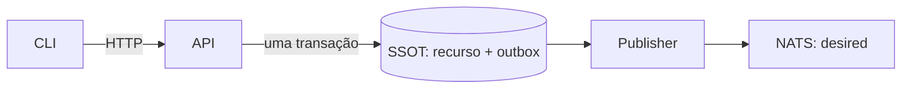

## 6.1.1 Interface HTTP

Cada tipo de recurso expõe a mesma interface, sob o prefixo do módulo e no plural do `resourceType` (`/v1/<módulo>/<tipos>`, por exemplo `/v1/ipm/organizations`; decisão 0030). As escritas são **síncronas na admissão**: a API valida, grava o recurso e o `desired` (no outbox) e só então responde, devolvendo o próprio `Resource` (decisão 0098). A **convergência** continua assíncrona: o `Resource` devolvido está na fase `Pending` (ou `Reconciling`, ou `Deleting`) e o cliente acompanha `phase` e `observedGeneration` lendo o recurso. As leituras vêm das views versionadas do SSOT (`POSTGRESQL.md`, decisão 0004). Cada tipo implementa o subconjunto aplicável da interface: a Account, por exemplo, não tem `PATCH` nem listagem (decisão 0014).

| Método e rota | Efeito | Resposta |
|---|---|---|
| `POST /v1/<módulo>/<tipos>` | admite a criação; a API atribui o `resourceId` (UUIDv7) e grava o recurso com geração 1 | `201` com o `Resource` |
| `GET /v1/<módulo>/<tipos>/{resourceId}` | leitura do recurso consolidado (`phase`, `conditions`, `resourceVersion`, `desiredGeneration`, `observedGeneration`) | `200` ou `404` |
| `GET /v1/<módulo>/<tipos>?limit=&cursor=` | lista paginada por cursor opaco, ordenada por `resourceId`; `limit` padrão 50, máximo 200 | `200` com `items` e `nextCursor` (ausente na última página) |
| `PATCH /v1/<módulo>/<tipos>/{resourceId}` | admite a alteração; o corpo traz `resourceVersion`; uma alteração efetiva incrementa a geração | `200` com o `Resource` |
| `DELETE /v1/<módulo>/<tipos>/{resourceId}?resourceVersion=` | admite a remoção (`lifecycle = absent`); o registro só é apagado quando a remoção converge | `202` com o `Resource` |

Não há recurso `Operation` nem rota `/operations` (decisão 0098): o resultado da admissão é a própria resposta, e o resultado da convergência é o `Resource`. Como o recurso é gravado antes da resposta, uma leitura logo depois de um `POST` já o encontra (não há `404` transitório após o aceite).

Regras:

- **Idempotência do pedido:** o cabeçalho opcional `Idempotency-Key` nas escritas é a chave do cliente. A API a guarda em `<tipo>_idempotency` (`requested_by`, `idempotency_key`, `request_digest`, `resource_id`), na mesma transação da admissão, sob trava consultiva por chave. Repetir a chave com o mesmo conteúdo devolve o **recurso atual**, sem gravar de novo; com outro conteúdo, a API responde `422 IdempotencyKeyReused`. A retenção do registro é de 24 h (`scripts/dev/retention`; `POSTGRESQL.md`).
- **Concorrência otimista:** `PATCH` e `DELETE` exigem o `resourceVersion` lido. Uma versão divergente é recusada na admissão com `409` (`Conflict`). A comparação e a gravação ocorrem sob `FOR UPDATE`, de modo que dois pedidos concorrentes não passam juntos.
- **Alteração sem efeito:** um `PATCH` que não muda o `desired` nem a reconciliação não grava nem publica nada e devolve o recurso atual.
- **Autorização:** a API autoriza o solicitante antes de gravar e filtra as leituras pelas Organizations autorizadas (`RESOURCE-CONTROL-SECURITY.md`, *Isolamento entre organizations*).
- **Privilégios por campo:** o contrato do recurso pode restringir campos a operadores. Na Organization, o dono altera só o `name`; `platformAccess` e `reconciliation` exigem a role de operador do tipo, `ipm.organization.admin` (`403` caso contrário; padrão de nomes na decisão 0028).
- **Causa da geração:** `requested_by` e `correlation_id` do pedido que produziu a geração vigente ficam no próprio recurso, e acompanham o `desired` e o `updated` dessa geração.
- **Erros:** `400` corpo inválido, `401` sem token válido, `403` sem permissão, `404` inexistente ou não autorizado, `409` conflito (`resourceVersion` divergente, nome em uso, recurso protegido contra exclusão, recurso em exclusão), `422` regra de negócio violada ou reuso da chave de idempotência, `429` limite de taxa e `503` com `Retry-After: 5` quando o banco está indisponível (o cliente repete; a `Idempotency-Key` torna a repetição segura). Quando o contrato do recurso define regras de elegibilidade ou de cota, `403` leva um código estável no corpo (`api-error`): por exemplo, `EmailNotVerified` (e-mail do solicitante não verificado) e `QuotaExceeded` (cota de criação do dono excedida).

## 6.1.2 Escritas anônimas

Por padrão, toda escrita exige solicitante autenticado. A exceção deve estar declarada no contrato do recurso e registrada em decisão. Hoje existe uma só: o auto-cadastro de usuário (`POST /v1/core/accounts`, decisão 0014).

Uma escrita anônima:

- usa `requestedBy = anonymous` (um valor fixo, que não identifica a pessoa);
- tem **limite de taxa por origem** no gateway e na API, com valores conservadores e configuráveis;
- tem **resposta uniforme**: o mesmo `202` e o mesmo corpo, exista ou não o recurso ou o dado informado (por exemplo, o e-mail). Não pode haver diferença observável de status, de corpo nem, de forma relevante, de tempo. Por isso o auto-cadastro responde `202` com `{resourceId}`, e não `201` com o `Resource`, que revelaria o estado;
- **não permite acompanhar o recurso**: o cliente anônimo não consulta o recurso, e por isso não há `--wait`. Isso impede que a consulta revele se o dado já existia (quando o dado já existia, a API reverte a transação, não grava nada e responde igual);
- aplica a validação estrita e os limites de tamanho do contrato (`SCHEMA.md`);
- não carrega segredo: a credencial é definida pelo próprio usuário no provedor de identidade, fora do loop.

# 6.2 Estado do recurso no SSOT

Não há um processo "Manager". O SSOT do recurso (`SSOT.md`) guarda, por recurso:

```text
Resource
Desired
Observed
Lifecycle
Conditions
Generation (desiredGeneration, observedGeneration)
Idempotência da admissão
```

Cada campo tem um único escritor (seção 3.5). O recurso é gravado pela API na admissão e atualizado pelo Controller a cada ciclo; ambos gravam a mensagem correspondente no outbox na mesma transação, e o Publisher a leva ao transporte.

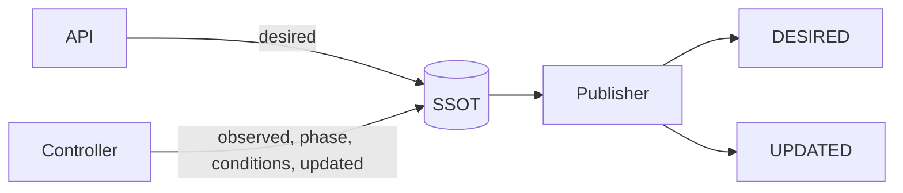

O SSOT não precisa conhecer detalhes do provider. Por exemplo, no caso de Organization, ele não implementa chamadas para o Zitadel: isso é do Controller.

# 6.3 Controller

O Controller é o processo que **reconcilia** os recursos de um tipo com o sistema externo. Ele reúne, num só processo, o que antes eram o Observer, o Reconciler e o Executor (decisão 0096), e segue o modelo dos controladores do Kubernetes (`AGENTS.md` §2.7): um **Informer**, uma **Workqueue** e um **ciclo de reconciliação**.

Responsabilidades:

- consumir o Stream `DESIRED` (Informer) e enfileirar o `resourceId` de cada recurso que mudou;
- manter as projeções locais de que depende (seção 3.8);
- reconciliar cada recurso na Workqueue (seção 3.3): observar, decidir, agir, reobservar e gravar;
- calcular `phase`, `conditions` e `observedGeneration` (seções 36 a 38);
- manter `failure_count` e suspender a reconciliação no limite de falhas (seção 23);
- reavaliar periodicamente os recursos da sua partição, independentemente de eventos (seção 25);
- anunciar o resultado no `updated`, via outbox.

O Controller **não** serve a API HTTP nem publica direto no transporte, e só acessa o sistema externo pelos seus `drivers/`.

Fluxo:

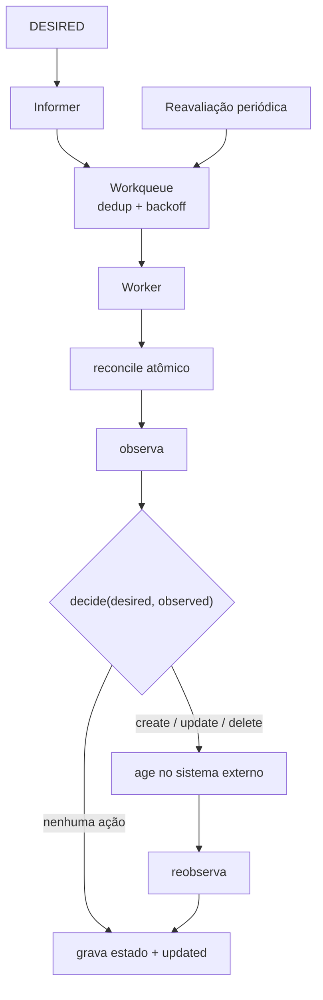

## 6.3.1 Workqueue

A Workqueue é a fila de `resourceId` a reconciliar. Segue a do `client-go` do Kubernetes:

- **deduplicação:** se a chave já está na fila ou em processamento, uma nova chegada a marca como pendente (`dirty`) para **um único** reprocessamento posterior, sem duplicar;
- **uma chave por vez:** a mesma chave nunca é processada por dois workers ao mesmo tempo (*single-flight* por recurso);
- **backoff exponencial com jitter** para o retry de falha transitória (padrão: 0,5 s até 60 s, jitter de 20 %), reiniciado (`forget`) quando o ciclo termina sem pedir retry;
- **paralelismo entre recursos:** `workers` simultâneos (padrão 2); a vazão total é limitada pelo provider.

## 6.3.2 Decisão

`decide(desired, observed)` é pura (seção 3.3). Ela devolve `Decision(operation, reason, fields)`, ou `None` quando não há o que fazer. Regras:

- com `observed.presence = unknown`, devolve `None` (seção 10.1);
- `desired` presente e `observed` ausente → `create` (`reason = resource_absent`);
- `desired` presente e divergente em campo gerenciado → `update` (`reason = drift`), com os nomes dos campos divergentes em `fields`;
- `desired` ausente e `observed` presente → `delete` (`reason = lifecycle_absent`);
- convergido → `None` (`noop`).

# 6.6 Publicação do outbox (Publisher)

A publicação das mensagens que a API e o Controller registraram no outbox do SSOT (`SSOT.md`, `POSTGRESQL.md`) é o papel do **Publisher** (decisão 0019). Ele existe porque quem decide grava o recurso e a mensagem a publicar na mesma transação (seção 8), e alguém precisa levar o outbox ao transporte.

## 6.6.1 O que é o outbox

O **outbox** (padrão *transactional outbox*) é uma tabela do SSOT que funciona como uma **caixa de saída**: cada linha é uma mensagem já pronta (`message_id`, `subject`, `payload`) que ainda precisa ir ao NATS. Ele resolve o problema da **escrita dupla**. Quando a API aplica um pedido (ou o Controller conclui um ciclo), precisa fazer duas coisas: gravar o novo estado do recurso no banco **e** avisar os outros componentes pelo NATS. Banco e NATS são sistemas diferentes e não participam da mesma transação, então qualquer ordem falha em algum caso:

- gravar e depois publicar: se o processo cair entre os dois passos, o banco mudou, mas ninguém foi avisado (o recurso fica parado para sempre);
- publicar e depois gravar: se a gravação falhar, o NATS anunciou um estado que não existe.

Com o outbox, quem decide faz **uma única transação no banco**: grava o recurso **e a linha do outbox**. Ou tudo é gravado, ou nada. Depois, e fora dessa transação, o Publisher lê as linhas pendentes, publica no NATS e só então marca `published_at`.

```text
API ou Controller (uma transação):  BEGIN
                                      atualiza o recurso        ← o estado
                                      grava a linha no outbox   ← "avisar que mudou"
                                    COMMIT                       (tudo ou nada)

Publisher (depois):                 lê as linhas com published_at nulo, em ordem
                                    publica no NATS e espera a confirmação
                                    marca published_at           (só depois da confirmação)
```

Consequências: uma mensagem nunca se perde (a linha continua pendente até a confirmação); nunca se anuncia um estado que não foi gravado; e, se o Publisher cair entre publicar e marcar, a mensagem é publicada de novo (entrega *pelo menos uma vez*), o que os consumidores toleram por serem idempotentes e porque o NATS deduplica pelo `messageId`. O atraso do outbox (idade da linha pendente mais antiga) é o sinal de que a publicação está presa.

## 6.6.2 Quem decide e quem entrega

Há duas perguntas diferentes sobre uma mensagem `desired` ou `updated`, e cada papel responde uma:

| Pergunta | Papel | Como aparece |
|---|---|---|
| **Quem decidiu** que essa mensagem deve existir (qual foi a mudança, qual a geração, qual o conteúdo)? | **API** (o `desired` da admissão) ou **Controller** (o `updated` e o `desired` suspenso) | É o `emitter` (`api` ou `controller`) do envelope |
| **Quem entregou** a mensagem ao transporte? | **Publisher** | Está no campo `publishedBy` do envelope (`<módulo>-<tipo>-publisher`) e, de forma independente, na identidade de mensageria que publica (permissões e log do NATS) |

O `emitter` identifica o autor da decisão, e não o processo que a transportou (`MESSAGING.md` §6.1). Por isso o Subject `<messageType>.<módulo>.<tipo>.<id>` não muda se o Publisher for trocado por outro mecanismo de entrega: os consumidores dependem do estado pretendido, e não de **como a mensagem chegou**. Cada papel responde só pelo que lhe cabe:

- a **API** e o **Controller** respondem pela decisão e pela gravação: validam, aplicam, gravam e registram no outbox. Não têm credencial para publicar no NATS;
- o **Publisher** responde pela entrega: ordem, confirmação, repetição e visibilidade do bloqueio. Não decide nem altera o conteúdo (apenas preenche `publishedAt` e `publishedBy` no instante da entrega) e só pode publicar os Subjects `desired.<m>.<t>.>` e `updated.<m>.<t>.>` do seu tipo.

O Publisher é um papel próprio da feature, com contêiner e *deployment* próprios (a imagem é a da feature, decisão 0063) e com papel de banco e identidade de mensageria próprios, para manter o menor privilégio:

- a **API** só **insere** no outbox e na idempotência, e lê as views; o **Controller** só **insere** no outbox e atualiza o recurso nos campos que lhe cabem (seção 3.5);
- o **Publisher** só **lê** o outbox e atualiza `published_at`; entrega a mensagem no Subject do tipo, em ordem por recurso, com uma instância ativa por outbox (trava consultiva de sessão), e só marca a publicação depois da confirmação do transporte;
- a **retenção** do outbox e da idempotência (linhas publicadas há mais de 24 h) é feita por um utilitário operacional com papel próprio de manutenção (`scripts/dev/retention`), e não por nenhum dos papéis acima.

O outbox é o contrato entre quem decide e o Publisher. O Publisher **não executa regra de negócio**.

# 7. O fluxo completo

O fluxo completo do perfil `external-reconciled` tem quatro fases. A primeira é síncrona (a admissão); as demais são assíncronas e ocorrem dentro do Controller:

1. **Admissão (Entrada):** o cliente submete a intenção à API via HTTP (`POST`, `PATCH`, `DELETE`). A API valida a estrutura e as regras de negócio, grava o recurso (com geração, causa e fase) e a mensagem `desired` no outbox, na mesma transação, e responde com o `Resource`. O Publisher a despacha com operação `changed`, expressando a intenção de existência (`lifecycle = present | absent`).
2. **Informer (Gatilho):** o Controller recebe o `desired` do Stream `DESIRED` e enfileira o `resourceId` na Workqueue (deduplicado; apenas a instância dona da partição do recurso o enfileira).
3. **Reconciliação (Observação, decisão e ação):** um worker reconcilia o recurso num único ciclo atômico: bloqueia a linha, **observa** o sistema externo com credencial de leitura (`presence: present | absent | unknown`), **decide** (`create`, `update`, `delete` ou nada), **age** se for o caso e **reobserva**.
4. **Consolidação (Convergência):** no mesmo ciclo e na mesma transação, o Controller compara a observação com o `desired`, confirma a geração se convergiu (`observedGeneration = desiredGeneration`), atualiza `phase` e `conditions` e registra o `updated` no outbox. Se não convergiu e a reconciliação segue ativa, o recurso volta à Workqueue com backoff.

Visualmente:

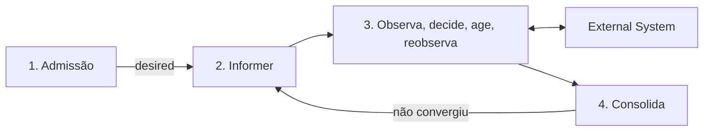

# 8. Fase 1 — Admissão

O cliente solicita uma alteração.

Exemplo:

```text
sk ipm organization create --name acme
```

Fluxo:

```mermaid
sequenceDiagram
    participant CLI
    participant API
    participant SSOT
    participant Publisher
    participant NATS

    CLI->>API: POST /v1/ipm/organizations
    API->>SSOT: BEGIN; regras; INSERT recurso; INSERT outbox (desired); COMMIT
    API-->>CLI: 201 Resource (phase=Pending)
    Publisher->>SSOT: lê outbox pendente
    Publisher->>NATS: desired.ipm.organization.<id>
    Publisher->>SSOT: marca published_at
```

Requisitos:

- a API aceita uma chave de idempotência (`Idempotency-Key`): a repetição do mesmo pedido não cria outro recurso nem outro `desired` (seção 6.1.1);
- atualizações devem informar a versão do recurso (`resourceVersion`, ver `MESSAGING.md`); uma versão desatualizada é recusada com `409`, e a atualização não sobrescreve silenciosamente outra concorrente;
- a API persiste o recurso e registra a publicação de `desired` **na mesma transação** (outbox, ver `SSOT.md` e `MESSAGING.md`), evitando o estado `persistido, mas não publicado`;
- as regras de unicidade e de cota são verificadas **na mesma transação**, sob trava consultiva por chave (por exemplo, por nome e por dono), de modo que pedidos concorrentes não as violem;
- se o banco estiver indisponível, a API responde `503` com `Retry-After`: nada foi gravado e o pedido pode ser repetido.

# 9. Desired

Na admissão, a API estabelece o estado desejado no SSOT.

Exemplo:

```json
{
  "resourceId": "organization-01",
  "desiredGeneration": 1,
  "desired": {
    "lifecycle": "present",
    "resourceName": "acme"
  }
}
```

Publicação:

```text
desired.ipm.organization.organization-01
```

O Desired é uma declaração.

Não significa que a Organization já existe.

```text
Desired = intenção
```

# 10. Observação

No início de cada ciclo, o Controller consulta o sistema externo, somente para leitura.

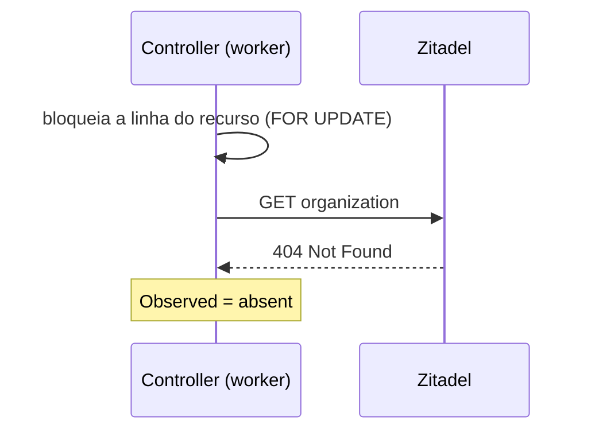

O resultado é:

```text
Observed = absent
```

## 10.1 Observação inconclusiva

Uma observação possui três resultados:

| Resultado | Significado |
|---|---|
| `present` | O recurso foi lido e existe. |
| `absent` | O provider confirmou, de forma inequívoca, que o recurso não existe. |
| `unknown` | A leitura falhou ou foi inconclusiva. |

Erro de leitura (timeout, 5xx, 401/403, limite de taxa) é `unknown`, nunca `absent`. Somente a confirmação inequívoca de ausência é `absent`.

Toda observação informa o resultado no campo `presence` e o momento em `observedAt`. O Controller:

- não age com base em `unknown`: `decide` devolve `None`;
- não decide convergência com base em `unknown`: registra o resultado e mantém a fase;
- como a observação é feita **dentro** do ciclo, não existe observação "mais antiga que o limite de validade": o que se compara é sempre uma leitura do próprio ciclo, e o `observedAt` registra o instante dela;
- depois de agir, **reobserva** no mesmo ciclo, e a convergência só é confirmada por essa reobservação (seção 16).

Os parâmetros do loop são do Controller e configuráveis por instância (`<FEATURE>_CONTROLLER_LOOP_*`); os valores de referência são:

| Parâmetro | Padrão | Significado |
|---|---|---|
| `reevaluation_interval_seconds` | 300 | Período da reavaliação periódica (seção 25), com jitter de `reevaluation_jitter` (0,2) |
| `workers` | 2 | Ciclos de reconciliação simultâneos (de recursos distintos) |
| `failure_limit` | 5 | Falhas de ação por geração antes de suspender a reconciliação (seção 23) |
| `progress_deadline_seconds` | 300 | Prazo para a geração convergir (decisão 0078) e para uma sequência de `unknown` (decisão 0090) |
| backoff da Workqueue | 0,5 s a 60 s, jitter 0,2 | Intervalo entre tentativas de um recurso que falhou ou não convergiu |

Eles substituem os antigos `observationInterval`, `observationValidity` e `actionDeadline` (`SCHEMA.md` §9.2), que pressupunham processos separados.

### Ação sem efeito e prazo de progresso (decisão 0078)

Uma ação que termina sem erro, mas cuja reobservação não converge, é uma **ação sem efeito** (por exemplo, quando o provedor aceita a escrita mas não reflete o campo). O recurso volta à Workqueue sob o backoff exponencial e, enquanto não converge, está sujeito ao prazo de progresso. Assim, uma ação que não muda nada não se repete sem freio.

O Controller mantém a condition `Progressing`, como a do Deployment do Kubernetes: `True` (`Reconciling`) desde a primeira observação da geração atual que não converge, `True` (`Converged`) quando converge, e `False` (`ProgressDeadlineExceeded`) quando o `progress_deadline_seconds` passa sem convergir. Nesse caso a fase vai para `Failed` e sai um aviso (`progress deadline exceeded`). O loop **não** é suspenso: segue tentando, no ritmo do backoff, e volta a `Ready` sozinho se a causa sumir.

### Observação que não chega a ser conclusiva (decisão 0090)

Quando o recurso permanece `unknown`, o prazo é o `progress_deadline_seconds`, contado desde a primeira `unknown` da sequência. Esgotado, `ObservationStale` fica `True` (`Timeout`) e um recurso com trabalho pendente (`phase != Ready`: `Pending`, `Reconciling` ou `Deleting`) vai para `Failed`, sem suspender o loop. Sem esse prazo, uma exclusão que o provedor nunca consegue ler ficaria em `Deleting` para sempre. Uma observação conclusiva encerra a sequência (`ObservationResumed`) e o recurso converge sozinho. Um recurso `Ready` que passa a `unknown` mantém a fase: a condition registra o problema, mas o recurso não é rebaixado por uma leitura que falhou.

# 11. Decisão

O Controller aplica `decide(desired, observed)` aos dois estados lidos no ciclo.

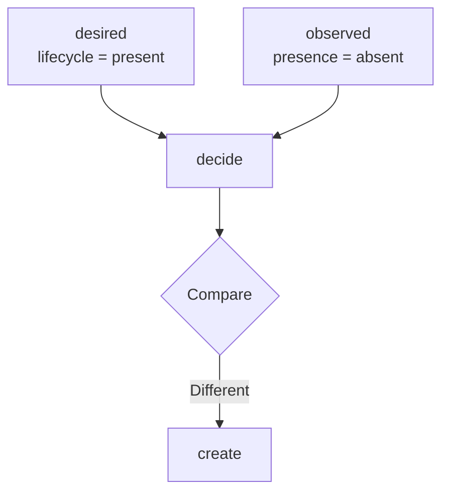

A decisão:

```text
Desired = present
Observed = absent

→ create
```

A decisão não é publicada: ela só existe dentro do ciclo, e é executada em seguida (seção 14). O que fica registrado é o seu efeito: `observed`, `phase`, `conditions` e a mensagem `updated`.

# 12. Gatilhos da reconciliação

O ciclo de reconciliação de um recurso é disparado ao enfileirar o seu `resourceId` na Workqueue. Os gatilhos são:

| Gatilho | Exemplo |
|---|---|
| `desired` mudou | A API admite uma nova geração. O Informer recebe o `desired` do Stream `DESIRED` e enfileira o recurso. |
| Mudança numa projeção | Uma dependência mudou (por exemplo, o último dependente de uma Organization saiu): a projeção reenfileira o recurso afetado (seção 22). |
| Reavaliação periódica | Detecta o **drift** causado por alteração externa e se recupera de mensagem perdida, restart ou inconsistência transitória (seção 25). |
| Retry / recovery | Nova tentativa, sob backoff, de um recurso cuja ação falhou ou que ainda não convergiu. |

O estado utilizado é o descrito em *Estado do Controller* (seção 3.8). Como a Workqueue deduplica, vários gatilhos próximos produzem um único ciclo.

# 13. Drift

Drift ocorre quando:

```text
Desired != Observed
```

Exemplo: um administrador renomeia a organização diretamente no Zitadel. O `desired` continua com o nome original; na próxima reavaliação periódica, o ciclo observa o nome diferente e decide `update`.

O Controller não precisa saber quem causou o drift. Ele apenas responde:

```text
Desired != Observed
```

O drift pode ter sido causado por:

- alteração manual;
- alteração por outro sistema;
- falha parcial;
- mudança externa;
- perda de estado;
- operação concorrente.

O mecanismo de correção permanece o mesmo. Quando o drift se repete continuamente, aplicam-se as proteções descritas em *Proteções de carga e estabilidade* (seção 53).

# 14. Ação

A ação é a escrita no sistema externo que `decide` pediu. Ela acontece **dentro** do ciclo, depois da observação e antes da reobservação.

Exemplo de decisão:

```text
Decision(operation="create", reason="resource_absent", fields=("lifecycle",))
```

A ação não é o Desired.

```text
Desired
   ↓
"o que deve existir"

Ação
   ↓
"o que precisa ser feito agora"
```

Não há mensagem `action`, `actionId` nem resultado `completed`/`failed` no transporte: a ação não é um comando entre processos, e sim um passo do ciclo. O resultado da ação é local ao ciclo: sucesso, ou falha com `reason` e `retryable`.

## 14.1 Idempotência da ação

A mesma decisão pode ser executada mais de uma vez (retry após timeout, reinício no meio do ciclo, reconciliação periódica). Por isso:

- **a decisão é recalculada a cada ciclo** a partir de uma observação nova, e não lembrada: se a ação anterior já teve efeito, a reobservação mostra o recurso convergido e `decide` devolve `None`. Se foi o recurso externo que sumiu depois de criado, a nova decisão de `create` é correta e é executada;
- **o ciclo é serializado por recurso** pelo bloqueio da linha (`FOR UPDATE`): dois workers, ou duas instâncias, não agem ao mesmo tempo sobre o mesmo recurso;
- **a ação deve ser idempotente contra o provedor** (seção 26): ter uma chave de correlação com o recurso externo, de modo que repetir um `create` não duplique o recurso;
- **uma ação baseada em geração obsoleta não existe:** o `desired` e a geração são lidos do SSOT, com a linha bloqueada, no início do ciclo. Se uma geração nova for admitida durante a ação, a API fica esperando o bloqueio, e o recurso é reenfileirado pelo `desired` novo.

# 15. Execução no sistema externo

A etapa de ação aplica a operação decidida no sistema externo, com credencial de escrita.

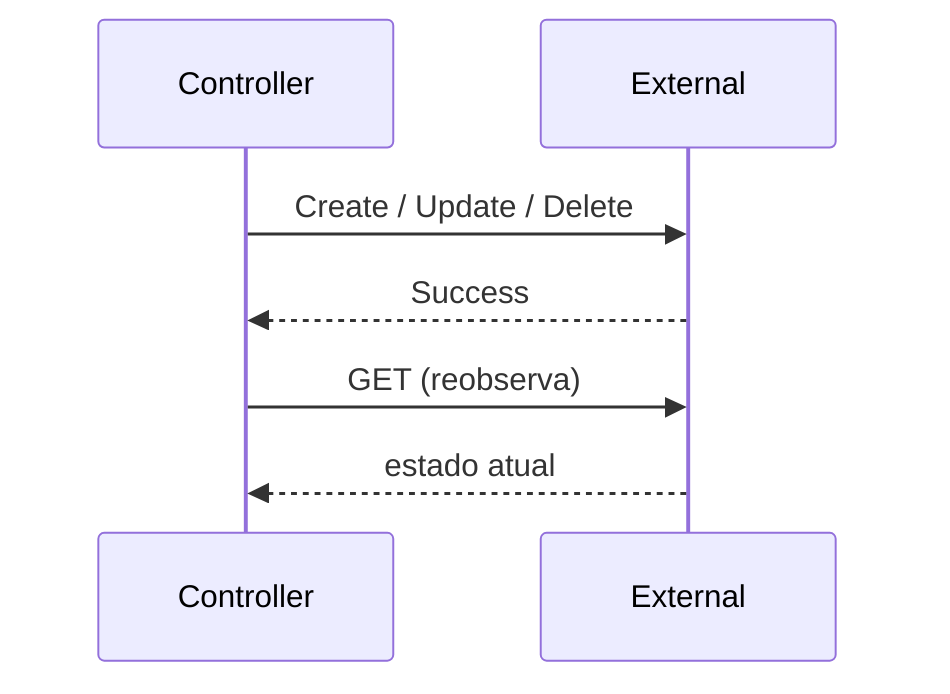

O código que escreve (os `drivers/` de escrita) não decide se a ação é necessária. Essa decisão pertence a `decide` (seção 6.3.2).

## 15.1 Falha da ação

Há dois pontos de falha no ciclo, com tratamentos diferentes:

| Onde | Comportamento |
|---|---|
| **Na ação** (a escrita no provedor, retryable ou permanente) | O ciclo **não é interrompido**: reobserva, incrementa `failure_count`, registra `Ready=False` (`ActionFailed`, com a causa) e grava o estado. O recurso volta à Workqueue com backoff (`add_rate_limited`) até o `failure_limit`, quando é suspenso (seção 23). Assim, toda falha de ação é contada e visível, e nenhuma é repetida sem freio. |
| **Na observação** (a leitura do provedor falha com erro do provedor) | A transação é desfeita e nenhum estado parcial é gravado. Se o erro é retryable (indisponibilidade, limite de taxa, timeout), o recurso volta à Workqueue com backoff; se é permanente, a fila esquece o recurso (`forget`) e quem o retoma é a reavaliação periódica. Quando a leitura é apenas inconclusiva, o resultado é `presence = unknown`, e não um erro (seção 10.1). |

Uma exceção inesperada do ciclo é registrada em log, a transação é desfeita e o recurso é reenfileirado com backoff.

# 16. Ação executada não significa convergência

Este princípio é obrigatório.

```text
ação executada com sucesso
        ≠
resource converged
```

Uma ação bem-sucedida significa:

> A operação solicitada foi aceita pelo sistema externo.

A convergência somente pode ser confirmada pela **reobservação** compatível com o `desired`. Por isso o ciclo sempre reobserva depois de agir, e a fase só vai a `Ready` se a leitura posterior ao `create`/`update`/`delete` mostrar o conteúdo esperado.

# 17. Reobservação

Após a ação, o ciclo lê o sistema externo novamente. Se o recurso existe, `presence=present`. Agora:

```text
Desired = present
Observed = present
```

# 18. Convergência

O ciclo compara novamente (`check_is_converged`):

Resultado:

```text
convergiu → observedGeneration = desiredGeneration, phase = Ready
```

O recurso convergiu.

## 18.1 Comparação entre Desired e Observed

A pergunta "Desired == Observed?" deve ter definição explícita para cada recurso:

- **campos gerenciados:** apenas os campos declarados em `desired` participam da comparação; campos não declarados não geram drift;
- **normalização:** os valores são normalizados antes da comparação (caixa, ordenação de listas, formatação), conforme o contrato do recurso;
- **defaults do provider:** valores preenchidos pelo provider e não declarados em `desired` não constituem drift;
- **resultado:** iguais → `noop`; diferentes → ação determinada pela diferença.

Uma comparação mal definida produz `update` infinito. A definição é declarada por anotação nos campos do contrato do recurso (`managed`, `normalization` e `providerDefault`; ver `SCHEMA.md`).

# 19. Atualização do SSOT

No fim do ciclo, o Controller grava o resultado no Resource, na mesma transação.

Exemplo:

```text
phase = Ready
desiredGeneration = 1
observedGeneration = 1
condition = Ready=True (observedGeneration = 1)
```

O Controller só confirma a geração (`observedGeneration`) quando a observação do ciclo converge (seção 36). Se nada mudou em relação ao que já estava gravado (fase, conditions, `observed`, geração, falhas), o ciclo não incrementa a `resourceVersion` nem registra `updated`: um ciclo periódico sem novidade não gera tráfego.

# 20. Fluxo completo da Organization

```mermaid
sequenceDiagram

    participant CLI
    participant API
    participant SSOT
    participant Publisher
    participant NATS
    participant Controller
    participant Zitadel

    CLI->>API: POST /v1/ipm/organizations
    API->>SSOT: valida; grava Resource (Pending) + desired no outbox
    API-->>CLI: 201 Resource

    Publisher->>SSOT: lê o outbox
    Publisher->>NATS: desired.ipm.organization.<id>

    NATS->>Controller: desired (Informer)
    Controller->>Controller: enfileira o resourceId

    Controller->>SSOT: BEGIN; FOR UPDATE
    Controller->>Zitadel: GET organization
    Zitadel-->>Controller: 404 (absent)
    Controller->>Controller: decide → create
    Controller->>Zitadel: POST organization
    Zitadel-->>Controller: 201 Created
    Controller->>Zitadel: GET organization (reobserva)
    Zitadel-->>Controller: 200 OK (present)
    Controller->>SSOT: grava Ready, observedGeneration=1 + updated no outbox; COMMIT

    Publisher->>NATS: updated.ipm.organization.<id>

    CLI->>API: GET /v1/ipm/organizations/<id>
    API-->>CLI: phase=Ready
```

# 21. Fluxo de atualização

Uma alteração do `desired` incrementa `desiredGeneration`, na admissão. O Controller reconcilia: observa o recurso, que ainda reflete a geração anterior, e decide `update`. Após a ação, a reobservação mostra o novo conteúdo, e a convergência é confirmada pela comparação de conteúdo (ver *Comparação entre Desired e Observed*).

**Toda alteração percorre o mesmo caminho** (decisão 0072), inclusive a de um campo da plataforma que o provedor não tem (`x-managed: false`): nova geração, fase `Reconciling`, `desired` no outbox. O Controller decide `update` se houver divergência em campo gerenciado, ou não faz nada se não houver. Nos dois casos, a geração é confirmada pela observação do ciclo (seção 36), e o `updated` é registrado. Não existe uma alteração que conclua sem passar pelo loop. Um controle da plataforma que precise aparecer no provedor vira campo gerenciado e é gravado como metadado (por exemplo, `deletionProtection`, decisão 0074).

No perfil `internal-state`, a alteração conclui na admissão: a nova geração já nasce confirmada (`observedGeneration = desiredGeneration`, `Ready`).

# 22. Fluxo de remoção

A remoção também é declarativa: o `desired` passa a `lifecycle = absent` (o `DELETE` responde `202`, porque a remoção ainda não terminou; equivale ao *finalizer* do Kubernetes). O Controller decide `delete` enquanto o `observed` indicar `present`, e converge quando a observação indicar `absent`.

A plataforma não precisa representar a exclusão como um comando imperativo no `desired`.

Após a convergência da remoção, o Controller **remove o registro do SSOT** e registra um `updated` com `removed=true`. O último `desired` (`lifecycle=absent`) permanece no transporte como tombstone até uma limpeza administrativa; o Controller ignora recurso com `lifecycle=absent` já convergido (`NATS.md` e `RESOURCE-CONTROL-SECURITY.md`). No perfil `internal-state`, o `DELETE` apaga a linha na própria admissão e publica o tombstone (`desired` com `lifecycle=absent`), que os consumidores das projeções esperam.

**Recursos dependentes (decisão 0100).** A remoção de um recurso com dependentes ativos é **bloqueada**, e não reordenada: o Controller não executa o `delete` enquanto a `DependentsProjection` mostrar dependentes ativos, mantém a fase `Deleting` e registra a condition `DeletionBlockedByDependents` (`DependentsRemaining`). Quando o último dependente sai (o `desired` dele passa a `absent`), a projeção reenfileira o recurso e a remoção prossegue. A ordem de remoção entre dependentes, quando houver mais de um nível, é regra do domínio de cada tipo.

# 23. Fluxo de falha

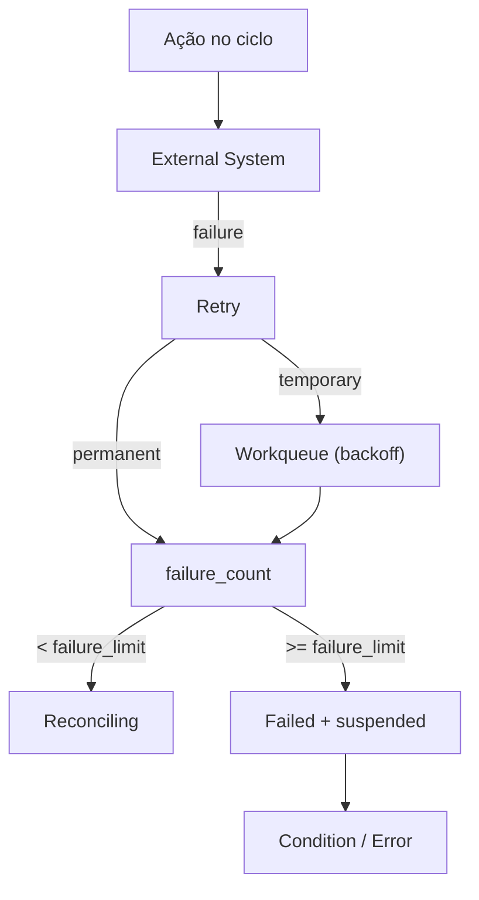

Uma falha de execução não deve destruir o Desired. O Desired permanece como fonte da intenção, o que permite retry e recuperação.

Retry, backoff, limite de tentativas e quarentena de mensagens do transporte seguem `NATS.md`. No nível do recurso:

- falha transitória mantém o recurso em `Reconciling`, com `Ready=False` (`ActionFailed`). O backoff entre tentativas é o da Workqueue (seção 6.3.1);
- o Controller, dono do estado reconciliado, conta as falhas **por geração** em `failure_count`. Ao atingir o `failure_limit`, marca o recurso como `Failed`, registra a causa em `conditions` (`Ready=False`, `FailureLimitReached`) e passa `reconciliation` a `suspended` no SSOT;
- ao suspender, o Controller registra também, no outbox e na mesma transação, o `desired` com a reconciliação **suspensa** (campo `reconciliation` do `desired`, ver `SCHEMA.md`; `emitter: controller`), para que os demais consumidores vejam a suspensão. O ciclo não reconcilia um recurso `suspended`, o que impede o ciclo contínuo contra o provider; a reavaliação periódica também só enfileira recursos `active`;
- a suspensão termina por **nova geração** do `desired` (que zera `failure_count` e reativa a reconciliação) ou por intervenção explícita de um operador (`PATCH` com `reconciliation=active`, que exige a role de operador do tipo);
- o prazo de progresso esgotado (seção 10.1) também leva a `Failed`, mas **sem** suspender: o recurso segue tentando e volta a `Ready` sozinho ao convergir.

# 24. Falha após alteração externa

Este é um dos cenários mais importantes.

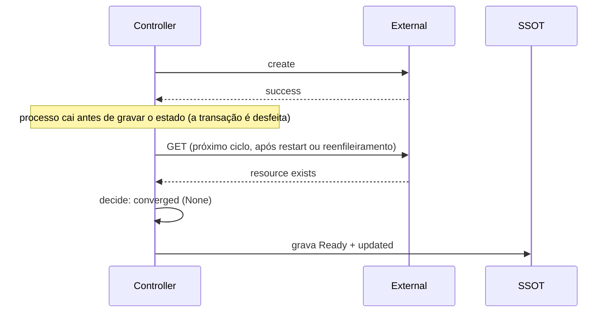

Como o estado do ciclo só é gravado ao final, uma queda entre a escrita externa e o commit deixa o SSOT como estava, e a ação externa já feita fica sem registro. O ciclo seguinte (por reenfileiramento, reentrega do `desired` ou reavaliação periódica) **observa de novo**, encontra o recurso e converge, sem repetir a escrita.

A arquitetura não depende de um registro "a ação foi feita" para recuperar o estado.

A realidade observada é a fonte de evidência.

# 25. Reconciliation periódica

Eventos não devem ser a única forma de disparar reconciliação.

O sistema deve possuir reconciliação periódica:

Isso permite recuperação após:

- perda de mensagem;
- indisponibilidade temporária;
- restart;
- falha do consumidor;
- falha externa;
- inconsistência transitória.

O período deve ser definido de acordo com o domínio.

Requisitos:

- o Controller reavalia periodicamente todos os recursos `reconciliation = active` da sua partição, enfileirando-os na Workqueue (padrão: a cada 300 s), para que `observed` não envelheça indefinidamente e o drift seja detectado;
- os disparos periódicos usam jitter, para evitar rajadas sincronizadas;
- um recurso `suspended` não é reavaliado até ser reativado (seção 23).

# 26. Reconciliation é idempotente

Uma mesma mensagem pode provocar múltiplas reconciliações: `desired` duplicado, reavaliação periódica ou ciclos de instâncias diferentes. O resultado deve ser o mesmo, sem efeito colateral indevido.

A etapa de ação também deve ser idempotente ou utilizar mecanismos que tornem a operação segura.

Para que a repetição de um `create` (por exemplo, após timeout) não duplique o recurso, a ação deve possuir uma chave de correlação com o recurso externo: um identificador externo determinístico, uma chave de idempotência aceita pelo provider ou uma consulta prévia quando o provider não garante unicidade.

# 26.1 Coordenação da reconciliação

Cada instância do Controller recebe todos os `desired` do tipo, mas, se todas reconciliassem todos os recursos, o provider receberia N vezes as leituras e as escritas.

Por isso, a reconciliação de um recurso é feita por **uma instância por vez**. O mecanismo padrão é a **partição determinística por `resourceId`**: cada instância reconcilia (enfileira, no Informer e na reavaliação periódica) apenas os recursos em que `hash(resourceId) mod número de réplicas` é igual ao índice estável da sua réplica (`partition.index` e `partition.count`).

- a indisponibilidade de uma instância deixa a sua partição sem reconciliação até que ela retorne. O `observedAt` envelhece e o recurso não progride; o alerta de idade da última reconciliação sinaliza o problema (seção 53);
- ao alterar o número de réplicas, a distribuição muda e alguns recursos podem ser reconciliados por duas instâncias por um período. Isso é inofensivo: o ciclo é serializado pelo bloqueio da linha no SSOT e a ação é idempotente;
- a partição reduz a carga sobre o provider, mas **não é a garantia de correção**: a garantia é o bloqueio por recurso (seção 34).

# 27. Idempotência em cada camada

Cada camada possui uma estratégia diferente. Não existe uma única técnica universal de idempotência.

| Camada | Estratégia |
|---|---|
| API | `Idempotency-Key` com `request_digest`, constraints do recurso, `resourceVersion` e outbox, tudo na mesma transação |
| Publisher | `messageId` como chave de deduplicação do transporte; ordem por recurso; marca `published_at` só depois da confirmação |
| Consumidores de estado (Informer e projeções) | Mensagens de estado: o `desired` mais recente (maior `desiredGeneration`) substitui os anteriores; reprocessar é inofensivo |
| Controller | Decisão recalculada a cada ciclo a partir de uma observação nova; comparação de conteúdo e geração; bloqueio por recurso |
| Ação no provider | Chave de correlação com o recurso externo e semântica própria do provider |

# 28. Mensageria

A comunicação utiliza o modelo semântico definido em `MESSAGING.md`.

Formato (decisão 0101):

```text
<messageType>.<module>.<resourceType>.<resourceId>
```

Exemplos:

```text
desired.ipm.organization.<id>

updated.ipm.organization.<id>
```

Só existem duas classes de mensagem, ambas de **estado**: `desired` (a intenção, emitida pela `api`; e o `desired` suspenso, emitido pelo `controller`) e `updated` (o fato consolidado, emitido pelo `controller`). O `operation` do envelope é sempre `changed`. O resultado da observação (`present`, `absent` ou `unknown`) fica no recurso, e não no endereço. Os Streams são `DESIRED`, `UPDATED` e `AUDIT` (que agrega os dois primeiros e não permite apagar), conforme `NATS.md`.

# 29. Quem publica e quem consome

O padrão define explicitamente:

| Mensagem | Decisor (`emitter`) | Consumidores principais |
|---|---|---|
| `desired` | `api` (admissão); `controller` (suspensão) | Controller do tipo (Informer), projeções de outros tipos (decisão 0100), auditoria |
| `updated` | `controller` | Console, auditoria, métricas, consumidores |

O Publisher entrega as duas, mas não é o decisor (seção 6.6.2). O consumidor não deve ser codificado no subject. No perfil `internal-state`, só existe o `desired`.

# 30. Matriz de responsabilidades

| Responsabilidade | API | Controller | Publisher |
|---|---:|---:|---:|
| AuthN / AuthZ | ✓ | | |
| Schema validation | ✓ | | |
| Business validation (admissão) | ✓ | | |
| SSOT: `desired`, geração, causa | ✓ | | |
| SSOT: `observed`, `phase`, `conditions`, `observedGeneration` | | ✓ | |
| Observe external | | ✓ (leitura) | |
| Compare Desired/Observed | | ✓ | |
| Decide / Execute Action | | ✓ (escrita) | |
| Lifecycle e Conditions | | ✓ | |
| Registrar mensagem no outbox | ✓ | ✓ | |
| Entregar o outbox ao transporte | | | ✓ |
| Provider credentials | | Read + Write | |

# 31. Separação de privilégios

A arquitetura permite aplicar princípio de menor privilégio. Com a unificação do Observer, do Reconciler e do Executor num só processo (decisão 0096), a credencial de escrita no provedor pertence ao Controller, e **só** a ele:

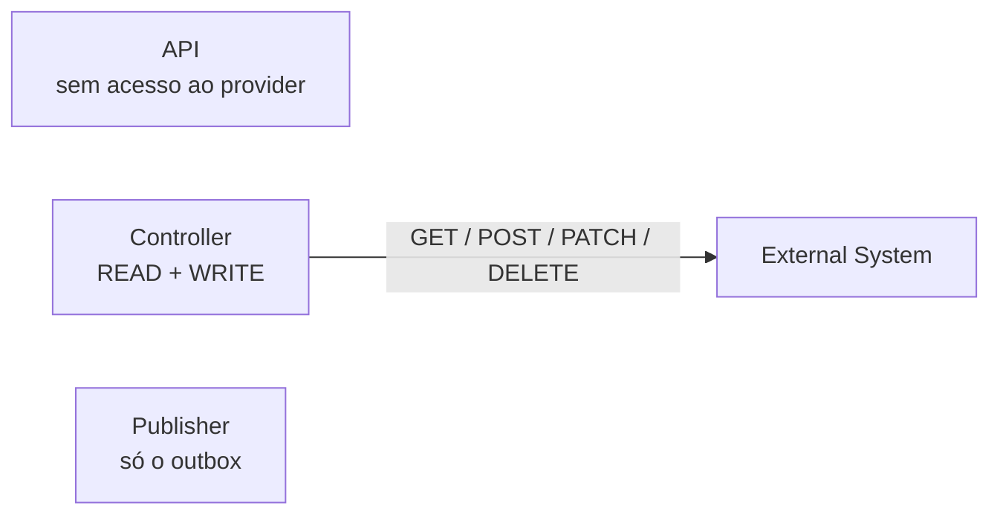

Credenciais do provedor não devem estar disponíveis para:

```text
API
Publisher
```

A separação entre leitura e escrita deixa de ser física e passa a ser **de código**: a observação usa `drivers/` somente de leitura, e a escrita fica nos `drivers/` de ação; `decide` é pura e não tem credencial alguma. Onde o provedor permite, a conta do Controller recebe apenas os papéis estritamente necessários (por exemplo, no Zitadel, o mínimo para ler e escrever as organizações do tipo).

Cada serviço (módulo, tipo de recurso e papel) deve possuir identidade própria no barramento, com permissões restritas ao seu papel e ao seu tipo de recurso. Os requisitos completos estão em `RESOURCE-CONTROL-SECURITY.md`.

# 32. Separação de falhas

Cada componente possui um domínio de falha diferente:

| Componente | Falha |
|---|---|
| API | Indisponibilidade de entrada de pedidos; banco fora do ar: `503` com `Retry-After`, sem gravar nada |
| Publisher | Mensagens ficam no outbox; o atraso do outbox sinaliza o problema; nada se perde |
| Controller | Falha de leitura do provider: `observed` fica `unknown` e o ciclo não age. Falha de escrita: `failure_count`, backoff e eventual suspensão. Indisponível: nenhum recurso converge, mas a admissão continua |

O objetivo é permitir que uma falha em um componente não exija indisponibilidade de toda a plataforma.

# 33. Escalabilidade

Cada serviço escala conforme o seu papel. Nem toda réplica adicional aumenta a vazão:

| Serviço | Réplicas servem para | Como a carga é dividida |
|---|---|---|
| API | Vazão e disponibilidade | Réplicas sem estado atrás do gateway; o SSOT garante a idempotência e a serialização por recurso; o limite de taxa do cadastro anônimo é em memória, por instância (o primeiro nível é o do gateway) |
| Publisher | Disponibilidade | Uma instância ativa por outbox (trava consultiva de sessão); as demais aguardam a trava |
| Controller | Vazão de reconciliação e disponibilidade | Partição por `resourceId` entre réplicas (seção 26.1) e `workers` por réplica; a vazão total é limitada pelo provider |

# 34. Concorrência

A unidade natural de concorrência é o recurso: a reconciliação de recursos distintos é independente.

Quando houver necessidade de serialização, ela deve ser definida explicitamente por `resourceId` ou `orderingKey`. Não assumir ordenação global.

Para cada `resourceId`, apenas um ciclo de reconciliação deve estar em execução por vez (*single-flight*). A serialização tem duas camadas:

- **na instância**, a Workqueue nunca entrega a mesma chave a dois workers;
- **entre instâncias e entre API e Controller**, o bloqueio da linha do recurso no SSOT (`SELECT ... FOR UPDATE`) serializa o ciclo e a admissão. Uma admissão que chega durante um ciclo espera o `COMMIT` e depois grava a geração nova; o ciclo seguinte reconcilia essa geração.

A ação permanece idempotente (seção 26), pois um processo pode cair depois de escrever no provedor e antes do commit.

# 35. DesiredGeneration

A geração identifica uma versão lógica do estado desejado.

Exemplo:

```text
generation 1
    name = ACME

generation 2
    name = ACME Corp

generation 3
    name = ACME Corporation
```

A API incrementa a geração apenas quando o `desired` muda de fato. O Controller trabalha sempre sobre a geração lida do SSOT, com a linha bloqueada, e nunca aplica uma decisão baseada em geração antiga quando uma mais recente já foi admitida.

# 36. ObservedGeneration

O modelo é o do Kubernetes (`metadata.generation` e `status.observedGeneration`; decisões 0071 e 0072). `observedGeneration` é a **última geração cuja convergência o Controller confirmou**. "Terminou" significa `observedGeneration == desiredGeneration` com `phase = Ready`.

O sistema externo não conhece a geração do `desired`. Por isso, a confirmação depende de duas condições, conferidas pelo Controller no mesmo ciclo:

1. **conteúdo:** a comparação entre `desired` e `observed` converge (ver *Comparação entre Desired e Observed*);
2. **tempo causal:** a observação foi feita **depois** da geração. No ciclo, isso é garantido pela construção: o `desired` e a geração são lidos com a linha bloqueada, e a observação (ou a reobservação, depois de uma ação) vem depois dessa leitura. Uma geração admitida durante o ciclo não é atribuída a ele, porque a admissão espera o bloqueio.

Uma leitura anterior à geração não a confirma, mesmo com o conteúdo igual. É o que acontece numa alteração só em campo da plataforma (`x-managed: false`), que o provedor não tem: `decide` não encontra o que fazer (noop), e quem conclui é a observação do ciclo da nova geração.

Regras:

- `observedGeneration` só cresce e nunca passa de `desiredGeneration` (restrição no banco);
- o Controller grava o par na mesma unidade atômica do estado e o publica no `updated` (`desiredGeneration` e `observedGeneration`), para que Console, CLI e outros consumidores saibam qual geração terminou;
- a API devolve `observedGeneration` no `Resource`, e o cliente conclui que a sua alteração terminou quando `observedGeneration >= ` à geração devolvida na admissão e `phase = Ready`;
- no perfil `internal-state`, a admissão já grava `observedGeneration = desiredGeneration`.

A geração também serve para:

- descartar trabalho baseado em geração obsoleta;
- identificar a que geração uma condition se refere.

Quando o provider permite gravar a geração no próprio recurso externo (por exemplo, como metadado gravado pela ação), ela pode ser lida na observação como evidência adicional:

```text
Desired:
generation = 5

Recurso externo (metadado gravado pela ação):
generation = 4
```

Isso indica que o recurso externo ainda não reflete a geração 5.

# 37. Lifecycle

O lifecycle do Resource Control Loop é definido no recurso, não na mensageria. A fase consolidada é o campo `phase`; ela não se confunde com `lifecycle` em `desired` (intenção de existência: `present` ou `absent`) nem com `presence` em `observed` (`SCHEMA.md`).

Exemplo:

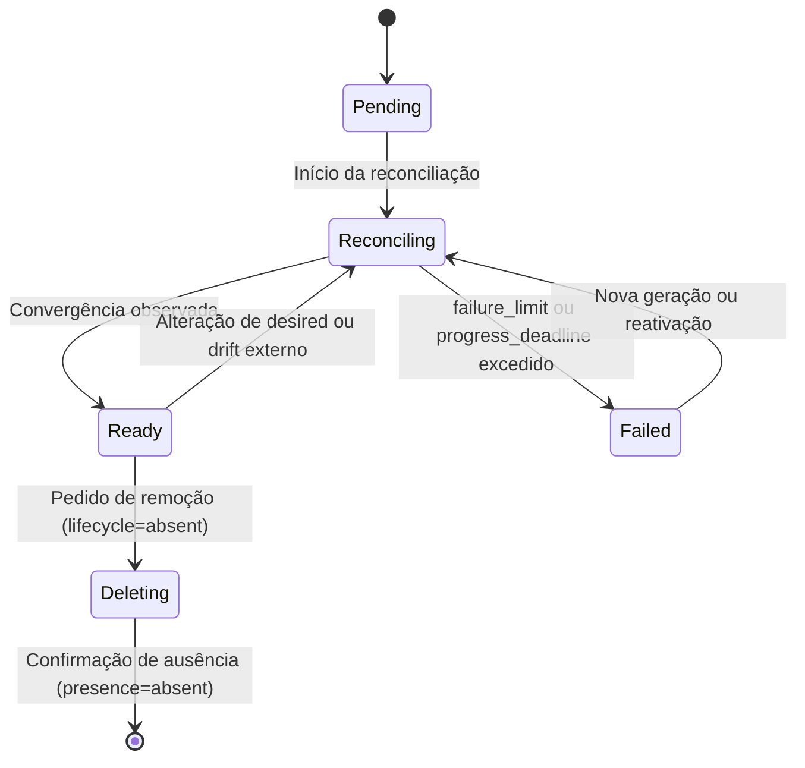

No perfil `internal-state`, o recurso nasce e permanece `Ready`.

## 37.1 Fases consolidadas do recurso (`phase`)

| Fase (`phase`) | Significado | Como entra | Como sai |
|---|---|---|---|
| **`Pending`** | Recurso registrado no SSOT, aguardando o primeiro ciclo do Controller. | Gravação inicial do recurso pela API ao admitir uma criação. | Transiciona para `Reconciling` no primeiro ciclo que encontra trabalho a fazer. |
| **`Reconciling`** | O recurso está ativamente convergindo para o estado desejado (agindo, aguardando nova leitura ou em backoff). Um recurso pode permanecer em `Reconciling` por múltiplos ciclos normais. | Entrada a partir de `Pending`, admissão de nova geração (`desiredGeneration`), ou detecção de drift pela reavaliação. | Transiciona para `Ready` quando a observação do ciclo converge; ou para `Failed` se esgotar o limite de falhas ou o prazo de progresso. |
| **`Ready`** | O estado desejado foi plenamente alcançado e confirmado pelo sistema externo (`observedGeneration == desiredGeneration`). | Quando a observação do ciclo confirma que todos os campos gerenciados convergiram. | Volta para `Reconciling` se o `desired` mudar ou se a reavaliação detectar drift externo; transiciona para `Deleting` se a remoção for admitida. |
| **`Failed`** | O loop esgotou as tentativas automáticas (e a reconciliação foi suspensa para evitar sobrecarga ou laço infinito contra o provedor), ou o prazo de progresso/observação expirou. | Quando `failure_count` atinge o `failure_limit`, ou quando o `progress_deadline` expira sem convergência (decisões 0078 e 0090). | Sai para `Reconciling` quando uma nova geração do `desired` é admitida (que zera as falhas e reativa a reconciliação) ou por reativação explícita; no caso de prazo esgotado sem suspensão, volta a `Ready` sozinho ao convergir. |
| **`Deleting`** | O recurso teve sua remoção declarada (`lifecycle = absent`) e aguarda a exclusão no sistema externo pelo Controller. | Remoção admitida pela API (com `deletionProtection = false`). | O registro é **fisicamente removido** do SSOT assim que o ciclo confirma `presence = absent` (invariante 8 do SSOT: remoção física só após a convergência). Enquanto houver dependentes ativos, permanece em `Deleting` com `DeletionBlockedByDependents`. |

## 37.2 Diferenciação entre os conceitos de Estado

Para evitar ambiguidade conceitual, a plataforma distingue explicitamente os papéis de cada campo de estado:

| Conceito | Campo | Onde reside | Valores possíveis | Papel no controle |
|---|---|---|---|---|
| **Fase consolidada** | `phase` | `Resource` (SSOT) | `Pending`, `Reconciling`, `Ready`, `Failed`, `Deleting` | Visão oficial do ciclo de vida do recurso na plataforma. |
| **Intenção de existência** | `lifecycle` | `desired` (SSOT e NATS) | `present`, `absent` | Declara se o recurso deve existir ou ser destruído. |
| **Controle de reconciliação** | `reconciliation` | `desired` (SSOT e NATS) | `active`, `suspended` | Habilita ou suspende o ciclo de reconciliação do Controller. |
| **Proteção contra exclusão** | `deletionProtection` | `desired` (SSOT e NATS) | `true`, `false` | Impede ou permite pedidos de remoção (`delete`). |
| **Presença real** | `presence` | `observed` (SSOT) | `present`, `absent`, `unknown` | O que foi constatado no provedor externo (`unknown` nunca é tratado como ausente). |
| **Geração confirmada** | `observedGeneration` | `Resource` (SSOT) e `updated` | inteiro, `<= desiredGeneration` | Última geração cuja convergência foi confirmada. |

# 38. Conditions

Conditions representam fatos consolidados sobre o recurso ao longo do tempo, seguindo o padrão estabelecido pelo Kubernetes (`type`, `status`, `reason`, `message`, `observedGeneration`, `lastTransitionAt`).

São calculadas e persistidas atomicamente no SSOT pelo **Controller** a cada ciclo. Em `internal-state` não há conditions de reconciliação: o recurso nasce `Ready`.

Exemplo:

```json
{
  "type": "Ready",
  "status": "True",
  "reason": "Reconciled",
  "message": "Organization exists in Zitadel",
  "observedGeneration": 1,
  "lastTransitionAt": "2026-10-04T00:00:00Z"
}
```

`lastTransitionAt` só muda quando o `status` muda.

## 38.1 Tipos oficiais de Condition

Os contratos da plataforma definem o vocabulário padronizado de conditions:

| Condition (`type`) | Status (`status`) | Motivo típico (`reason`) | Significado |
|---|---|---|---|
| **`Ready`** | `True` | `Reconciled` | O recurso convergiu completamente e está pronto para uso. |
| | `False` | `Reconciling` | O recurso está em processo de convergência. |
| | `False` | `ActionFailed` | A última ação falhou; o ciclo tenta de novo sob backoff (`message` traz a causa). |
| | `False` | `FailureLimitReached` | O `failure_limit` foi atingido; a reconciliação foi suspensa. |
| | `False` | `Failed` | Prazo de progresso ou de observação esgotado na geração vigente. |
| **`Progressing`**<br/>*(decisão 0078)* | `True` | `Reconciling` | Há trabalho e progresso ativo sendo executado para a geração atual. |
| | `True` | `Converged` | O progresso da geração foi concluído com sucesso. |
| | `False` | `ProgressDeadlineExceeded` | O tempo decorrido desde o início da geração excedeu o `progress_deadline_seconds` (padrão de 5 minutos) sem convergir. |
| **`ObservationStale`**<br/>*(decisão 0090)* | `False` | `ObservationUnknown` | O recurso está `unknown` há menos que o prazo. |
| | `True` | `Timeout` | O provedor permaneceu em `unknown` por mais que o `progress_deadline_seconds`. |
| | `False` | `ObservationResumed` | Voltou uma observação conclusiva depois do `Timeout`. |
| **`DeletionBlockedByDependents`**<br/>*(decisão 0100)* | `True` | `DependentsRemaining` | A remoção está bloqueada porque há recursos dependentes ativos (Organization). |
| **`DriftLoop`** | `True` | `RepeatedDrift` | **Reservada, ainda não implementada** (lacuna declarada em `docs/platform/IMPLEMENTATION-STATUS.md`): correções de drift ocorrendo ciclicamente em curto intervalo. |

# 39. Sem Operation

Não há recurso `Operation` (decisão 0098). O seu papel é coberto por:

| Antes (`Operation`) | Agora |
|---|---|
| `accepted` / `rejected` | A resposta da própria admissão: `201`/`200`/`202` com o `Resource`, ou o erro (`409`, `422`, `403`...), conforme a seção 6.1.1 |
| `in_progress` | `phase = Reconciling` (ou `Deleting`) e `Progressing=True` |
| `completed` | `observedGeneration == desiredGeneration` e `phase = Ready`; para remoção, o recurso deixa de existir (`404`) |
| `failed` | `phase = Failed`, com a causa em `conditions` |
| `operationId` | O `correlationId` do pedido (guardado em `correlation_id` do recurso e propagado ao `desired` e ao `updated`) |
| Motivos de rejeição (`conflict`, `validation`, `not_found`, `protected`) | Códigos de erro estáveis da resposta (`Conflict`, `NameInUse`, `NotFound`, `DeletionProtected`...) |

O recurso carrega a **causa da geração vigente** (`requested_by` e `correlation_id`), o que basta para auditar quem pediu a alteração em curso. Não se guarda histórico de pedidos por recurso: o histórico é o Stream `AUDIT`.

# 40. CLI e experiência síncrona

A admissão já é síncrona, e a convergência é assíncrona; a CLI pode escondê-la do usuário.

Exemplo:

```text
sk ipm organization create --name acme --wait
```

Fluxo:

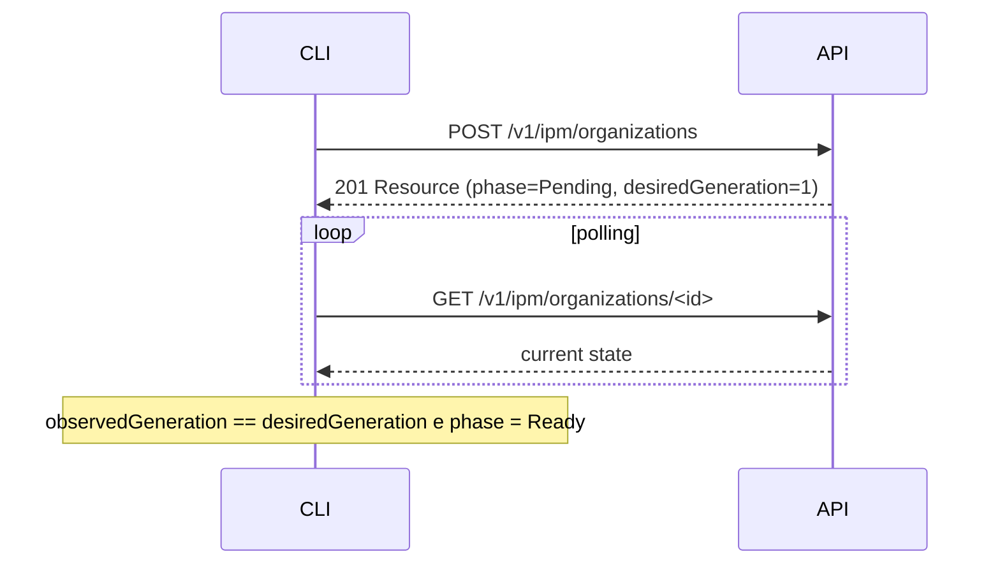

O `--wait` é uma conveniência do cliente: ele acompanha `observedGeneration` e `phase` no recurso (e a ausência, `404`, numa remoção). Não altera o modelo interno. Num tipo `internal-state`, o `--wait` termina de imediato.

# 41. Console, projeções e auditoria

O SSOT não deve conhecer detalhes da interface. O Console, a auditoria, as métricas, os alertas e outros consumidores (billing, analytics) consomem `updated` e `desired` e constroem suas próprias projeções, sem alterar a API nem o Controller.

A auditoria não deve ser necessária para a operação normal do control loop: ela é um consumidor (o Stream `AUDIT`).

# 42. Recuperação após restart

Os componentes devem poder reiniciar sem perder a capacidade de convergir.

O SSOT guarda o estado de cada recurso; as projeções e a Workqueue são descartáveis. Ao reiniciar, o Controller:

1. reconstrói as projeções relendo o Stream `DESIRED` (o `/health/ready` só passa depois da sincronização, seção 3.8);
2. enfileira, pela mensageria (reentrega do Informer) e pela reavaliação periódica, os recursos da sua partição;
3. retoma cada recurso a partir do SSOT e de uma observação nova.

Para evitar rajadas após o restart de muitos componentes, a reconciliação inicial deve usar jitter e limite de mensagens pendentes.

# 43. Recuperação após perda de mensagem

Caso uma mensagem seja perdida:

A retenção do último estado pela mensageria, o outbox (que reentrega o que não foi confirmado) e a reconciliação periódica permitem recuperação. Como o Controller trabalha sobre o `desired` gravado no SSOT, e não sobre o conteúdo da mensagem, uma mensagem perdida atrasa o gatilho, mas não corrompe a decisão.

# 44. Padrão de dependências

A direção de dependência é: API, Publisher e Controller dependem do SSOT; API, Publisher e Controller dependem da mensageria; o Controller depende do sistema externo.

Não deve existir:

```text
API → sistema externo
API → API de outro tipo (HTTP)
Publisher → regra de negócio
Controller → API de outro tipo (HTTP)
```

quando o objetivo for comunicação entre componentes do control loop. O que um tipo precisa de outro vem de uma projeção local do `DESIRED` (decisão 0100).

Escrevem no SSOT: a **API** (admissão: recurso, idempotência e outbox), o **Controller** (estado reconciliado e outbox) e o **Publisher** (somente `published_at`). A API também lê as views para atender as consultas. Nenhum papel de runtime administra o esquema do tipo (seção 48).

# 45. Resource Control Loop como padrão

O padrão se abstrai para qualquer recurso:

```text
Resource
    │
    ├── Desired
    │
    ├── Observed
    │
    ├── Lifecycle
    │
    ├── Conditions
    │
    └── Generations
```

O fluxo do padrão é o descrito em *Modelo geral*.

# 46. Aplicação à Organization

A Organization é um recurso do módulo `ipm` (`sk ipm organization`, decisão 0016), criado por um usuário registrado (a Account, do módulo `core`), que passa a ser o dono dela. Perfil `external-reconciled`.

Para Organization, o Controller lê e escreve em uma organização do Zitadel. A etapa de ação escreve a organização (decisão 0038), de forma idempotente: na criação, a organização no Zitadel, com o `resourceId` como ID; na alteração, renomeia e ativa ou desativa a organização (`platformAccess` `granted` ou `revoked`); na remoção, a remove. Com a organização ativa, ele também a **prepara para os usuários** (campo gerenciado `userAccess`, decisão 0081): o Project Grant do projeto de roles do `ipm` com exatamente o catálogo `grantableRole` do contrato, e os papéis das contas do `ipm/user` na organização e no Grant, acrescentando só o que falta. A observação lê o Grant e os papéis, e a ausência de algum deles é divergência (`Drift`). A remoção da organização leva o Grant e os papéis.

O Controller da Organization **não cria usuários nem autoriza o dono**: o dono (`ownerAccountId`, o usuário autenticado que a criou) já existe, pelo cadastro (seção seguinte), e já tem as roles de ação no projeto. Como o dono vive na organização `core` do Zitadel, e não na organização criada, o token não identifica a Organization: a API decide o pertencimento pelo `ownerAccountId` guardado na plataforma (decisão 0010).

Os recursos derivados em outros sistemas (namespace do OpenBao, do Kubernetes) não são escritos por este Controller: são recursos dos próprios módulos, que referenciam o `organizationId`. Assim, cada Controller escreve em um único sistema externo.

O Controller cria a organização no Zitadel informando o `resourceId` como ID da organização (`organization_id`), em vez de deixar o Zitadel gerá-lo. Assim, o ID da organização no Zitadel é o mesmo `resourceId` (`SCHEMA.md`, *Organization e identificadores derivados*), e uma criação repetida (retry, reentrega) não produz uma segunda organização. O Zitadel responde HTTP 409 a um ID ou nome já usado (verificado na v4.19.4); o Controller então lê a organização pelo ID: se existe com o nome esperado, é sucesso idempotente (o mesmo vale para o Project Grant, que também responde 409 quando repetido); se existe com outro nome, ou não existe, é falha permanente.

Antes de gravar, a API exige solicitante autenticado, com e-mail verificado e a role `ipm.organization.create`. A **cota** de Organizations por dono é aplicada pela API, na mesma transação da admissão, com trava consultiva por dono (decisão 0010): uma pré-checagem não bastaria para criações concorrentes. Nomes reservados e já existentes são rejeitados na admissão (`ReservedName`, `NameInUse`). A exclusão de uma Organization com dependentes ativos é bloqueada pelo Controller (seção 22).

Papéis (um projeto e uma imagem em `features/ipm/organization/`, decisões 0063 e 0096):

```text
ipm-organization-api
ipm-organization-publisher
ipm-organization-controller
```

O comando `sk ipm organization` pertence ao CLI da plataforma (`clients/cli`), que é cliente da API. Estado: os três componentes existem e o loop fecha em dev contra o Zitadel (`features/ipm/organization`, decisão 0038); a observação informa `platformAccess` pelo estado da organização (`active` ↔ `granted`) e `organizationState`.

## 46.1 Aplicação à Account

A Account é um recurso da plataforma, no módulo `core` (decisão 0014), criado pelo auto-cadastro (`sk account create`), uma escrita anônima (seção 6.1.2). Perfil `external-reconciled`. O Controller escreve em um único sistema externo, o Zitadel:

1. cria o usuário na organização `register`, com o `resourceId` como ID e **sem senha**: o `desired` da Account não tem senha, porque `desired` fica retido no SSOT e na mensageria (`SCHEMA.md`);
2. o Zitadel envia o e-mail "Verificar e-mail" na criação, e a pessoa confirma o e-mail e define a senha na página desse link (um e-mail só; o Controller não pede `password_reset`). A senha nunca passa por CLI, API, SSOT nem mensageria;
3. autoriza o usuário nos projetos de roles dos módulos, que pertencem à organização `core` e são delegados à `register` por um Project Grant cada (decisão 0032) (a autorização é criada no contexto da `register`, e só roles do Project Grant são aceitas), com o conjunto de roles de ação do usuário cadastrado (`ipm.organization.create`, `ipm.organization.get`, `ipm.organization.list`, `ipm.organization.update`, `ipm.organization.delete`, `core.account.get` e `core.account.delete`).

Quando o e-mail já está cadastrado no SSOT, a API reverte a transação sem criar nada; quando ele só existe no Zitadel, a criação do Controller falha de forma permanente (`Rejected`). O Zitadel responde `AlreadyExisting` (HTTP 400, id `COMMAND-7yiox1isql`, verificado na v4.19.4) a um ID ou e-mail já usado, e o Controller lê o usuário pelo ID: se existe com o e-mail esperado, é sucesso idempotente. Em todos os casos o solicitante anônimo recebe o mesmo `202`, sem revelar se o e-mail existia. O `desired` com `lifecycle = absent` não carrega dados pessoais (decisão 0014).

Componentes (projetos em `features/core/account/`, desde a decisão 0098): `core-account-api`, `core-account-publisher` e `core-account-controller`. O comando `sk account create` pertence ao CLI da plataforma.

## 46.2 Aplicação a um recurso `internal-state`

A Role (`ipm/role`) é só dado do SSOT: nenhum sistema externo a materializa. Os papéis são `ipm-role-api` e `ipm-role-publisher`. Na admissão, a API valida (nome único, vínculos, `deletionProtection`, `resourceVersion`), grava a Role já `Ready` com `observedGeneration` igual à geração e registra o `desired` no outbox. O `DELETE` apaga a linha e publica o tombstone (`lifecycle=absent`). Outros tipos consomem o `desired` da Role por projeção (por exemplo, `RoleUsageProjection`).

# 47. Aplicação a outros recursos

O mesmo padrão se aplica a Agent, Runner e Tool. Mudam apenas o sistema externo e os `drivers/` do Controller:

| Recurso | Sistema externo lido e alterado pelo Controller |
|---|---|
| Agent | Agent Runtime |
| Runner | Runner Runtime |
| Tool | External Tool Provider |

Cada recurso possui seu próprio `desired`, `observed`, `decide` e `drivers/`.

# 48. Componentes por papel

A plataforma implementa **cada papel de cada tipo de recurso como um componente com processo e contêiner próprios** (decisões 0015, 0063 e 0096). A feature (`<módulo>/<tipo>`) é **um projeto e uma imagem**: código, dependências, testes, `Dockerfile`, versão e configuração são da feature, e cada papel roda como contêiner à parte, escolhido pelo `command`. Fica em `features/<módulo>/<tipo>/`, com `src/<módulo>_<tipo>/<papel>/` e `src/<módulo>_<tipo>/common/`. Os papéis são `api`, `publisher` e, no perfil `external-reconciled`, `controller`.

Regras:

- **Papéis isolados pela credencial, não pela imagem.** Cada papel tem o seu processo, as suas variáveis e segredos, o seu papel de banco, a sua identidade no NATS e a sua conta no provedor; ter o código de um papel na imagem de outro não dá privilégio. Nenhum papel importa outro (um teste confere): só o `common/`, que reúne o que é igual em todos (configuração, mensageria, ciclo de vida, banco, token da conta de serviço, contratos gerados e logging). O código comum existe uma vez por feature; entre features continua duplicado, com fonte única onde houver (decisão 0046).
- **Artefatos neutros compartilhados.** O que é comum é independente de linguagem: contratos em JSON Schema, OpenAPI de cada API, SQL (tabelas, outbox, idempotência e views), a especificação das mensagens, as convenções de log, métrica e trace, e uma **suíte de testes e2e black-box** por tipo (`features/<módulo>/<tipo>/tests/e2e`, não é um componente), que valida o contrato pela rede e deve passar para qualquer implementação.
- **Estrutura interna.** Todo componente separa regra (`domain/`, pura e sem I/O), orquestração (`http/` ou `engine/`), adaptadores (`store/`, `drivers/`, `transport/`) e a entrada (o `main.py` de cada papel), com a dependência em um sentido só e o `domain` sem importar adaptadores (decisão 0017). No Controller, o acesso ao sistema externo é dividido em `provider/` (só a conexão autenticada) e `drivers/` (um por sub-recurso, com observação e ação; decisão 0073).
- **Comunicação.** Somente pela mensageria. Exceção: o SSOT, em que a API e o Controller escrevem (nos campos que lhes cabem), a API lê as views e o Publisher lê e marca o outbox (seção 44).
- **A API contém a sua autenticação e autorização.** Não há serviço de autenticação compartilhado no caminho de uma requisição.
- **O esquema do tipo é da feature.** O código das migrações fica em `migrations/` da feature e executa como etapa de implantação com o papel administrativo do banco, nunca com o papel de runtime (`SSOT.md`, seção 16).
- **Criação incremental.** Um componente é criado quando o seu papel é necessário. A ordem usual é `api` e `publisher`, depois `controller`, quando houver sistema externo a reconciliar. Um papel ainda inexistente não é uma lacuna do padrão, mas uma etapa do recurso.
- **Ambientes.** Em dev, Docker Compose espelha o que será implantado: um serviço por papel, todos com a imagem da feature. Em stg e prd, Kubernetes com CI/CD e GitOps, com um Deployment por papel e a versão da imagem da feature.

O padrão continua definindo **responsabilidades** (seção 3.7). Dois papéis só voltam ao mesmo processo por decisão registrada que mostre, com evidência, que a separação não se justifica (como a decisão 0096 fez com Observer, Reconciler e Executor).

# 49. Critérios que sustentam a separação

A separação entre `api`, `publisher` e `controller` é a regra porque há diferenças relevantes em:

```text
security boundary
scaling profile
failure domain
deployment lifecycle
resource consumption
external dependencies
credentials
availability requirements
```

Exemplo:

```text
API
    → sem credencial do provider; escreve só a admissão

Controller
    → credencial do provider (read + write)

Publisher
    → só o outbox e o transporte
```

Essa diferença já constitui uma forte justificativa para separação. Já a separação entre observar, decidir e agir **dentro** do Controller não tem esses critérios: eles escalam, falham e se autorizam juntos, e por isso são um só processo (seção 3.7).

# 50. Evitar fragmentação artificial

A separação é por **papel e por tipo de recurso**, e não por camada técnica. Não criar componentes que:

- não possuam fronteira clara de responsabilidade;
- existam apenas para dividir código que sempre muda, escala e falha junto;
- dependam de outro componente por chamada síncrona dentro do loop.

O objetivo é **separação de responsabilidades com contratos explícitos**, e não a maximização do número de projetos.

# 51. Anti-padrões

## 51.1 API executando provider

```text
API → Zitadel
```

Evitar.

## 51.2 Decisão com efeito colateral

```text
decide(desired, observed) → chama o provider
```

Evitar: `decide` é pura. A escrita é da etapa de ação.

## 51.3 Observação corrigindo drift

```text
observa → UPDATE
```

Evitar: a leitura não escreve. Só a etapa de ação escreve, depois que `decide` a pedir.

## 51.4 API ou Publisher executando operações externas

```text
API → POST provider
Publisher → POST provider
```

Evitar.

## 51.5 Controller dependendo de uma única mensagem

O Controller não deve depender da sequência:

```text
desired
  ↓
reconcile
```

Ele deve conseguir reconciliar a partir do estado atual do SSOT e de uma observação nova, mesmo se o gatilho for perdido (a reavaliação periódica o recupera).

## 51.6 Convergência baseada em ACK

```text
ACK = Ready
```

Incorreto.

## 51.7 Control loop baseado somente em eventos

Eventos aceleram a convergência, mas o sistema deve possuir mecanismos de recuperação. A reconciliação periódica é obrigatória.

## 51.8 Divergências em relação ao Kubernetes

A referência é o modelo do Kubernetes (`AGENTS.md` §2.7). A plataforma diverge em:

| Ponto | Kubernetes | Plataforma | Motivo |
|---|---|---|---|
| Fonte do gatilho | *watch* no etcd | Stream `DESIRED`, alimentado por *transactional outbox* | O SSOT é PostgreSQL, que não tem *watch*; o outbox garante que gravar e anunciar não divergem |
| Remoção | `DELETE` marca `deletionTimestamp` e o *finalizer* retém o objeto | `DELETE` responde `202`, o `desired` vai a `absent` e o registro só é apagado quando a remoção converge | Equivale ao *finalizer*, sem um campo adicional |
| Leitura do estado | O controlador lê do cache do Informer | O ciclo lê a linha do SSOT com `FOR UPDATE` | Serializa a admissão e a reconciliação por recurso sem *leader election*; a partição por `resourceId` reduz a carga |
| `status` | Sub-recurso separado | Mesma linha, em colunas com escritor distinto (seção 3.5) | Simplicidade; o escritor de cada campo é único |

# 52. Segurança do loop

Os requisitos de segurança do Resource Control Loop são definidos em [`RESOURCE-CONTROL-SECURITY.md`](RESOURCE-CONTROL-SECURITY.md). Este documento mantém apenas as invariantes que o padrão exige:

- cada serviço (módulo, tipo e papel) possui identidade própria e publica somente no seu próprio tipo de recurso; a API e o Controller não publicam no transporte (só gravam no outbox) e o Publisher só publica os Subjects `desired` e `updated` do seu tipo;
- a escrita no sistema externo é a operação mais privilegiada do loop: somente o Controller a executa, e só depois de `decide` pedi-la, sobre o `desired` e a geração lidos do SSOT com a linha bloqueada;
- `observed` inconclusivo (`unknown`) não autoriza ação;
- a identidade do solicitante (`requestedBy`) acompanha a geração de ponta a ponta (no recurso, no `desired` e no `updated`);
- segredos trafegam somente por referência;
- a credencial de escrita no provedor pertence exclusivamente ao Controller;
- nenhum serviço de runtime possui permissão de purge ou de administração do transporte.

# 53. Proteções de carga e estabilidade

O loop corrige continuamente a realidade. Sem limites, ele pode sobrecarregar o provider ou disputar indefinidamente com outro agente.

- **Limite de taxa e backpressure:** o Controller limita a concorrência (`workers`) e a taxa de chamadas ao provider, aplica backoff exponencial com jitter a cada recurso que falha ou não converge e respeita sinais de limite do provider (por exemplo, `Retry-After`).
- **Limite de falhas e prazo de progresso:** `failure_limit` suspende o recurso que falha repetidamente; `progress_deadline_seconds` torna visível (`Failed`) o recurso que não converge (seções 10.1 e 23).
- **Flapping:** quando o mesmo recurso diverge repetidamente após convergir, a condition `DriftLoop` (prevista, ainda não implementada; ver `IMPLEMENTATION-STATUS.md`) deve sinalizá-lo e o backoff crescente deve ser mantido até intervenção, em vez de corrigir indefinidamente. Enquanto não implementada, a proteção é o backoff e o `failure_limit`.
- **Restart em massa:** jitter na reconciliação inicial e periódica, e limite de mensagens pendentes por consumidor.
- **Observação envelhecida:** a condition `ObservationStale` e o alerta correspondente sinalizam recursos sem observação conclusiva dentro do prazo do domínio.
- **Métricas mínimas:** latência até a convergência, idade da última reconciliação por recurso, tamanho e idade da Workqueue, quantidade de recursos `Failed` e `suspended`, atraso do outbox e taxa de falha por provider (ver `NATS.md`, observabilidade).
- **Pontos únicos de falha:** o PostgreSQL e a mensageria são dependências críticas. Com a API indisponível, o loop continua para os recursos já admitidos, mas não aceita novos pedidos. Com o Controller indisponível, a admissão continua e os recursos ficam `Pending`/`Reconciling` até ele voltar. Com o PostgreSQL indisponível, a API responde `503` com `Retry-After` e o Controller não reconcilia.

# 54. Propriedades desejadas

Uma implementação madura do Resource Control Loop deve possuir:

```text
Declarative
Idempotent
Eventually Consistent
Recoverable
Observable
Auditable
Scalable
Least Privilege
Provider Independent
Transport Independent
```

# 55. Checklist de implementação

Antes de considerar um novo recurso conforme ao padrão, verificar:

### Resource

- [ ] Existe `resourceId` estável?
- [ ] Existe `desired`?
- [ ] Existe `observed` (perfil `external-reconciled`)?
- [ ] Existe `desiredGeneration`?
- [ ] Existe `observedGeneration`?
- [ ] Lifecycle (`phase`) está definido?
- [ ] Conditions estão definidas?
- [ ] O perfil (`internal-state` ou `external-reconciled`) está escolhido e justificado pela existência de um sistema externo?

### API

- [ ] Admite a escrita de forma síncrona, gravando o recurso e o `desired` (outbox) na mesma transação?
- [ ] Responde `201`/`200`/`202` com o `Resource`, sem Operation?
- [ ] Verifica `resourceVersion` sob `FOR UPDATE` e responde `409` quando diverge?
- [ ] Guarda a `Idempotency-Key` com `request_digest` na mesma transação e responde `422` ao reuso com outro conteúdo?
- [ ] Verifica unicidade, cota e vínculos na mesma transação, sob trava por chave?
- [ ] Grava `requested_by` e `correlation_id` no recurso?
- [ ] Responde `503` com `Retry-After` quando o banco está indisponível?
- [ ] Não executa o provider diretamente e não chama a API de outro tipo (usa projeções locais)?
- [ ] Só fica pronta (`/health/ready`) depois de sincronizar as projeções de que depende?
- [ ] Tem a sua autenticação e autorização?

### Controller

- [ ] Consome o `DESIRED` (Informer) e enfileira na Workqueue com deduplicação e backoff exponencial com jitter?
- [ ] Reconcilia em um ciclo atômico, com a linha bloqueada (`FOR UPDATE`) e o estado, o `updated` e as conditions na mesma transação?
- [ ] `decide(desired, observed)` é pura, e devolve `None` com `observed` `unknown`?
- [ ] A observação é somente leitura, e distingue `present`, `absent` e `unknown`?
- [ ] Reobserva depois de agir e só confirma a geração com a reobservação convergida?
- [ ] A ação é idempotente e tem chave de correlação com o recurso externo?
- [ ] Limita taxa e concorrência contra o provider?
- [ ] Conta as falhas por geração, marca `Failed` e suspende a reconciliação (`desired` suspenso no outbox) ao atingir o `failure_limit`?
- [ ] Mantém `Progressing` e `ObservationStale` e leva o recurso a `Failed` ao esgotar o prazo?
- [ ] Reavalia periodicamente, com jitter, os recursos `active` da sua partição?
- [ ] Reconcilia apenas os recursos da sua partição?
- [ ] Bloqueia a remoção enquanto houver dependentes ativos (`DeletionBlockedByDependents`) e a retoma quando saem?
- [ ] Apaga o registro e publica `updated` com `removed=true` só depois da ausência confirmada?
- [ ] A comparação entre `desired` e `observed` está definida para o recurso?
- [ ] Não decide o estado desejado?

### Componentes

- [ ] Cada papel roda como processo e contêiner próprios, sem importar outro papel (só o `common/` da feature)?
- [ ] O esquema do tipo (migrações, incluindo outbox e idempotência) é da feature, executado como etapa de implantação com papel administrativo?
- [ ] O Publisher é um papel próprio, com papel de banco e identidade de mensageria próprios?
- [ ] Existe retenção do outbox e da idempotência (`scripts/dev/retention`)?
- [ ] Os contratos (JSON Schema, OpenAPI, SQL, mensagens) são verificados pelos testes e2e black-box?
- [ ] A estrutura interna segue a decisão 0017 (`domain/` puro, orquestração, adaptadores, `main.py`) e o `domain/` não importa adaptador?

### Messaging

- [ ] Subject segue a gramática oficial (`<messageType>.<module>.<resourceType>.<resourceId>`)?
- [ ] `messageType` é `desired` ou `updated`, e o `emitter` é `api` ou `controller`?
- [ ] `operation` é `changed`?
- [ ] `messageId` é único?
- [ ] `correlationId` é utilizado quando necessário?
- [ ] Reentrega é suportada?
- [ ] Ordering é explicitamente definido quando necessário?

# 56. Fonte de verdade

Este documento define o **Resource Control Loop** como padrão arquitetural da plataforma.

`MESSAGING.md` define a semântica das mensagens.

`NATS.md` define a implementação da mensageria utilizando NATS e NATS JetStream.

`SCHEMA.md` define os contratos formais e a evolução dos schemas.

`RESOURCE-CONTROL-SECURITY.md` define os requisitos de segurança do padrão.

`FEATURE-BOOTSTRAP.md` define como criar uma feature de cada perfil.

As decisões `0096` (Controller), `0097` (`desired` puro), `0098` (API síncrona e fim da Operation), `0099` (fim do banco `platform`), `0100` (projeções do `DESIRED`) e `0101` (Subjects de 4 tokens, Streams e retenção) definem o modelo de componentes vigente; a `0015` é a origem do modelo por papel, no que não foi substituída por elas.

O contrato do Resource define:

```text
Resource
Desired
Observed
Lifecycle
Conditions
Generations
```

O Resource Control Loop define como esses conceitos participam de um processo contínuo de convergência.

**O sistema não é considerado concluído quando uma ação é executada. O sistema é considerado convergido quando o `Observed` demonstra que a realidade corresponde ao `Desired`, conforme as regras do recurso.**
