# Resource Control Security

> **Escopo:** requisitos de segurança do padrão Resource Control Loop.
>
> **Papel:** Fonte de Verdade da segurança específica do control loop.
>
> **Responsabilidade:** Definir ameaças, fronteiras de confiança, identidades de serviço, autorização de mensageria, segurança na reconciliação do Controller, confiabilidade da observação, credenciais de provedores externos, rastreabilidade e limites de abuso dos componentes do loop, de forma independente de linguagem, broker e provedor.

# 1. Introdução

O Resource Control Loop (`RESOURCE-CONTROL-LOOP.md`) organiza o ciclo de vida dos recursos da plataforma em dois padrões consolidados (decisões 0096, 0098, 0100 e 0101):
- **`internal-state`:** recursos gerenciados exclusivamente no estado interno da plataforma (`api` + `publisher`);
- **`external-reconciled`:** recursos cujo estado declarativo é reconciliado contra provedores externos (`api` + `publisher` + `controller`).

Essa arquitetura substitui o loop legado de sete papéis e estabelece fronteiras de segurança bem delimitadas entre admissão do cliente, persistência no SSOT, entrega assíncrona e convergência com provedores externos.

Este documento define como impor essas fronteiras com menor privilégio e segurança por padrão.

Ele não substitui, e não duplica, as regras de:

```text
RESOURCE-CONTROL-LOOP.md
→ o que o padrão é e como o fluxo funciona

RESOURCE-CONTROL-SECURITY.md
→ como o padrão se protege

SSOT.md e POSTGRESQL.md
→ isolamento, controle de concorrência e privilégios no banco de dados

NATS.md
→ TLS, mTLS, ACLs de Subjects, segredos e administração do broker

MESSAGING.md
→ segredos em mensagens, campos do envelope e semântica das mensagens

SCHEMA.md
→ classificação e tratamento de dados sensíveis nos contratos
```

# 2. Objetivo

- impedir que requisições ou mensagens forjadas causem escritas indevidas em sistemas externos;
- impedir que observações falsas ou inconclusivas causem ações destrutivas contra recursos reais;
- restringir o acesso a credenciais de provedores externos estritamente ao Controller de cada recurso;
- garantir que nenhuma escrita ocorra sem identificação clara de quem a solicitou (`requestedBy`);
- isolar módulos, tipos de recurso e organizações para impedir acesso lateral;
- limitar o impacto de falhas transitórias, loops de erro e abusos em massa.

# 3. Princípios

Seguem os princípios do `AGENTS.md` (§4): menor privilégio, segurança por padrão e segredos fora do código e das mensagens.

Específicos deste padrão:

- **O Controller é o guardião da credencial de escrita externa.** Somente o Controller do tipo possui credenciais para alterar recursos no provedor externo correspondente.
- **A API não acessa o provedor externo nem o barramento NATS.** A API realiza apenas admissão síncrona no SSOT e insere mensagens no outbox transacional.
- **O Publisher não conhece regras de negócio.** Ele possui permissão estrita para ler mensagens pendentes no outbox e publicá-las nos Subjects do respectivo recurso.
- **Observação é evidência factual, nunca suposição.** Leitura com erro, timeout ou resposta inconclusiva é tratada como `presence = unknown` e nunca autoriza ação destrutiva.
- **Negar por padrão.** Toda permissão de rede, banco, mensageria e provedor externo é explícita e mínima.

# 4. Modelo de ameaças

## 4.1 Ativos

| Ativo | Por que importa |
|---|---|
| **Credencial de escrita do provedor** | Permite criar, alterar e remover recursos reais na infraestrutura externa (ex: organizações e contas no Zitadel). |
| **Estado Desejado (`desired`)** | Define a intenção do usuário; sua adulteração redefine o que a plataforma converge. |
| **Estado Observado e Confirmado (`updated`)** | Confirmação da convergência; consumida pelo Console, auditoria e projeções de outros módulos. |
| **SSOT** | Registro durável da verdade da plataforma, protegido contra escrita não autorizada. |
| **Broker NATS (JetStream)** | Transporte de intenções e fatos; protegido contra publicações forjadas e consumo indevido. |

## 4.2 Ameaças principais e controles

| Ameaça | Cenário | Controle |
|---|---|---|
| **Publicação forjada no barramento** | Serviço comprometido tenta publicar `desired` ou `updated` de outro módulo/tipo. | Autorização estrita por Subject no NATS (`NATS.md`): o Publisher de um tipo só publica nos Subjects do seu tipo. |
| **Injeção de Subject** | `resourceId` contendo pontos (`.`) ou wildcards (`*`, `>`) desvia o roteamento no broker. | Validação estrita de formato de `resourceId` na API e no schema (`MESSAGING.md` §30). |
| **Ação destrutiva por erro temporário** | Provedor externo retorna 5xx ou 403 e o sistema presume que o recurso não existe, recriando-o ou apagando dados. | Tratamento canônico de `presence`: falha de leitura é obrigatoriamente `unknown`. Ação destrutiva exige confirmação inequívoca de ausência (`SSOT.md` §9). |
| **Vazamento de credencial do provedor** | Credencial de administração do sistema externo acessível a componentes de consulta ou API. | Credencial de escrita isolada exclusivamente no processo do Controller. A API e o Publisher não têm acesso a segredos do provedor externo. |
| **Escalação de privilégios no banco** | Serviço de aplicação executando DDL ou apagando histórico do outbox. | Papéis de banco segregados (`POSTGRESQL.md` §14.2): `api` e `controller` não possuem `DELETE` no outbox/idempotência nem privilégios de DDL. |
| **Repúdio de ações** | Não ser possível identificar quem originou uma criação ou remoção. | `requestedBy` obrigatório atribuído pela API no envelope e na linha do recurso, propagado até o `updated` e gravado no Stream `AUDIT`. |
| **Vazamento entre Organizations** | Usuário ou componente de uma Organization acessa ou altera dados de outra. | Isolamento por `organizationId` no contrato, com autorização na API e escopo estrito nas chamadas do Controller. |
| **Exaustão por Loop Infinito (`DriftLoop`)** | Divergência irreconciliável faz o Controller bombardear o provedor externo com chamadas repetidas. | Limite de falhas consecutivas (`failureLimit`, padrão 5 tentativas): suspende a reconciliação (`reconciliation = suspended`) e marca o recurso como `Failed`. |

# 5. Fronteiras de confiança e identidades

Cada **serviço** possui identidade própria e bem delimitada na rede, no barramento, no banco e no provedor externo.

A nomenclatura padronizada de identidade é `<módulo>-<tipo>-<papel>` (por exemplo: `ipm-organization-api`, `ipm-organization-publisher`, `ipm-organization-controller`).

Serviços que compartilham identidade não possuem fronteira de segurança entre si. Portanto, a separação é física:

```mermaid
flowchart LR
    Client[Cliente / CLI / Console] -->|mTLS / JWT| Gateway[Gateway]
    Gateway -->|HTTP autenticado| API["API (<módulo>-<tipo>-api)"]
    API -->|SSOT: admissão, outbox, idempotência| SSOT[(Banco SSOT)]
    
    SSOT -->|leitura do outbox| Publisher["Publisher (<módulo>-<tipo>-publisher)"]
    Publisher -->|publica desired e updated| NATS[(NATS JetStream)]
    
    NATS -->|Informer DESIRED| Controller["Controller (<módulo>-<tipo>-controller)"]
    Controller -->|SSOT: FOR UPDATE, observed, phase, conditions| SSOT
    Controller <-->|leitura e escrita com credencial isolada| External[Provedor Externo / Zitadel]
```



## 5.1 Fronteiras e papéis

1. **Cliente → Gateway → API:**
   - O Gateway valida a assinatura, expiração e emissores do token JWT (`0052`);
   - A API valida a autorização RBAC do solicitante para a organização e operação pretendidas;
   - A API atribui a identidade autenticada ao campo `requestedBy` do envelope e da linha do recurso.
2. **API → SSOT:**
   - Papel de banco: `<módulo>_<tipo>_api`;
   - Permissão para inserir/atualizar o recurso, registrar idempotência e inserir no outbox;
   - Sem privilégio de apagar registros nem acessar tabelas de outros recursos.
3. **Publisher → SSOT e NATS:**
   - Papel de banco: `<módulo>_<tipo>_publisher` (apenas `SELECT` e `UPDATE (published_at)` no `<tipo>_outbox`);
   - No NATS: permissão estrita de publicação nos Subjects `<messageType>.<módulo>.<tipo>.*`;
   - Sem acesso ao provedor externo e sem execução de regras de negócio.
4. **NATS → Controller:**
   - Consome via Informer no Stream `DESIRED` do seu tipo de recurso;
   - No SSOT: papel de banco `<módulo>_<tipo>_controller` com bloqueio exclusivo (`FOR UPDATE`), gravação de `observed`, `conditions`, `phase` e inserção de `updated` no outbox;
   - É o único processo com permissão de `DELETE` físico na linha do recurso, executado estritamente após a confirmação factual da exclusão no sistema externo.
5. **Controller → Provedor Externo:**
   - Possui credencial de menor privilégio dedicada para ler e escrever no sistema externo correspondente;
   - Nenhuma outra identidade de aplicação tem acesso a essa credencial.

# 6. Autorização no barramento (NATS JetStream)

A autorização de mensageria utiliza Subjects hierárquicos padronizados em 4 tokens (decisão 0101):

```text
<messageType>.<module>.<resourceType>.<resourceId>
```

A identidade de mensageria do Publisher que entregou a mensagem é declarada no campo `publishedBy` do envelope (`schemas/common/message-envelope.v1.schema.json`).

## 6.1 Matriz de permissões por serviço

Na tabela, `<m>.<t>` representa o módulo e o tipo do recurso (ex: `ipm.organization`):

| Serviço | Publica no NATS | Consome do NATS |
|---|---|---|
| `<m>-<t>-api` | — *(não publica direto; insere no outbox)* | — |
| `<m>-<t>-publisher` | `desired.<m>.<t>.>`, `updated.<m>.<t>.>` | — |
| `<m>-<t>-controller` | — *(não publica direto; insere no outbox)* | `desired.<m>.<t>.>` (Stream `DESIRED`, via Informer / Workqueue) |
| Projeções locais (outros módulos) | — | `desired.<origem>.>` ou `updated.<origem>.>` (Streams autorizados) |
| Console e Auditoria | — | `updated.>`, `audit.>` |

Consequências de segurança:
- Nenhum serviço de runtime possui `publish: >` ou `subscribe: >`;
- O Publisher só consegue publicar no prefixo do seu próprio `<módulo>.<tipo>`;
- A API não possui conexão de publicação aberta com o NATS, impedindo desvios do outbox transacional;
- O Controller consome apenas o estado pretendido (`desired`) do tipo que ele gerencia;
- Consumers de persistência e Streams são criados exclusivamente pela infraestrutura.

## 6.2 Validação de identificadores (`resourceId`)

O `resourceId` faz parte dos tokens do Subject NATS. Portanto:
- É obrigatoriamente validado na entrada da API para coincidir com a expressão regular de UUIDv7 ou identificador opaco autorizado;
- Não pode conter caracteres delimitadores de token (`.`) nem curingas (`*`, `>`), impedindo injeção de roteamento no broker (`MESSAGING.md` §30).

## 6.3 Identidade administrativa e isolamento de Streams

- Nenhum serviço de aplicação possui permissão de `purge`, criação ou remoção de Streams;
- A criação de Streams e a limpeza de mensagens tombstone são atribuídas a credenciais de infraestrutura/deploy;
- O Stream `AUDIT` é alimentado diretamente por Stream Sources no JetStream e possui `deny_delete: true`, garantindo imutabilidade do histórico.

# 7. Segurança no ciclo do Controller

No modelo unificado (`RESOURCE-CONTROL-LOOP.md` §3.3), a decisão e a ação externa ocorrem em um **ciclo local e atômico** dentro do Controller, sob bloqueio exclusivo de linha no SSOT (`SELECT ... FOR UPDATE`):

1. **Leitura com Bloqueio Exclusivo:** O Controller adquire a trava da linha antes de qualquer deliberação, impedindo corridas entre workers concorrentes;
2. **Conferência de Reconciliação Suspensa:** Se `reconciliation == suspended`, o Controller aborta imediatamente o ciclo, sem emitir chamadas ao provedor externo;
3. **Observação Factual:** Lê a realidade factual no sistema externo. Nunca assume estado a partir de cache defasado;
4. **Decisão Determinística:** Compara `desired` e `observed`. Se a realidade já coincide com a intenção, nenhuma ação de escrita é disparada (convergência idempotente);
5. **Ação com Menor Privilégio:** Se houver divergência, executa a menor alteração necessária no provedor externo com sua credencial própria;
6. **Reobservação Imediata:** Confirma se a alteração foi efetivamente refletida pelo provedor externo antes de atestar a convergência no SSOT;
7. **Consolidação Atômica:** Grava duravelmente o novo estado no SSOT e insere o `updated` no outbox na mesma transação.

Como a ação e a reobservação ocorrem sob posse da linha no SSOT, elimina-se o risco de ordens de ação forjadas, reentradas operacionais e corridas de estado.

# 8. Confiabilidade da observação

O estado observado (`observed`) orienta as decisões de convergência do Controller. Erros na observação podem levar à exclusão indevida ou corrupção de recursos reais. Por isso:

- A leitura do provedor externo deve categorizar a resposta estritamente em:
  - `presence = present`: recurso lido e verificado com sucesso;
  - `presence = absent`: comprovação inequívoca (ex: HTTP 404 inequívoco do recurso exato) de que o recurso não existe;
  - `presence = unknown`: falha de rede, timeout, resposta 5xx, erro de autenticação ou resposta parcial.
- **`unknown` nunca é interpretado como `absent`:** sob `unknown`, o Controller registra a condição `Ready=False` com motivo `ObservationFailed` e retenta no próximo ciclo, sem disparar ações de criação ou deleção;
- Ação de exclusão física no SSOT (`DELETE`) **exige categoricamente** `presence = absent` comprovado após a emissão de pedido com `lifecycle = absent`;
- Toda observação grava o timestamp `observed_at`, e o banco de dados impõe monotonicidade temporal na atualização.

# 9. Credenciais de provedores externos

A concessão de credenciais para sistemas externos (ex: APIs de nuvem, provedores de identidade) obedece à separação estrita de funções:

| Componente | Credencial do Provedor Externo | Escopo Autorizado |
|---|---|---|
| **API** | Nenhuma | Acesso restrito ao banco de dados SSOT |
| **Publisher** | Nenhuma | Acesso restrito ao outbox do SSOT e publicação NATS |
| **Controller** | Credencial dedicada do tipo de recurso | Menor escopo possível no provedor (leitura e escrita restritas ao tipo e organização) |
| **Manutenção** | Nenhuma | Acesso restrito de expurgo no banco |

Regras obrigatórias:
- **Sem compartilhamento de credenciais:** O Controller de `ipm/organization` e o Controller de `ipm/user` possuem contas de serviço separadas e tokens distintos;
- **Segredos fora de mensagens:** As mensagens `desired` e `updated` nunca transportam senhas, tokens ou chaves em texto puro. Dados confidenciais trafegam estritamente por referências seguras (`SCHEMA.md`);
- **Contas de bootstrap restritas:** A conta administrativa de inicialização da infraestrutura não é utilizada por serviços de aplicação em runtime;
- **Logs limpos:** Parâmetros confidenciais e credenciais são redigidos e omitidos de logs estruturados e spans de telemetria.

# 10. Identidade do solicitante e auditoria

Toda alteração de estado na plataforma deve ser atribuível a um solicitante autenticado:

- **Atribuição pela API:** Ao admitir uma escrita, a API obtém a identidade verificada do solicitante a partir do token de autenticação e a grava no campo `requested_by` do recurso e em `requestedBy` no envelope da mensagem no outbox;
- **`writer = server`:** O campo `requestedBy` possui anotação `x-writer: server` no schema (`SCHEMA.md`). O cliente não pode forjar seu valor: a API rejeita qualquer valor enviado pelo cliente no corpo da requisição;
- **Propagação contínua:** O Controller preserva o `requestedBy` e o `correlationId` ao consolidar o ciclo de reconciliação e emitir o `updated`;
- **Escritas anônimas:** São admitidas estritamente como exceção declarada no contrato de recursos públicos (`RESOURCE-CONTROL-LOOP.md` §6.1.2, como o cadastro inicial). Nesses casos, o valor do solicitante é fixado como o literal `anonymous`, e o endereço de origem é auditado na camada de borda (Gateway e API);
- **Trilha de auditoria:** O Stream `AUDIT` no JetStream consome todas as mensagens `desired` e `updated`, formando um registro cumulativo e imutável de quem solicitou e de quando cada estado foi atingido.

# 11. Isolamento entre Organizations

A `Organization` é a unidade primária de isolamento multi-tenant da plataforma (`SCHEMA.md`):

- **Contexto semântico:** O identificador da organização pertence ao contrato de dados (`data.organizationId`), não aos tokens de roteamento do Subject NATS;
- **Autorização na Admissão:** O Gateway e a API validam a associação do usuário à organização do recurso antes de admitir qualquer leitura ou escrita;
- **Escopo no Provedor Externo:** O Controller atua no provedor externo limitando as operações exclusivamente ao contexto da organização informada no `desired` vigente;
- **Views e Listagens:** As consultas da API filtram os recursos estritamente pela organização autorizada para a sessão.

# 12. Prevenção de abuso e limites operacionais

Para mitigar negação de serviço, exaustão de capacidade e custos descontrolados em provedores externos:

- **Limite de Taxa (Rate Limiting):** A API e o Gateway aplicam limites de requisições por solicitante, por IP de origem e por organização;
- **Cotas por Dono:** A admissão de novos recursos que consomem capacidade da plataforma aplica limites máximos por proprietário (ex: cota de organizações por conta) verificados atomicamente sob trava consultiva no banco;
- **Limite de Falhas Consecutivas (`failureLimit`):** O Controller contabiliza falhas consecutivas de ação (`failureCount`). Ao atingir o limite (padrão de 5 tentativas):
  1. A reconciliação do recurso é suspensa (`reconciliation = suspended`);
  2. O recurso passa para a fase `Failed`, com a condition `Ready=False` detalhando a causa;
  3. Uma mensagem `desired` com a suspensão é gravada no outbox para anunciar a parada no barramento.
  Isso interrompe imediatamente laços infinitos de erro contra o provedor externo e impede bloqueios de IP ou exaustão de cotas de terceiros;
- **Respostas Uniformes em Endpoints Públicos:** Em endpoints anônimos, a API fornece respostas temporais e mensagens uniformes para prevenir enumeração de recursos e contas existentes.

# 13. Observabilidade de segurança

Eventos e anomalias de segurança devem ser monitorados continuamente, sem expor dados confidenciais:

- Tentativas de publicação ou subscrição negadas no NATS JetStream (ACL rejects);
- Falhas de autenticação ou tokens inválidos barrados no Gateway e na API;
- Requisições de alteração rejeitadas por concorrência desatualizada (`409 Conflict`) ou violação de cota;
- Reuso inválido de chave de idempotência com digest divergente (`422 IdempotencyKeyReused`);
- Ocorrências de `presence = unknown` durante a reconciliação do Controller e sua duração;
- Recursos que atingiram o limite de falhas e tiveram a reconciliação suspensa (`phase = Failed`);
- Utilização de credenciais de escrita do Controller no provedor externo (registrando recurso e operação nos spans de telemetria).

# 14. Anti-padrões de segurança

- Compartilhar credenciais do provedor externo entre a API e o Controller;
- Permitir que a API publique diretamente no barramento NATS sem passar pelo outbox transacional;
- Tratar erro de leitura, timeout ou resposta 403 do provedor como `presence = absent`;
- Conceder permissão curinga (`publish: >` ou `subscribe: >`) a serviços de aplicação;
- Permitir que papéis de serviço de runtime executem comandos DDL (`CREATE`, `ALTER`, `DROP`);
- Conceder permissões de `DELETE` em tabelas de outbox ou idempotência para serviços de aplicação;
- Transportar senhas, segredos ou tokens de acesso em texto puro no payload das mensagens ou em colunas `jsonb`;
- Permitir que o cliente informe seu próprio `requestedBy` na requisição;
- Executar remoção física de uma linha no SSOT antes da confirmação factual de ausência no sistema externo.

# 15. Checklist de segurança por tipo de recurso

- [ ] A API atende com menor privilégio e não possui credenciais do provedor externo nem conexão direta de publicação no NATS?
- [ ] O Publisher publica exclusivamente nos Subjects de 4 tokens do seu `<módulo>.<tipo>`?
- [ ] O Controller possui credencial própria e isolada de menor privilégio para o provedor externo?
- [ ] O Controller executa o ciclo sob bloqueio de linha (`FOR UPDATE`) no SSOT?
- [ ] Falhas de leitura do provedor externo são categorizadas estritamente como `unknown` e nunca como `absent`?
- [ ] A remoção física no SSOT só ocorre após a comprovação inequívoca de `presence = absent`?
- [ ] O limite de falhas consecutivas (`failureLimit`) suspende a reconciliação em caso de erro repetido?
- [ ] A identidade do solicitante (`requestedBy`) é atribuída pela API a partir do token verificado e propagada em todo o ciclo?
- [ ] Segredos trafegam exclusivamente por referências seguras, sem credenciais em texto puro no `jsonb` ou nos logs?
- [ ] As tabelas e schemas do banco possuem isolamento de papéis conforme a matriz do `POSTGRESQL.md`?

# 16. Fonte de verdade

Este documento define a segurança específica do Resource Control Loop.

```text
AGENTS.md
    >
RESOURCE-CONTROL-SECURITY.md
    >
implementação
```

`RESOURCE-CONTROL-LOOP.md` define o padrão e o fluxo de convergência. `NATS.md` define a configuração física do broker. `SSOT.md` e `POSTGRESQL.md` definem a durabilidade e o isolamento de privilégios no banco de dados.

Em caso de divergência ou ambiguidade, prevalece sempre a diretriz mais restritiva de segurança (`AGENTS.md` §4).
