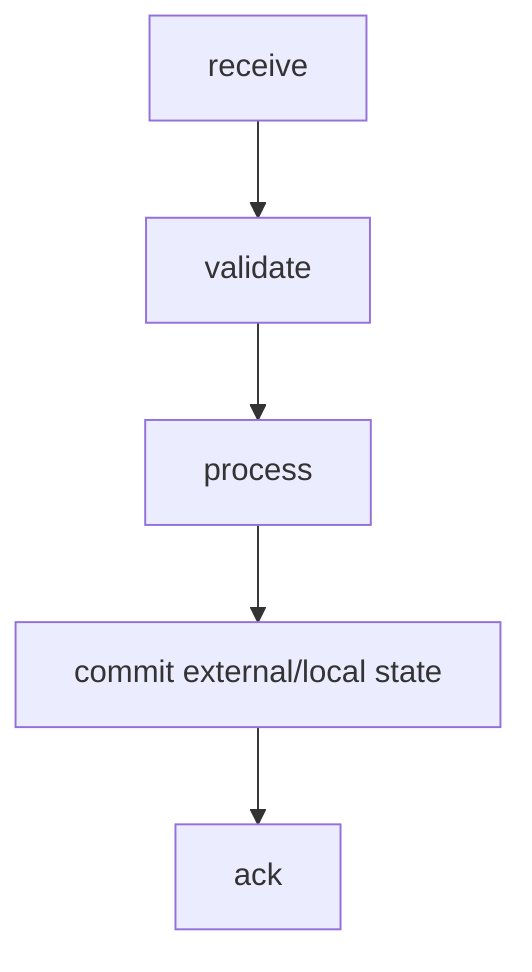
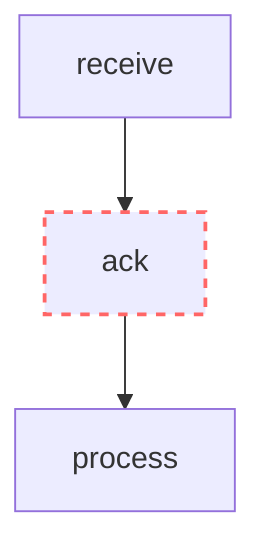
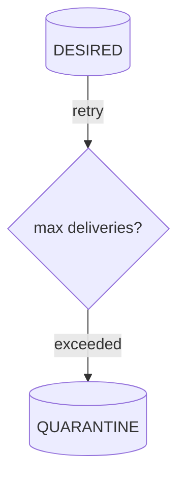
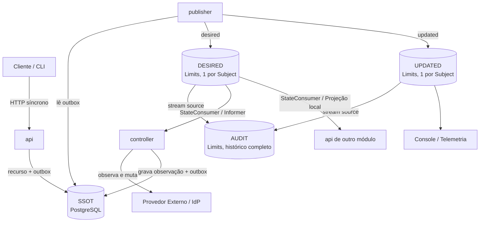
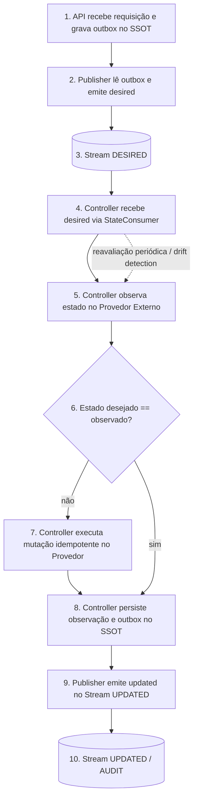

# NATS

# 1. Introdução

Este documento define a implementação de referência do modelo de mensageria em NATS e NATS JetStream (decisão 0101). A semântica das mensagens é definida exclusivamente em `MESSAGING.md`.

NATS é uma tecnologia de transporte. Este documento descreve como o contrato semântico é materializado em Subjects, Streams, Consumers e demais recursos do NATS.

# 2. Objetivos

O objetivo é estabelecer uma implementação NATS consistente, previsível, segura e resiliente para os contratos definidos em `MESSAGING.md`, incluindo roteamento, persistência, consumo, distribuição, retry, quarentena, replay, segurança e observabilidade.

# 3. Princípios de implementação

## 3.1 Respeitar o modelo semântico

A implementação NATS deve preservar:

```text
emitter
messageType
module
resourceType
resourceId
operation
```

conforme definido em `MESSAGING.md`.

## 3.2 Subject como materialização do endereço lógico

No NATS, o endereço lógico é materializado em um Subject hierárquico canônico de 4 tokens:

```text
<messageType>.<module>.<resourceType>.<resourceId>
```

Exemplos:

```text
desired.ipm.organization.<id>
updated.ipm.organization.<id>
```

## 3.3 Emissor no envelope, não no Subject

O emissor funcional (`api` ou `controller`) é declarado no envelope da mensagem (`emitter`), e não faz parte dos tokens do Subject.

## 3.4 Destinatário não é codificado no Subject

Não utilizar prefixos ou tokens no Subject para representar destinatário:

```text
api.controller.desired...
controller.api.updated...
```

O consumidor manifesta interesse exclusivamente por meio de subscription ou JetStream Consumer sobre os subjects canônicos.

## 3.5 `resourceId` no Subject

Quando `resourceId` fizer parte do Subject, ele deve respeitar a sintaxe de Subject do NATS.

Em particular, `.` é separador de tokens e, portanto, não deve aparecer no `resourceId` usado no Subject. Caracteres que criem tokens extras ou wildcards (`*`, `>`) também não são permitidos.

O `resourceId` deve ser validado antes de compor o Subject, e um valor inválido deve ser rejeitado (ver `RESOURCE-CONTROL-SECURITY.md`).

A regra semântica de identidade de recurso continua pertencendo a `MESSAGING.md`; a restrição de caracteres é específica da implementação NATS.

## 3.6 Um Subject por recurso nas mensagens de estado e fato

Cada recurso possui um único Subject para o seu estado pretendido e um único Subject para o fato consolidado:

```text
desired.<module>.<resourceType>.<resourceId>
updated.<module>.<resourceType>.<resourceId>
```

Assim, cada recurso possui **um único Subject** por tipo de mensagem, e a retenção de uma mensagem por Subject guarda exatamente o último estado do recurso no Stream correspondente.

# 4. Core NATS e JetStream

Core NATS entrega mensagens aos subscribers conectados e não fornece persistência para reprocessamento posterior. Quando mensagens precisam sobreviver a reinícios, aguardar consumidores ou ser reproduzidas, a implementação deve utilizar JetStream.

## 4.1 Uso recomendado

Para mensagens de negócio relacionadas a `desired` e `updated` que tenham requisito de durabilidade, replay, retry ou tolerância a indisponibilidade do consumidor, utilizar JetStream.

Core NATS pode ser utilizado para interações que explicitamente sejam efêmeras, como sinais operacionais ou request/reply de baixo risco, desde que isso não viole o contrato de `MESSAGING.md`.

# 5. Subjects

## 5.1 Subject canônico

O formato canônico de 4 tokens (decisão 0101) é:

```text
<messageType>.<module>.<resourceType>.<resourceId>
```

Em que:
- `messageType`: `desired` ou `updated`;
- `module`: módulo do recurso (ex.: `ipm`, `core`, `bsm`, `sum`);
- `resourceType`: tipo do recurso (ex.: `organization`, `account`, `service`, `user`);
- `resourceId`: identificador do recurso (UUID v7 ou equivalente sem pontos).

## 5.2 Exemplos

```text
desired.ipm.organization.0192d6e3-231a-7b3c-a579-a7e7810e95ab
updated.ipm.organization.0192d6e3-231a-7b3c-a579-a7e7810e95ab
desired.core.account.0192d6e3-552b-7c1d-842f-d8b3c10a4421
updated.core.account.0192d6e3-552b-7c1d-842f-d8b3c10a4421
```

## 5.3 Wildcards

Wildcards devem ser restritos ao escopo necessário.

Exemplos:

```text
desired.>
desired.ipm.>
desired.ipm.organization.>
updated.ipm.organization.>
```

Evitar subscriptions genéricas como:

```text
>
*
```

em componentes de produção.

## 5.4 Identificadores

O identificador deve sempre ocupar um único token:

```text
desired.ipm.organization.01a17641-4895-761f-888f-24ca35143f79
```

Não utilizar identificadores contendo pontos ou sufixos de operação no Subject.

# 6. Streams JetStream

Streams são o mecanismo de persistência e replay do JetStream. O desenho do Stream segue a semântica das classes de mensagem (decisão 0101): `DESIRED` para estado pretendido, `UPDATED` para fatos consolidados e `AUDIT` para histórico auditável.

## 6.1 Consolidação dos Streams

A plataforma consolida o transporte em 3 Streams JetStream:

- `DESIRED`: persistência do estado pretendido por recurso;
- `UPDATED`: fatos de alteração e convergência emitidos após consolidação;
- `AUDIT`: trilha histórica imutável que agrega `DESIRED` e `UPDATED` via stream sources.

Streams legados (`REQUESTED`, `OBSERVED`, `ACTION` e `RESULT`) pertenciam à divisão distribuída anterior em 7 papéis e foram eliminados nas decisões 0096, 0098 e 0101.

## 6.2 Mapeamento

| Stream | Subjects | Retenção | Classe | Consumidores |
|---|---|---|---|---|
| `DESIRED` | `desired.>` | `LimitsPolicy`, `max_msgs_per_subject=1`, `allow_direct=true`, `max_age=0` (indefinido) | Estado | Controller, projeções locais da API |
| `UPDATED` | `updated.>` | `LimitsPolicy`, `max_msgs_per_subject=1`, `allow_direct=true`, `max_age=24h` em dev | Fato | Console, observabilidade, clientes externos |
| `AUDIT` | `audit.>` | `LimitsPolicy`, `max_msgs_per_subject=-1` (histórico total), `deny_delete=true`, `max_age=24h` em dev | Histórico | Auditoria, conformidade |
| `QUARANTINE` | definido por política de DLQ | `LimitsPolicy` | Diagnóstico | Operação / Engenharia |

Os limites de ambiente em dev são: `max_bytes: 1GB`, `max_msg_size: 512KB` e `duplicate_window: 120s`.

## 6.3 `DESIRED`: estado pretendido

Mensagens de estado pretendido emitidas pela API (via transactional outbox e Publisher):

- `LimitsPolicy` com `max_msgs_per_subject: 1`: o Stream retém o último estado pretendido de cada recurso;
- `allow_direct: true` habilitado para leitura direta de alta performance por Subject ou chave de mensagem;
- `max_age: 0` (retenção temporal indefinida): o último estado pretendido permanece preservado para reconciliação contínua e recuperação a frio após reinício;
- Consumido pelo `Controller` para conduzir a convergência do recurso e pelas APIs de outros serviços que mantêm projeções locais em memória (decisão 0100).

## 6.4 `UPDATED`: fatos consolidados

Fatos emitidos após convergência ou alteração confirmada (gravados no outbox e publicados pelo Publisher):

- `LimitsPolicy` com `max_msgs_per_subject: 1` e `allow_direct: true`;
- Retenção temporal configurada por ambiente (24h em dev, durável em produção);
- Consumido por clientes, Console e ferramentas de observabilidade para acompanhamento de mudanças de fase e geração.

## 6.5 `AUDIT`: trilha histórica imutável

Histórico completo de auditoria das mensagens que trafegam na plataforma:

- Configurado com replicação nativa de fontes (`sources: [{"name": "DESIRED"}, {"name": "UPDATED"}]`);
- `deny_delete: true` impede expurgo ou alteração de mensagens individuais já gravadas;
- `max_msgs_per_subject: -1` preserva todas as versões e transições cronológicas de cada recurso;
- Não possui sobreposição de subjects de publicação direta com `DESIRED` ou `UPDATED`.

## 6.6 Contexto de rastreabilidade (Tracing)

Quando a requisição original possui contexto OpenTelemetry/W3C (`traceparent`), o Publisher repassa o cabeçalho `traceparent` no transporte NATS ao lado do `Nats-Msg-Id`. O rastreador extrai o contexto da mensagem, mantendo o span vinculado à operação original de forma distribuída (decisão 0055).

## 6.7 Evitar streams excessivamente fragmentados

Não criar um Stream por recurso ou por componente. A divisão padronizada nos Streams `DESIRED`, `UPDATED` e `AUDIT` é suficiente para isolar o ciclo de vida, as políticas de retenção e as garantias de auditoria sem sobrecarga de grupos Raft ou descritores de arquivos no broker.

# 7. Consumers

Consumers mantêm o estado de entrega por leitor e controlam como mensagens persistidas são disponibilizadas. JetStream suporta pull consumers, replay, ACK, redelivery e escalabilidade entre instâncias.

## 7.1 Papéis e consumers por serviço

Cada módulo e tipo de recurso é estruturado em papéis bem delimitados (decisões 0096, 0098 e 0100):

- `<módulo>-<tipo>-api`: interface HTTP síncrona com os clientes. Não publica no broker diretamente: persiste o recurso e os eventos no transactional outbox no SSOT (`ssot`). Cria consumers de estado em memória no stream `DESIRED` apenas quando necessita de projeções locais de outros recursos sem acoplamento HTTP (decisão 0100);
- `<módulo>-<tipo>-publisher`: processo em background responsável pela garantia de entrega do outbox para o broker NATS (streams `DESIRED` e `UPDATED`). Não consome streams do NATS;
- `<módulo>-<tipo>-controller`: processo único e autônomo de reconciliação contínua para recursos que possuem provedor ou estado externo (decisão 0096). Consome `DESIRED` com consumer de estado em memória para alimentar seu cache e laço de controle.

## 7.2 Classes de consumer no modelo consolidado

Com a consolidação nos 3 streams permanentes (`DESIRED`, `UPDATED`, `AUDIT`), os consumers adotam a seguinte classificação:

| Classe | Finalidade | Modelo | Serviços |
|---|---|---|---|
| Estado em memória (`StateConsumer`) | Manter cache do estado mais recente por recurso para reconciliação ou projeção | Um consumer durável **por instância**, com limpeza por inatividade (`inactive_threshold`) | `controller` (em `DESIRED`) e `api` (projeções em `DESIRED`) |
| Observabilidade e Fatos | Acompanhar conclusões de ciclos e mudanças de fase | Pull consumer durável compartilhado | Console, telemetria, clientes |
| Auditoria | Trilha histórica imutável consolidada | Pull consumer durável | Auditoria e conformidade |

## 7.3 Estado em memória: `StateConsumer` por instância

Tanto o `Controller` quanto as projeções locais das APIs mantêm em memória o último `desired` dos recursos relevantes. Um consumer durável estático compartilhado não serve a esse propósito porque particionaria o estado entre réplicas e não reentregaria o último estado completo de cada recurso após um reinício.

Por isso, cada instância ativa instancia um `StateConsumer` na inicialização:

- **Nome único:** `<módulo>-<tipo>-<papel>-desired-<sufixo>`, em que `<sufixo>` é único por execução da instância. Evita reutilização de posição de offset anterior e garante reconstrução completa do estado;
- **Filtro canônico:** escopado no nível do recurso necessário (ex.: `desired.ipm.organization.>`);
- **Política de entrega:** `DeliverLastPerSubject` (`DeliverPolicy.LAST_PER_SUBJECT`), que entrega o último estado de cada Subject existente no stream e, em seguida, as novas alterações;
- **Confirmação explícita:** `AckExplicit`;
- **Inatividade:** `inactive_threshold_seconds=300` (5 minutos), permitindo que o NATS remova automaticamente consumers órfãos deixados por processos reiniciados ou encerrados;
- **Controle de entregas:** `max_deliver=20`, com backoff exponencial entre 5 s e 60 s em falhas (`nak`), culminando em descarte (`term()`) após 20 entregas.

## 7.4 Controllers e reconciliação contínua

Para recursos com provedor externo (como `core/account`, `ipm/organization`, `ipm/permission`, `ipm/user`, `ipm/serviceaccount` e `sum/service`):

- O `Controller` consome o stream `DESIRED` do seu tipo via `StateConsumer`;
- As mensagens alimentam seu catálogo em memória (Informer);
- Na recepção de um `desired` ou na reavaliação periódica, o Controller observa o provedor externo, compara o estado observado com o estado desejado, executa as mutações necessárias com idempotência e registra o estado atualizado no SSOT;
- O fato resultante (`updated`) é inserido no outbox transacional e publicado no stream `UPDATED` pelo Publisher do serviço;
- A operação de leitura pontual pelo Controller ou API pode utilizar *Direct Get* (`last_by_subj`) no stream `DESIRED` quando não houver necessidade de manter um laço de consumo contínuo.

## 7.5 Consumers das features (exemplo `ipm.user` e `ipm.organization`)

| Papel | Consumer | Stream | Filtro de Subject | Modelo |
|---|---|---|---|---|
| `ipm-user-api` | `ipm-user-api-desired-<id>` | `DESIRED` | `desired.ipm.organization.>` | Projeção em memória de Organization para autorização sem chamada HTTP |
| `ipm-user-publisher` | — | — | — | Apenas publica (`desired.ipm.user.>`, `updated.ipm.user.>`) a partir do outbox |
| `ipm-user-controller` | `ipm-user-controller-desired-<id>` | `DESIRED` | `desired.ipm.user.>` | Reconciliação com o provedor de identidade (Zitadel) |

Tipos sem provedor externo (ex.: `ipm/role`, `ipm/group`) utilizam apenas `api` e `publisher`, sem necessidade de processo `controller`.

## 7.6 Regras de filtro

- Cada consumer possui **um único filtro** no nível `<módulo>.<tipo>`;
- Evitar filtros amplos (`desired.>`) em componentes de negócio para assegurar autorização restrita (menor privilégio) por Subject.

## 7.7 Pull Consumer

Pull Consumer é o padrão arquitetural em JetStream:

- Backpressure sob controle total da aplicação receptora;
- Tamanho de lote ajustável conforme capacidade de processamento;
- Comportamento previsível sob sobrecarga temporária do broker.

# 8. Distribuição de trabalho e reconciliação

No modelo reconciliado adotado pela plataforma (decisões 0096 e 0101):

- A distribuição de trabalho para escrita inicial ocorre no nível da API síncrona (balanceada via gateway HTTP);
- A reconciliação com sistemas externos é centralizada no `Controller`, que orquestra a convergência a partir do stream `DESIRED`;
- Quando houver múltiplas instâncias de um mesmo `Controller` em produção (dev opera com uma instância por papel), a coordenação de execução ativa adota eleição de líder via lock no banco de dados ou particionamento determinístico por `resourceId`.

# 9. Fanout de estado

O stream `DESIRED` atua como barramento de fanout de estado confiável entre domínios da plataforma:

```text
               +-------------------+
               |  Stream DESIRED   |
               +-------------------+
                  /             \
                 /               \
                v                 v
     +--------------------+     +------------------------+
     | ipm-org-controller |     | ipm-user-api           |
     | (reconciliação     |     | (projeção local de     |
     |  da Organization)  |     |  organizações em cache)|
     +--------------------+     +------------------------+
```

- Cada consumidor mantém seu próprio ponteiro de leitura sem bloquear os demais;
- O ACK confirma a leitura pela réplica receptora, enquanto o estado pretendido permanece preservado em `DESIRED` para qualquer novo consumidor que seja inicializado posteriormente.

# 10. ACK e processamento

JetStream rastreia a entrega por consumer e considera a mensagem processada quando há ACK apropriado. Mensagens não confirmadas podem ser entregues novamente.

## 10.1 Regra de ACK

Para processamento de negócio:



Evitar:



quando a perda de uma falha após ACK puder causar inconsistência.

## 10.2 ACK não é convergência

```text
JetStream ACK
      !=
Desired converged
```

Convergência é determinada pelo ciclo de reconciliação e pelas observações persistidas.

# 11. Retry e Backoff

Falhas transitórias devem usar redelivery com backoff quando suportado pelo consumer.

Configurações como:

```text
ack_wait
backoff
max_deliver
```

devem ser escolhidas com base no tempo de processamento e na natureza da falha.

O retry não deve causar tempestade de mensagens.

## 11.1 Falha transitória

Exemplos:

- timeout do provedor;
- conexão temporariamente indisponível;
- lock transitório;
- indisponibilidade temporária do serviço externo.

Essas falhas normalmente devem retornar para retry.

## 11.2 Falha permanente

Exemplos:

- contrato inválido;
- recurso impossível de processar;
- credencial inválida sem mecanismo automático de recuperação;
- payload incompatível.

Essas falhas devem eventualmente ser direcionadas à quarentena, evitando loops infinitos.

**Consumers de estado das features (`StateConsumer`).** O consumer de cada instância usa `max_deliver=20`. Uma falha de processamento volta à fila com `nak` e espera crescente de 5 s, 10 s, 20 s, 40 s e, daí em diante, 60 s (cerca de 15 minutos até o limite). Na última entrega, a mensagem recebe `term` e um log `ERROR` (`message discarded after the maximum number of deliveries`, com `smarkee.delivery.attempt`): ela continua no Stream e só deixa de ser entregue àquele consumer. Isso é seguro porque o estado se refaz pelo último `desired` do recurso e pela reavaliação periódica. Ainda **não** há Stream de quarentena (§12): o descarte é visível em log, mas a mensagem não é copiada para outro lugar.

**Conexão.** O cliente reconecta sem limite (`max_reconnect_attempts=-1`). O padrão da biblioteca (60 tentativas de 2 s) fecha a conexão depois de cerca de 2 minutos e deixa o processo vivo, sem receber mensagens; o `restart: unless-stopped` do Compose não o reinicia, porque o processo não terminou.

**Publicação do outbox (Publisher, decisões 0018 e 0019).** Uma recusa permanente do transporte (mensagem grande demais ou inválida) **não** é descartada nem pulada, porque isso quebraria a ordem por recurso: o Publisher preserva a ordem, registra `ERROR` com `sequence` e `message_id` e sai de `ready`, para o bloqueio aparecer no orquestrador. A saída é uma atuação humana explícita.

# 12. Quarentena / DLQ

JetStream fornece mecanismos de redelivery e limite de entregas; uma política de DLQ/quarentena deve ser implementada de forma explícita conforme a necessidade da aplicação.

Fluxo de referência:



Uma mensagem deve ser movida para quarentena somente quando houver decisão explícita de que o processamento normal não deve continuar.

A mensagem original deve ser preservada com seus metadados de diagnóstico.

# 13. Retry não é DLQ

São mecanismos diferentes:

```text
retry      = tentar novamente
quarantine = retirar do fluxo normal
replay     = executar novamente de forma controlada
```

Não tratar uma fila de retry como auditoria.

Não tratar uma quarentena como armazenamento histórico permanente.

# 14. Replay

JetStream permite leitura e replay de mensagens persistidas.

Replay deve ser controlado para evitar efeitos duplicados.

Antes de realizar replay:

1. identificar consumer de destino;
2. definir janela ou ponto inicial;
3. avaliar idempotência;
4. avaliar efeito sobre sistemas externos;
5. registrar o motivo do replay;
6. monitorar a carga gerada.

Replay não deve ser utilizado como mecanismo cotidiano de retry.

# 15. Streams e retenção

## 15.1 `LimitsPolicy` como padrão

Todos os streams em operação utilizam `LimitsPolicy`. As mensagens permanecem disponíveis de forma independente para múltiplos leitores e projeções, sem que o consumo por um serviço remova a mensagem para os demais.

Os limites operacionais são definidos por:
- Quantidade de mensagens por Subject (`max_msgs_per_subject: 1` em `DESIRED` e `UPDATED`);
- Retenção temporal (`max_age: 0` indefinido em `DESIRED`; configurado por ambiente em `UPDATED` e `AUDIT`);
- Tamanho total do Stream (`max_bytes`) e tamanho máximo por mensagem (`max_msg_size`).

A política `WorkQueuePolicy` não é utilizada na plataforma consolidada, pois o fluxo de trabalho é orientado à convergência contínua sobre o estado pretendido (`DESIRED`) e não a tarefas pontuais transitórias.

## 15.2 `InterestPolicy`

Pode ser utilizada quando a retenção deve depender estritamente da existência de consumidores ativos. Esta política não é adotada nos streams da plataforma.

## 15.3 Remoção de recursos e tombstones

Como `DESIRED` retém o último estado por recurso (`max_msgs_per_subject: 1`), o estado de um recurso removido permanece no Stream até ser expressamente expurgado.

**Nenhum serviço de runtime recebe permissão de purge de Stream.** A permissão de purge do NATS não consegue ser restringida por filtro de Subject; conceder purge a uma feature permitiria que ela apagasse o estado de outros módulos em `DESIRED`.

O ciclo ordenado de remoção é:

1. A API processa a exclusão, marca o recurso com `lifecycle=absent` e gera a nova geração, gravando a alteração e o evento de outbox na mesma transação no SSOT;
2. O Publisher publica a mensagem de `desired` com `lifecycle=absent`;
3. O `Controller` processa o `lifecycle=absent`: remove o recurso no provedor externo (se a proteção contra exclusão permitir), atualiza o registro no SSOT e gera o evento `updated` final;
4. A última mensagem permanece no stream `DESIRED` como **tombstone** com `lifecycle=absent`. O `Controller` e as projeções ignoram recursos já removidos;
5. O utilitário `scripts/dev/cleanup` remove periodicamente os tombstones de recursos de teste em dev via `purge_stream(subject=...)` com credenciais administrativas. Em ambientes produtivos, um job de infraestrutura administrativa efetua a limpeza periódica de tombstones antigos.

# 16. Replicação e durabilidade

Streams críticos utilizam armazenamento persistente em disco (`storage: file`) e número de réplicas compatível com o ambiente (`num_replicas: 1` em dev; `num_replicas: 3` em stg e prd com quorum Raft).

## 16.1 Custo de Streams e Consumers

- A consolidação em 3 Streams fixos (`DESIRED`, `UPDATED`, `AUDIT`) reduz drasticamente a sobrecarga de descritores de arquivos e tráfego de heartbeats de grupos Raft;
- Em vez de múltiplos consumers duráveis e efêmeros por papel em 6 streams, cada feature com reconciliação possui apenas o consumer de estado do seu `Controller` e os eventuais consumers de projeção de APIs consumidoras;
- O uso de `inactive_threshold` nos consumers de estado por instância garante que réplicas encerradas não deixem resíduos no broker.

## 16.2 Janela de recuperação

A **janela de recuperação** é o maior intervalo de indisponibilidade de um consumidor (ou do próprio broker) que o sistema tolera sem perda de dados:

- Em `DESIRED`, a retenção é temporalmente indefinida (`max_age: 0`), o que permite recuperação a frio a qualquer momento e reidratação de projeções sem dependência de janela temporal;
- Em `UPDATED` e `AUDIT`, a janela é configurada por política de auditoria e métricas (24h em dev; durável com retenção estendida em stg/prd).

# 17. Source, Mirror e Republish

NATS possui mecanismos diferentes para copiar ou transformar fluxos, incluindo sources, mirrors e republish. A escolha depende do objetivo operacional e da política do Stream.

## 17.1 Regra arquitetural

Não utilizar `Source`, `Mirror` ou `RePublish` apenas para criar uma segunda cópia sem definir:

- finalidade;
- retenção;
- independência operacional;
- impacto sobre ACK;
- recuperação;
- autorização.

## 17.2 Auditoria

Para auditoria de longa duração, preferir um fluxo explicitamente desenhado para auditoria, em vez de depender de comportamento implícito de um Stream operacional.

# 18. Segurança

## 18.1 TLS

Em ambientes não locais, conexões NATS devem utilizar TLS.

O certificado do servidor deve ser validado pelo cliente usando CA confiável.

## 18.2 mTLS

Para comunicação serviço-a-serviço, mTLS é a configuração recomendada quando a identidade criptográfica do cliente for necessária.

## 18.3 Autorização

Publicação e assinatura devem ser autorizadas separadamente.

A matriz de permissões por componente é definida em `RESOURCE-CONTROL-SECURITY.md`. Este documento descreve como ela é materializada em NATS.

NATS suporta ACLs de publicação e assinatura por Subject. Uma allow-list explícita restringe o acesso aos subjects não autorizados.

Em JetStream há uma particularidade: a permissão de subscribe por Subject não restringe o que um consumidor JetStream lê do Stream. O acesso à API de consumers é autorizado por Stream (`$JS.API.CONSUMER.*.<stream>...`) e, para um consumer com um único filtro, por filtro. Por isso:

- cada classe de mensagem possui seu Stream (`DESIRED`, `UPDATED`, `AUDIT`);
- a identidade de um serviço é `<módulo>-<tipo>-<papel>`, e suas permissões são sempre escopadas por `<módulo>.<tipo>` (por exemplo, `desired.ipm.organization.>`), nunca por `desired.>`;
- o `Publisher` recebe apenas permissão de publicação nos subjects do seu módulo e tipo (`desired.<módulo>.<tipo>.>` e `updated.<módulo>.<tipo>.>`);
- a `API` não recebe permissão de publicação direta no NATS (ela grava no outbox do SSOT);
- o `Controller` recebe permissão de criação e consumo do seu consumer de estado em memória sobre `DESIRED` (`$JS.API.CONSUMER.CREATE.DESIRED.<consumer>.<filtro>` e `$JS.API.CONSUMER.MSG.NEXT.DESIRED.<consumer>`);
- a `API` que mantém projeção local em memória de outro domínio recebe permissão estrita de criação e consumo do seu `StateConsumer` no subject correspondente (ex.: `$JS.API.CONSUMER.CREATE.DESIRED.<consumer>.desired.ipm.organization.>`);
- nenhum serviço de runtime recebe permissão sobre `$JS.API.STREAM.*`, inclusive purge;
- a criação de Streams e a limpeza administrativa de tombstones usam uma identidade administrativa separada.

Os Subjects exatos de autorização devem ser validados no servidor utilizado conforme a infraestrutura do ambiente.

## 18.4 Princípio do menor privilégio

Cada identidade deve possuir somente os Subjects necessários.

Evitar permissões amplas como:

```text
publish: ">
subscribe: ">"
```

para componentes de aplicação.

## 18.5 Segredos

Credenciais de NATS, chaves privadas e tokens não devem ser versionados no repositório.

Devem ser fornecidos por mecanismo seguro de secrets management.

# 19. TLS do cluster e clientes

A configuração de TLS deve distinguir claramente:

```text
client -> server
server -> server
```

O material criptográfico utilizado para comunicação cliente-servidor não deve ser automaticamente reutilizado para comunicação de cluster.

No mínimo, devem existir identidades adequadas aos diferentes trust domains quando a topologia exigir essa separação.

# 20. Configuração por ambiente

A política semântica não depende do ambiente.

A infraestrutura pode variar:

```text
dev  -> NATS local
stg  -> cluster NATS interno
prd  -> cluster NATS resiliente
```

mas os Subjects e contratos semânticos devem permanecer compatíveis.

Parâmetros de deployment pertencem à infraestrutura, não a este contrato.

# 21. Versionamento do NATS

A versão do NATS Server deve ser explicitamente pinada no ambiente de execução.

Evitar tags flutuantes como:

```text
latest
2.12
```

em ambientes de integração, homologação e produção.

Uma atualização de versão deve incluir:

- validação de compatibilidade dos clientes;
- validação de Streams e Consumers;
- testes de integração;
- revisão de release notes;
- verificação de comportamento de recursos JetStream utilizados pelo projeto;
- registro da alteração no changelog da plataforma.

Este documento não fixa uma versão específica do servidor. O número efetivamente suportado deve ser definido pelo ambiente e pelos testes do projeto.

# 22. Observabilidade

A plataforma deve monitorar pelo menos:

```text
publish rate
consume rate
consumer lag
pending messages
redelivery count
ack latency
processing latency
stream size
stream age
storage usage
quorum status
consumer state
quantidade de consumers por Stream
mensagens pendentes e sem ACK por consumer
idade do último estado por tipo de recurso
```

**Saúde dos componentes (decisão 0018).** Todo componente expõe `/health/live`, `/health/ready` e `/health/startup` na porta `8000`. A liveness só olha o sinal de vida do laço principal e **não** consulta o NATS nem o banco; a readiness inclui a conexão com o NATS e, no Publisher, a ausência de bloqueio por recusa permanente.

Os sinais devem ser coletados do NATS e das aplicações consumidoras.

Observabilidade do broker não substitui observabilidade do processamento de negócio.

# 23. Métricas de aplicação

Para cada consumidor, observar:

```text
messages_received_total
messages_processed_total
messages_failed_total
messages_retried_total
messages_quarantined_total
message_processing_duration
```

Correlacionar os dados com:

```text
messageId
correlationId
causationId
resourceId
resourceType
messageType
```

# 24. Requisitos de resiliência do cliente

Clientes devem tratar desconexões e reconexões como comportamento normal.

Devem possuir:

- timeout explícito;
- reconnect controlado;
- backoff;
- tratamento de falha de autenticação;
- observabilidade das reconexões;
- shutdown ordenado;
- recuperação do consumer durável quando aplicável.

Falha de autenticação não deve ser mascarada como simples indisponibilidade de rede. Clientes NATS possuem comportamentos específicos para reconexão e falhas de autenticação que devem ser considerados na operação.

# 25. JetStream API e administração

A criação e alteração de Streams e Consumers deve ser controlada.

Preferir configuração declarativa e versionada por infraestrutura como código ou mecanismo equivalente.

A infraestrutura cria os Streams e os consumers duráveis a partir de um manifesto por tipo de recurso. A limpeza de tombstones é um job de infraestrutura com identidade administrativa própria. Aplicações de runtime criam apenas os consumers de estado em memória, com a permissão escopada descrita na seção de Segurança.

Não permitir que aplicações de runtime tenham privilégios administrativos amplos sobre:

```text
$JS.API.>
```

sem necessidade explícita.

# 26. Exemplos de autorização

Exemplos conceituais por serviço para o tipo `ipm.organization`. A matriz normativa detalhada está em `RESOURCE-CONTROL-SECURITY.md`; as configurações concretas do broker pertencem à infraestrutura.

## 26.1 `ipm-organization-publisher`

O Publisher é o único componente da feature com permissão de publicação no broker NATS (decisão 0019):

```text
ipm-organization-publisher
publish:
  desired.ipm.organization.>
  updated.ipm.organization.>
subscribe: nenhum
```

O Publisher lê do outbox transacional no banco `ssot` e publica exclusivamente nos subjects do seu módulo e tipo.

## 26.2 `ipm-organization-api`

A API processa requisições síncronas de escrita e grava o recurso e o outbox no SSOT:

```text
ipm-organization-api
publish: nenhum (grava no outbox)
subscribe:
  apenas se mantiver projeção local em memória de outro domínio (ex.: desired.ipm.organization.>)
```

## 26.3 `ipm-organization-controller`

O Controller reconcilia o estado do recurso contra o sistema externo:

```text
ipm-organization-controller
publish: nenhum (grava no outbox e no SSOT)
consumo (consumer de estado criado pela instância):
  DESIRED → ipm-organization-controller-desired-<instância>
  filtro:   desired.ipm.organization.>
```

## 26.4 Identidade administrativa

```text
administração:
  criar Streams (DESIRED, UPDATED, AUDIT)
  gerenciar limites e retenção
  expurgar tombstones de DESIRED (job periódico)
```

Esta identidade é restrita à automação de infraestrutura e não é utilizada por serviços de aplicação em runtime.

## 26.5 Observabilidade, auditoria e billing

Componentes de visualização e métricas (Console, billing, auditoria) criam consumers duráveis independentes sobre os streams de fatos e histórico:

```text
consumo:
  UPDATED → billing-updated (filtro: updated.>)
  AUDIT   → compliance-audit (filtro: audit.>)
```

# 27. Exemplo de arquitetura

A topologia consolidada da plataforma (decisões 0096, 0098, 0100 e 0101):



# 28. Fluxo de reconciliação contínua

Ciclo de vida de controle e convergência coordenado pelo Controller:



# 29. Anti-padrões

## 29.1 Proibido: destinatário como prefixo do Subject

Não utilizar rotas ponto-a-ponto no Subject (ex.: `api.controller.desired...`). O consumidor manifesta interesse exclusivamente via filtro de subscription ou consumer.

## 29.2 Proibido: termos e tipos não canônicos

A semântica de tipos de mensagem é estritamente:

```text
desired
updated
```

Não utilizar nomenclaturas não padronizadas (`task`, `reality`, `action`, etc.).

## 29.3 Proibido: operação imperativa no Subject de `desired` e `updated`

Não utilizar sufixos operacionais no Subject:

```text
desired.ipm.organization.<id>.create
updated.ipm.organization.<id>.deleted
```

O Subject canônico possui exatamente 4 tokens:

```text
<messageType>.<module>.<resourceType>.<resourceId>
```

A mutação ou ciclo de vida (`lifecycle`) é declarado no contrato do envelope e do payload da mensagem, e não nos tokens de endereçamento de rede.

## 29.4 Proibido: subscription `>` sem justificativa

Subscriptions globais abertas violam o princípio do menor privilégio e impedem isolamento operacional.

## 29.5 Proibido: secrets no payload

Credenciais em texto claro nunca devem trafegar em mensagens de eventos ou estado.

## 29.6 Proibido: ACK antecipado

Nunca confirmar a mensagem antes de processá-la e assegurar a persistência ou mutação correspondente.

## 29.7 Proibido: depender de exactly-once para correção

Toda operação de recepção, projeção e reconciliação deve ser idempotente.

## 29.8 Proibido: criar um Stream por recurso

Streams são fixos e consolidados (`DESIRED`, `UPDATED`, `AUDIT`). Novos recursos e módulos acrescentam apenas Subjects e Consumers.

## 29.9 Proibido: conceder purge ou administração de Stream a serviço de runtime

A permissão de purge do NATS não possui escopo por Subject. Conceder purge a um serviço permite a destruição inadvertida de dados de toda a plataforma.

## 29.10 Proibido: consumer compartilhado para estado em memória

Consumidores que mantêm projeções em memória (Informer do Controller ou projeções da API) devem usar um `StateConsumer` exclusivo por instância, garantindo reconstrução total do catálogo local em caso de reinício.

## 29.11 Proibido: filtro de consumer mais largo que `<módulo>.<tipo>`

Consumers de serviço devem restringir seu filtro ao seu domínio estrito (ex.: `desired.ipm.organization.>`).

# 30. Nomenclatura recomendada

## 30.1 Streams

```text
DESIRED
UPDATED
AUDIT
QUARANTINE
```

## 30.2 Consumers

Nomes funcionais utilizando letras minúsculas, dígitos e hífen:

```text
<módulo>-<tipo>-<papel>-desired-<instância>
```

Exemplos:

```text
ipm-organization-controller-desired-0192d6
ipm-user-api-desired-0192e4
billing-account-updated
```

## 30.3 Subjects

```text
desired.ipm.organization.01a17641-4895-761f-888f-24ca35143f79
updated.ipm.organization.01a17641-4895-761f-888f-24ca35143f79
desired.core.account.0192d6e3-552b-7c1d-842f-d8b3c10a4421
updated.core.account.0192d6e3-552b-7c1d-842f-d8b3c10a4421
```

# 31. Checklist operacional

Antes de promover alterações de mensageria para homologação e produção, verificar:

- [ ] Subject segue estritamente o formato canônico de 4 tokens (`<messageType>.<module>.<resourceType>.<resourceId>`);
- [ ] `messageType` restrito a `desired` ou `updated`;
- [ ] Emissor funcional é declarado no envelope (`emitter`), nunca no Subject;
- [ ] Destinatário não faz parte do Subject;
- [ ] Streams ativos são exclusivamente `DESIRED`, `UPDATED` e `AUDIT`;
- [ ] `DESIRED` e `UPDATED` utilizam `LimitsPolicy` com `max_msgs_per_subject: 1` e `allow_direct: true`;
- [ ] `AUDIT` agrega `DESIRED` e `UPDATED` via stream sources com `deny_delete: true` e `max_msgs_per_subject: -1`;
- [ ] Consumers de estado em memória utilizam `DeliverLastPerSubject`, `inactive_threshold=300s`, `max_deliver=20` e identificador por instância;
- [ ] Falhas no `StateConsumer` implementam backoff exponencial e descarte com `term()` na última entrega (`max_deliver`);
- [ ] Clientes NATS configuram reconexão ilimitada (`max_reconnect_attempts: -1`) com callbacks de log estruturado;
- [ ] Nenhum serviço de runtime possui permissão de purge ou administração de Streams;
- [ ] Contexto de rastreabilidade (`traceparent`) é propagado nos cabeçalhos de mensagem;
- [ ] Operações de processamento e reconciliação são rigorosamente idempotentes;
- [ ] Remoção de recursos utiliza tombstones em `DESIRED` com `lifecycle=absent`;
- [ ] TLS habilitado fora do ambiente de desenvolvimento;
- [ ] Credenciais de acesso gerenciadas com menor privilégio e fora do controle de versão.
- [ ] ordering necessário possui chave explícita;
- [ ] TLS está habilitado fora do ambiente local;
- [ ] autorização utiliza menor privilégio;
- [ ] secrets não estão no repositório;
- [ ] métricas e traces estão disponíveis;
- [ ] Streams e Consumers são gerenciados de forma controlada;
- [ ] versão do NATS está pinada no ambiente.

# 32. Fontes técnicas

A implementação deste documento utiliza como referência a documentação oficial do NATS:

- NATS Core e comportamento de subscribers: https://docs.nats.io/learn/core-nats/
- JetStream Deep Dive: https://docs.nats.io/learn/jetstream/
- JetStream Reference: https://docs.nats.io/reference/2.12/jetstream
- Authorization: https://docs.nats.io/learn/security/authorization
- TLS/Auth e clientes resilientes: https://docs.nats.io/learn/resilient-clients/tls-and-auth
- Encryption at rest: https://docs.nats.io/learn/security/encryption
- Retention policies: https://docs.nats.io/learn/jetstream/retention-policies
- Consumers: https://docs.nats.io/nats-concepts/jetstream/consumers
- Priority groups: https://docs.nats.io/learn/jetstream/priority-groups
- Queue groups (Core NATS): https://docs.nats.io/concepts/queue-groups
- Leitura direta (Direct Get): https://docs.nats.io/learn/jetstream/get-direct
- Sizing e recursos: https://docs.nats.io/learn/deployment/sizing-and-resources

# 33. Fonte de verdade

`MESSAGING.md` é a fonte de verdade para a semântica de mensageria.

`NATS.md` é a fonte de verdade para a implementação dessa semântica em NATS.

A hierarquia é:

```text
MESSAGING.md
      |
      v
   NATS.md
```

Uma limitação específica do NATS não deve alterar o modelo semântico. Quando a implementação exigir adaptação, a adaptação deve permanecer confinada a `NATS.md` e à infraestrutura.
