# Arquitetura de observabilidade

> **Escopo:** **como** a telemetria é coletada, roteada e gravada: as peças, o papel de cada uma, o caminho de cada sinal, o que acontece quando uma peça falha, a segurança, o mapeamento para Kubernetes e como acrescentar uma feature.
>
> **Fora do escopo:** **o que** a telemetria contém (formato e campos dos logs, atributos, semconv, contexto de negócio, spans do gateway). Isso é o contrato e está em [`OBSERVABILITY.md`](OBSERVABILITY.md).
>
> **Decisões:** [`0050`](../../.decisions/0050-traces-do-gateway-opentelemetry.md), [`0051`](../../.decisions/0051-telemetry-agent-coleta-em-dev.md), [`0053`](../../.decisions/0053-telemetria-infra-app-limites-e-rotas-zitadel.md), [`0059`](../../.decisions/0059-telemetria-no-piso.md), [`0061`](../../.decisions/0061-contexto-de-negocio-nos-logs-dos-apps.md), [`0062`](../../.decisions/0062-coleta-de-telemetria-em-duas-camadas.md) e [`0102`](../../.decisions/0102-kubernetes-kind-argocd-vault-e-operadores.md) (`OpenTelemetry Operator`, `telemetry-sink` e coleta CRI `containerd` / `kubeletstats` em Kubernetes). Em conflito, vale `AGENTS.md`.

**Telemetria não é auditoria.** A telemetria pode perder dado (a fila descarta quando cheia, a rotação apaga em cerca de 1 dia, o trace pode ser amostrado) e é **de operador**. A auditoria, que precisa de completude, retenção e acesso por dono, é outro produto, alimentado pelos fatos de negócio duráveis (outbox e NATS), e **não** passa por esta arquitetura.

# 1. Ideia central

Quatro peças, **um verbo cada**. Todas são o OpenTelemetry Collector (distribuição contrib) com configurações diferentes; por isso o nome diz o **papel**, e não o binário.

| Verbo | Peça | Em uma frase |
|---|---|---|
| **Lê** | `telemetry-agent` | Lê os logs dos pods (`/var/log/pods`) e as métricas dos nós (`kubeletstats`) e os envia adiante |
| **Roteia** | `telemetry-router` | Manda cada sinal ao telemeter dono e **não grava em nenhum backend** |
| **Grava** | `telemetry-sink` | Processa e grava a **infra** e o app que nenhuma feature reivindica |
| **Grava** | `<módulo>-<tipo>-telemeter` | Processa e grava os sinais de **app** de **uma** feature |

**Por que separar.** Quem lê precisa de privilégio (é a única peça privilegiada), então ela não deve fazer mais nada. Quem roteia precisa conhecer só os atributos dos sinais, e não o negócio. Quem grava é por **dono** (cada feature e a plataforma), para que a feature seja dona da sua observabilidade de app e para limitar o raio de uma falha.

# 2. Visão geral

*Fonte: [`diagrams/observability-architecture.mmd`](../diagrams/observability-architecture.mmd).*

## 2.1 As peças

| Peça | Onde está | Entrada | Saída | Privilégio | Quantas |
|---|---|---|---|---|---|
| **`telemetry-agent`** | `infrastructure/k8s/platform/telemetry/base/telemetry-agent.yaml` | logs dos pods (`/var/log/pods`, formato CRI `containerd`) e `kubeletstats` | OTLP gRPC ao roteador, com fila em disco | **root e `hostPath` de `/var/log/pods`** (lacuna declarada); sem `docker.sock` | uma por nó (`DaemonSet`) |
| **`telemetry-router`** | `infrastructure/k8s/platform/telemetry/base/telemetry-router.yaml` | OTLP gRPC (`4317`, do agente) e OTLP HTTP (`4318`, do APISIX) | OTLP gRPC a cada telemeter, com fila em disco por destino | nenhum | uma |
| **`telemetry-sink`** | `infrastructure/k8s/platform/telemetry/base/telemetry-sink.yaml` | OTLP gRPC (`4317`, do roteador) | arquivos: `logs/{app,infra}`, `metrics/{app,infra}`, `traces/` | nenhum | uma |
| **`<módulo>-<tipo>-telemeter`** | `features/<módulo>/<tipo>/k8s/base/telemeter.yaml` (configuração em `features/<módulo>/<tipo>/telemeter/config.yaml`) | OTLP gRPC (`4317`, do roteador) | arquivos: `telemeter/logs/`, `telemeter/traces/` | nenhum | uma por feature (hoje as 10) |
| `tests/telemetry` | `tests/telemetry` | — | — | — | teste black-box da cadeia inteira (não é serviço) |

Todas expõem `health_check` em `13133` (rede do cluster) e não publicam portas no host. O manifesto de cada peça detalha a função: [`telemetry-router`](../../infrastructure/k8s/platform/telemetry/base/telemetry-router.yaml), [`telemetry-sink`](../../infrastructure/k8s/platform/telemetry/base/telemetry-sink.yaml) e [`cam-account-telemeter`](../../features/cam/account/telemeter/README.md).

## 2.2 O que cada peça não faz

| Peça | Não lê | Não roteia | Não grava em backend | Não conhece o negócio |
|---|---|---|---|---|
| `telemetry-agent` | — | ✔ não roteia | ✔ não grava | ✔ só identifica o sinal |
| `telemetry-router` | ✔ | — | ✔ | ✔ só usa atributos |
| `telemetry-sink` | ✔ | ✔ | — (grava arquivos) | ✔ |
| `…-telemeter` | ✔ | ✔ | — (grava arquivos) | aplica a política da feature |

O `telemeter` **não é um dos papéis do loop** (`api`, `publisher` e `controller`): nenhum componente depende dele.

# 3. Sinais e roteamento

*Fonte: [`diagrams/observability-routing.mmd`](../diagrams/observability-routing.mmd).*

| Sinal | Origem | Chave de roteamento | Telemeter da feature | Padrão |
|---|---|---|---|---|
| **Logs de app** | os pods das features (stdout, JSON do contrato 0045) | Resource: `smarkee.module` e `smarkee.resource.type` | o da feature (`<módulo>-<tipo>-telemeter`, por exemplo `cam-account-telemeter`) | `telemetry-sink` |
| **Logs de infra** | messaging, banco, Zitadel, gateway, mail, operadores, coletores | não têm `smarkee.module` | — | `telemetry-sink` |
| **Spans** | plugin `opentelemetry` do APISIX | atributo `apisix.service_name` (o ADC define um serviço por feature) | o da feature (`<módulo>-<tipo>-api` → `<módulo>-<tipo>-telemeter`) | `telemetry-sink` (identidade e rotas sem feature) |
| **Métricas** | `kubeletstats` (`k8s.*`, `container.*`), `postgresql`, `sql_query/outbox` e `prometheus/infra` (`identity` e o `exporter` do pod `messaging-0`) | — | — (ainda não há métrica de app) | `telemetry-sink` |

- **O agente não conhece as features.** O roteamento é do roteador, com o conector `routing` do Collector, usando o que os sinais já trazem. O contrato 0045 já exige `smarkee.module`, `smarkee.resource.type` e `smarkee.component.role` no Resource.
- **Por que o roteamento de spans é no roteador.** O endereço do coletor do plugin `opentelemetry` do APISIX é um metadado do plugin, global, e não por rota. Então o APISIX envia tudo ao roteador, e este decide.
- **A normalização dos spans** à semconv (decisão 0050) e a redação do `url.query` acontecem no roteador, **antes** de rotear, para que cada telemeter receba o span conforme.
- **O `telemetry-sink` separa infra de app** (decisão 0053): log de **app** é o que traz `smarkee.component.role`; métrica de **infra** é a de prefixo `container.`, `system.`, `process.`, `k8s.` ou `postgresql.`, ou cujo `service.name` seja um serviço da plataforma (`database`, `identity`, `messaging`, `gateway`); o resto é de app.

# 4. Fluxos

## 4.1 Logs de app de `cam/account`

`componente (stdout)` → `telemetry-agent` (lê o arquivo do pod em `/var/log/pods`, identifica o sinal, descarta healthchecks) → `telemetry-router` (casa `smarkee.module` e `smarkee.resource.type` no Resource, aqui `cam` e `account`) → `cam-account-telemeter` → `features/cam/account/telemeter/logs/`.

## 4.2 Spans de uma requisição a `cam/account`

`APISIX` (plugin `opentelemetry`, span de servidor) → `telemetry-router` (normaliza à semconv, casa `apisix.service_name = cam-account-api`) → `cam-account-telemeter` → `telemeter/traces/`. O `trace_id` do span é o mesmo dos logs dos componentes (decisão 0055), o que permite juntar os dois.

## 4.3 Logs e métricas da infra

`pods da plataforma` → `telemetry-agent` (só `WARN` ou acima nos logs, sem as linhas de acesso do nginx; redação de e-mail) → `telemetry-router` (default) → `telemetry-sink` → `logs/infra/` e `metrics/infra/`.

## 4.4 Um trace atravessa features

O cadastro de uma conta passa também pelo `sum` e pelo `bsm`. Os logs de cada feature vão ao telemeter dela (ou ao `telemetry-sink`, se a feature ainda não tiver um). A chave para juntá-los é o `trace_id`; a suíte `tests/telemetry` lê as duas fontes.

# 5. Filas, retry e falhas

Cada salto que pode falhar tem `sending_queue` **em disco** (`file_storage`, 1000 lotes, sem bloquear quando cheia) e `retry_on_failure` explícito (de 5 s a 30 s, por até 10 minutos).

| Elo | Fila em disco | Onde |
|---|---|---|
| agente → roteador | sim | `emptyDir` do pod do agente (também guarda a posição de leitura dos logs) |
| roteador → telemeters | sim, uma por destino e por sinal | `emptyDir` do pod do roteador (`/var/lib/otelcol/file_storage`) |
| telemeter → arquivo | — (o exporter `file` não tem fila) | `…/logs`, `…/traces` |

| Cenário | Comportamento | Evidência |
|---|---|---|
| Um telemeter cai | o roteador retém na fila e reenvia quando ele volta | 150 de 150 registros, sem duplicatas |
| O roteador reinicia (o contêiner) durante a queda de um telemeter | a fila em disco persiste, **desde que o pod não seja recriado**: a fila está em `emptyDir` e some com o pod (lacuna de dev, seção 10) | idem (medido nos dois caminhos de uma vez, com os dois telemeters fora por 60 s) |
| O agente reinicia durante a queda do roteador | a fila em disco persiste (com a fila só em memória, perdiam-se 31 de 150) | decisão 0059 |
| Fila cheia | descarta o dado novo, sem bloquear a leitura | configuração |
| Passou o `max_elapsed_time` (10 min) | o lote é descartado | configuração |
| **Telemeter ausente** (feature não implantada) | o que era dele se perde depois da fila; a plataforma não depende da feature, mas o roteamento aponta para ela | decisão 0062 |
| **Recriar um telemeter** | o roteador alcança o telemeter pelo `Service` do cluster (`<módulo>-<tipo>-telemeter.<módulo>.svc.cluster.local`); a fila retém o que ficou pendente | manifesto do roteador. O cache de DNS do roteador no Compose (2026-10-19) não foi reavaliado no cluster |
| Duas réplicas na mesma pasta de fila | o arquivo da fila tem trava: a segunda não inicia | observado em dev em 2026-10-19 (Compose); no cluster cada pod tem o próprio `emptyDir` |

A telemetria **nunca** bloqueia o negócio: os componentes só escrevem em stdout, e o agente lê de forma assíncrona.

# 6. Segurança e privacidade

| Tema | Como está |
|---|---|
| **Privilégio** | só o `telemetry-agent` é privilegiado (root e `hostPath` somente leitura de `/var/log/pods`, **lacuna de dev declarada**, `IMPLEMENTATION-STATUS.md` 7.1). Não há `docker.sock`. Os manifestos do roteador e dos telemeters não declaram `securityContext` restritivo (lacuna a fechar antes do stg) |
| **Transporte** | OTLP sem TLS nem autenticação na rede do cluster em dev (**lacuna de dev declarada**); em stg e prd, TLS e autenticação |
| **Dados pessoais na infra** | o agente descarta o `WARN` "missing translation" do Zitadel e troca e-mail por `<redacted-email>` (decisão 0059) |
| **Dados nos apps** | só identificador opaco; sem e-mail nem nome (decisão 0061); o schema valida o formato |
| **Isolamento** | o telemeter da feature só recebe a feature; não há leitura de arquivo de outros contêineres. **Por feature não é por cliente**: a separação por dono é o contexto de negócio dos logs |
| **Acesso** | arquivos na máquina do operador, ignorados pelo git; sem exposição a clientes |
| **Retenção** | rotação em 10 MB, 3 arquivos, no máximo 1 dia por arquivo (dev). Em stg e prd, retenção e base legal a definir antes de guardar ator e IP |

# 7. Kubernetes (`OpenTelemetry Operator`: dev, stg e prd)

| Peça | CRD `OpenTelemetryCollector` | Namespace | Modo e responsabilidade |
|---|---|---|---|
| `telemetry-agent` | `infrastructure/k8s/platform/telemetry/base/telemetry-agent.yaml` | `telemetry` | **`mode: daemonset`**; lê `/var/log/pods` (formato CRI `containerd`) e coleta métricas de nós e pods via `kubeletstats`, **sem `docker.sock`** |
| `telemetry-router` | `infrastructure/k8s/platform/telemetry/base/telemetry-router.yaml` | `telemetry` | `mode: statefulset` (`telemetry-router-collector.telemetry.svc.cluster.local`) |
| `telemetry-sink` | `infrastructure/k8s/platform/telemetry/base/telemetry-sink.yaml` | `telemetry` | `mode: statefulset` (`telemetry-sink-collector.telemetry.svc.cluster.local`), gravando em `infrastructure/dev/telemetry-sink/{logs,metrics,traces}` |
| `<módulo>-<tipo>-telemeter` | `features/<módulo>/<tipo>/k8s/base/telemeter.yaml` | `<módulo>` | **`mode: statefulset` no namespace da feature** (`<módulo>-<tipo>-telemeter-collector.<módulo>.svc.cluster.local`) |

A arquitetura e os manifestos base são **os mesmos** em `dev`, `stg` e `prd` (decisão `0102`). Em dev, a saída dos telemeters e do sink é gravada por `hostPath` em `/var/lib/smarkee/telemetry/...` do nó `kind`, espelhada nas pastas `telemeter/` das features e em `infrastructure/dev/telemetry-sink/`, usando o `OpenTelemetry Operator` (`v0.162.0` com `otel/opentelemetry-collector-contrib:0.164.0`). O formato CRI `containerd` do `filelog` e o `kubeletstats` em Kubernetes foram verificados em 2026-10-29 com a suíte `tests/telemetry` (20/20).

# 8. Nomes e convenções

- `telemetry-agent` e `telemetry-router`: nomes por função, em `infrastructure/k8s/platform/telemetry`. "Gateway" foi evitado porque neste repositório já designa o APISIX.
- `telemeter` (nome escolhido pelo responsável): quem **processa e grava**, **por dono**. `telemetry-sink` é o da plataforma; `<módulo>-<tipo>-telemeter` é o da feature, como os papéis (pasta `features/<módulo>/<tipo>/telemeter/`, contêiner `<módulo>-<tipo>-telemeter`).
- A saída do telemeter da feature (`telemeter/logs/`, `telemeter/traces/`) só tem sinais de app, então não há subpasta `app`. A do `telemetry-sink` separa `logs/{app,infra}` e `metrics/{app,infra}`.
- Variáveis de limites: `SMARKEE_TELEMETRY_ROUTER_CPUS|MEMORY`, `SMARKEE_PLATFORM_TELEMETER_CPUS|MEMORY`, `<MÓDULO>_<TIPO>_TELEMETER_CPUS|MEMORY`; endereço do agente ao roteador: `SMARKEE_TELEMETRY_ROUTER_ENDPOINT`; do APISIX ao roteador: `SMARKEE_GATEWAY_TELEMETRY_ADDRESS`.

# 9. Como acrescentar uma feature com telemeter

1. **Na feature:** a pasta `telemeter/` com o `config.yaml` (receptor OTLP gRPC `4317`, limites, lotes e exportadores de arquivo para logs e spans), as pastas `logs/` e `traces/` com `.gitkeep`, e `k8s/base/telemeter.yaml` (`Service` e `OpenTelemetryCollector` no namespace da feature), listado no `kustomization.yaml`. A semente `templates/feature/seed/` já traz esse arquivo. Modelo: `features/cam/account`.
2. **No roteador** (`infrastructure/k8s/platform/telemetry/base/telemetry-router.yaml`): uma linha na tabela de `routing/logs` (módulo e tipo) e de `routing/traces` (`apisix.service_name`), uma pipeline por sinal e um exportador `otlp_grpc/<feature>` com fila em disco.
3. **No `.gitignore`:** as regras da saída da feature (`logs/*` e `traces/*`, com `.gitkeep`).
4. **Na suíte `tests/telemetry`:** a pasta nova em `FEATURE_TELEMETRY_DIRS`, a rota em `FEATURE_ROUTES` e a outbox em `outbox_collections`.
5. **Verificar:** sincronizar a feature no ArgoCD (ver `docs/infrastructure/k8s/OPERATION.md`), fazer uma requisição e conferir que os sinais da feature chegaram à pasta dela e que **nenhum** caiu no `telemetry-sink`.

Nada muda nos apps nem no agente.

# 10. Estado atual e limites

- **Implementado e verificado em dev:** o agente (`DaemonSet`), o roteador, o `telemetry-sink` e os telemeters das 10 features (`config.yaml` idêntico). O `telemetry-sink` recebe a infra e o app de qualquer feature sem telemeter próprio.
- **Destino ainda é arquivo.** Não há backend; trocar o exportador do telemeter é a mudança necessária.
- **Lacunas de dev declaradas:** OTLP sem TLS nem autenticação; o agente privilegiado; roteador e telemeters únicos (sem alta disponibilidade); filas em `emptyDir` (somem com a recriação do pod; em stg e prd, volume persistente); saída em `hostPath` do nó. Condições de saída em [`IMPLEMENTATION-STATUS.md`](../platform/IMPLEMENTATION-STATUS.md) 7.1.
- **Ainda não existe:** métricas de aplicação (`metrics/app` está vazio), spans dos componentes (só o span do gateway), o auditor.
- **Evolução (decisão 0058: do simples ao avançado, sem descartar):** política própria por feature neste `config.yaml`; métricas de app derivadas dos logs (conector `count`); backend ou fila no lugar do arquivo; os componentes enviarem OTLP direto (SDK), quando o agente de nó fica só com a infra.

# 11. Verificação

Em 2026-10-19, em dev (Compose; a suíte `tests/telemetry` foi reexecutada no cluster em 2026-10-29, 20/20):

- Todas as configurações validadas pelo próprio Collector (`otelcol validate`), com controle negativo.
- **Roteamento nos três sinais:** cada feature teve seus logs e spans no telemeter dela; a infra e as métricas, no `telemetry-sink`; nenhum sinal de app de uma feature caiu no `telemetry-sink` nem no telemeter de outra (suíte `tests/telemetry`, com sonda sintética por feature para os logs).
- **Resiliência nos dois caminhos de uma vez** (app de `cam` e infra): 150 de 150 registros, sem duplicatas, com os dois telemeters fora do ar por 60 s e o roteador recriado no meio da queda.
- **Suíte `tests/telemetry`** (9 testes): correlação do `trace_id` entre o gateway e os papéis `api`, `publisher` e `controller`, `traceparent` forjado ignorado, contexto de negócio, roteamento de logs e de spans, ausência de dado sensível e redação do agente.
