# core.account

O **Account** é a identidade da plataforma: a pessoa que se cadastra sozinha (`sk register`) e depois se autentica (`sk auth login`) para criar Organizations. É um recurso do módulo `core`, gerenciado pelo Resource Control Loop (`docs/RESOURCE-CONTROL-LOOP.md`), e vive na organização de sistema `core` do Zitadel.

Decisões que definem este módulo: `.decisions/0014-user-no-modulo-core-com-auto-cadastro.md` (Account, auto-cadastro sem senha), `0013` (API → CLI → console, Zitadel protegido), `0010` (roles e dono), `0015` (componentes por papel), `0017` (estrutura interna dos componentes e testes e2e), `0018` (partição do `ACTION`, saúde e erro permanente do Publisher), `0019` (Publisher como sexto papel) e `0020` (Receiver em lugar de API). **Esta é a primeira feature e o modelo das demais.**

# 1. Estado da implementação

| Papel | Projeto | Estado |
|---|---|---|
| Receiver | `receiver/` (`core-account-receiver`) | Implementado |
| Manager | `manager/` (`core-account-manager`) | Implementado: `requested`, `observed`, `completed` e `failed` |
| Publisher | `publisher/` (`core-account-publisher`) | Implementado: publica o outbox do Manager |
| Reconciler | `reconciler/` (`core-account-reconciler`) | Implementado |
| Observer | `observer/` (`core-account-observer`) | Implementado |
| Executor | `executor/` (`core-account-executor`) | Implementado |
| Telemeter (observabilidade, **não é papel do loop**) | `telemeter/` (`core-account-telemeter`) | Implementado: recebe os logs e os spans de app da feature (do `telemetry-router`) e os grava em `telemeter/logs/` e `telemeter/traces/` (`telemeter/README.md`, decisão 0062) |
| Testes e2e | `tests/e2e/` | Implementados: 8 testes de conformidade e 3 de resiliência (`E2E_CHAOS=1`); **não são um componente** |
| CLI | `clients/cli` | `sk register` (cadastro anônimo) e `sk account get\|delete` (consulta e exclusão segura; veja `clients/cli/README.md`) |

**Estrutura interna.** Os seis papéis seguem a decisão 0017 (camadas `domain/` puro, orquestração, adaptadores e `main.py`, com um teste por projeto que falha se o `domain/` importar um adaptador) e a decisão 0018 (`/health/live`, `/health/ready` e `/health/startup` em cada componente; no Publisher, a readiness também cai diante de recusa permanente do transporte; o Stream `ACTION` é particionado por `resourceId`). Verificado em 2026-10-11: testes de cada projeto, `ruff`, `pyright` e os testes e2e contra o Zitadel e o Mailpit reais.

O loop completo foi verificado em desenvolvimento contra o Zitadel e o Mailpit reais (conformidade, 2026-10-11): cadastro anônimo, criação do usuário sem senha, e-mail "Verificar e-mail" (um só, que também define a senha), observação, `Ready` e remoção pelo próprio loop. A ativação foi verificada em dev em 2026-10-12: a pessoa definiu a senha e confirmou o e-mail, e os reenvios pelo provedor funcionaram (`docs/IMPLEMENTATION-STATUS.md` §7). **Não verificado de ponta a ponta:** o `sk auth login` com o usuário novo.

# 2. Arquitetura


*Fonte: [`docs/architecture/01-componentes.mmd`](docs/architecture/01-componentes.mmd). Cores: azul = cliente e borda, verde = módulo, roxo = mensageria, vermelho = sistema externo.*

Os seis papéis são **um projeto e uma imagem** (`.decisions/0063`), cada um rodando como processo e contêiner próprios, com o seu privilégio. O código que é igual em todos fica em `common/`, e nenhum papel importa outro. O que os une é a mensageria, o SSOT (cada papel com o seu privilégio) e os contratos neutros de `schemas/`.

# 3. Papéis e componentes

## 3.1 Receiver (`core-account-receiver`)

Porta de entrada HTTP. Autentica o token (JWKS do Zitadel), autoriza pela role da ação, valida o corpo (modo estrito), gera `resourceId` (UUIDv7), `operationId` e `requestDigest` e **publica `requested`**. Responde `202 Accepted`. Lê o SSOT só pelas views `user_v1` e `user_operation_v1`. Não escreve no SSOT nem no Zitadel.

| Rota | Efeito | Quem | Respostas |
|---|---|---|---|
| `POST /v1/core/accounts` | Auto-cadastro (**anônimo**) | Qualquer pessoa | `202` uniforme, `400`, `429` (com `Retry-After`), `503` (com `Retry-After`) |
| `GET /v1/core/accounts/{id}` | Lê o usuário | O próprio usuário ou `core.account.admin`, role `core.account.get` | `200`, `401`, `403`, `404` |
| `PATCH /v1/core/accounts/{id}` | Liga ou desliga a proteção contra exclusão (corpo `{resourceVersion, deletionProtection}`; cabeçalho opcional `Idempotency-Key`). Conclui na hora, sem reconciliar (decisão 0043) | O próprio usuário ou `core.account.admin`, role `core.account.delete` | `202`, `400`, `401`, `403`, `404`, `409`, `422`, `503` |
| `DELETE /v1/core/accounts/{id}?resourceVersion=` | Remove (cabeçalho opcional `Idempotency-Key`); a conta **nasce protegida**: recusa com `409 DeletionProtected` até desproteger (decisão 0043); depois, **recusa com `409` enquanto a conta tiver Organizations ou serviços habilitados** (decisão 0040) | O próprio usuário ou `core.account.admin`, role `core.account.delete` | `202`, `400`, `401`, `403`, `404`, `409`, `422` (`Idempotency-Key` reutilizada com outro conteúdo), `503` |
| `GET /v1/core/accounts/{id}/operations/{operationId}` | Acompanha a Operation | Solicitante ou `core.account.admin` (a do cadastro anônimo só operadores) | `200`, `401`, `404` |

Não há listagem (`GET /v1/core/accounts`) nem `PATCH`: a Account não tem `update` (decisão 0014). O contrato descritivo é [`openapi.json`](openapi.json). Erros: `{errorCode, message, field?}` (`schemas/common/api-error`; códigos `ValidationFailed`, `Unauthorized`, `Forbidden`, `NotFound`, `Conflict`, `RateLimited`, `IdempotencyKeyReused`, `ServiceUnavailable` e `InternalError`), sem repetir valores enviados. Um usuário que não é o dono recebe `404`, e não `403`, para não revelar a existência.

## 3.2 Manager (`core-account-manager`)

**Único escritor do SSOT** do tipo. Cada mensagem é uma unidade atômica (linha bloqueada, Operation única, `desired` ou `updated` no outbox, `COMMIT`, só então `ACK`):

- `requested`: valida, garante e-mail único (normalizado, trava consultiva), grava o recurso (`Pending`, geração 1), a Operation (`accepted`) e o `desired` no outbox; rejeita com motivo (`validation`, `conflict`, `not_found`, `protected`).
- `observed`: guarda a observação (nunca retrocede), recalcula `conditions` e `phase` (`Reconciling`, `Ready`, `Deleting`), conclui a Operation e, na remoção convergida, apaga a linha.
- `completed` e `failed`: registra o `actionId` (idempotência), conta falhas por geração e, no limite (5), marca `Failed` e republica o `desired` com a reconciliação suspensa.

É dono do esquema do tipo: o código das migrações está em `migrations/` e roda como etapa de implantação com o papel administrativo, nunca com o papel de runtime do Manager.

## 3.3 Publisher (`core-account-publisher`)

Publica no NATS, em ordem e de forma sequencial, as mensagens que o Manager gravou no **outbox**. Uma instância ativa por vez (trava consultiva de sessão); marca `published_at` só depois da confirmação do transporte (entrega *pelo menos uma vez*, deduplicada por `Nats-Msg-Id`). Não executa regra de negócio. É o sexto papel (decisão 0019), em projeto e processo próprios, para manter o menor privilégio: o Manager só insere no outbox (papel `core_account_manager`), e o Publisher só lê e marca (papel `core_account_publisher`, identidade NATS `core-account-publisher`). Uma recusa permanente do transporte bloqueia a fila na ordem e tira o Publisher de `ready` (decisão 0018). Detalhes em [`publisher/README.md`](src/core_account/publisher/README.md).

## 3.4 Reconciler (`core-account-reconciler`)

Compara o último `desired` e o último `observed` de cada usuário (campos gerenciados: `lifecycle`, `platformAccess` e `platformRoles`) e decide `create`, `update` ou `delete`. Não executa e **não acessa o SSOT**: o estado é um cache em memória reconstruído da mensageria (consumers de estado por instância, `DeliverLastPerSubject`). Não decide com `observed` `unknown` ou antigo (10 min; 5 min para `delete`), com `desired` suspenso, nem enquanto há ação pendente (prazo de 2 min); espera a observação causada por cada resultado e aplica *backoff* após falha (5 s, dobrando até 300 s).

## 3.5 Observer (`core-account-observer`)

Lê o Zitadel (conta de serviço **somente leitura**, `ORG_OWNER_VIEWER`) e publica `observed`:

- `absent` **só** com 404 inequívoco do usuário exato (código 5 com detalhe do erro); qualquer outra falha (timeout, 5xx, 401/403, 429, corpo inesperado) é `unknown`;
- `present` com `emailVerified`, `accountState` (`initial` até a senha ser definida) `platformAccess` (`granted` quando há ao menos uma role no projeto) e `platformRoles` (as roles que o usuário tem no projeto).

Observa quando o `desired` é novo, depois de cada `completed`/`failed` (com `causationId` do resultado) e periodicamente (5 min, com jitter), só os recursos da sua partição (`hash(resourceId) mod count`).

## 3.6 Executor (`core-account-executor`)

A **única identidade com escrita no Zitadel** (conta `core-account-executor`: `ORG_USER_CREATOR` na organização `register` e `PROJECT_GRANT_OWNER` nos Grants dos módulos `core` e `sum`; cada role vai para o projeto do seu módulo, decisão 0032). Para cada `action`: revalida contra o `desired` vigente (geração, operação coerente, reconciliação ativa), consulta o desfecho já registrado do `actionId` e só então executa:

- `create`: `POST /v2/users/human` **sem senha**, com `userId = resourceId` (o `sub` do token será o `resourceId`); o Zitadel envia o e-mail "Verificar e-mail", cuja página também define a senha (um e-mail só, decisão da jornada de 2026-10-16); por fim concede no projeto `roles` as roles de `desired.platformRoles` (o Executor não tem lista própria). Cada passo é idempotente (repetição confere o dono do ID pelo e-mail).
- `update`: garante (ou remove, se `revoked`) as roles do projeto.
- `delete`: remove o usuário (ausente é sucesso).

Publica `completed` ou `failed {reason, retryable}`. O retry é do Reconciler. Consome `ACTION` em 4 partições por `resourceId` (um laço e um consumer por partição, `max_ack_pending = 1`): uma `action` por vez em cada recurso, até 4 recursos em paralelo.

## 3.6.1 Um projeto, uma imagem, seis contêineres (decisão 0063)

`core.account` é **um projeto** (`pyproject.toml`, `uv.lock`, `Dockerfile`) e **uma imagem** (`smarkee-core-account`), que contém o código dos seis papéis. Cada papel roda como **contêiner próprio**, escolhido pelo `command` (`core-account-receiver`, `core-account-manager`, `core-account-publisher`, `core-account-observer`, `core-account-reconciler` e `core-account-executor`), com as suas próprias variáveis, segredos, papel de banco e identidade no NATS. Ter o código de um papel na imagem de outro não dá privilégio: ele vem da credencial.

```text
src/core_account/
  common/      o que é igual em todos os papéis:
                 settings.py    seções de configuração (NATS, banco, saúde) e missing_variables
                 messaging.py   conexão NATS, StreamPublisher, consume (laço de pull), StateConsumer
                 lifecycle.py   start_role, sinais e supervisão das tarefas
                 runtime.py     role_runtime: conexão, saúde, tarefas e encerramento de cada papel
                 database.py    conexão e pool do SSOT
                 identity.py     configuração e token da conta de serviço (Observer e Executor)
                 ports.py       PublishError e Publisher
                 resource.py    módulo, tipo e versão do contrato desta feature
                 contracts/     modelos gerados, base e leitura do envelope
                 logging_config.py, ids.py, http/health.py, http/server.py (uvicorn do Receiver)
               Os arquivos de common/ (exceto resource.py e contracts/generated.py) são gerados do
               template (templates/feature, decisão 0064): altere o modelo, não a cópia.
  receiver/  manager/  publisher/  observer/  reconciler/  executor/    (cada um com o seu README)
tests/
  common/  receiver/  manager/  publisher/  observer/  reconciler/  executor/    (unit, contract e integration)
  e2e/                                                                             (projeto à parte, black-box)
migrations/    SQL do Manager, aplicado pelo serviço core-account-migrate
consumers/     manifestos dos consumers do Manager e do Executor
```

Um papel nunca importa outro (`tests/common/unit/test_role_isolation.py`); só o `common/`. Comandos de desenvolvimento, na raiz da feature: `uv sync`, `uv run ruff check . && uv run ruff format --check . && uv run pyright` e `uv run pytest` (a suíte e2e, em `tests/e2e`, tem projeto próprio).

## 3.7 Estrutura interna dos papéis

Cada papel é um subpacote com `main.py`, `settings.py` e `domain/` puro e sem I/O (decisão 0017): a dependência vai em um sentido só (`main → orquestração → domain`), e o `domain` nunca importa um adaptador (cada papel tem um teste que garante isso). A estrutura de pastas de cada papel está no README dele:

| Papel | Camadas | README |
|---|---|---|
| Receiver | `domain/`, `http/`, `auth/`, `store/` (leitura pelas views), `transport/` | [`receiver`](src/core_account/receiver/README.md) |
| Manager | `domain/`, `handlers/`, `store/` (único código que escreve no SSOT), `transport/` | [`manager`](src/core_account/manager/README.md) |
| Publisher | `domain/`, `outbox/` | [`publisher`](src/core_account/publisher/README.md) |
| Reconciler | `domain/` (a decisão), `engine/`, `transport/` | [`reconciler`](src/core_account/reconciler/README.md) |
| Observer | `domain/`, `provider/` (leitura no provedor de identidade), `engine/`, `transport/` | [`observer`](src/core_account/observer/README.md) |
| Executor | `domain/`, `provider/` (escrita no provedor de identidade), `actions/`, `engine/`, `transport/` | [`executor`](src/core_account/executor/README.md) |

A saúde (`/health/*`) é de `common/http/health.py`, igual em todos os papéis.

O outbox existe porque o Manager grava o recurso **e** a mensagem na mesma transação (senão haveria "gravado, mas nunca publicado"); alguém precisa levá-lo ao NATS, e isso é o Publisher. Ele é um processo à parte do Manager por ter privilégio de banco diferente, uma instância ativa por trava (enquanto o Manager escala) e domínio de falha próprio.

## 3.8 Testes e2e (`tests/e2e`)

Não é um componente nem vai para produção. É um projeto de **testes black-box** do contrato da Account: exercita o Receiver (HTTP), o NATS e o Zitadel pela rede e valida as mensagens e as respostas contra os JSON Schemas de `schemas/`, **sem importar o código dos componentes**. É o que permite trocar um componente de linguagem (por exemplo, o Receiver de Python para Go) e provar que o contrato continua igual. Os testes de contrato (schemas e modelos gerados) ficam em `tests/common/contract` e `tests/receiver/contract`.

# 4. Fluxos

Cada fluxo é uma sequência numerada (quem publica, quem consome, qual subject), no estilo do infográfico histórico de `docs/images/` (nomenclatura anterior; veja `docs/images/README.md`). As imagens estão em [`docs/flow/`](docs/flow/), com o fonte `.mmd` ao lado.

## 4.1 Caminho perfeito: do `sk register` ao aviso à pessoa

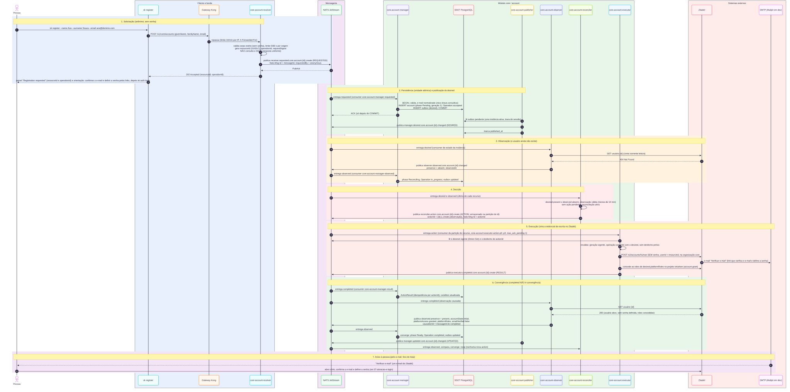

*Fonte: [`01-caminho-perfeito.mmd`](docs/flow/01-caminho-perfeito.mmd); [`01-caminho-perfeito.drawio`](docs/flow/01-caminho-perfeito.drawio) embute o mesmo SVG como imagem (regere-o a partir do `.mmd`; não é editável por formas).* Sete fases: solicitação, persistência, observação, decisão, execução, convergência e aviso. O `completed` do Executor **não** é a convergência: só a observação compatível converge. A pessoa é avisada pelos **e-mails do Zitadel**; o cliente anônimo não recebe retorno do loop (não consulta a Operation, o que impede descobrir e-mails cadastrados).

## 4.2 Erros antes de entrar no loop

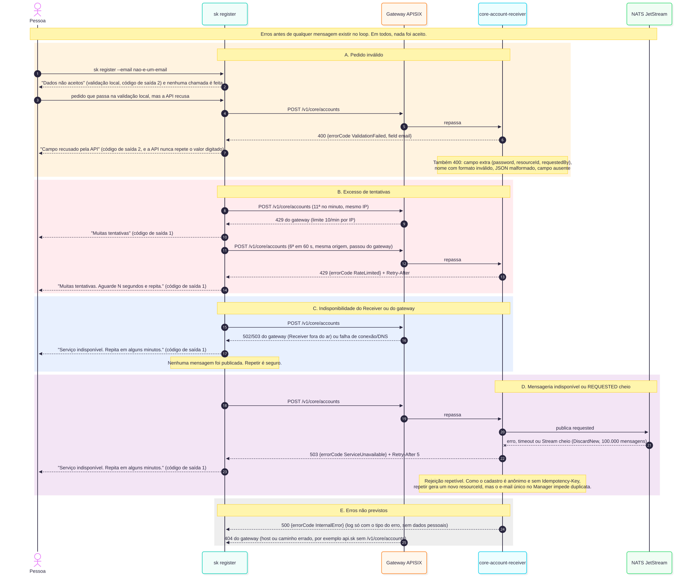

*Fonte: [`02-validacao-e-borda.mmd`](docs/flow/02-validacao-e-borda.mmd).* Pedido inválido (400), excesso de tentativas (429 no gateway e no Receiver), Receiver indisponível, NATS indisponível ou `REQUESTED` cheio (503 repetível) e erros não previstos. Em todos, nada foi aceito.

## 4.3 E-mail já cadastrado

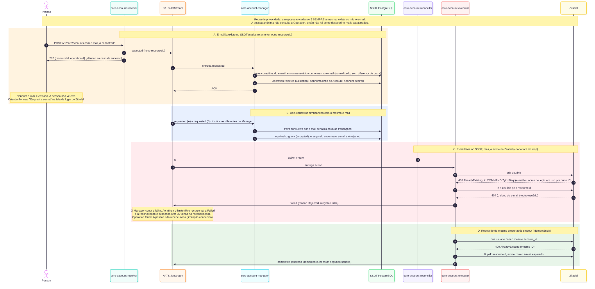

*Fonte: [`03-email-ja-cadastrado.mmd`](docs/flow/03-email-ja-cadastrado.mmd).* A resposta é sempre a mesma. O Manager rejeita (`validation`) sem criar nada nem enviar e-mail; cadastros simultâneos são serializados; e-mail livre no SSOT mas em uso no Zitadel vira falha permanente do Executor.

## 4.4 Falhas no Manager e na mensageria

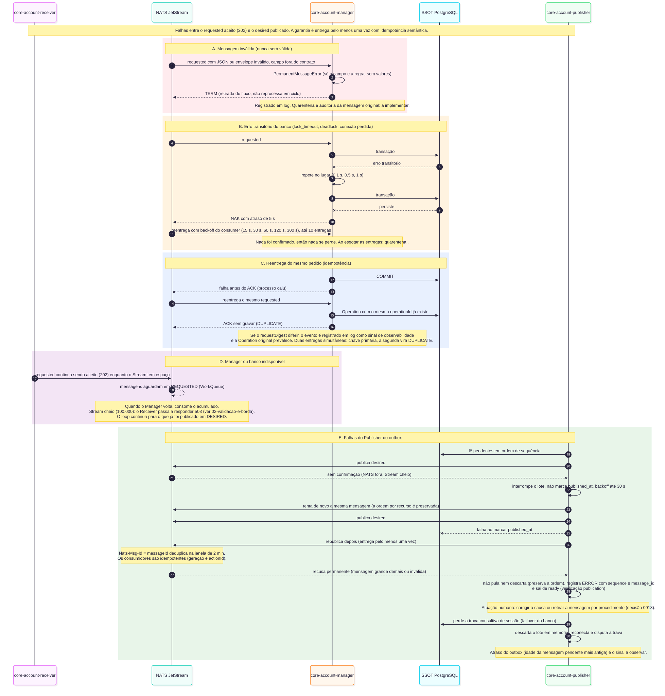

*Fonte: [`04-falhas-no-manager-e-mensageria.mmd`](docs/flow/04-falhas-no-manager-e-mensageria.mmd).* Mensagem inválida (`TERM`), erro transitório do banco (retry local e `NAK` com backoff), reentrega (idempotência por `operationId`), Manager ou banco indisponível e as falhas do Publisher (inclusive o bloqueio por recusa permanente).

## 4.5 Falhas na reconciliação

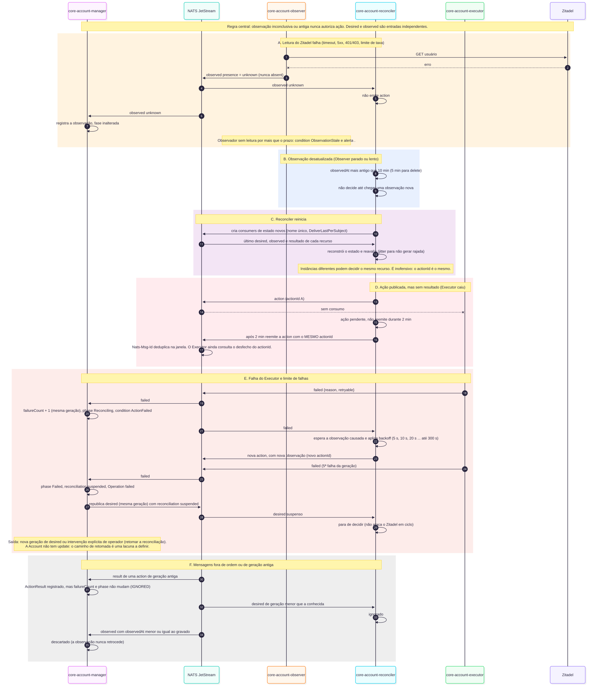

*Fonte: [`05-falhas-na-reconciliacao.mmd`](docs/flow/05-falhas-na-reconciliacao.mmd).* Observação `unknown` ou antiga, reinício do Reconciler, ação sem resultado (reemissão com o mesmo `actionId`), limite de falhas com suspensão e mensagens fora de ordem ou de geração antiga.

## 4.6 Falhas no Executor e no e-mail

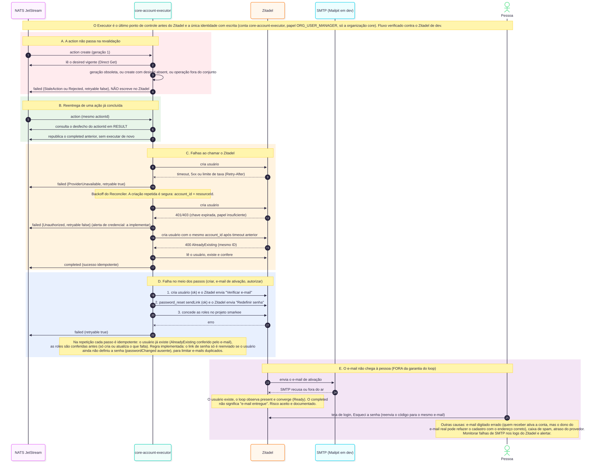

*Fonte: [`06-falhas-no-executor-e-email.mmd`](docs/flow/06-falhas-no-executor-e-email.mmd).* Revalidação reprovada, reentrega de ação concluída, falhas do Zitadel (retentável ou não), falha entre os passos e o e-mail que **não chega** (fora da garantia do loop: o `completed` não significa "e-mail entregue").

## 4.7 Ativação e login

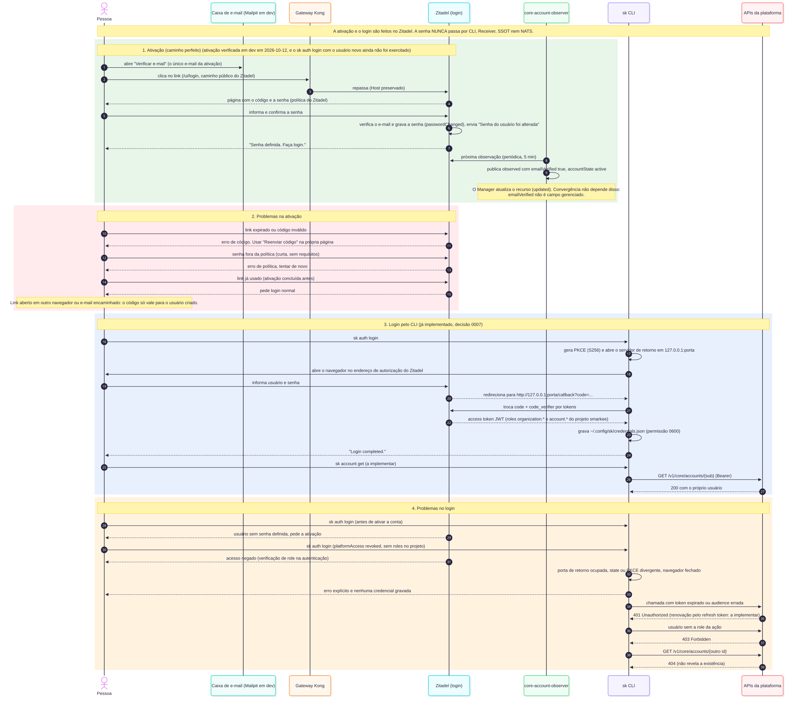

*Fonte: [`07-ativacao-e-login.mmd`](docs/flow/07-ativacao-e-login.mmd).* A pessoa define a senha na página do Zitadel (a senha nunca passa por CLI, Receiver, SSOT nem NATS) e depois entra com `sk auth login` (PKCE com retorno em loopback, decisão 0007). Inclui os problemas de ativação e de login. A ativação (senha e e-mail) foi verificada em dev em 2026-10-12; **o `sk auth login` com o usuário novo ainda não foi exercitado.**

### Como ativar a conta (senha e e-mail)

Depois do `sk register`, a pessoa tem uma conta criada, mas sem senha e com o e-mail não verificado. Ela ativa a conta assim:

1. **Abra o e-mail "Verificar e-mail"** mais recente do provedor e use o botão. A página do Zitadel confirma o e-mail e já pede a senha: informe e confirme (a política de senha da instância se aplica). Um e-mail só.
2. **Entre.** Com o e-mail confirmado e a senha definida, `sk auth login` autentica a pessoa.

Em desenvolvimento, as mensagens chegam ao Mailpit (http://localhost:8025). Em outros ambientes, chegam à caixa de e-mail real.

**Se o link expirou ou a pessoa não recebeu o e-mail:**

- **Senha:** na tela de login do Zitadel (`http://ipm-dev.smarkee.com.br:8080/ui/v2/login/`), use a opção de recuperar a senha ("Esqueci a senha") e informe o e-mail do cadastro, que é também o nome de login. O Zitadel envia um novo link. Use sempre o link da mensagem mais recente.
- **Verificação do e-mail:** na página de verificação, use a opção de reenviar o código.

Esses reenvios não passam pela plataforma, de propósito: um reenvio anônimo revelaria se um e-mail já está cadastrado (`docs/RESOURCE-CONTROL-LOOP.md`, seção 6.1.2).

**Procedimento do operador (dev).** Se a opção do provedor não estiver disponível, um operador reenvia com a conta de serviço do Executor, que já tem essa permissão (`docs/RESOURCE-CONTROL-SECURITY.md`, seção 9): `POST /v2/users/{id}/password_reset` com `{"sendLink": {}}` para o link de senha, e `POST /v2/users/{id}/email/resend` com `{"sendCode": {}}` para o código de verificação. A chave da conta de serviço nunca sai do volume `identity-bootstrap`.

## 4.8 Remoção

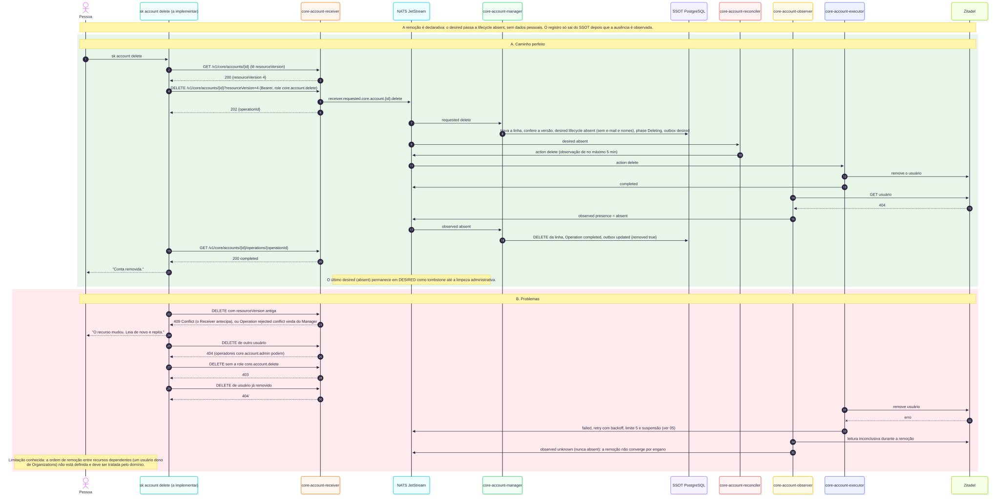

*Fonte: [`08-remocao.mmd`](docs/flow/08-remocao.mmd).* Declarativa: o `desired` passa a `absent` (sem dados pessoais); o Reconciler decide `delete`; o registro só sai do SSOT quando a ausência é observada. Inclui conflito de versão, permissão e falhas.

## 4.9 Fluxo de dados

[`docs/CORE-ACCOUNT-DATA-FLOW.md`](docs/CORE-ACCOUNT-DATA-FLOW.md) (padrão da decisão 0024) segue os **dados** do `sk register` até `Ready`: a chamada à API, o payload de cada mensagem, as queries do Manager e as linhas gravadas em cada tabela.

# 5. Estados

| Fase do recurso | Estados da Operation |
|---|---|
|  |  |

Fontes: [`01-fase-do-recurso.mmd`](docs/state/01-fase-do-recurso.mmd) e [`02-operation.mmd`](docs/state/02-operation.mmd). A fase `Failed` suspende a reconciliação; a saída é uma nova geração ou intervenção explícita (lacuna a definir: a Account não tem `update`).

# 6. Mensageria

Gramática: `<emitter>.<messageType>.<module>.<resourceType>.<resourceId>.<operation>` (`docs/MESSAGING.md`). Para este tipo, `module = core` e `resourceType = user`.

| Mensagem | Subject | Publica | Consome | Stream |
|---|---|---|---|---|
| `requested` | `receiver.requested.core.account.<id>.create\|delete` | Receiver | Manager | `REQUESTED` |
| `desired` | `manager.desired.core.account.<id>.changed` | Publisher | Reconciler, Observer, Executor (leitura direta) | `DESIRED` |
| `observed` | `observer.observed.core.account.<id>.changed` | Observer | Reconciler, Manager | `OBSERVED` |
| `action` | `reconciler.action.core.account.<id>.create\|update\|delete` (armazenado como `reconciler.action.core.account.<partição>.<id>.<op>`) | Reconciler | Executor | `ACTION` (4 partições) |
| `completed` / `failed` | `executor.completed\|failed.core.account.<id>.<op>` | Executor | Manager, Observer, Reconciler | `RESULT` |
| `updated` | `manager.updated.core.account.<id>.changed` | Publisher | Console, auditoria, métricas | `UPDATED` |

Consumers: Manager `core-account-manager-{requested,observed,result}` (duráveis, compartilhados); Executor `core-account-executor-action-p{0..3}` (duráveis, um por partição do Stream `ACTION`, `max_ack_pending = 1`); Reconciler e Observer criam consumers de estado **por instância** (`core-account-<papel>-<stream>-<instância>`). Os manifestos dos consumers duráveis estão em `consumers/`.

# 7. Contratos

Em [`schemas/core/account/`](../../../schemas/core/account/) (JSON Schema 2020-12, com exemplos): `desired`, `observed`, `requested-create`, `requested-delete`, `api-create-request`, `resource`; e, em `schemas/common/`, envelope, `action`, `completed`, `failed`, `updated`, `operation`, `api-error` e `api-accepted-response`. O índice usado para gerar os modelos é `schemas/core.account.index.json`.

Campos da Account: `givenName`, `familyName` e `email` são `confidential` (nunca em log, mensagem de erro nem métrica) e **não existem** no `desired` de remoção. Campos gerenciados (comparados com o `observed`): `lifecycle`, `platformAccess` e `platformRoles` (as desejadas precisam estar contidas nas observadas; roles a mais não divergem). O conjunto de roles do cadastro vem da configuração do Manager (`CORE_ACCOUNT_MANAGER_PLATFORM_ROLES`) e fica registrado no SSOT ([decisão 0025](../../../.decisions/0025-roles-do-user-no-ssot.md)). A revogação de acesso de um usuário existente é privilégio de operador e ainda não está exposta. A política completa da exclusão da conta (dados residuais, Organizations do usuário, sessões e confirmação) ainda será definida (`ROADMAP.md`). Não há senha em nenhum contrato (`SCHEMA.md` §20.1).

# 8. Segurança e privacidade

- **Cadastro anônimo:** `requestedBy = anonymous`; limite de taxa por origem no gateway (10/min por IP) e no Receiver (5/60 s); resposta uniforme; sem consulta da Operation por anônimo.
- **Sem senha na mensageria:** o Zitadel cria o usuário e envia o link; a senha é definida na página dele.
- **Menor privilégio:** o Receiver não escreve no SSOT nem no Zitadel; o Manager é o único escritor do SSOT; o Observer só lê o Zitadel; o Executor é o único que escreve nele. Cada componente tem papel de banco e identidade próprios, e **monta só a sua chave** do Zitadel.
- **Revalidação no Executor** e consulta do desfecho do `actionId` antes de escrever.
- **Observação inconclusiva nunca é ausência.**
- **Dados pessoais:** só no `desired` de criação (SSOT e `DESIRED`); o `desired` de remoção não os carrega.

## 8.1 Identidades e privilégios por papel

| Papel | Contêiner (Compose) | Identidade NATS | Papel de banco | Privilégio no SSOT | Conta no Zitadel |
|---|---|---|---|---|---|
| Receiver | `core-account-receiver.smarkee.internal` | `core-account-receiver` | `core_account_receiver` | `SELECT` nas views `user_v1` e `user_operation_v1` | nenhuma (só valida tokens pelo JWKS) |
| Manager | `core-account-manager.smarkee.internal` | `core-account-manager` | `core_account_manager` | `SELECT/INSERT/UPDATE/DELETE` em `user`; `SELECT/INSERT/UPDATE` em `user_operation`; `SELECT/INSERT` em `user_action_result`; só `INSERT` em `user_outbox` | nenhuma |
| Publisher | `core-account-publisher.smarkee.internal` | `core-account-publisher` | `core_account_publisher` | `SELECT` em `user_outbox` e `UPDATE (published_at)` | nenhuma |
| Reconciler | `core-account-reconciler.smarkee.internal` | `core-account-reconciler` | nenhum (não acessa o SSOT) | nenhum | nenhuma |
| Observer | `core-account-observer.smarkee.internal` | `core-account-observer` | nenhum | nenhum | `core-account-observer` (`ORG_OWNER_VIEWER`, leitura) |
| Executor | `core-account-executor.smarkee.internal` | `core-account-executor` | nenhum | nenhum | `core-account-executor` (`ORG_USER_CREATOR` na `register`; `PROJECT_GRANT_OWNER` em `core` e `sum`) |

Etapas de implantação (executam e terminam): `core-account-migrate` (migrações, papel administrativo) e `core-account-consumer` (cria os consumers duráveis). A manutenção (`core_maintenance`) é uma identidade de infraestrutura, com `SELECT` e `DELETE` no outbox, nos resultados de ação e nas Operations. Em dev, todos os componentes usam o mesmo usuário NATS (veja a seção 10).

**Saúde.** Cada componente atende `GET /health/live`, `/health/ready` e `/health/startup` na porta `8000` (rede interna; o gateway publica só `/v1/core/accounts`). O healthcheck do Compose usa `/health/ready`. A liveness só olha o sinal de vida do laço principal; a readiness exige o NATS e, no Publisher, a ausência de bloqueio por recusa permanente.

# 9. Configuração, execução e testes

Variáveis de ambiente `CORE_ACCOUNT_<PAPEL>_<SEÇÃO>_<CAMPO>` (decisão 0016), sem arquivo de configuração. Cada projeto documenta as suas no `README.md` e em `settings.py`. Obrigatórias: senha do NATS (todos), senhas dos papéis do banco (Receiver, Manager, Publisher), `AUTH_AUDIENCE` (Receiver) e os IDs no Zitadel: a organização `register` (Observer e Executor) e os projetos de roles dos módulos (`PROJECT_IDS`, só no Executor).

```bash
# 1. Plataforma (banco, messaging, identidade, gateway, e-mail): infrastructure/dev
cd infrastructure/dev && docker compose up -d && docker compose up -d --wait messaging database gateway identity identity-login mail

# 2. Os componentes da Account
cd features/core/account && cp -n .env.example .env   # preencha os valores vazios
docker compose up -d --build

# 3. Testes de cada projeto
cd receiver && uv sync && uv run ruff check . && uv run pyright && uv run pytest   # idem manager, publisher, reconciler, observer, executor
# 4. Testes e2e (stack no ar)
cd tests/e2e
  CONFORMANCE_MESSAGING_PASSWORD=... CONFORMANCE_MAILPIT_URL=http://localhost:8025 uv run pytest
  # resiliência (derruba Manager, Executor e Publisher, um por vez): acrescente E2E_CHAOS=1
```

Os e-mails do Zitadel de dev são capturados pelo Mailpit (http://localhost:8025): ninguém os recebe.

# 10. Limitações e pendências

- **CLI:** `sk register` confirma que o pedido foi aceito e orienta a verificar o e-mail; `sk account get|delete` consulta e exclui a própria conta (exclusão segura, decisão 0040).
- **E-mail:** o loop não garante a entrega; falha de SMTP, endereço errado e spam estão fora da garantia (fluxo 4.6). É um e-mail só ("Verificar e-mail"), com texto do Zitadel a revisar.
- **Retomada de `Failed`:** a Account não tem `update`; falta definir a intervenção explícita.
- **Remoção com dependentes:** a ordem de remoção entre recursos dependentes (um usuário dono de Organizations) não está definida.
- **Quarentena e `ObservationStale`:** mensagens esgotadas não têm quarentena, e a condition `ObservationStale` ainda não é registrada pelo Manager.
- **Executor:** os consumers de `ACTION` usam `max_ack_pending = 1` sem `pinned_client` (a validar no servidor, `docs/NATS.md` §7.5). O número de partições (4) é fixado no bootstrap do messaging.
- **Migrações:** sem controle de versão (obrigatório antes de stg e prd).
- **Observer:** em dev, uma só partição (`0/1`, aplicada na aplicação por `hash(resourceId) mod count`); com mais réplicas, defina `CORE_ACCOUNT_OBSERVER_PARTITION_INDEX` e `CORE_ACCOUNT_OBSERVER_PARTITION_COUNT` por réplica (por exemplo, `StatefulSet` no Kubernetes).
- **Identidades no NATS em dev:** os componentes se conectam com um único usuário (`smarkee`) e a senha da plataforma; o nome de conexão é o `core-account-<papel>`. As identidades e permissões por papel (`docs/NATS.md` §18 e §26) são o alvo para stg e prd.

# 11. Banco de dados (SSOT da Account)

O SSOT da Account é o schema `core` do banco PostgreSQL `smarkee` (decisão 0001), de propriedade do usuário `smarkee`, que só migra e recupera. A especificação lógica está em [`docs/SSOT.md`](../../../docs/SSOT.md) e a física, em [`docs/POSTGRESQL.md`](../../../docs/POSTGRESQL.md); esta seção descreve o que existe de fato para o tipo `account`.

- **Criação:** a migração [`migrations/0001-account.sql`](migrations/0001-account.sql) (código do Manager, decisões 0015 e 0063) é aplicada pelo serviço `core-account-migrate`, com o papel administrativo, a cada `up`; é idempotente. Os papéis de serviço vêm de [`infrastructure/dev/database/bootstrap/core.sql`](../../../infrastructure/dev/database/bootstrap/core.sql).
- **Nomes:** a tabela do tipo é `core.account`, e as demais são `core.account_operation`, `core.account_action_result` e `core.account_outbox`; as views (`core.account_v1`, `core.account_operation_v1`) não precisam de aspas.

## 11.1 Entidade e relacionamento


*Fonte: [`docs/database/01-er-fisico.mmd`](docs/database/01-er-fisico.mmd); gerado a partir do DDL e conferido com o banco de dev (`information_schema`, 2026-10-12).* Quatro tabelas e duas views. **Não há chave estrangeira** (verificado: zero `FOREIGN KEY` no schema): `resource_id` relaciona as tabelas de forma lógica, porque a Operation sobrevive à remoção do usuário e o ActionResult e o outbox têm ciclo de vida próprio. A consistência vem da unidade atômica de gravação do Manager: uma transação por mensagem.

## 11.2 Tabelas

| Tabela | Uma linha por | Chave | Nasce quando | Sai quando |
|---|---|---|---|---|
| `core.account` | usuário (estado consolidado) | `resource_id` (UUIDv7, é o ID do usuário no Zitadel) | o Manager aceita o `requested` de `create` | a ausência é observada depois do `delete` (`DELETE` da linha) |
| `core.account_operation` | pedido (aceito ou rejeitado) | `operation_id` | cada `requested` tratado (também o rejeitado, ou o sem mudança) | **não há retenção implementada** |
| `core.account_action_result` | `actionId` contabilizado | `action_id` (`<id>.<geração>.<operação>.<messageId do observed>`) | o Manager recebe `completed` ou `failed` da ação | **não há retenção implementada** |
| `core.account_outbox` | mensagem a publicar (`desired` ou `updated`) | `sequence` (ordem de gravação) e `message_id` único | cada gravação do Manager que gera mensagem | **não há retenção implementada** (o Publisher só marca `published_at`) |

Views (a interface de leitura do Receiver, decisão 0004): `core.account_v1` (o usuário **sem** `failure_count`) e `core.account_operation_v1` (a Operation com `requested_by`, que o Receiver usa só para autorizar a leitura e não devolve ao cliente).

## 11.3 O que cada coluna `jsonb` guarda

| Coluna | Conteúdo na Account |
|---|---|
| `desired` | `lifecycle`, `platformAccess`, `platformRoles` `deletionProtection` (nasce `true`) e, no `create`, `givenName`, `familyName` e `email` (normalizado). No `delete`, só `lifecycle = absent`, `platformAccess` e `platformRoles`: **sem dados pessoais** |
| `observed` | `emailVerified`, `accountState` (`initial` até a senha ser definida), `platformAccess` e `platformRoles` |
| `conditions` | Array com a condition `Ready` (`status`, `reason`, `observedGeneration`, `lastTransitionAt`) |
| `user_outbox.payload` | O envelope completo da mensagem (`desired` ou `updated`), com `publishedAt` e `publishedBy` preenchidos pelo Publisher |

## 11.4 Índices e restrições

| Objeto | Definição | Para quê |
|---|---|---|
| `user_pkey` | `PRIMARY KEY (resource_id)` | identidade e `FOR UPDATE` do registro |
| `user_email` | índice **não único** sobre `desired ->> 'email'` | busca do e-mail na regra de unicidade |
| `user_operation_resource` | `(resource_id, created_at)` | Operations de um recurso |
| `user_operation_retention` | `(updated_at)` parcial (`completed`, `failed`, `rejected`) | retenção (a tarefa ainda não existe) |
| `user_action_result_recorded` | `(recorded_at)` | retenção (idem) |
| `user_outbox_message_id_key` | `UNIQUE (message_id)` | deduplicação |
| `user_outbox_pending` | `(sequence)` parcial, `published_at IS NULL` | o Publisher lê só o que falta publicar |
| `user_outbox_published` | `(published_at)` parcial, `published_at IS NOT NULL` | retenção do que já foi publicado |

Restrições `CHECK` em todas as colunas de controle e de identificação (`lifecycle`, `reconciliation`, `presence`, `phase`, `operation_status`, formato de `resource_id` e de `request_digest`, tamanho dos `jsonb`, `presence` nulo se e só se `observed_at` nulo).

**A unicidade do e-mail não é uma restrição do banco.** Ela é conferida pelo Manager na unidade atômica do `requested`, sob uma **trava consultiva** por e-mail (`pg_advisory_xact_lock`), que serializa os cadastros simultâneos, e depois por uma consulta sobre `desired ->> 'email'`. Escrever na tabela por outro caminho (o papel do Manager é o único com `INSERT`) pularia a regra.

## 11.5 Quem grava o quê

| Mensagem | `core.account` | `core.account_operation` | `core.account_action_result` | `core.account_outbox` |
|---|---|---|---|---|
| `requested` (`create`) | `INSERT` (`Pending`, geração 1) | `INSERT` (`accepted`, ou `rejected` se e-mail repetido) | — | `INSERT` do `desired` |
| `requested` (`delete`) | `UPDATE` (`desired` `absent`, `Deleting`, nova geração) | `INSERT` | — | `INSERT` do `desired` |
| `observed` | `UPDATE` da observação, `phase` e `conditions`; `DELETE` se a ausência convergiu | `UPDATE` do status | — | `INSERT` do `updated` |
| `completed` / `failed` | `UPDATE` de `failure_count`, `phase`, `reconciliation` | `UPDATE` do status | `INSERT` | `INSERT` do `updated` (e do `desired` suspenso no limite de falhas) |

A figura genérica, por mensagem: [`docs/diagrams/ssot-gravacao-por-mensagem.svg`](../../../docs/diagrams/ssot-gravacao-por-mensagem.svg). Os privilégios por papel de banco estão na seção 8.1 e em [`docs/diagrams/postgresql-privilegios.svg`](../../../docs/diagrams/postgresql-privilegios.svg).

## 11.6 Dados pessoais no banco

`givenName`, `familyName` e `email` ficam em claro em `core.account.desired` e no `payload` da linha do outbox que carregou o `desired` de criação. O `request_digest` da Operation é o SHA-256 do conteúdo do pedido (inclui esses campos), e não o conteúdo. Com a remoção do usuário, a linha de `core.account` sai e o `desired` de remoção não os carrega, **mas o outbox e as Operations não têm retenção implementada**: o `payload` do `desired` de criação permanece no outbox (e no Stream `DESIRED`, como tombstone até a limpeza). É uma pendência de privacidade, registrada em `docs/IMPLEMENTATION-STATUS.md`.

## 11.7 Consultas úteis (dev)

```bash
# Usuários por fase
docker exec database.smarkee.internal psql -U postgres -d smarkee -c \
  'SELECT phase, count(*) FROM core.account GROUP BY phase'
# Atraso do outbox (idade da mensagem pendente mais antiga)
docker exec database.smarkee.internal psql -U postgres -d smarkee -c \
  'SELECT now() - min(created_at) AS atraso, count(*) AS pendentes FROM core.account_outbox WHERE published_at IS NULL'
# Operations de um recurso
docker exec database.smarkee.internal psql -U postgres -d smarkee -c \
  "SELECT operation_id, operation_type, operation_status, operation_status_reason FROM core.account_operation WHERE resource_id = '<id>' ORDER BY created_at"
```
