# ipm.organization

A **Organization** é a unidade de isolamento da plataforma (`.decisions/0006-organization-como-unidade-de-isolamento.md`): um recurso do módulo `ipm` (`.decisions/0016-organization-no-modulo-ipm.md`), criado por um usuário registrado (a Account, do módulo `core`), que passa a ser o dono dela. É gerenciada pelo Resource Control Loop (`docs/RESOURCE-CONTROL-LOOP.md`, seção 46) e vive, no Zitadel, como uma organização com o mesmo ID (`resourceId`).

Decisões que definem esta feature: `0006` e `0016` (o que é a Organization e onde mora), `0010` (roles, dono, cota e acesso no Zitadel), `0015` (componentes por papel), `0017` (estrutura interna e testes e2e), `0018` (partições e saúde), `0019` (Publisher), `0020` (Receiver) e `0038` (refeita a partir da Account: só a organização no Zitadel). A feature `features/core/account` é o **modelo** desta estrutura.

# 1. Estado da implementação

Os seis componentes do loop e a CLI estão implementados e rodam no dev (Compose). A suíte e2e cria, renomeia, desativa, reativa e remove a organização no Zitadel real, com falha de componente.

| Papel | Projeto | Estado |
|---|---|---|
| Receiver | `receiver/` (`ipm-organization-receiver`) | API `/v1/ipm/organizations`: autentica, confere a role, o e-mail verificado e a cota, publica `requested`. Contrato em `openapi.json` |
| Manager | `manager/` (`ipm-organization-manager`) | Consome `requested`, `observed` e `completed`/`failed`; nomes reservados, unicidade e cota por dono na unidade atômica |
| Publisher | `publisher/` (`ipm-organization-publisher`) | Publica o outbox no NATS, com trava de sessão, envelope estrito e `Nats-Msg-Id` (decisão 0019) |
| Reconciler | `reconciler/` (`ipm-organization-reconciler`) | Compara `name` e `platformAccess` e decide `create`, `update` ou `delete`; estado reconstruído da mensageria |
| Observer | `observer/` (`ipm-organization-observer`) | Lê a organização no Zitadel (somente leitura) e publica `observed`; partição por `resourceId` |
| Executor | `executor/` (`ipm-organization-executor`) | Escreve só a organização no Zitadel; revalida cada ação; um laço por partição |
| Testes e2e | `tests/e2e/` | Black-box: contrato, loop completo e caos (os cinco papéis de runtime) |

A CLI é o comando `sk ipm organization create|get|list|update|delete` (`clients/cli`).

# 2. Arquitetura



Fonte: [`01-componentes.mmd`](docs/architecture/01-componentes.mmd). O fluxo de dados completo está em [`docs/IPM-ORGANIZATION-DATA-FLOW.md`](docs/IPM-ORGANIZATION-DATA-FLOW.md).

# 3. Papéis e componentes

Os seis papéis são **um projeto e uma imagem** (decisão 0063), cada um rodando como processo e contêiner próprios: cada papel tem o próprio papel de banco (`ipm_organization_<papel>`, em `infrastructure/dev/database/bootstrap/ipm.sql`), a própria identidade no NATS e, quando usa o Zitadel, a própria conta de serviço. O código igual em todos fica em `common/`, e nenhum papel importa outro.

| Componente | Serviço no Compose | Papel de banco | Conta no Zitadel | Escreve |
|---|---|---|---|---|
| Receiver | `ipm-organization-receiver` | `ipm_organization_receiver` (só leitura das views) | — | `requested` no NATS |
| Manager | `ipm-organization-manager` | `ipm_organization_manager` | — | SSOT (`ipm.organization*`) e outbox |
| Publisher | `ipm-organization-publisher` | `ipm_organization_publisher` | — | `published_at` do outbox; NATS |
| Reconciler | `ipm-organization-reconciler` | — | — | `action` no NATS |
| Observer | `ipm-organization-observer` | — | `ipm-organization-observer` (`IAM_OWNER_VIEWER`, de instância, leitura) | `observed` no NATS |
| Executor | `ipm-organization-executor` | — | `ipm-organization-executor` (`IAM_ORG_MANAGER`, de instância) | `completed` e `failed`; a organização no Zitadel |

## 3.1 Receiver (`ipm-organization-receiver`)

- Rotas sob `/v1/ipm/organizations`: `POST` cria, `GET` lista, `GET /{resourceId}` lê, `PATCH /{resourceId}` altera, `DELETE /{resourceId}?resourceVersion=` remove e `GET /{resourceId}/operations/{operationId}` acompanha a Operation.
- Valida o token (assinatura por JWKS, `iss`, `aud` = projeto `roles-ipm`, `exp`). O dono é o `sub`: nunca vem do corpo, que só tem `name`. Cada ação exige a role `ipm.organization.<create|get|list|update|delete>`. Para criar, o solicitante precisa de **e-mail verificado** e de cota (`IPM_ORGANIZATION_RECEIVER_API_ORGANIZATION_QUOTA`, padrão 1); o operador (`ipm.organization.admin`) não tem cota.
- O dono altera o `name` e a proteção contra exclusão (`deletionProtection`); `platformAccess` e `reconciliation` são do operador. A Organization **nasce protegida** (decisão 0043): o `DELETE` responde `409 DeletionProtected` até um `PATCH` com `deletionProtection: false`; alterar só a proteção conclui na hora, sem reconciliar. Registro sem o campo vale como protegido. Uma Organization de outro dono responde `404`, para não revelar que existe. `Idempotency-Key` torna o `POST`, o `PATCH` e o `DELETE` repetíveis.
- Só lê o SSOT, pelas views `ipm.organization_v1` e `ipm.organization_operation_v1`. Não expõe `/docs` nem `/openapi.json`: o contrato descritivo é o arquivo versionado `openapi.json`, conferido por teste. Erros no formato `api-error`; a entrada inválida é `400` e nunca repete o valor enviado.

## 3.2 Manager (`ipm-organization-manager`)

- Único escritor do SSOT (`ipm.organization`, `ipm.organization_operation`, `ipm.organization_action_result`) e do outbox.
- Consome `requested` (criar, alterar e remover), `observed` e os resultados `completed` e `failed`. Aceita ou recusa com motivo (`conflict`, `validation`, `not_found`, `protected`): o `delete` de uma Organization protegida (`deletionProtection`, decisão 0043) é `protected`; nome reservado, nome já usado e cota por dono esgotada são `validation`; a unicidade e a cota são conferidas na mesma unidade atômica, sob trava consultiva por nome e por dono.
- Só insere no outbox: a publicação é do Publisher. ACK depois do `COMMIT`; falha transitória do banco é `RETRY`; mensagem fora do contrato (inclusive de outra versão `MAJOR`) é `TERM`.
- Aplica `observed` (fase `Ready`, `Reconciling` ou `Deleting`) e acompanha as Operations; remoção convergida apaga a linha.

## 3.3 Publisher (`ipm-organization-publisher`)

- Lê o outbox em ordem de `sequence`, valida o envelope de forma estrita, acrescenta `publishedAt` e `publishedBy` e publica em `manager.desired.ipm.organization.<resourceId>.changed` (e `updated`), com `Nats-Msg-Id` igual ao `messageId`. Marca `published_at` depois da confirmação.
- Uma instância ativa por trava consultiva de sessão. Recusa permanente (ou envelope inválido) mantém a mensagem pendente, registra `ERROR` e tira o Publisher de `ready`, sem derrubar o processo (decisão 0018).

## 3.4 Reconciler (`ipm-organization-reconciler`)

- Mantém em memória o último `desired`, `observed` e resultado de cada Organization, reconstruídos a cada início (consumer por instância, `DeliverLastPerSubject`). Não acessa o SSOT.
- Decide com as guardas do loop (sem os dois estados, suspenso, `observed` `unknown` ou vencido, ação pendente, backoff) e publica a `action` (`create`, `update` ou `delete`) com `Nats-Msg-Id` igual ao `actionId`. Reavalia periodicamente, com jitter.

## 3.5 Observer (`ipm-organization-observer`)

- Lê a organização no Zitadel (API v2, `ListOrganizations` pelo ID) e publica `observed`: `present` com `name`, `platformAccess` (`active` ↔ `granted`) e `organizationState`; `absent` só quando a consulta tem sucesso e não traz resultado; `unknown` para qualquer falha de leitura. Observa quando o `desired` muda, depois de cada resultado e periodicamente (com jitter); cada réplica observa só a sua partição.

## 3.6 Executor (`ipm-organization-executor`)

- Único componente que escreve a organização no Zitadel, por `IAM_ORG_MANAGER`. **Só a organização**: não cria usuários, não autoriza o dono e não cria Project Grant (decisão 0038). O ID da organização é o `resourceId`, então repetir a criação não duplica.
- Valida a mensagem (emissor `reconciler`, tipo, módulo, versão `MAJOR`), não repete um `actionId` já concluído e revalida a ação contra o `desired` vigente (geração, `suspended`, `lifecycle`). Ação velha ou recusada vira `failed` permanente; erro transitório vira `failed` com `retryable`, e o retry é do Reconciler. Um consumer e um laço por partição do `ACTION`.

## 3.6.1 Um projeto, uma imagem, seis contêineres (decisão 0063)

`ipm.organization` é **um projeto** (`pyproject.toml`, `uv.lock`, `Dockerfile`) e **uma imagem** (`smarkee-ipm-organization`), que contém o código dos seis papéis. Cada papel roda como **contêiner próprio**, escolhido pelo `command` (`ipm-organization-receiver`, `-manager`, `-publisher`, `-observer`, `-reconciler` e `-executor`), com as suas próprias variáveis, segredos, papel de banco e identidade no NATS. Ter o código de um papel na imagem de outro não dá privilégio: ele vem da credencial.

```text
src/ipm_organization/
  common/      o que é igual em todos os papéis: settings, messaging, lifecycle, database, identity
               (token da conta de serviço), ports, resource (módulo, tipo e versão), contracts/
               (modelos gerados, base e envelope), logging_config, ids e http/health
               Os arquivos de common/ (exceto resource.py e contracts/generated.py) são gerados do
               template (templates/feature, decisão 0064): altere o modelo, não a cópia.
  receiver/  manager/  publisher/  observer/  reconciler/  executor/    (cada um com o seu README)
tests/
  common/  receiver/  manager/  publisher/  observer/  reconciler/  executor/    (unit, contract e integration)
  e2e/                                                                             (projeto à parte, black-box)
migrations/    SQL do Manager, aplicado pelo serviço ipm-organization-migrate
consumers/     manifestos dos consumers do Manager e do Executor
```

Um papel nunca importa outro (`tests/common/unit/test_role_isolation.py`); só o `common/`. Comandos de desenvolvimento, na raiz da feature: `uv sync`, `uv run ruff check . && uv run ruff format --check . && uv run pyright` e `uv run pytest` (a suíte e2e, em `tests/e2e`, tem projeto próprio).

## 3.7 Estrutura interna dos papéis

Cada papel é um subpacote com `main.py`, `settings.py` e `domain/` puro e sem I/O (decisão 0017): a dependência vai em um sentido só (`main → orquestração → domain`), e o `domain` nunca importa um adaptador (`tests/common/unit/test_domain_isolation.py` garante isso para todos os papéis). As pastas de cada papel:

| Papel | Pastas | README |
|---|---|---|
| Receiver | `auth/`, `domain/`, `http/`, `store/` | [`receiver`](src/ipm_organization/receiver/README.md) |
| Manager | `domain/`, `handlers/`, `store/`, `transport/` | [`manager`](src/ipm_organization/manager/README.md) |
| Publisher | `domain/`, `outbox/` | [`publisher`](src/ipm_organization/publisher/README.md) |
| Reconciler | `domain/`, `engine/`, `transport/` | [`reconciler`](src/ipm_organization/reconciler/README.md) |
| Observer | `domain/`, `engine/`, `provider/`, `transport/` | [`observer`](src/ipm_organization/observer/README.md) |
| Executor | `actions/`, `domain/`, `engine/`, `provider/`, `transport/` | [`executor`](src/ipm_organization/executor/README.md) |

A saúde (`/health/*`) é de `common/http/health.py`, igual em todos os papéis.

## 3.8 Testes e2e (`tests/e2e`)

Suíte black-box (decisão 0017): fala só com o gateway, o NATS, o SSOT (limpeza) e o Docker (caos), e valida contra os schemas. Ver [`tests/e2e/README.md`](tests/e2e/README.md).

# 4. Fluxos

| Fluxo | Diagrama |
|---|---|
| Criar uma Organization, do `POST` à organização no Zitadel | [`flow/01-criar-organization`](docs/flow/01-criar-organization.svg) |
| Erros antes de entrar no loop e recusas do Manager | [`flow/02-validacao-e-borda`](docs/flow/02-validacao-e-borda.svg) |
| Atualizar (renomear) e remover | [`flow/03-atualizar-e-remover`](docs/flow/03-atualizar-e-remover.svg) |
| Falhas no Manager, na mensageria e no Publisher | [`flow/04-falhas-no-manager-e-mensageria`](docs/flow/04-falhas-no-manager-e-mensageria.svg) |
| Falhas na reconciliação e reinício do estado | [`flow/05-falhas-na-reconciliacao`](docs/flow/05-falhas-na-reconciliacao.svg) |
| Falhas no Executor | [`flow/06-falhas-no-executor`](docs/flow/06-falhas-no-executor.svg) |

O fluxo de dados completo, passo a passo, está em [`docs/IPM-ORGANIZATION-DATA-FLOW.md`](docs/IPM-ORGANIZATION-DATA-FLOW.md).

# 5. Estados

- Fase do recurso (`phase`): [`state/01-fase-do-recurso`](docs/state/01-fase-do-recurso.svg).
- Operation (`operationStatus`): [`state/02-operation`](docs/state/02-operation.svg).

# 6. Mensageria

| Stream | Subject | Consumer | Quem lê |
|---|---|---|---|
| `REQUESTED` | `receiver.requested.ipm.organization.>` | `ipm-organization-manager-requested` (durável) | Manager |
| `DESIRED` | `manager.desired.ipm.organization.>` | `ipm-organization-{reconciler,observer}-desired-<instância>` | Reconciler, Observer |
| `OBSERVED` | `observer.observed.ipm.organization.>` | `ipm-organization-manager-observed` (durável); `ipm-organization-reconciler-observed-<instância>` | Manager, Reconciler |
| `RESULT` | `executor.*.ipm.organization.>` | `ipm-organization-manager-result` (durável); `ipm-organization-{reconciler,observer}-result-<instância>` | Manager, Reconciler, Observer |
| `ACTION` | `reconciler.action.ipm.organization.<partição>.>` | `ipm-organization-executor-action-p0..p3` (duráveis) | Executor |

Os consumers de trabalho (Manager e Executor) são duráveis, compartilhados e declarados pelo serviço `ipm-organization-consumer`, a partir dos manifestos em `consumers/`. O Reconciler e o Observer não têm manifesto: cada instância cria os próprios consumers de estado, com nome único por execução, `DeliverLastPerSubject` e `inactive_threshold`, e reconstrói o estado da mensageria (`docs/NATS.md` §7.4).

No `ACTION`, a partição é aplicada pelo servidor (`subject_transform`, decisão 0018), com `max_ack_pending = 1`: uma ação por recurso por vez.

# 7. Contratos

Os contratos estão em `schemas/ipm/organization/` (e `schemas/common/`), com o índice `schemas/ipm.organization.index.json`: `desired`, `observed`, `requested-create|update|delete`, `api-create-request`, `api-update-request`, `resource` e `resource-list`. Os modelos Pydantic de cada componente são gerados (`uv run datamodel-codegen`, decisão 0012) e conferidos por teste de contrato no Manager e no Receiver. A API HTTP é descrita em [`openapi.json`](openapi.json), gerado por `uv run python -m ipm_organization_receiver.http.openapi` e conferido por teste.

# 8. Segurança e privacidade

- **Dono pelo token:** o `ownerAccountId` é o `sub` do token. O corpo do `POST` só aceita `name`; qualquer outro campo é recusado pelo contrato. O dono vive só no `desired` (no SSOT e na mensageria), nunca no Zitadel nem nas respostas ao usuário.
- **Sem dados pessoais:** a Organization guarda só IDs e o nome. Não há e-mail, nome de pessoa nem token no banco, nas mensagens ou nos logs.
- **Menor escrita:** o Executor escreve só a organização. Os papéis `IAM_ORG_MANAGER` e `IAM_OWNER_VIEWER` são de instância (o Zitadel não tem papel padrão menor para criar e listar organizações). **Exceção deliberada** (decisão 0060): ficam assim em todos os ambientes, até o Zitadel oferecer um papel padrão menor.
- **Última barreira:** o Executor não confia em quem enviou a ação: confere o emissor, a versão e o `desired` vigente, e não assume `present` quando falta o `lifecycle`.
- **Nomes:** nomes reservados e repetidos são recusados antes de o pedido chegar ao Zitadel; um nome já usado só no Zitadel (e não reservado) vira `failed` `Rejected` no Executor.
- **Erros e logs:** nenhuma resposta ou log repete o valor enviado, senhas ou tokens; as configurações escondem os segredos (`SecretStr`).

## 8.1 Identidades e privilégios por papel

| Papel | Banco | NATS | Zitadel |
|---|---|---|---|
| Receiver | `SELECT` nas views `organization_v1` e `organization_operation_v1` | publica `requested` | só valida tokens (JWKS) |
| Manager | `SELECT`, `INSERT`, `UPDATE` e `DELETE` em `organization`; `SELECT`, `INSERT` e `UPDATE` em `organization_operation`; `SELECT` e `INSERT` em `organization_action_result`; `INSERT` no outbox | lê `requested`, `observed`, resultados | — |
| Publisher | `SELECT` no outbox e `UPDATE (published_at)` | publica `desired` e `updated` | — |
| Reconciler | — | lê o estado; publica `action` | — |
| Observer | — | lê `desired` e resultados; publica `observed` | leitura de organizações, `IAM_OWNER_VIEWER` |
| Executor | — | lê `action`; publica `completed` e `failed` | cria, altera, ativa, desativa e remove organizações, `IAM_ORG_MANAGER` |

# 9. Configuração, execução e testes

Variáveis `IPM_ORGANIZATION_<COMPONENTE>_<SEÇÃO>_<CAMPO>`, sem arquivo de configuração. O `.env.example` lista as obrigatórias: a senha do NATS (todos), as senhas dos papéis do banco (Receiver, Manager, Publisher) e a audience do Receiver. As chaves das contas de serviço do Zitadel (Observer e Executor) são arquivos montados do volume `identity-bootstrap`, cada componente com a sua.

```bash
# 1. Plataforma (banco, messaging, identidade, gateway): infrastructure/dev, no ar e saudável
# 2. Os componentes da Organization
cd features/ipm/organization && cp -n .env.example .env   # preencha os valores vazios
docker compose up -d --build
# 3. Testes do projeto
uv sync && uv run ruff check . && uv run pyright && uv run pytest   # na raiz da feature (projeto único)
# 4. Testes e2e (stack no ar): ver tests/e2e/README.md
```

Os papéis `ipm_organization_*` e o esquema `ipm` são criados por `infrastructure/dev/database/bootstrap/ipm.sql` e pelas migrações de `migrations/`. O dono do esquema é `smarkee`. Nos bancos de dev já existentes, o bootstrap só roda na criação do volume: aplique-o à mão. Os testes de integração de `manager/` e `publisher/` usam os papéis de login do banco de dev (`IPM_TEST_DATABASE_HOST` e `_PORT`); sem o banco, são pulados.

Depois de recriar o contêiner do Receiver, o gateway volta a resolver o nome sozinho em poucos segundos (com `502` nesse intervalo); não é preciso reiniciá-lo.

# 10. Limitações e pendências

- A Operation não vira `failed`: a falha aparece na fase `Failed` da Organization.
- Logo depois do `202`, a leitura pode dar `404` até o Manager gravar a Operation (`docs/RESOURCE-CONTROL-LOOP.md` §6.1.1).
- O Executor não cria Project Grant nem autoriza membros: a Organization de hoje só existe como organização no Zitadel. Membros e Agents, e os recursos derivados (OpenBao, Kubernetes), são de outras features.
- Os papéis de instância `IAM_ORG_MANAGER` e `IAM_OWNER_VIEWER` são mais largos que o necessário, e ficam assim por exceção deliberada (decisão 0060).
- Remover não tem retenção: a organização some do Zitadel e a linha é apagada ao convergir.
- As chaves das contas de serviço vencem em 2030-01-01 e a rotação é manual (`infrastructure/dev/README.md`).
- Endurecimento comum aos módulos, ainda pendente: `cap_drop` e `no-new-privileges` no Compose, limite de taxa e de tamanho nas rotas autenticadas do gateway, e `pinned_client` no Executor (`docs/IMPLEMENTATION-STATUS.md`).

# 11. Banco de dados (SSOT da Organization)

## 11.1 Entidade e relacionamento


Fonte: [`01-er-fisico.mmd`](docs/database/01-er-fisico.mmd).

## 11.2 Tabelas

| Tabela | Conteúdo | Quem grava |
|---|---|---|
| `ipm.organization` | Uma linha por Organization: intenção, observado, fase | Manager |
| `ipm.organization_operation` | Uma linha por pedido aceito ou recusado | Manager |
| `ipm.organization_outbox` | Mensagens `desired` e `updated` à espera de publicação, em ordem de `sequence` | Manager insere; Publisher marca `published_at` |
| `ipm.organization_action_result` | Resultado já contado, por `actionId` | Manager |

O Receiver lê pelas views `ipm.organization_v1` (sem `failure_count`) e `ipm.organization_operation_v1` (com `requested_by`, só para autorizar a leitura).

## 11.3 O que cada coluna `jsonb` guarda

- `organization.desired`: `lifecycle`, `reconciliation`, `name`, `platformAccess`, `deletionProtection` e `ownerAccountId`.
- `organization.observed`: `name`, `platformAccess` e `organizationState` lidos do Zitadel.
- `organization.conditions`: lista de condições do recurso.
- `organization_outbox.payload`: o envelope publicado, sem `publishedAt` e `publishedBy` (o Publisher os preenche).

## 11.4 Índices e restrições

- `organization_owner` e `organization_name` (índices de busca sobre `desired`): a cota por dono e a unicidade do nome são conferidas pelo Manager na unidade atômica, sob trava consultiva, e não por restrição única.
- `organization_operation`: `(operation_status = 'rejected') = (operation_status_reason IS NOT NULL)` e `= (desired_generation IS NULL)`.
- `organization_outbox_pending` (parcial, `published_at IS NULL`) e `organization_outbox_published`; `message_id` único.
- Limites de tamanho e padrões nos identificadores, nas fases e nos estados (`CHECK`), e `jsonb` limitado a 256 KiB.

## 11.5 Quem grava o quê

Ver o mapa em [`docs/IPM-ORGANIZATION-DATA-FLOW.md`](docs/IPM-ORGANIZATION-DATA-FLOW.md) §9 e os privilégios em `migrations/0001-organization.sql`.

## 11.6 Dados pessoais no banco

Nenhum dado pessoal: só o ID do dono no Zitadel (`ownerAccountId`, dentro de `desired`) e o nome da Organization.

## 11.7 Consultas úteis (dev)

```sql
-- Organizations por fase e situação
SELECT phase, lifecycle, count(*) FROM ipm.organization GROUP BY 1, 2 ORDER BY 1, 2;

-- Organizations por dono
SELECT desired ->> 'ownerAccountId' AS dono, count(*) FROM ipm.organization GROUP BY 1;

-- Atraso do outbox (idade da mensagem pendente mais antiga)
SELECT now() - min(created_at) AS atraso FROM ipm.organization_outbox WHERE published_at IS NULL;

-- Operations de um recurso
SELECT operation_id, operation_type, operation_status, operation_status_reason, desired_generation
  FROM ipm.organization_operation WHERE resource_id = '<resourceId>' ORDER BY created_at;
```
