# ipm.user

O **usuário da Organization** é a pessoa que trabalha numa Organization sem ser a dona dela, no modelo das clouds: o dono (o *root*, a Account que criou a Organization) cria usuários **dentro** da própria Organization, e cada um recebe só permissões da plataforma. Decisão [`0077`](../../../.decisions/0077-ipm-user-usuarios-da-organizacao.md). É gerenciado pelo Resource Control Loop (`docs/loop/RESOURCE-CONTROL-LOOP.md`) e vive, no Zitadel, como um usuário humano da organização do cliente, com o mesmo ID (`resourceId`), e uma autorização no Project Grant de `roles-ipm` para essa organização.

Decisões que definem esta feature: `0096` (o loop unificado no Controller), `0077` (o tipo, o escopo, as permissões e o `bind`), `0076` (administrador no lugar de membro), `0028` (padrão das permissões, com a ação `bind`), `0040` (consulta entre Receivers com o token de quem pede), `0043` e `0074` (proteção contra exclusão como metadado; aqui ela nasce desligada), `0072` (toda alteração percorre o loop) e `0075` (motores gerados do template). A `0096` substitui, para este tipo, a separação em Observer, Reconciler e Executor (`0063`, `0065`, `0072` e `0073`). A feature `features/ipm/organization` é o **modelo** desta estrutura.

# 1. Estado da implementação

Os quatro papéis do loop e a CLI estão implementados e rodam no dev (Compose). A suíte e2e cria o usuário numa organização real do Zitadel, troca as permissões, liga a proteção e o remove pelo loop.

| Papel | Projeto | Estado |
|---|---|---|
| Receiver | `receiver/` (`ipm-user-receiver`) | API `/v1/ipm/users`: autentica, decide o escopo (operador, root ou usuário da Organization), confere o catálogo do Grant, a regra do `bind` e a cota, publica `requested`. Contrato em `openapi.json` |
| Manager | `manager/` (`ipm-user-manager`) | Consome `requested` e os catálogos `DESIRED` de permission, role e group; e-mail único na Organization, permissões do módulo e cota por Organization na unidade atômica |
| Publisher | `publisher/` (`ipm-user-publisher`) | Publica o outbox no NATS (template, decisão 0065) |
| Controller | `controller/` (`ipm-user-controller`) | Decisão 0096: lê o `desired` do Stream `DESIRED` e, por usuário, observa o Zitadel, decide, age e reobserva numa só transação, e grava o estado e `updated` no outbox. Substitui o Reconciler, o Observer e o Executor |
| Testes e2e | `tests/e2e/` | Black-box: contrato e loop completo numa Organization preparada pelo operador |

Além dos papéis, dois serviços rodam e saem: `ipm-user-migrate` (migrações) e `ipm-user-consumer` (consumer de `requested` do Manager).

A CLI é o comando `sk ipm user create|get|list|update|protect|unprotect|delete` (`clients/cli`), com a Organization de `--organization-id` ou a ativa.

# 2. Arquitetura



Fonte: [`01-componentes.mmd`](docs/architecture/01-componentes.mmd). O fluxo de dados completo está em [`docs/IPM-USER-DATA-FLOW.md`](docs/IPM-USER-DATA-FLOW.md).

# 3. Papéis e componentes

Os papéis são **um projeto e uma imagem** (decisão 0063), cada um rodando como processo e contêiner próprios, com o próprio papel de banco (`ipm_user_<papel>`, em `infrastructure/dev/database/bootstrap/ipm.sql`), a própria identidade no NATS e, quando usa o Zitadel, a própria conta de serviço.

| Componente | Serviço no Compose | Papel de banco | Conta no Zitadel | Escreve |
|---|---|---|---|---|
| Receiver | `ipm-user-receiver` | `ipm_user_receiver` (só leitura das views) | — | `requested` no NATS |
| Manager | `ipm-user-manager` | `ipm_user_manager` | — | SSOT (`ipm.user*`) e outbox |
| Publisher | `ipm-user-publisher` | `ipm_user_publisher` | — | `published_at` do outbox; NATS |
| Controller | `ipm-user-controller` | `ipm_user_controller` (lê e atualiza `user` e `user_operation`; remove a linha que convergiu; `INSERT` só no outbox) | `ipm-user-controller` (`ORG_USER_CREATOR` e `ORG_OWNER_VIEWER` na organização e `PROJECT_GRANT_OWNER` no Grant dela) | estado observado, fase, conditions e Operations no SSOT; `updated` no outbox; o usuário no Zitadel |

## 3.1 Receiver (`ipm-user-receiver`)

- Rotas sob `/v1/ipm/users`: `POST` cria, `GET ?organizationId=` lista, `GET /{resourceId}` lê, `PATCH /{resourceId}` altera, `DELETE /{resourceId}?resourceVersion=` remove e `GET /{resourceId}/operations/{operationId}` acompanha a Operation.
- Valida o token (assinatura por JWKS, `iss`, `aud` = projeto `roles-ipm`, `exp`). Cada ação exige a permissão `ipm.user.<create|get|list|update|delete>`; o operador tem `ipm.user.admin`.
- **Escopo por Organization:** o operador age em qualquer uma; o **usuário da Organization** é reconhecido pelo próprio registro no SSOT do tipo (o `resourceId` é o `sub` do token) e só age na Organization dele; o **root** é confirmado pelo Receiver da Organization (`GET /v1/ipm/organizations/{id}` com o token de quem pede, decisão 0040). Fora do escopo, a resposta é `404`, para não revelar que existe.
- **Permissões:** só as do catálogo `grantablePermission` do contrato (`schemas/ipm/definitions.v1.schema.json`, o mesmo que a `ipm/organization` grava no Project Grant de cada Organization, decisão 0081); sem `ipm.user.bind`, quem pede só atribui ou retira permissões que ele mesmo tem (o RBAC do Kubernetes, decisão 0071). O root e o operador têm o `bind`.
- **Cota:** 5 usuários por Organization (`IPM_USER_RECEIVER_API_USER_QUOTA`, valor provisório); o operador não tem cota.
- O usuário **nasce desprotegido** (exceção à 0043, registrada na 0077): `sk ipm user protect` liga a proteção, e então o `DELETE` responde `409 DeletionProtected`. Todo usuário lê o próprio registro sem permissão. `reconciliation` é do operador. `Idempotency-Key` torna as escritas repetíveis.
- Só lê o SSOT, pelas views `ipm.user_v1` e `ipm.user_operation_v1`. Erros no formato `api-error`; a entrada inválida é `400` e nunca repete o valor enviado.

## 3.2 Manager (`ipm-user-manager`)

- Admite os pedidos no SSOT (`ipm.user`, `ipm.user_operation`) e no outbox: cria a linha, grava o novo `desired` e registra a Operation. Quem grava o estado observado, a fase e a conclusão das Operations é o Controller (decisão 0096).
- Recusa com `validation` o e-mail já usado na Organization, a permissão fora do módulo `ipm` e a cota esgotada (conferidos na unidade atômica, sob trava consultiva por e-mail e por Organization); `protected` o `delete` de um usuário protegido; `conflict` e `not_found` como em toda feature.
- Ao remover, o `desired` perde `givenName`, `familyName` e `email` (`lifecycle absent` sem dados pessoais).

## 3.3 Publisher e Controller

- **Publisher:** o do template (decisão 0065), sem regra do tipo. Publica `desired` (que o Manager gravou) e `updated` (que o Controller gravou) do mesmo outbox.
- **Controller:** consome o Stream `DESIRED`, enfileira o `resourceId` numa fila com deduplicação e backoff e, para cada um, executa o ciclo atômico `reconcile`. Detalhes no [README do Controller](src/ipm_user/controller/README.md) e em [`docs/IPM-USER-DATA-FLOW.md`](docs/IPM-USER-DATA-FLOW.md), seção 4.
  - **Decisão:** campos gerenciados `lifecycle`, `permissions` e `deletionProtection`; a Organization e os dados pessoais são imutáveis.
  - **Observação:** lê o usuário (`userState`, `initial` até a senha ser definida, e `emailVerified`), as permissões dele em `roles-ipm` e o metadado `deletionProtection`. `absent` só com o `404` do usuário exato; qualquer falha é `unknown`. Não grava dados pessoais no `observed`.
  - **Ação:** cria o usuário humano **sem senha** na organização do cliente (o Zitadel envia o e-mail de verificação, que define a senha), deixa a autorização em `roles-ipm` com **exatamente** as permissões do `desired` e grava o metadado; remove o usuário no `delete`. O Project Grant é o teto: uma permissão fora dele é recusada pelo Zitadel.

## 3.4 Um projeto, uma imagem, quatro papéis (decisões 0063 e 0096)

```text
src/ipm_user/
  common/      igual em todos os papéis (template, decisão 0064), exceto resource.py e contracts/generated.py
  receiver/  manager/  publisher/  controller/    (cada um com o seu README)
tests/
  common/  receiver/  manager/  publisher/  controller/    (unit, contract e integration)
  e2e/                                                     (projeto à parte, black-box)
migrations/    SQL do Manager e do Controller, aplicado pelo serviço ipm-user-migrate
consumers/     manifesto do consumer do Manager
```

A convergência e os handlers do Manager e o domínio comum do Receiver vêm do template (perfis `receiver-http`, `manager-handlers` e `identity-metadata`, decisão 0075): altere o modelo em `templates/feature/`, não a cópia.

## 3.5 Estrutura interna dos papéis

| Papel | Pastas | README |
|---|---|---|
| Receiver | `auth/`, `domain/` (`access.py`: catálogo e `bind`), `http/`, `store/`, `transport/` (Receiver da Organization) | [`receiver`](src/ipm_user/receiver/README.md) |
| Manager | `domain/`, `handlers/`, `store/`, `transport/` | [`manager`](src/ipm_user/manager/README.md) |
| Publisher | `domain/`, `outbox/` | [`publisher`](src/ipm_user/publisher/README.md) |
| Controller | `domain/` (`decision`, `convergence`), `drivers/` (`user`, `authorization`, `metadata`, `identity`), `engine/` (fila, observação, ação, ciclo `reconcile`), `store/` | [`controller`](src/ipm_user/controller/README.md) |

## 3.6 Testes e2e (`tests/e2e`)

Suíte black-box (decisão 0017): fala só com o gateway, o NATS e o SSOT (limpeza), numa Organization preparada pelo operador (`CONFORMANCE_ORGANIZATION_ID`). Ver [`tests/e2e/README.md`](tests/e2e/README.md).

# 4. Fluxos

| Fluxo | Diagrama |
|---|---|
| Criar um usuário, do `POST` ao usuário no Zitadel | [`flow/01-criar-usuario`](docs/flow/01-criar-usuario.svg) |
| Erros antes de entrar no loop e recusas do Manager | [`flow/02-validacao-e-borda`](docs/flow/02-validacao-e-borda.svg) |
| Alterar as roles e remover | [`flow/03-alterar-roles-e-remover`](docs/flow/03-alterar-roles-e-remover.svg) |
| Falhas no Manager, na mensageria e no Publisher | [`flow/04-falhas-no-manager-e-mensageria`](docs/flow/04-falhas-no-manager-e-mensageria.svg) |
| Falhas na reconciliação e reinício do estado | [`flow/05-falhas-na-reconciliacao`](docs/flow/05-falhas-na-reconciliacao.svg) |
| Falhas na ação do provedor | [`flow/06-falhas-no-executor`](docs/flow/06-falhas-no-executor.svg) |

# 5. Estados

- Fase do recurso (`phase`): [`state/01-fase-do-recurso`](docs/state/01-fase-do-recurso.svg).
- Operation (`operationStatus`): [`state/02-operation`](docs/state/02-operation.svg).

# 6. Mensageria

Este tipo só usa os Streams `REQUESTED` e `DESIRED` (decisão 0096): os Streams `OBSERVED`, `ACTION` e `RESULT` não existem para ele. O modelo geral está em [`docs/messaging/NATS.md`](../../../docs/messaging/NATS.md).

| Stream | Subject | Consumer | Quem lê |
|---|---|---|---|
| `REQUESTED` | `receiver.requested.ipm.user.>` | `ipm-user-manager-requested` (durável) | Manager |
| `DESIRED` | `manager.desired.ipm.user.>` | `ipm-user-controller-desired-<instância>` | Controller |
| `DESIRED` | `manager.desired.ipm.{permission,role,group}.>` | `ipm-user-manager-{permissions,roles,groups}-<instância>` | Manager (catálogos que expandem as permissões do usuário) |

O consumer do Manager para `requested` é declarado pelo serviço `ipm-user-consumer`, a partir do manifesto em `consumers/`.

# 7. Contratos

Em `schemas/ipm/user/` (e `schemas/common/`), com o índice `schemas/ipm.user.index.json`: `definitions`, `desired`, `observed`, `requested-create|update|delete`, `api-create-request`, `api-update-request`, `resource` e `resource-list`. Os modelos Pydantic são gerados (`uv run datamodel-codegen`, decisão 0012) e conferidos por teste de contrato. A API HTTP é descrita em [`openapi.json`](openapi.json), gerado por `uv run python -m ipm_user.receiver.http.openapi > openapi.json` e conferido por teste.

# 8. Segurança e privacidade

- **Só permissões da plataforma:** o usuário nunca recebe papel nativo do Zitadel (`ORG_OWNER`, `ORG_USER_CREATOR`...): eles permitiriam agir pelo console, fora do loop (decisão 0077).
- **O Grant é o teto, três vezes:** o Receiver recusa a permissão fora do catálogo, o Manager a permissão fora do módulo `ipm`, e o Zitadel a permissão fora do Project Grant da organização (verificado pelo e2e).
- **`bind`:** sem ele, ninguém concede mais do que tem, nem retira o que não tem.
- **Escopo:** um usuário só age na própria Organization; o reconhecimento é pelo registro no SSOT, e o do root, pelo Receiver da Organization com o token de quem pede (o User não tem credencial no outro tipo).
- **Sem senha na plataforma:** o usuário define a senha no Zitadel, pelo e-mail de ativação; ela nunca passa por CLI, Receiver, SSOT nem NATS.
- **Dados pessoais:** `givenName`, `familyName` e `email` são `confidential`: ficam no `desired` (SSOT e Stream `DESIRED`) enquanto o usuário existe, saem dele na remoção e nunca vão para logs, erros ou métricas. O `observed` não os traz.
- **Menor privilégio no Zitadel:** o Controller, única identidade do tipo no provedor, só tem `ORG_USER_CREATOR`, `ORG_OWNER_VIEWER` e `PROJECT_GRANT_OWNER` nas organizações de cliente; não tem papel na `core`, na `register` ou na instância (conferido pela suíte de conformidade de identidade). Como ele escreve e lê com a mesma conta, não há mais a separação de leitura e escrita que o Observer e o Executor davam: o limite passou a ser o Project Grant e o `desired` que o Manager admitiu (decisão 0096).

## 8.1 Identidades e privilégios por papel

| Papel | Banco | NATS | Zitadel |
|---|---|---|---|
| Receiver | `SELECT` nas views `user_v1` e `user_operation_v1` | publica `requested` | só valida tokens (JWKS) |
| Manager | `SELECT`, `INSERT` e `UPDATE` em `user`; `SELECT` e `INSERT` em `user_operation`; `INSERT` no outbox | lê `requested` e os catálogos `DESIRED` | — |
| Publisher | `SELECT` no outbox e `UPDATE (published_at)` | publica `desired` e `updated` | — |
| Controller | `SELECT`, `UPDATE` e `DELETE` em `user`; `SELECT` e `UPDATE` em `user_operation`; `INSERT` no outbox | lê `desired` | `ORG_USER_CREATOR` e `ORG_OWNER_VIEWER` na organização; `PROJECT_GRANT_OWNER` no Grant dela |

# 9. Configuração, execução e testes

Variáveis `IPM_USER_<PAPEL>_<SEÇÃO>_<CAMPO>`, com `config.toml` por papel e senhas em `/run/secrets`. Todos os parâmetros estão em [`docs/CONFIGURATION.md`](docs/CONFIGURATION.md) (decisões 0067 e 0070). O `.env.example` lista as obrigatórias: a senha do NATS, as senhas dos papéis do banco, a audience do Receiver e o ID do projeto `roles-ipm` (Controller). As chaves das contas de serviço são arquivos montados do volume `identity-bootstrap`.

**Toda Organization já nasce preparada** pelo loop da `ipm/organization` (decisão 0081): o Project Grant de `roles-ipm` com o catálogo e os papéis do Controller do User nela. As anteriores à decisão são preparadas pelo rollout na partida do Manager da Organization.

```bash
# 1. Plataforma (banco, messaging, identidade, gateway): infrastructure/dev, no ar e saudável
# 2. Os componentes do User
cd features/ipm/user && cp -n .env.example .env   # preencha os valores vazios
docker compose up -d --build
# 3. Testes do projeto
uv sync && uv run ruff check . && uv run pyright && uv run pytest
# 4. Testes e2e (stack no ar e uma Organization preparada): ver tests/e2e/README.md
```

# 10. Limitações e pendências

- O catálogo do Grant é o mesmo para todas as Organizations e muda só com o contrato (decisão 0081): mudar o enum `grantablePermission`, regerar os modelos das duas features e implantar.
- O root recebe as permissões `ipm.user.*` pelo catálogo do SUM ao habilitar o `ipm` (`SUM_SERVICE_MANAGER_CATALOG_PERMISSIONS`); quem habilitou antes dessa versão precisa desabilitar e habilitar de novo.
- A cota (5) é provisória, para testar o mecanismo.
- O e-mail é imutável: a troca é pelo fluxo do Zitadel, e o SSOT não acompanha.
- A Operation não vira `failed`: a falha aparece na fase `Failed` do usuário.

# 11. Banco de dados (SSOT do usuário da Organization)

## 11.1 Entidade e relacionamento



Fonte: [`01-er-fisico.mmd`](docs/database/01-er-fisico.mmd).

## 11.2 Tabelas

| Tabela | Conteúdo | Quem grava |
|---|---|---|
| `ipm.user` | Uma linha por usuário: intenção, observado, fase, geração confirmada | Manager (intenção); Controller (observado, fase, conditions, geração confirmada; remove a linha ao convergir a remoção) |
| `ipm.user_operation` | Uma linha por pedido aceito ou recusado | Manager insere; Controller conclui |
| `ipm.user_outbox` | Mensagens `desired` e `updated` à espera de publicação, com o `traceparent` | Manager insere o `desired`; Controller insere o `updated`; Publisher marca `published_at` |

A migração [`0001-user.sql`](migrations/0001-user.sql) nasce com o estado atual das migrações do modelo: `observed_generation` (decisão 0072), o motivo `protected` (decisão 0043) e o `traceparent` do outbox (decisão 0055). As migrações [`0004`](migrations/0004-user-controller.sql) (privilégios do Controller) e [`0005`](migrations/0005-user-remove-action-result.sql) (remove `ipm.user_action_result` e reduz os privilégios do Manager) são da decisão 0096.

## 11.3 O que cada coluna `jsonb` guarda

- `user.desired`: `lifecycle`, `organizationId`, `permissions`, `deletionProtection` e, enquanto `present`, `givenName`, `familyName` e `email`.
- `user.observed`: `emailVerified`, `userState`, `permissions` e `deletionProtection`, lidos do Zitadel pelo Controller.

## 11.4 Índices e restrições

- `user_organization` (sobre `desired ->> 'organizationId'` e `desired ->> 'email'`): a lista e a cota por Organization e o e-mail único nela, conferidos pelo Manager sob trava consultiva, e não por restrição única.
- `user_observed_generation_check`: `observed_generation` nula ou entre 1 e `desired_generation`.

## 11.5 Consultas úteis (dev)

```sql
-- Usuários por Organization e fase
SELECT desired ->> 'organizationId' AS organizacao, phase, count(*) FROM ipm.user GROUP BY 1, 2 ORDER BY 1, 2;

-- Geração pedida e confirmada
SELECT resource_id, desired_generation, observed_generation, phase FROM ipm.user ORDER BY updated_at DESC LIMIT 20;
```
